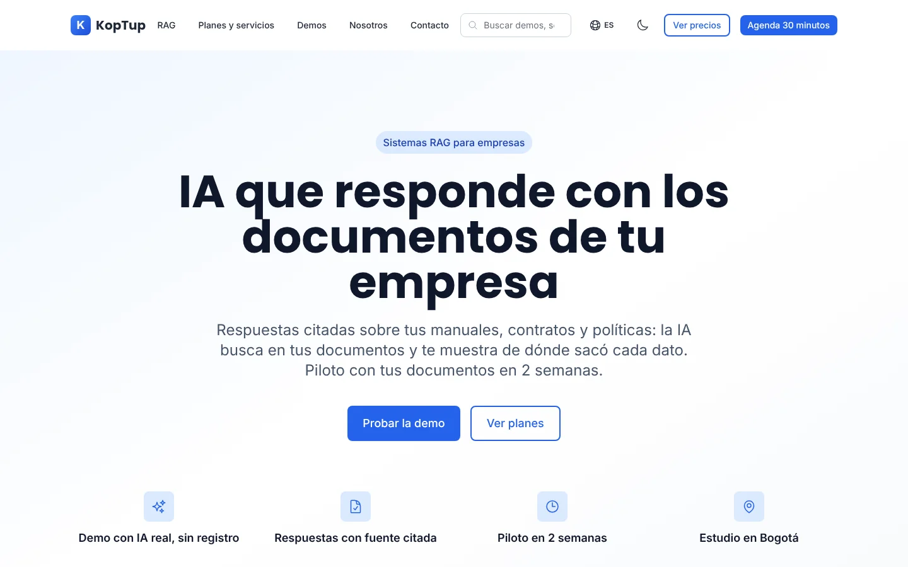
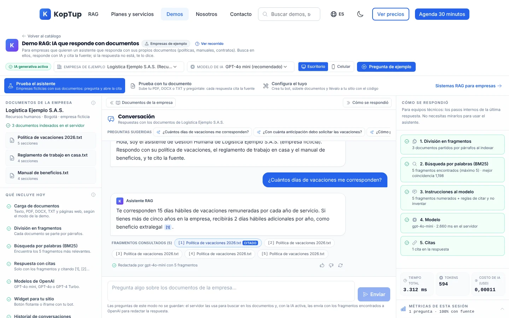
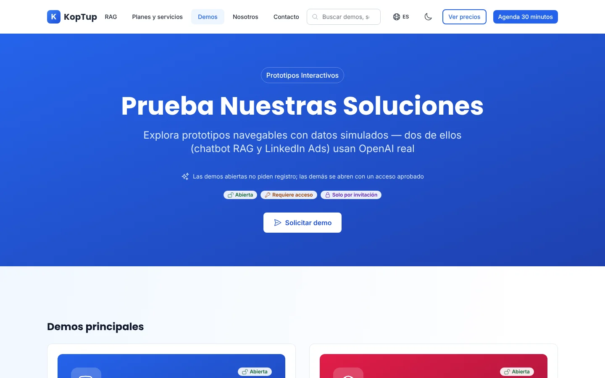
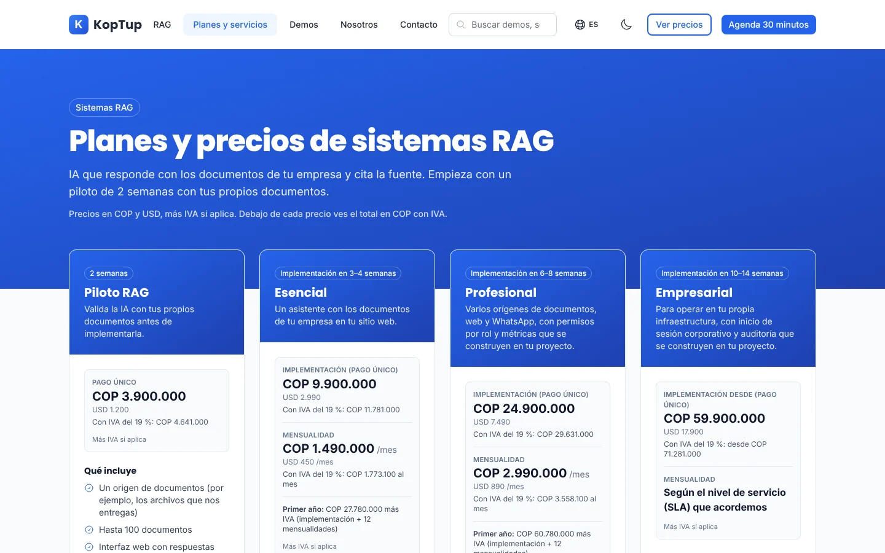
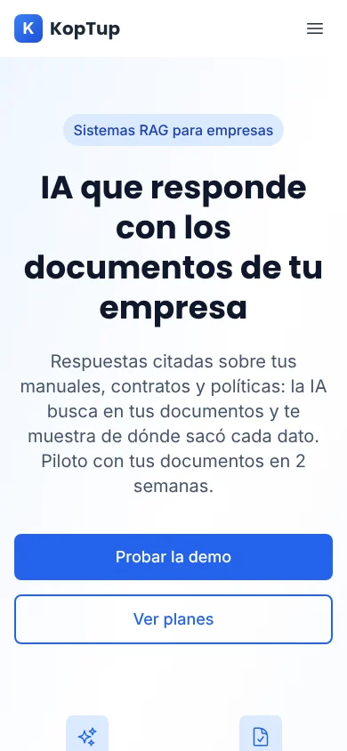

<div align="center">

# Koptup

**Estudio de desarrollo de software a medida · Bogotá, Colombia**

[](https://nextjs.org)
[](https://www.typescriptlang.org)
[](https://nodejs.org)
[](https://mongodb.com)
[](https://openai.com)
[](LICENSE)
[](https://github.com/ronalc90/koptup/actions/workflows/ci.yml)

[**www.koptup.com**](https://www.koptup.com) · [Catálogo de prototipos](https://www.koptup.com/demo) · [Planes y servicios](https://www.koptup.com/services) · [Contacto](https://www.koptup.com/contact)



</div>

---

## Capturas

| Demo RAG: responde con los documentos y cita la fuente | Catálogo de demos |
|---|---|
|  |  |
| **Planes y precios de los sistemas RAG** | **Versión móvil** |
|  |  |

La demo RAG ([`/demo/chatbot`](https://www.koptup.com/demo/chatbot)) se prueba sin registro: elige una empresa de ejemplo, haz una pregunta y el asistente responde con la cita `[1]` al documento, muestra los fragmentos consultados y, a la derecha, cómo respondió: fragmentos, búsqueda BM25, instrucciones al modelo, modelo y citas, con el tiempo, los tokens y el costo de la consulta.

## Qué es

Koptup es el portafolio comercial de un estudio de desarrollo a medida. Construimos software para empresas en LATAM — web, mobile, integraciones, IA aplicada. Este repo contiene:

- **28 demos.** [`/demo`](https://www.koptup.com/demo) lista 14: 5 principales y 9 de apoyo, definidas en [`apps/web/src/lib/demo-showcase.ts`](apps/web/src/lib/demo-showcase.ts). Las otras se abren por su URL, sin indexar.
  - **9 con IA o backend reales:** el chatbot RAG (producto principal), el sistema experto de cuentas médicas, el motor de reglas del auditor, el generador de contenido para LinkedIn, el gestor documental y una función con IA real en las demos de mesa de ayuda, gestión humana, LMS y gestor de contenido.
  - **19 con datos de ejemplo:** corren en el navegador, muestran el flujo completo y lo dicen en pantalla.
  - Qué es real y qué es simulado en cada una, y su estado de revisión: [Guía de demos](docs/wiki/Doc-07-Guia-de-Demos.md).
- **Sistema de solicitud y acceso a demos:** el visitante pide una demo, el equipo la aprueba desde el panel y la persona entra con su cuenta (ver más abajo).
- **Panel de administración y portal del cliente** (`/admin` y `/dashboard`).
- **Sitio comercial** (planes RAG con precios fijos en COP y USD, catálogo de otras soluciones a medida en COP con referencia en USD a una TRM fija de 3.300, sobre nosotros, contacto).

No es un SaaS ni un producto. Es la vitrina de un equipo que cobra por construir cosas a medida.

## Aplicaciones reales

### [Chatbot RAG con IA](https://www.koptup.com/demo/chatbot)

Plataforma RAG de punta a punta. Ingesta de PDF, Word (DOCX), texto (TXT, CSV, Markdown, HTML, JSON) y páginas web por URL; fragmentación, búsqueda BM25 y llamadas a OpenAI Chat Completions (`gpt-4o-mini` por defecto, configurable) con citas `[1] [2]` que se pueden abrir. Builder visual para personalizar avatar, color y posición, vista previa en tres modos (sitio web, celular y enlace directo) y código para insertarlo en tu sitio (`<script>` o `<iframe>`).

**Stack real:** Next.js · TypeScript · Express · OpenAI SDK · BM25 implementado a mano · bots, documentos y conversaciones en MongoDB.
**Código:** [`apps/backend/src/routes/chatbot.routes.ts`](apps/backend/src/routes/chatbot.routes.ts).

### [Generador de LinkedIn Ads](https://www.koptup.com/demo/linkedin-ads)

Generador de copies para campañas de LinkedIn con OpenAI server-side. Calendario editorial, plantillas por industria, variantes A/B, preview en formato nativo de LinkedIn.

**Stack real:** Express (backend) con OpenAI, límite por cuenta (o por IP sin sesión) en Redis y tope de gasto mensual · ruta de Next como proxy · UI con preview LinkedIn-style.
**Código:** [`apps/backend/src/routes/linkedin-ads.routes.ts`](apps/backend/src/routes/linkedin-ads.routes.ts) y el proxy [`apps/web/src/app/api/linkedin-ads/generate/route.ts`](apps/web/src/app/api/linkedin-ads/generate/route.ts).

## Demos con datos de ejemplo

Las otras demos (CRM, ERP, POS, WMS, telemedicina, facturación electrónica, agente de voz, e-commerce, automatización, extracción de datos, entre otras) son **interfaces interactivas con datos de ejemplo**: cubren el flujo de la pantalla — pestañas, formularios validados, gráficas, modales —, pero los datos no vienen de un backend de producción y cada demo lo dice. Las que tienen una función con IA real (mesa de ayuda, gestión humana, LMS, gestor de contenido) la marcan en su guía. Sirven para que un cliente potencial vea cómo se vería la solución antes de contratarnos para construirla.

Catálogo filtrable por categoría: **<https://www.koptup.com/demo>**

### Solicitud y acceso a demos

Cada demo tiene un modo de acceso que el administrador cambia en **Admin › Catálogo de demos** (`/admin/catalogo-demos`): **Abierta** (cualquiera la abre), **Requiere acceso** (solo con un acceso aprobado) o **Solo por invitación**. El modo inicial de cada una está en [`apps/web/src/lib/demo-access-defaults.ts`](apps/web/src/lib/demo-access-defaults.ts) (igual a la semilla del backend).

1. El visitante pide la demo en [`/solicitar-demo`](https://www.koptup.com/solicitar-demo) (también desde el cierre de cada demo, las tarjetas de `/demo` y la pantalla de acceso). La solicitud exige la autorización de datos (Ley 1581 de 2012) y tiene honeypot y cupos por IP y por email.
2. El equipo la revisa en **Admin › Solicitudes de demo** (`/admin/solicitudes`): aprueba (elige demos, días y nota) o rechaza (motivo). Al aprobar se crea la cuenta del prospecto y un enlace de activación de un solo uso (72 h) que el panel muestra para **copiar** o **enviar por WhatsApp**; si el servidor tiene correo configurado (Resend o SMTP), también se envía por email.
3. El prospecto crea su contraseña en `/activar/<token>` y entra a **Mis demos** (`/dashboard/demos`), con los días que le quedan.
4. Al abrir `/demo/<slug>`, el middleware de Next ([`apps/web/src/middleware.ts`](apps/web/src/middleware.ts)) pregunta al backend (`GET /api/demo-access/<slug>`) con la sesión; sin acceso muestra la pantalla "Solicita acceso" (`/demo-acceso/<slug>`, sin indexar). Si el backend no responde, las demos abiertas siguen abiertas y las demás no se abren.
5. En **Admin › Accesos a demos** (`/admin/accesos`) el equipo extiende, revoca (la demo deja de abrirse desde su siguiente carga; las APIs de las demos con backend real lo verifican en cada llamada) o concede acceso directo por email.

## Stack

Tecnologías que realmente usamos en este repo:

**Frontend:** Next.js 15 (App Router) · React 19 · TypeScript · TailwindCSS · next-intl (ES/EN) · next-themes · Framer Motion · React Hook Form + Zod · SWR · Axios · Recharts · date-fns

**Backend:** Node.js 20.9+ · Express · TypeScript · Mongoose (MongoDB 7) · Redis (sesiones, cupos y topes de gasto de IA) · OpenAI SDK · Zod · JWT · bcryptjs · Multer · Helmet · Resend (correo por API HTTPS; Nodemailer solo como respaldo SMTP) · WhatsApp Cloud API de Meta (avisos al dueño con plantilla) · Swagger (OpenAPI 3, solo fuera de producción)

**Datos e infraestructura:** MongoDB · Redis · AWS S3 (opcional, documentos del portal) · Vercel (web) · Railway (API, con Nixpacks)

**Pruebas y calidad:** Jest (ts-jest en el backend, next/jest en la web) · React Testing Library · Playwright · ESLint · TypeScript (modo `strict` en la web) · GitHub Actions (CI, seguridad con `npm audit` y gitleaks, monitoreo de disponibilidad)

## Quick start

Requisitos: **Node.js 20.9 o superior**, npm 9+, y MongoDB 7 y Redis 7 (con Docker o instalados). La guía paso a paso, con problemas comunes, está en [`SETUP.md`](SETUP.md).

```bash
git clone https://github.com/ronalc90/koptup.git
cd koptup
NODE_ENV=development npm install
npm run docker:up                                  # MongoDB y Redis locales (docker-compose.dev.yml)

# Backend (terminal A)
cp apps/backend/.env.example apps/backend/.env    # cambia JWT_SECRET y JWT_REFRESH_SECRET; agrega OPENAI_API_KEY si la tienes
cd apps/backend && npm run dev                     # http://localhost:3001 (salud: /health)

# Web (terminal B)
cp apps/web/.env.example apps/web/.env.local      # apunta a http://localhost:3001
cd apps/web && npm run dev                         # http://localhost:3000
```

**No golpees producción en desarrollo:** `next dev` usa `http://localhost:3001` si no defines `NEXT_PUBLIC_API_URL`; la URL pública de la API solo está en `apps/web/.env.production`, que Next carga en `next build`/`next start`. No la copies a `.env.local`: lo que pruebes crearía cuentas, solicitudes y leads reales.

**Tu cuenta admin:** regístrate en `http://localhost:3000/register` y, desde `apps/backend`, corre `npx ts-node --transpile-only src/scripts/set-admin.ts <tu-email>` (lee `apps/backend/.env`). Cierra sesión y vuelve a entrar.

El chatbot RAG funciona sin `OPENAI_API_KEY` (modo extractivo con BM25, y lo dice). Con la clave, responde con el modelo. Para no gastar, usa el mock de OpenAI del repositorio: `node apps/web/e2e/support/openai-mock.js` y `OPENAI_BASE_URL=http://127.0.0.1:3999/v1` en el backend.

## Variables de entorno

Plantillas: [`apps/web/.env.example`](apps/web/.env.example) y [`apps/backend/.env.example`](apps/backend/.env.example). En producción la web se configura en **Vercel** (proyecto → *Settings* → *Environment Variables*) y el backend en **Railway** (servicio del backend → *Variables*).

### Web (Vercel): medición para anuncios

Las tres son opcionales: si una no existe, su etiqueta no se carga. Aunque exista, la etiqueta solo se carga después de que el visitante acepte cookies en el banner o en [`/cookies`](https://www.koptup.com/cookies) ("Rechazar" deja solo las esenciales). El banner de cookies aparece solo si hay al menos una de las tres configurada (sin ninguna no hay cookies opcionales que aceptar).

| Variable | Formato | Qué hace |
|---|---|---|
| `NEXT_PUBLIC_GA_ID` | `G-XXXXXXXXXX` | ID de medición de GA4 (GA4 → *Administrar* → *Flujos de datos* → flujo web). Carga Google Analytics 4 si el visitante acepta las cookies de **analítica**. |
| `NEXT_PUBLIC_GOOGLE_ADS_ID` | `AW-XXXXXXXXX` | ID de la etiqueta de Google de la cuenta de Google Ads. Carga la etiqueta de Google Ads (vinculador de conversiones y remarketing) si el visitante acepta las cookies de **marketing**. |
| `NEXT_PUBLIC_LINKEDIN_PARTNER_ID` | número | *Partner ID* del Insight Tag en LinkedIn Campaign Manager. Carga LinkedIn Insight Tag si el visitante acepta las cookies de **marketing**. |

- Son variables `NEXT_PUBLIC_*`: Next las fija al compilar. Después de crearlas o cambiarlas en Vercel hay que **redesplegar**. La CSP de [`apps/web/next.config.js`](apps/web/next.config.js) abre los dominios de Google o de LinkedIn solo si su variable existe en ese build.
- Un valor con un formato distinto al de la tabla se ignora (la etiqueta no se carga). En Google Ads también se acepta solo el número, sin `AW-`.
- Eventos que se envían a GA4 (y a Google Ads si su etiqueta está cargada):

  | Evento | Cuándo | Parámetros |
  |---|---|---|
  | `generate_lead` | Formulario de [`/contact`](https://www.koptup.com/contact) o de [`/solicitar-demo`](https://www.koptup.com/solicitar-demo) enviado con éxito | `lead_source` (`contact_form` o `demo-request`); en contacto, `service` y `plan_id` (si viene de un plan RAG); en solicitud de demo, `demos_count` y `demo_slugs` |
  | `demo_start` | Primera pregunta en [`/demo/chatbot`](https://www.koptup.com/demo/chatbot) en cada carga de la página | `demo_mode` (`sample`: documento de ejemplo; `upload`: documento propio) |
  | `demo_upload` | Documento subido con éxito en "Prueba con tu documento" | `file_type` (`pdf`, `docx` o `txt`), `pages` |
  | `whatsapp_click` | Clic en un botón de WhatsApp: el de `/contact` y los de [`/solicitar-demo`](https://www.koptup.com/solicitar-demo) (en el formulario y en la confirmación) | `link_location` (`contact_page`, `solicitar_demo` o `solicitar_demo_gracias`) |
  | `plan_click` | Clic en el botón de un plan RAG (`/services#planes-rag`, `/rag` y "Agenda un piloto" de `/chatbots-ia`) o en los botones de las tarjetas de "Otras soluciones a medida" | `plan_name` (en el idioma del visitante; para agrupar usa `plan_id`), `plan_id`, `plan_group` (`planes_rag` u `otras_soluciones`), `cta` (`quote`, `details` o `demo`) y, en el detalle de una solución, `plan_tier` y `modality` |

- **Conversiones de Google Ads:** el código no tiene etiquetas de conversión propias de Ads. Vincula GA4 con Google Ads, marca en GA4 como *eventos clave* los que quieras optimizar (por ejemplo `generate_lead` y `demo_upload`) e impórtalos en Google Ads como conversiones de Google Analytics 4.
- **Conversiones de LinkedIn:** el Insight Tag mide visitas y audiencias. Las conversiones se crean en Campaign Manager (por ejemplo, por URL); el código no tiene IDs de conversión de LinkedIn.
- Para ver `plan_name` y los demás parámetros en los informes de GA4, regístralos como dimensiones personalizadas (*Administrar* → *Definiciones personalizadas*).

La web también usa `NEXT_PUBLIC_API_URL` (URL del backend en Railway; se fija al compilar: el navegador, el middleware de `/admin`, `/dashboard` y `/demo/<slug>` y la demo "Prueba con tu documento" llaman al backend con ella) y, solo del lado del servidor, `INTERNAL_API_KEY` (opcional; ver la tabla de seguridad del backend: debe ser igual en Vercel y en Railway).

### Backend (Railway): demo "Prueba con tu documento"

La subida de documentos en `/demo/chatbot` (`/api/demo-rag`) queda **apagada** hasta que `DEMO_UPLOAD_ENABLED=true`, Redis esté conectado y exista `OPENAI_API_KEY`. Si falta algo, el sitio muestra "Agenda una demo con nosotros" y la demo con el documento de ejemplo sigue funcionando.

| Variable | Valor | Qué hace |
|---|---|---|
| `DEMO_UPLOAD_ENABLED` | `true` para encender (por defecto `false`) | Encendido explícito de la subida de documentos. |
| `DEMO_MONTHLY_BUDGET_USD` | por defecto `50` | Tope de gasto mensual (USD, mes UTC) en OpenAI de esta demo, calculado con los tokens de cada respuesta. Al alcanzarlo se desactivan la subida y las preguntas. Un valor inválido o negativo la deja desactivada. |
| `OPENAI_API_KEY` | obligatoria | Clave de OpenAI (la demo usa `gpt-4o-mini`). La usan también el chatbot y otros módulos del backend. |
| `REDIS_URL` | obligatoria para la demo | Redis de Railway (plugin Redis). Guarda el límite de 3 documentos por IP al día y el contador de gasto. |
| `MONGODB_URI` | obligatoria para la demo | Base de datos donde se guardan los leads: los del formulario de contacto y el email de la demo (origen `demo-rag`) con la prueba de la autorización. Si no se puede guardar el lead, el documento no se procesa (`503 lead_unavailable`). |
| `TRUST_PROXY_HOPS` | `1` en Railway | Cantidad de proxies delante del backend; define la IP real del visitante para los límites por IP. |
| `RESEND_API_KEY`, `NOTIFY_EMAIL` y las de WhatsApp | las de [avisos al dueño](#backend-railway-avisos-al-dueño-correo-y-whatsapp) | Aviso al dueño por correo y WhatsApp de cada lead (el mismo del formulario de contacto). |
| `DEMO_RAG_TTL_SECONDS` | **no la definas en Railway** | Solo para pruebas locales: baja el tiempo de vida de 1 hora de los documentos. Se ignora con `NODE_ENV=production`. |

### Backend (Railway): seguridad y topes de IA

Al arrancar, el backend valida sus variables con zod (`apps/backend/src/config/env.ts`): en producción **no arranca** si falta `MONGODB_URI` o `JWT_SECRET`. Sin `JWT_REFRESH_SECRET` **sí arranca**, pero nadie puede iniciar sesión: el log lo avisa. Las opcionales que faltan dejan un aviso `[env] …` que dice qué función queda apagada (por ejemplo `RESEND_API_KEY`, que decide si sale correo, las de WhatsApp, `DEMO_UPLOAD_ENABLED`, `INTERNAL_API_KEY` y `ADMIN_EMAIL`). La lista completa, con su efecto, está en [`apps/backend/.env.example`](apps/backend/.env.example) y en [Operación y despliegue](docs/wiki/Doc-11-Operacion-y-Despliegue.md#4-variables-de-entorno).

| Variable | Valor | Qué hace |
|---|---|---|
| `JWT_SECRET`, `JWT_REFRESH_SECRET` | obligatorias, largas y distintas | Firman los tokens de sesión y de renovación. |
| `JWT_REFRESH_EXPIRES_IN` | por defecto `7d` (máximo 7 días) | Vida de la sesión renovable: la misma cifra firma el token y vence su copia en Redis. Un valor mayor o inválido usa 7 días (lo que dura la cookie de la web). |
| `CHATBOT_MONTHLY_BUDGET_USD` | por defecto `50` | Tope de gasto mensual en OpenAI del chatbot (Builder, Playground y chat por sesión). Al alcanzarlo, el chat responde en modo extractivo y lo dice. |
| `LINKEDIN_ADS_MONTHLY_BUDGET_USD` | por defecto `20` | Tope mensual del generador de LinkedIn Ads (además, 5 generaciones cada 10 minutos y 30 al día por cuenta, o por IP si no hay sesión). |
| `CONTENT_MONTHLY_BUDGET_USD` | por defecto `20` | Tope mensual del gestor de contenido con IA. |
| `DOCUMENTS_MONTHLY_BUDGET_USD` | por defecto `10` | Tope mensual del gestor de documentos (`/api/documents`: análisis, búsqueda semántica y explicaciones). Sin cupo, una subida se guarda sin análisis y lo dice; las demás funciones con IA responden 503. |
| `HEALTH_MONTHLY_BUDGET_USD` | por defecto `30` | Tope mensual de las APIs de salud (cuentas médicas, auditoría, sistema experto, CUPS y reglas de facturación). |
| `DOCUMENTS_AI_DAILY_LIMIT_PER_USER`, `HEALTH_AI_DAILY_LIMIT_PER_USER` | por defecto `30` y `20` | Solicitudes con IA por cuenta y por día en esas dos funciones (429 al pasarlo). El equipo de KopTup solo tiene el tope mensual. |
| `INTERNAL_API_KEY` | opcional, igual en Vercel y Railway | Permite que la web (middleware de `/admin`, `/dashboard` y `/demo/<slug>`, proxy de LinkedIn Ads) informe la IP real del visitante para los límites por IP (sin ella, esas peticiones cuentan por la IP de salida de Vercel). |
| `ADMIN_EMAIL` | recomendada | Destino de los avisos por correo **solo si falta `NOTIFY_EMAIL`** (no hay dirección fija en el código). Además, al arrancar da el rol admin a esa cuenta **solo si existe, está activa y no hay ningún otro admin** (primer admin o recuperación), y lo deja en la bitácora. Si ya hay otro admin no cambia roles: usa Admin › Usuarios o `src/scripts/set-admin.ts`. |
| `API_DOCS_ENABLED` | `false` en producción | `/api-docs` solo existe fuera de producción o con este valor en `true`. |
| `RATE_LIMIT_WINDOW_MS`, `RATE_LIMIT_MAX_REQUESTS` | por defecto 15 min y `100` | Límite general de la API, por cuenta (con sesión) o por IP. |
| `AUTH_ME_RATE_LIMIT_MAX` | por defecto `120` por minuto | Cupo propio de `GET /api/auth/me` y `GET /api/demo-access/<slug>`, que el middleware de la web consulta en cada navegación del panel, del portal y de las demos con acceso. |
| `CHATBOT_RATE_LIMIT_MAX` | por defecto `60` por minuto | Preguntas por IP al chat de los bots (`POST /api/chatbot/bots/:id/chat`). |
| `CHATBOT_API_RATE_LIMIT_MAX` | por defecto `180` por minuto | Resto de peticiones por IP a `/api/chatbot` (`GET /models` no cuenta). |
| `LOGIN_RATE_LIMIT_MAX`, `LOGIN_IP_RATE_LIMIT_MAX`, `REGISTER_RATE_LIMIT_MAX`, `FORGOT_PASSWORD_RATE_LIMIT_MAX`, `RESET_PASSWORD_RATE_LIMIT_MAX`, `ACTIVATION_RATE_LIMIT_MAX`, `CHANGE_PASSWORD_RATE_LIMIT_MAX` | por defecto `10`, `30`, `5`, `3`, `10`, `10` y `5` | Límites propios de cada ruta de cuenta (cada una con su contador). Login por IP + email y por IP cada 15 min; registro por IP por hora; recuperación por IP + email (además, 10 por IP), restablecer y activación por IP cada 15 min; cambio de contraseña por cuenta cada 15 min. El correo se cuenta normalizado (mayúsculas, puntos y `+etiqueta` de Gmail no abren un contador nuevo). |
| `CHATBOT_CREATE_LIMIT_PER_HOUR` | por defecto `30` | Bots nuevos por IP cada hora en el Builder del chatbot. |
| `CHATBOT_EXAMPLE_BOT_IDS` | opcional | IDs, separados por coma, de los bots de ejemplo que todos ven en `GET /api/chatbot/bots` (el resto solo lo ve su dueño). |
| `CHATBOT_CONVERSATION_TTL_DAYS` | por defecto `30` | Días que se guarda cada pregunta al widget de un bot de usuario (los bots y sus conversaciones viven en MongoDB). Las de "Prueba el asistente", la vista previa y los bots de ejemplo no se guardan. |
| `CHATBOT_STATE_DIR` | por defecto `./data/chatbots` | Carpeta del archivo heredado `state.json`: si existe al arrancar, se migra una vez a MongoDB y se borra. |
| `CUPS_IMPORT_DIR` | por defecto `./data/imports` | Única carpeta desde la que el admin puede importar CUPS, solo por nombre de archivo. |
| `OPENAI_BASE_URL` | **no la definas en Railway** | Solo para pruebas locales y CI: apunta el backend al mock de OpenAI (ver [Pruebas y CI](#pruebas-y-ci)). |

Railway revisa `GET /health` al desplegar (`apps/backend/railway.json`): responde 503 si MongoDB no está conectado, así que un despliegue sin base de datos no entra en servicio y el anterior sigue atendiendo. `GET /health/live` solo dice que el proceso responde.

### Backend (Railway): solicitud y acceso a demos

El modo de acceso de cada demo (abierta, requiere acceso o solo por invitación) no es una variable: se cambia en **Admin › Catálogo de demos** y queda en MongoDB. Estas variables ajustan el resto del sistema:

| Variable | Valor | Qué hace |
|---|---|---|
| `FRONTEND_URL` | URL pública de la web (`https://www.koptup.com`) | Base de los enlaces que arma el backend: activación (`/activar/<token>`), Mis demos, restablecer contraseña y los correos. Sin ella usa `http://localhost:3000`. |
| `RESEND_API_KEY`, `EMAIL_FROM` (o el respaldo `SMTP_*`) | recomendadas | Acuse a quien pide la demo, correo de aprobación con el enlace de activación y recordatorio 3 días antes de que venza el acceso. Sin correo no se envía ninguno y el panel muestra siempre el enlace para copiarlo o enviarlo por WhatsApp. Ver [avisos al dueño](#backend-railway-avisos-al-dueño-correo-y-whatsapp). |
| `NOTIFY_EMAIL` y las de WhatsApp | recomendadas | Aviso al dueño de cada solicitud nueva, el mismo del formulario de contacto. |
| `PRIVACY_POLICY_VERSION` | por defecto `2026-10` | Versión de la política de tratamiento de datos que se guarda con cada autorización (Ley 1581). Cámbiala cuando publiques una política nueva. |
| `DEMO_REQUEST_LIMIT_PER_HOUR` | por defecto `5` | Solicitudes válidas por IP cada hora en `/solicitar-demo` (las que tienen errores de formulario no cuentan). |
| `DEMO_REQUEST_LIMIT_PER_EMAIL_DAY` | por defecto `3` | Solicitudes válidas por email al día. |
| `DEMO_GRANTS_JOB_ENABLED` | por defecto `true` | Job que marca como vencidos los accesos que pasaron su fecha y envía el recordatorio (si hay correo configurado). Usa un candado en Redis para que, con varias instancias, corra una sola. `false` lo apaga en esa instancia. |
| `DEMO_GRANTS_JOB_INTERVAL_MS` | por defecto `3600000` (1 hora; mínimo `60000`) | Cada cuánto corre ese job. |

### Backend (Railway): avisos al dueño (correo y WhatsApp)

Cada contacto nuevo (formulario de `/contact`, «Solicitar demo» y «Prueba con tu documento») avisa al dueño por **correo** (API HTTPS de Resend) y por **WhatsApp** (WhatsApp Cloud API de Meta con la plantilla aprobada `koptup_aviso`). Los avisos salen sin frenar la respuesta del formulario; el resultado de cada canal queda en el contacto (Admin › Contactos), un job reintenta los que fallan y una prueba mensual mantiene vivos los dos canales aunque lleguen pocos mensajes. **Railway Free, Trial y Hobby bloquean el SMTP saliente**, así que en esos planes el correo solo sale con `RESEND_API_KEY`. Twilio y UltraMsg ya no se soportan.

| Variable | Valor | Qué hace |
|---|---|---|
| `RESEND_API_KEY` | key de Resend con permiso «Sending access» | Con ella **todos** los correos del backend salen por Resend (avisos, demos, propuestas, restablecer contraseña). Sin ella ni SMTP no sale ningún correo. |
| `EMAIL_FROM` | por defecto `KopTup <avisos@koptup.com>` | Remitente; su dominio debe estar verificado en Resend. Si Resend dice que no lo está, el aviso al dueño se reintenta desde `onboarding@resend.dev`. |
| `NOTIFY_EMAIL` | uno o varios correos separados por coma | A quién le llegan los avisos por correo (con «Responder a» = el email de quien escribió). Si falta se usa `ADMIN_EMAIL`. |
| `SMTP_HOST`, `SMTP_PORT`, `SMTP_SECURE`, `SMTP_USER`, `SMTP_PASS` | opcionales | Respaldo, solo sin `RESEND_API_KEY` (desarrollo local o Railway Pro). |
| `WHATSAPP_PROVIDER` | `meta` | Proveedor de WhatsApp (acepta el valor viejo `whatsapp-business`; `twilio` o `ultramsg` dejan el canal apagado). |
| `WHATSAPP_API_TOKEN` | token permanente de un usuario del sistema de Meta | Permisos `whatsapp_business_messaging` y `whatsapp_business_management`, caducidad «Nunca». |
| `WHATSAPP_PHONE_NUMBER_ID` | id numérico | Identificador del número que envía (Meta › WhatsApp › Configuración de la API). |
| `ADMIN_WHATSAPP_NUMBER` | tu número con indicativo | Recibe los avisos. Con el número de prueba gratis de Meta, debe estar en su lista de destinatarios verificados. |
| `WHATSAPP_TEMPLATE_NAME`, `WHATSAPP_TEMPLATE_LANG`, `WHATSAPP_GRAPH_VERSION` | por defecto `koptup_aviso`, `es` y `v25.0` | Plantilla y versión de la API de Meta. |
| `WHATSAPP_HELLO_WORLD_FALLBACK` | por defecto `true` | Si la plantilla propia falla por un error de plantilla, envía `hello_world` para que al menos suene el teléfono. |
| `WHATSAPP_APP_SECRET`, `WHATSAPP_WEBHOOK_VERIFY_TOKEN` | opcionales (las dos) | Encienden el webhook firmado `/api/webhooks/whatsapp` (entregado, leído o fallido, y correo de alerta si Meta no entrega un aviso). Sin ellas responde 404. |
| `NOTIFY_HEARTBEAT_DAYS` | por defecto `30` (`0` la apaga) | Prueba mensual automática por cada canal, entre las 9:00 y las 18:59 hora de Bogotá. |
| `NOTIFY_JOBS_ENABLED` | por defecto `true` | `false` apaga los reintentos (cada 5 min, hasta 6 intentos en 3 días) y la prueba mensual en esa instancia. |
| `RESEND_API_URL`, `WHATSAPP_GRAPH_URL` | **no las definas en Railway** | Solo pruebas locales y CI: apuntan al mock de Resend y WhatsApp. |

Para comprobarlo después de desplegar: el registro del arranque dice una línea por canal con el destino enmascarado (`Avisos por correo: Resend → ro***@gmail.com`), y **Admin › Configuración › Avisos de nuevos contactos** muestra el estado de cada canal y tiene el botón **Enviar aviso de prueba** (solo admin). Paso a paso completo (Resend, plantilla y token de Meta, reenvío de correo en Namecheap, filtro de Gmail, Railway sin Serverless): [Operación y despliegue › 4.5](docs/wiki/Doc-11-Operacion-y-Despliegue.md#45-configurar-los-avisos-al-dueño-paso-a-paso).

## Estructura del repo

```
apps/
  web/                    # Next.js — sitio, demos en /demo, panel /admin y portal /dashboard
    e2e/                  # pruebas end-to-end (Playwright) y mock de OpenAI
  backend/                # Express — API (MongoDB, Redis, OpenAI, correo)
docs/
  wiki/                   # fuente de la wiki del proyecto
scripts/                  # audit-check.mjs (npm audit en CI) y uptime-check.sh (monitoreo)
.github/workflows/        # CI (ci.yml), monitoreo (monitor.yml) y publicación de la wiki (wiki-sync.yml)
docker-compose.dev.yml    # MongoDB 7 y Redis 7 para desarrollo local
```

## Pruebas y CI

```bash
npm test               # Jest de backend y web (turbo)
npm run lint           # ESLint de backend y web
npm run typecheck      # TypeScript (tsc --noEmit) de backend y web, incluidas las pruebas
npm run test:e2e       # Playwright contra un sitio ya levantado (ver "E2E en local")
```

### Pruebas unitarias y de integración

- **Backend:** Jest con `ts-jest` ([`apps/backend/jest.config.js`](apps/backend/jest.config.js)). Las pruebas viven en carpetas `__tests__` dentro de `apps/backend/src`: `unit/` no necesita nada; `integration/` (supertest contra la app completa: permisos por rol, sistema de demos, chatbot, topes de gasto, perfil) necesita MongoDB y Redis y se **omite** si no se definen:

  ```bash
  MONGODB_URI_TEST=mongodb://127.0.0.1:27017/koptup_test \
  REDIS_URL_TEST=redis://127.0.0.1:6379/15 \
  npm test --workspace=apps/backend
  ```

  Usa una base y un índice de Redis solo para pruebas: cada archivo crea y borra su base `<base>_<sufijo>` y las pruebas borran claves de cupos y gasto en ese Redis.
- **Web:** Jest con `next/jest` y jsdom ([`apps/web/jest.config.js`](apps/web/jest.config.js)): `npm test --workspace=apps/web`. Las pruebas de humo de las demos renderizan cada página con los mensajes reales en español ([`apps/web/src/test-utils`](apps/web/src/test-utils)) y fallan si la página lanza un error, no pinta nada o usa una clave de traducción inexistente. También prueban el middleware de acceso a demos. Ninguna prueba unitaria sale a la red.

### E2E (Playwright)

[`apps/web/playwright.config.ts`](apps/web/playwright.config.ts), pruebas en [`apps/web/e2e`](apps/web/e2e), en escritorio y en móvil (Pixel 7) con el navegador en `es-CO`. No arranca servidores: corre contra una web y un backend ya levantados. Un tercer proyecto, `catalogo`, corre al final y solo `access-mode.spec.ts`, porque cambia el catálogo de demos (un dato global) y no debe cruzarse con las pruebas que abren esa demo.

| Archivo | Qué comprueba |
|---|---|
| `smoke.spec.ts` | Home, `/rag` y `/services#planes-rag`: 200, título, un solo H1, el ancla de planes a la vista y cero errores de consola (incluidos los de hidratación de React). |
| `demos.spec.ts` | El catálogo `/demo` y cada demo: 200, sin textos de error y sin errores de consola. Si una demo tiene un error ya conocido, se anota en [`e2e/support/known-issues.ts`](apps/web/e2e/support/known-issues.ts) con su motivo (hoy la lista está vacía: todas las demos deben cargar sin errores): la prueba falla si aparece cualquier otro error y también si el conocido deja de ocurrir (la lista solo se achica). |
| `demo-access.spec.ts` | Lo que ve un visitante: badges del catálogo, pantalla de acceso de una demo por solicitud o privada, formulario `/solicitar-demo` (este último registra una solicitud de verdad: solo con `E2E_API_URL`). |
| `demo-flow.spec.ts` | El flujo completo con la interfaz de cada persona: el visitante pide una demo → el admin la aprueba en el panel y copia el enlace → el prospecto activa su cuenta, ve Mis demos y abre la demo → el admin revoca → la demo vuelve a pedir acceso. |
| `permissions.spec.ts` | Autorización en el servidor: un prospecto no entra a `/admin`, un visitante sin sesión no entra a `/dashboard` y una demo privada sin acceso muestra la pantalla de acceso (también con sesión). |
| `access-mode.spec.ts` | El admin cambia el modo de acceso de una demo en Admin › Catálogo de demos y el sitio lo aplica (espera hasta 90 s por la caché de 60 s del middleware). Corre una vez, en escritorio, cuando terminan las demás (proyecto `catalogo`; si alguna falló, Playwright la marca como no ejecutada) y deja la demo como estaba. |
| `contact.spec.ts` | El formulario de `/contact` envía el lead y queda guardado (lo lista Admin › Contactos). |
| `owner-notify.spec.ts` | Avisos al dueño de un nuevo contacto, contra el mock de Resend y WhatsApp: enviar `/contact` produce 1 correo para `NOTIFY_EMAIL` con `reply_to` = el email de la persona y 1 plantilla `koptup_aviso` con 2 parámetros sin saltos de línea; Admin › Contactos muestra "Enviado" en ambos canales; Admin › Configuración muestra los dos canales configurados y "Enviar aviso de prueba" sale por los dos. Corre solo en escritorio y necesita `E2E_NOTIFY_MOCK_URL`. |
| `public-seo.spec.ts` | Sitio público y SEO: `noindex` y canonical de las páginas de cuenta, 404, `/pricing` (308), sitemap, `robots.txt`, `llms.txt` y cabeceras; el embudo RAG ("Prueba con tu documento", caso de salud con invitación, "Cotizar este tier" con nivel, modalidad y plazo guardados en el lead); el cambio de idioma conserva la URL; menú, pie y textos verificables de `/about`, inicio y landings, en español e inglés; títulos del panel. |
| `rag-upload.spec.ts` | `/demo/chatbot` › "Prueba con tu documento": sube un PDF de 2 páginas ([`e2e/fixtures`](apps/web/e2e/fixtures)), pregunta, ve la cita de la página y el contador de preguntas pasa de 0/10 a 1/10. |
| `embed-chatbot.spec.ts` | `/embed/chatbot/<id>` (el chat de `widget.js` y del iframe): solo el chat, sin menú, pie ni banner de cookies; responde con la fuente y canal `widget`; un 429 pide esperar y un 503 dice que el asistente no está disponible. |
| `api-health.spec.ts` | `GET /health` del backend. |

Las pruebas de la plataforma siembran sus datos por la API del backend ([`e2e/support/backend.ts`](apps/web/e2e/support/backend.ts): cuentas, invitaciones, activación, catálogo) con emails únicos en el dominio reservado `.test`. La única excepción es la cuenta admin de pruebas: [`e2e/global-setup.ts`](apps/web/e2e/global-setup.ts) la registra por la API con una contraseña al azar de cada corrida y le da el rol con el script del backend `src/scripts/set-admin.ts` (la API no deja que nadie se asigne el rol admin). Cada visitante de prueba se presenta con su propia IP en `X-Forwarded-For`, como haría el proxy de Railway, para que los cupos por IP (login, contacto, solicitudes, documentos de la demo RAG) se apliquen igual que en producción sin que varias corridas seguidas los agoten.

| Variable | Para qué |
|---|---|
| `E2E_BASE_URL` | URL de la web (por defecto `http://localhost:3300`). |
| `E2E_API_URL` | URL del backend al que apunta esa web. Sin ella, las pruebas que siembran datos se omiten con el motivo y el resto corre solo contra la web. |
| `E2E_MONGODB_URI` | Base de MongoDB de ese backend, para crear la cuenta admin de pruebas. |
| `E2E_ADMIN_EMAIL`, `E2E_ADMIN_PASSWORD` | En lugar de `E2E_MONGODB_URI`: una cuenta que ya es admin. Sin ninguna de las dos opciones, la corrida falla con un mensaje claro (las pruebas del panel no se saltan en silencio). |
| `E2E_ALLOW_REMOTE` | Con `E2E_API_URL`, la corrida se niega a empezar si la web o el backend no son locales (`localhost`, `127.0.0.1`), porque siembra datos y cambia el catálogo. `1` lo permite, solo para un entorno de pruebas desechable (nunca producción). |
| `E2E_INCLUDE_KNOWN_ISSUES` | `1` para exigir cero errores de consola también en las demos de la lista de problemas conocidos. |
| `OPENAI_MOCK_PORT`, `OPENAI_MOCK_HOST`, `OPENAI_MOCK_LOG` | Puerto (3999), host (127.0.0.1) y archivo de registro opcional del mock de OpenAI. |
| `E2E_NOTIFY_MOCK_URL` | URL del mock de Resend y WhatsApp (en CI, `http://127.0.0.1:3998`). Sin ella, `owner-notify.spec.ts` se omite con el motivo. |
| `E2E_NOTIFY_EMAIL`, `E2E_ADMIN_WHATSAPP_NUMBER` | Los destinos ficticios que tiene el backend en `NOTIFY_EMAIL` y `ADMIN_WHATSAPP_NUMBER` (por defecto `dueno@e2e.koptup.test` y `573000000000`). |
| `NOTIFY_MOCK_PORT`, `NOTIFY_MOCK_HOST`, `NOTIFY_MOCK_LOG` | Puerto (3998), host (127.0.0.1) y archivo de registro opcional del mock de Resend y WhatsApp. |

#### E2E en local, paso a paso

Igual que el job de CI: MongoDB 7, Redis 7, el mock de OpenAI ([`apps/web/e2e/support/openai-mock.js`](apps/web/e2e/support/openai-mock.js), sin clave ni costo: responde "Respuesta simulada (mock de OpenAI)…" y cita el primer extracto que recibe), el mock de Resend y WhatsApp ([`apps/web/e2e/support/notify-mock.js`](apps/web/e2e/support/notify-mock.js): recibe los avisos al dueño como lo harían Resend y la WhatsApp Cloud API de Meta, valida los parámetros de la plantilla como Meta y guarda cada llamada para que las pruebas la revisen en `GET /__requests?kind=email|whatsapp&q=<texto>`; `DELETE /__requests` las borra), el backend y la web compilados. Así ninguna corrida envía un correo ni un WhatsApp real.

```bash
# 0. MongoDB y Redis (o instalados en esos puertos)
npm run docker:up                                        # docker-compose.dev.yml

# 1. Mocks de OpenAI y de Resend + WhatsApp (terminal A)
node apps/web/e2e/support/openai-mock.js &               # http://127.0.0.1:3999/v1
node apps/web/e2e/support/notify-mock.js                 # http://127.0.0.1:3998

# 2. Backend compilado (terminal B). Los valores son solo para pruebas locales.
npm run build --workspace=apps/backend
cd apps/backend && PORT=3001 NODE_ENV=production \
  MONGODB_URI=mongodb://127.0.0.1:27017/koptup_e2e REDIS_URL=redis://127.0.0.1:6379 \
  JWT_SECRET=solo-local-e2e JWT_REFRESH_SECRET=solo-local-e2e-refresh \
  CORS_ORIGIN=http://localhost:3000 FRONTEND_URL=http://localhost:3000 \
  OPENAI_BASE_URL=http://127.0.0.1:3999/v1 OPENAI_API_KEY=sk-test-mock \
  DEMO_UPLOAD_ENABLED=true RATE_LIMIT_MAX_REQUESTS=10000 \
  RESEND_API_KEY=re_solo_local_no_es_clave RESEND_API_URL=http://127.0.0.1:3998 \
  NOTIFY_EMAIL=dueno@e2e.koptup.test ADMIN_WHATSAPP_NUMBER=573000000000 \
  WHATSAPP_PROVIDER=meta WHATSAPP_API_TOKEN=solo-local-no-es-token \
  WHATSAPP_PHONE_NUMBER_ID=100000000000001 WHATSAPP_GRAPH_URL=http://127.0.0.1:3998 \
  NOTIFY_JOBS_ENABLED=false \
  node dist/index.js

# 3. Web compilada apuntando a ese backend (terminal C)
NEXT_PUBLIC_API_URL=http://localhost:3001 npm run build --workspace=apps/web
cd apps/web && npx next start -p 3000

# 4. Playwright (terminal D)
npx playwright install chromium                          # solo la primera vez
E2E_BASE_URL=http://localhost:3000 E2E_API_URL=http://localhost:3001 \
  E2E_MONGODB_URI=mongodb://127.0.0.1:27017/koptup_e2e \
  E2E_NOTIFY_MOCK_URL=http://127.0.0.1:3998 npm run test:e2e

# Un archivo o un proyecto:
#   npm run test:e2e -- e2e/demo-flow.spec.ts --project=escritorio
# El proyecto "catalogo" depende de los otros dos; para correr solo su prueba:
#   npm run test:e2e -- e2e/access-mode.spec.ts --project=catalogo --no-deps
```

Los avisos al dueño apuntan siempre al mock (`RESEND_API_URL` y `WHATSAPP_GRAPH_URL`) con clave, token y destinos ficticios: nunca corras la suite con las credenciales reales, porque cada contacto de prueba mandaría un aviso de verdad. `NOTIFY_JOBS_ENABLED=false` apaga los reintentos y la prueba mensual en segundo plano para que el mock solo reciba los avisos que provocan las pruebas.

`RATE_LIMIT_MAX_REQUESTS` alto es necesario porque todas las páginas y demos salen de la misma máquina; los cupos por IP de login, contacto, solicitudes y la demo RAG no se tocan (cada visitante de prueba usa su propia IP). La suite completa tarda unos 4 a 5 minutos con 2 workers (minuto y medio es la prueba del proyecto `catalogo`, que espera dos veces la caché del middleware).

### CI

El workflow [`ci.yml`](.github/workflows/ci.yml) corre en cada pull request y en cada push a `main`, con Node 20:

| Job | Qué hace |
|---|---|
| Lint y tipos | Verifica que los mensajes i18n agregados estén al día, ESLint, `tsc` y el formato de los títulos de página |
| Pruebas unitarias | Jest del backend (con MongoDB y Redis, así que también corren las de integración) y de la web |
| Build | `tsc` del backend y `next build` de la web (apuntando a un backend local, nunca al de producción) |
| E2E | Levanta MongoDB 7, Redis 7, el mock de OpenAI versionado, el mock de Resend y WhatsApp, el backend (`DEMO_UPLOAD_ENABLED=true` y los avisos al dueño apuntando a ese mock) y la web compilados (`next start`) y corre toda la suite de Playwright, incluido el flujo de solicitud → aprobación → activación → acceso → revocación |
| Seguridad | `npm audit` de las dependencias de producción (falla con una alerta alta o crítica que no esté revisada en [`.github/audit-allowlist.json`](.github/audit-allowlist.json), con fecha de revisión) y gitleaks (secretos en los archivos y en los commits nuevos; [`.gitleaks.toml`](.gitleaks.toml)) |

El workflow [`monitor.yml`](.github/workflows/monitor.yml) revisa cada 15 minutos que `https://www.koptup.com` y la salud de la API respondan; la URL de la API va en la variable del repositorio `BACKEND_HEALTH_URL`. Si algo cae, la corrida falla y GitHub avisa por correo (ver [Operación y despliegue › 7](docs/wiki/Doc-11-Operacion-y-Despliegue.md#7-salud-del-sistema-monitoreo-y-registros)).

### Cómo probar todo antes de un PR

```bash
npm run lint && npm run typecheck                  # ESLint y TypeScript de web y backend
MONGODB_URI_TEST=mongodb://127.0.0.1:27017/koptup_test REDIS_URL_TEST=redis://127.0.0.1:6379/15 \
  npm test                                         # Jest de los dos, con las pruebas de integración
NEXT_PUBLIC_API_URL=http://localhost:3001 npm run build   # tsc del backend y next build de la web (apuntando a tu backend local)
npm run test:e2e                                   # Playwright (ver "E2E en local, paso a paso")
node scripts/audit-check.mjs                       # dependencias de producción, igual que el job Seguridad
scripts/uptime-check.sh http://localhost:3000 http://localhost:3001/health   # el chequeo del monitoreo, contra tu entorno local
```

Para gitleaks en local instala su binario (por ejemplo `go install github.com/zricethezav/gitleaks/v8@v8.30.1`) y corre `gitleaks dir . --config .gitleaks.toml` en una copia limpia del repositorio (sin `node_modules`).

## Despliegue

GitHub Actions **no despliega**: el workflow de CI solo verifica. El despliegue lo hacen las integraciones de cada plataforma con el repositorio de GitHub:

- **Web:** Vercel (proyecto conectado al repositorio).
- **API:** Railway, que construye con Nixpacks según [`apps/backend/railway.json`](apps/backend/railway.json) (`npm install && npm run build`, arranca con `npm run start`, una sola instancia y chequeo de salud en `/health`). Nixpacks elige la versión de Node con `engines.node` de [`apps/backend/package.json`](apps/backend/package.json) (`>=20.9.0`; si el servicio no define `NIXPACKS_NODE_VERSION`, hoy resuelve a Node 24 LTS) e instala también las `devDependencies` para compilar (`NPM_CONFIG_PRODUCTION=false`): TypeScript y los `@types/*` están ahí.

Las variables de cada entorno se configuran en esas plataformas (ver [Variables de entorno](#variables-de-entorno)). Los secretos nunca van en el repositorio: el único archivo de entorno versionado, `apps/web/.env.production`, solo tiene la URL pública de la API.

No hay imágenes de Docker para desplegar: `docker-compose.dev.yml` solo levanta MongoDB y Redis para desarrollo. Lo que falta configurar en las plataformas (proteger `main` con CI obligatorio, dejar un solo proyecto de Vercel, el volumen de Railway para archivos subidos, la variable del monitoreo y los avisos al dueño por correo y WhatsApp) está en [Operación y despliegue](docs/wiki/Doc-11-Operacion-y-Despliegue.md#10-acciones-pendientes-del-dueño).

En Railway deja **apagado «Serverless»** (antes «App Sleeping») en el servicio del backend: si el servicio se duerme por falta de tráfico, no corren los reintentos de los avisos ni la prueba mensual.

## Documentación y plan de producto

El plan para convertir Koptup en un producto vendible (flujo del cliente, sistema de solicitud y acceso a demos, panel de administración, plan por producto y por sección, roadmap) vive en la **[wiki del proyecto](https://github.com/ronalc90/koptup/wiki)**. La fuente versionada está en [`docs/wiki/`](docs/wiki/Home.md) y se publica en la wiki con el workflow [`wiki-sync.yml`](.github/workflows/wiki-sync.yml).

## Estado del proyecto

- **Producción:** [www.koptup.com](https://www.koptup.com) (Vercel) + API en Railway.
- **Chatbot RAG:** integración real con OpenAI, bots y conversaciones en MongoDB, un bot por cliente con su propio token de dueño.
- **Demos con datos de ejemplo:** pantalla completa con datos ficticios; no están listas para producción sin el proyecto a medida.
- **Lo que falta y lo que está en curso:** [Estado y próximos pasos](docs/wiki/15-Estado-y-Proximos-Pasos.md) y [Correcciones pendientes](docs/wiki/16-Correcciones-Pendientes.md).

## ¿Quieres contratarnos?

Construimos a medida lo que viste en los prototipos — o lo que necesites que no esté acá. Tarifas en COP y USD, propuesta en 48h hábiles.

- **Email:** [dirox7@gmail.com](mailto:dirox7@gmail.com)
- **Sitio:** [www.koptup.com/contact](https://www.koptup.com/contact)
- **LinkedIn:** [/in/ronalc90](https://www.linkedin.com/in/ronalc90)

## Licencia

[MIT](LICENSE) · Ronald Cipagauta · 2026
