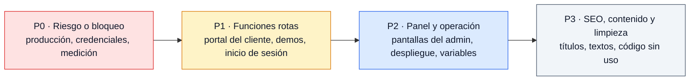

# Correcciones pendientes

> Al documentar todo el sitio contra el código de `main` y al dibujar sus diagramas de flujo aparecieron más de 200 puntos que no funcionan, confunden o no cumplen lo que prometen. Esta página los reúne sin repetir, ordenados por prioridad, para corregirlos desde el martes. Cada punto enlaza la página donde se explica con más detalle.
>
> Las limitaciones propias de cada demo no se repiten aquí: están en la sección **Limitaciones conocidas** de su guía ([Guía de demos](Doc-07-Guia-de-Demos.md)).

**En esta página:** [Resumen](#resumen) · [P0: riesgo o bloqueo](#p0-riesgo-o-bloqueo) · [P1: funciones rotas](#p1-funciones-rotas-que-ve-el-cliente-o-el-equipo) · [P2: panel y operación](#p2-panel-y-operación) · [P3: SEO, contenido y limpieza](#p3-seo-contenido-y-limpieza)

---

## Resumen

| Prioridad | Qué agrupa | Puntos |
|---|---|---|
| **P0** | Lo que impide vender hoy o es un riesgo legal o de seguridad | 3 |
| **P1** | Funciones que el cliente o el equipo usan y no sirven, incluidas las demos | 19 |
| **P2** | Detalles del panel, de la operación y de la configuración | 22 |
| **P3** | SEO, coherencia de textos y código que sobra | 1 |

---

## P0: riesgo o bloqueo

| # | Qué pasa | Qué hacer | Detalle |
|---|---|---|---|
| 0.1 | **El backend de producción no responde** ("Application not found" de Railway). Contacto, inicio de sesión, panel, solicitudes de demo, chatbot con IA y "Prueba con tu documento" fallan en `www.koptup.com`. Las demos "Con solicitud" muestran "No se pudo verificar" | Volver a desplegar el backend en Railway y, si cambia el dominio, actualizar `NEXT_PUBLIC_API_URL` en Vercel | [Estado y próximos pasos](15-Estado-y-Proximos-Pasos.md#acciones-del-dueño) |
| 0.2 | **Credenciales que estuvieron en el historial del repositorio** | Rotar la contraseña de MongoDB y los secretos JWT | [Estado y próximos pasos](15-Estado-y-Proximos-Pasos.md#acciones-del-dueño) |
| 0.10 | **Producción no mide nada:** no hay ninguna etiqueta configurada (GA4, Google Ads, LinkedIn), así que no aparece el banner y no se registra ninguna conversión | Crear las variables en Vercel antes de pautar | [SEO, analítica y legal](Doc-12-SEO-Analitica-y-Legal.md) |

---

## P1: funciones rotas que ve el cliente o el equipo

### Portal del cliente

| # | Qué pasa | Detalle |
|---|---|---|
| 1.1 | **No se pueden crear facturas, entregables ni conversaciones:** los cuatro modelos generan su número después de validarlo y todo guardado falla con error 500 | [API › Limitaciones](Doc-08-API.md#11-limitaciones-conocidas), [Modelos de datos](Doc-09-Modelos-de-Datos.md) |
| 1.2 | Aunque se arregle, **las facturas y los entregables quedan a nombre de quien los crea** (el equipo) y no del cliente, así que el cliente no los vería | [API](Doc-08-API.md#11-limitaciones-conocidas) |
| 1.4 | **La conversación automática de cada pedido nunca se crea,** y responder desde el detalle de conversación del panel usa una ruta sin el prefijo `/api` | [Manual del administrador](Doc-06-Manual-del-Administrador.md) |
| 1.5 | **"Descargar" factura no hace nada:** la lista usa el número como id y el servicio no genera un PDF | [Manual del administrador](Doc-06-Manual-del-Administrador.md) |
| 1.6 | **Entregables y Facturación muestran datos inventados como si fueran reales** cuando la API falla, y no tienen estado vacío | [Flujos del prospecto y cliente](Doc-05-Flujos-del-Prospecto-y-Cliente.md) |
| 1.7 | **El inicio de `/dashboard` es una maqueta** con datos fijos. La vista "Plan SaaS" además usa voseo | [Flujos del prospecto y cliente](Doc-05-Flujos-del-Prospecto-y-Cliente.md) |
| 1.8 | **Nada en la web crea proyectos, entregables ni notificaciones:** esas secciones del portal siempre están vacías | [Flujos del prospecto y cliente](Doc-05-Flujos-del-Prospecto-y-Cliente.md) |

### Demo RAG y LinkedIn Ads

| # | Qué pasa | Detalle |
|---|---|---|
| 1.16 | **LinkedIn Ads muestra el cupo mensual agotado y la falta de Redis como un error genérico.** El backend ya responde `budget_exhausted` y `limits_unavailable` con mensajes claros; falta que la demo los use | [Flujos técnicos › Hallazgos](Doc-14-3-Flujos-Tecnicos.md#hallazgos) |

### Cuenta e inicio de sesión

| # | Qué pasa | Detalle |
|---|---|---|
| 1.17 | **El botón de GitHub no hace nada;** el de Google sin configurar deja una respuesta JSON 503; "Recordarme" no tiene efecto | [Flujos del prospecto y cliente](Doc-05-Flujos-del-Prospecto-y-Cliente.md) |
| 1.18 | **Sin correo configurado, "Olvidé mi contraseña" dice que envió un enlace que no llega,** y el panel no permite copiarlo como sí hace con la activación | [Flujos de negocio › Hallazgos](Doc-14-1-Flujos-de-Negocio.md#hallazgos) |
| 1.19 | **Una sola sesión renovable por cuenta:** iniciar sesión en otro navegador cierra la del primero cuando vence su token | [Flujos de negocio › Hallazgos](Doc-14-1-Flujos-de-Negocio.md#hallazgos) |
| 1.21 | **Con el backend caído, el panel manda al login en vez de avisar** que el servicio no está disponible | [Flujos de administración › Hallazgos](Doc-14-2-Flujos-de-Administracion-y-Operacion.md#hallazgos) |

### Operación que afecta al cliente

| # | Qué pasa | Detalle |
|---|---|---|
| 1.22 | **Los adjuntos de pedidos y los archivos de cuentas médicas se pierden en cada despliegue** de Railway hasta que el dueño monte un volumen en `/app/uploads` | [Operación y despliegue › Acciones pendientes](Doc-11-Operacion-y-Despliegue.md#10-acciones-pendientes-del-dueño) |
| 1.24 | **`main` no exige CI en verde,** y Vercel y Railway despliegan sin esperarlo. Es configuración de GitHub y Railway (acción del dueño) | [Operación y despliegue › Acciones pendientes](Doc-11-Operacion-y-Despliegue.md#10-acciones-pendientes-del-dueño) |

### Demos

| # | Qué pasa | Detalle |
|---|---|---|
| 1.25 | **Las tarjetas del catálogo de 20 demos prometen funciones que la demo no tiene** ("ML", "multi-país", integraciones, cumplimiento). Es el repaso de honestidad pendiente | [Guía de demos › Limitaciones comunes](Doc-07-Guia-de-Demos.md#limitaciones-comunes) |
| 1.26 | **7 demos sin revisar** tienen botones que no hacen nada, no dicen que usan datos de ejemplo y mezclan textos en inglés | [Guía de demos](Doc-07-Guia-de-Demos.md) |
| 1.30 | **"Solicitar acceso" mal dirigido dentro de las demos de salud:** en cuentas médicas apunta a una ruta que no existe y en el motor de reglas lleva a `/contact` | [Guía: cuentas médicas](Guia-Demo-cuentas-medicas.md), [Guía: motor de reglas](Guia-Demo-sistema-experto.md) |
| 1.31 | **"Ver Planes y Precios"** al final de las demos de otras soluciones lleva a los planes RAG | [Guía de demos › Limitaciones comunes](Doc-07-Guia-de-Demos.md#limitaciones-comunes) |
| 1.34 | **La nota de "Simular ticket entrante" del helpdesk dice que el mensaje no sale del navegador,** pero "Redactar con IA" lo envía al servidor | [Guía: helpdesk](Guia-Demo-helpdesk-ia.md) |

---

## P2: panel y operación

### Panel de administración

| # | Qué pasa | Detalle |
|---|---|---|
| 2.1 | **Admin › Usuarios no permite dar los roles comercial, prospecto ni cliente,** muestra "Usuario" en esas cuentas y al manager le ofrece un selector que la API rechaza | [Roles y permisos](Doc-10-Roles-y-Permisos.md) |
| 2.2 | **Un rol nuevo no se ve en el panel ni en el menú del portal** hasta volver a iniciar sesión | [Flujos de administración › Hallazgos](Doc-14-2-Flujos-de-Administracion-y-Operacion.md#hallazgos) |
| 2.3 | **Accesos a demos a 1440 px:** la primera columna y la de acciones quedan recortadas | [Manual del administrador](Doc-06-Manual-del-Administrador.md) |
| 2.4 | **En el formulario de aprobación,** el botón "Agregar" queda cortado | [Manual del administrador](Doc-06-Manual-del-Administrador.md) |
| 2.5 | **El enlace de activación desde Accesos no ofrece WhatsApp,** aunque la cuenta tenga teléfono | [Manual del administrador](Doc-06-Manual-del-Administrador.md) |
| 2.6 | **Se puede conceder acceso a una demo desactivada:** la persona recibe el correo y ve "En mantenimiento" | [Flujos de administración › Hallazgos](Doc-14-2-Flujos-de-Administracion-y-Operacion.md#hallazgos) |
| 2.7 | **Contadores distintos para lo mismo:** el menú cuenta solo "pendiente", el inicio suma "en revisión" y el menú no se refresca al aprobar | [Manual del administrador](Doc-06-Manual-del-Administrador.md) |
| 2.8 | **Cada solicitud de demo, incluido el spam, crea además un contacto,** así que "Contactos sin leer" sale inflado | [Manual del administrador](Doc-06-Manual-del-Administrador.md) |
| 2.9 | **Contactos:** el detalle no refleja el nuevo estado al marcarlo, no muestra el origen del lead y no tiene buscador ni borrado | [Manual del administrador](Doc-06-Manual-del-Administrador.md) |
| 2.10 | **Pedidos:** la fecha aparece un día antes en Colombia, los estados salen en inglés y se usan `confirm()` y `alert()` del navegador | [Manual del administrador](Doc-06-Manual-del-Administrador.md) |
| 2.11 | **Facturas y Entregables** no tienen estado vacío, tienen filtros en inglés y no hay pantalla para crear registros | [Manual del administrador](Doc-06-Manual-del-Administrador.md) |
| 2.12 | **Configuración del admin y del cliente:** las preferencias solo se guardan en el navegador y no tienen efecto, y "Cancelar" no hace nada | [Manual del administrador](Doc-06-Manual-del-Administrador.md) |
| 2.13 | **La bitácora de auditoría no tiene pantalla** (solo API) | [Flujos de administración › Hallazgos](Doc-14-2-Flujos-de-Administracion-y-Operacion.md#hallazgos) |
| 2.14 | **El panel no permite volver una solicitud a "pendiente",** aunque la API lo acepta | [Flujos de negocio › Hallazgos](Doc-14-1-Flujos-de-Negocio.md#hallazgos) |
| 2.15 | **Una solicitud que se fusiona con otra abierta no avisa a nadie** ni registra lead | [Flujos de negocio › Hallazgos](Doc-14-1-Flujos-de-Negocio.md#hallazgos) |
| 2.16 | **Cambiar el modo de una demo tarda hasta 60 s** en aplicarse, por la caché del filtro de la web | [Manual del administrador](Doc-06-Manual-del-Administrador.md) |
| 2.18 | **"Pedir más tiempo"** prellena nombre y correo, pero no la empresa | [Flujos del prospecto y cliente](Doc-05-Flujos-del-Prospecto-y-Cliente.md) |
| 2.19 | **`/reset-password` muestra el mismo mensaje** para enlace usado, reemplazado o vencido | [Flujos de negocio › Hallazgos](Doc-14-1-Flujos-de-Negocio.md#hallazgos) |
| 2.20 | **El portal puede perder la ruta de regreso** al mandar al login | [Flujos de negocio › Hallazgos](Doc-14-1-Flujos-de-Negocio.md#hallazgos) |
| 2.21 | **La pantalla de una demo desactivada** muestra dos veces "En mantenimiento" | [SEO, analítica y legal](Doc-12-SEO-Analitica-y-Legal.md) |

### Despliegue y configuración

| # | Qué pasa | Detalle |
|---|---|---|
| 2.22 | **Dos proyectos de Vercel despliegan `main`** (`koptup`, con el dominio, y `koptup-web`): doble build y riesgo de cambiar variables en el equivocado. Acción del dueño | [Operación y despliegue › Acciones pendientes](Doc-11-Operacion-y-Despliegue.md#10-acciones-pendientes-del-dueño) |
| 2.34 | **Crear o previsualizar una regla de facturación con IA falla** en `/liquidacion`: el servicio usa un modelo de Anthropic de 2024 que ya no está disponible. Hay que pasarlo a un modelo vigente | [API](Doc-08-API.md) |

---

## P3: SEO, contenido y limpieza

### Contenido y coherencia

| # | Qué pasa | Detalle |
|---|---|---|
| 3.14 | **Falta el inglés en** "Nuevo pedido" del portal (`/dashboard/orders/new`) | [Páginas públicas](Doc-03-Paginas-Publicas.md) |

---

## Cómo se encontraron

- **Documentación:** cada página `Doc-*` se escribió leyendo el código de `main` y recorriendo el sitio con el mismo código en un entorno local. Lo que no funcionaba quedó en su sección "Limitaciones conocidas".
- **Diagramas de flujo:** cada nodo y cada decisión de los 64 diagramas se comparó con el código; lo que no cuadraba quedó en la sección "Hallazgos" de cada página ([Diagramas de flujo](Doc-14-Diagramas-de-Flujo.md#hallazgos)).
- **Guías de demos:** cada demo se recorrió completa; sus limitaciones están en su guía ([Guía de demos](Doc-07-Guia-de-Demos.md)).

Cuando se corrija un punto, bórralo de esta página en el mismo commit.
