# Guía de la demo: Automatización de procesos

> Ruta `/demo/automatizacion` · Modo de acceso: **Abierta** · Tipo: **datos de ejemplo con motor real en el navegador** (los flujos se ejecutan de verdad paso a paso sobre eventos de ejemplo; los conectores y la «IA» son simulados; no hay servidor) · Plan del producto: [Automatización de procesos con IA](Producto-automatizacion-workflows.md)

**Resumen.** Es un editor de flujos que funciona: una distribuidora ficticia («Distribuciones Nogal Andino S.A.S.», NIT 901.345.678-2) tiene tres procesos automatizados (**facturas de proveedores al software contable**, **cobranza de cartera vencida** y **leads del sitio web al CRM**) y se puede ejecutar cada uno con eventos de ejemplo, ver cada paso con sus datos de entrada y salida, editar el flujo (agregar pasos con clic o arrastrando, moverlos, borrarlos, configurarlos), resolver los casos que quedan **para revisar**, guardar y restaurar versiones, crear flujos desde plantillas, correr código JavaScript aislado y exportar el historial (CSV) o el flujo (JSON). Todo queda guardado en el navegador. La demo lo dice con los rótulos **Datos de ejemplo** y **Conectores e IA simulados** y con el desplegable **¿Qué es real y qué es simulado?**.

**En esta página:** [Recorrido sugerido](#recorrido-sugerido-demo-comercial-de-5-minutos) · [Pantallas y funciones](#pantallas-y-funciones) · [Datos de ejemplo](#datos-de-ejemplo) · [Qué es real y qué es simulado](#qué-es-real-y-qué-es-simulado) · [Acceso](#acceso) · [Limitaciones conocidas](#limitaciones-conocidas)

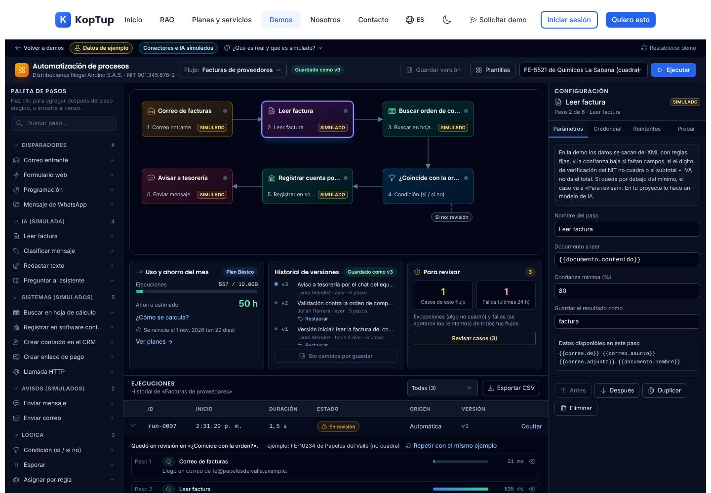

*Vista inicial a 1440 px: franja con «Volver a demos» y los rótulos, barra del editor, paleta de pasos a la izquierda, el flujo «Facturas de proveedores» en el lienzo, la configuración del paso elegido a la derecha y, abajo, las tarjetas de uso, versiones y casos para revisar y el historial de ejecuciones.*

---

## Recorrido sugerido (demo comercial de 5 minutos)

La historia: a la distribuidora le llegan por correo las facturas electrónicas de sus proveedores. El flujo las lee, las compara con la orden de compra, las registra como cuenta por pagar y avisa a tesorería. Lo que no cuadra no se pierde: queda en **Para revisar** para que una persona decida.

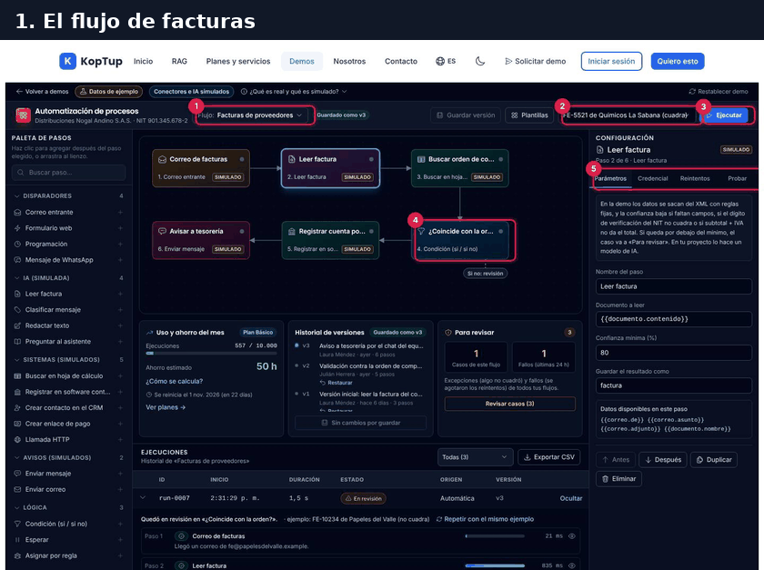

*Recorrido completo en seis cuadros: el flujo, la ejecución, el detalle de la corrida, la excepción, la revisión del caso y el cambio de la regla.*

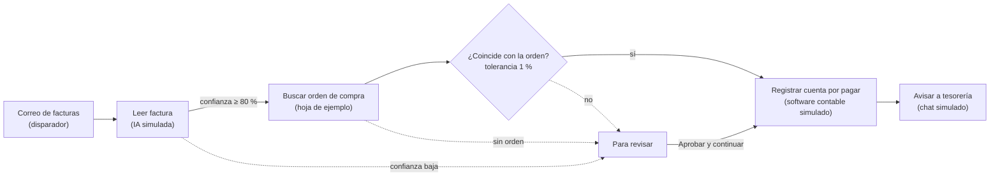

*El flujo «Facturas de proveedores» como lo ejecuta la demo. Las líneas punteadas son los casos que van a revisión.*

### Paso 1. Presenta el flujo

Al abrir la demo está activo el flujo **Facturas de proveedores** y elegido el paso **Leer factura**. El lienzo se lee como una serpiente: la primera fila de izquierda a derecha, la segunda de derecha a izquierda, siempre siguiendo las flechas.

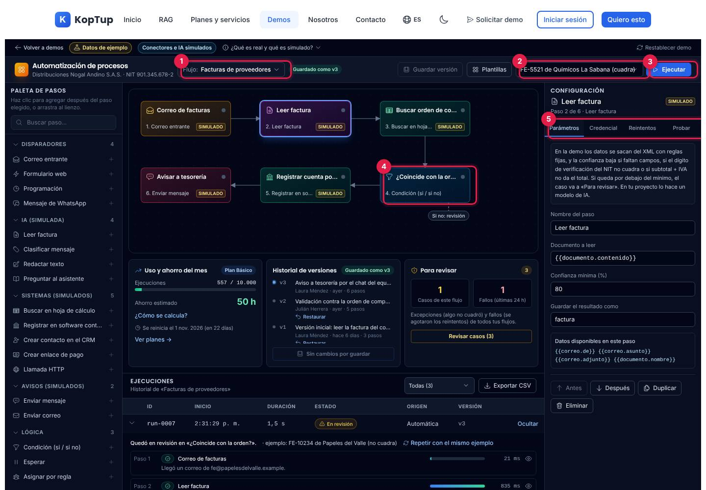

*El flujo de seis pasos con el inspector abierto en «Leer factura».*

1. **Flujo**: menú para cambiar entre los tres flujos de ejemplo (y los que crees), renombrar, duplicar o eliminar.
2. **Ejemplo para ejecutar**: los eventos de ejemplo del disparador (aquí, cuatro facturas que llegan por correo).
3. **Ejecutar**: corre el flujo con el ejemplo elegido.
4. **Condición**: «¿Coincide con la orden?» con su rama **Si no: revisión**.
5. **Configuración** del paso elegido, en cuatro pestañas: Parámetros, Credencial, Reintentos y Probar.

Qué decir: «Cada caja es un paso; la flecha es el camino de los datos. Las cajas marcadas como *Simulado* son conectores que en tu proyecto se conectan a tus sistemas».

### Paso 2. Ejecuta con la factura que cuadra

Deja elegida **FE-5521 de Químicos La Sabana (cuadra)** y pulsa **Ejecutar**.

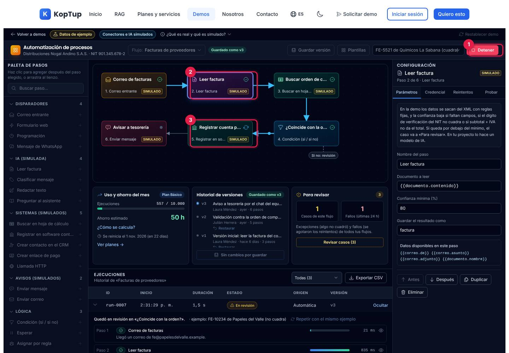

*A mitad de la ejecución: los pasos terminados con ✓ y el que está en curso parpadeando.*

1. **Ejecutar** se convierte en **Detener** mientras corre (detiene la ejecución en el paso en que vaya y la registra como «Detenida»).
2. **Paso terminado**: marca verde y la flecha recorrida en azul.
3. **Paso en curso**: ícono que gira.

Al terminar aparece un aviso («run-0009: Exitosa: 6 pasos») y la corrida queda arriba del historial. El motor de verdad leyó el XML, buscó la orden OC-2026-0141 en la hoja de ejemplo, comparó $ 2.618.000 contra $ 2.618.000, generó la cuenta por pagar **CxP-2026-00414** (el consecutivo sigue a las dos facturas de ejemplo ya registradas hoy) y armó el mensaje a tesorería con esos datos. Los tiempos de cada paso son simulados.

### Paso 3. Revisa la corrida en Ejecuciones

La corrida nueva se abre sola. Pulsa el ojo de **Leer factura**.

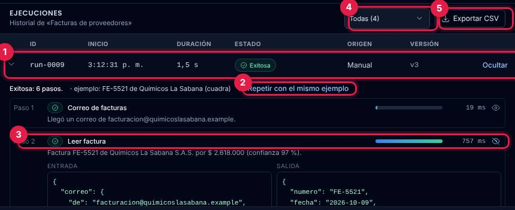

*La corrida nueva abierta con sus pasos y los datos de entrada y salida de «Leer factura».*

1. **Corrida**: identificador consecutivo, hora (Colombia), duración (la suma de sus pasos), estado, origen (Manual, Automática, Reintento, Aprobación o Repetición) y versión del flujo.
2. **Repetir con el mismo ejemplo**: vuelve a ejecutar el flujo actual con ese evento.
3. **Paso**: estado, barra proporcional a su duración, milisegundos y el mensaje de lo que hizo; el ojo muestra la **entrada** y la **salida** en JSON.
4. **Filtro por estado**: Todas, Exitosa, Exitosa con reintento, En revisión, Fallida, Sin acción y Detenida (con el conteo de cada una).
5. **Exportar CSV**: descarga las corridas filtradas del flujo.

Qué decir: «Cada ejecución deja rastro: qué entró, qué salió y cuánto tardó cada paso».

### Paso 4. Ejecuta la factura que no cuadra

Elige **FE-10234 de Papeles del Valle (no cuadra)** y pulsa **Ejecutar**. Luego elige la condición y, en **Probar**, pulsa **Probar este paso** con el mismo ejemplo.

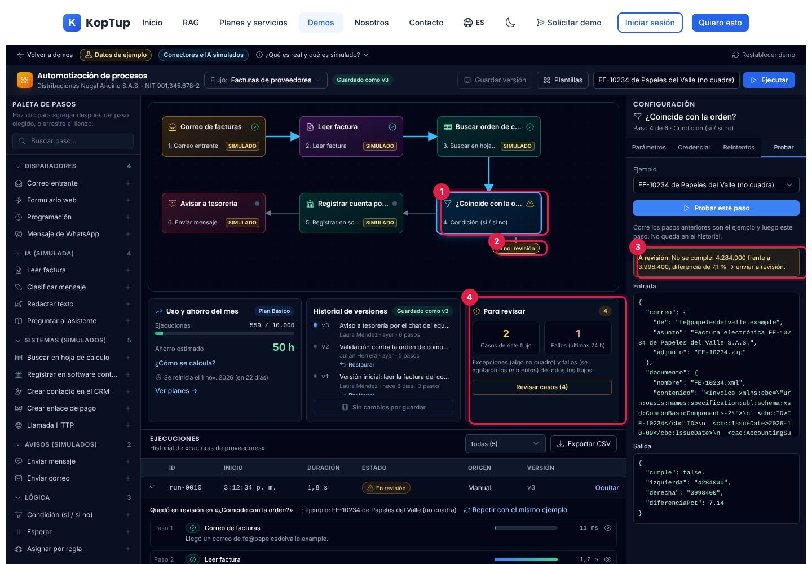

*La factura de $ 4.284.000 contra una orden de $ 3.998.400: la condición no se cumple y el caso va a revisión.*

1. **Condición** con ícono de advertencia: ahí se detuvo la ejecución.
2. **Rama «Si no: revisión»** resaltada.
3. **Probar**: corre los pasos anteriores y la condición sin dejar rastro en el historial, y dice por qué no se cumple («diferencia de 7,1 %»), con la entrada y la salida del paso.
4. **Para revisar**: el contador sube a 4 casos abiertos.

### Paso 5. Resuelve el caso en «Para revisar»

Pulsa **Revisar casos (4)**.

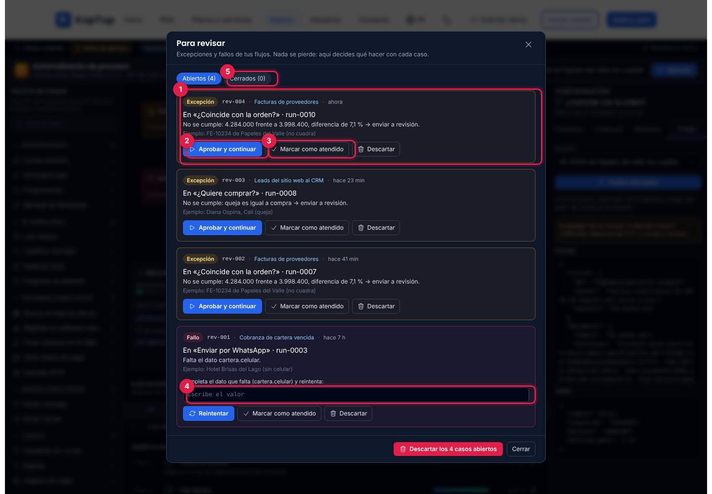

*La ventana con las excepciones y los fallos de todos los flujos.*

1. **Caso**: tipo (Excepción o Fallo), flujo (el nombre lleva al flujo), paso, corrida, motivo y ejemplo.
2. **Aprobar y continuar**: retoma el flujo desde el paso siguiente a la condición con los mismos datos; se crea una corrida nueva («Aprobación de run-0010») y el caso pasa a **Cerrados** como «resuelto con run-0011».
3. **Marcar como atendido** (alguien lo resolvió a mano) y **Descartar**.
4. **Dato que falta**: en el fallo de cobranza del Hotel Brisas del Lago, que no tiene celular, se escribe uno válido (por ejemplo, 3005550199) y **Reintentar** termina el envío. Con un número inválido vuelve a fallar y el caso sigue abierto.
5. **Cerrados**: los casos resueltos o descartados, con cuándo y cómo.

Qué decir: «La IA y las reglas hacen el trabajo repetitivo; las excepciones llegan a una persona, que decide».

### Paso 6. Ajusta la regla y guarda una versión

Elige la condición, sube la **Tolerancia** a 10 y vuelve a ejecutar la factura FE-10234: ahora pasa. Guarda el cambio como versión.

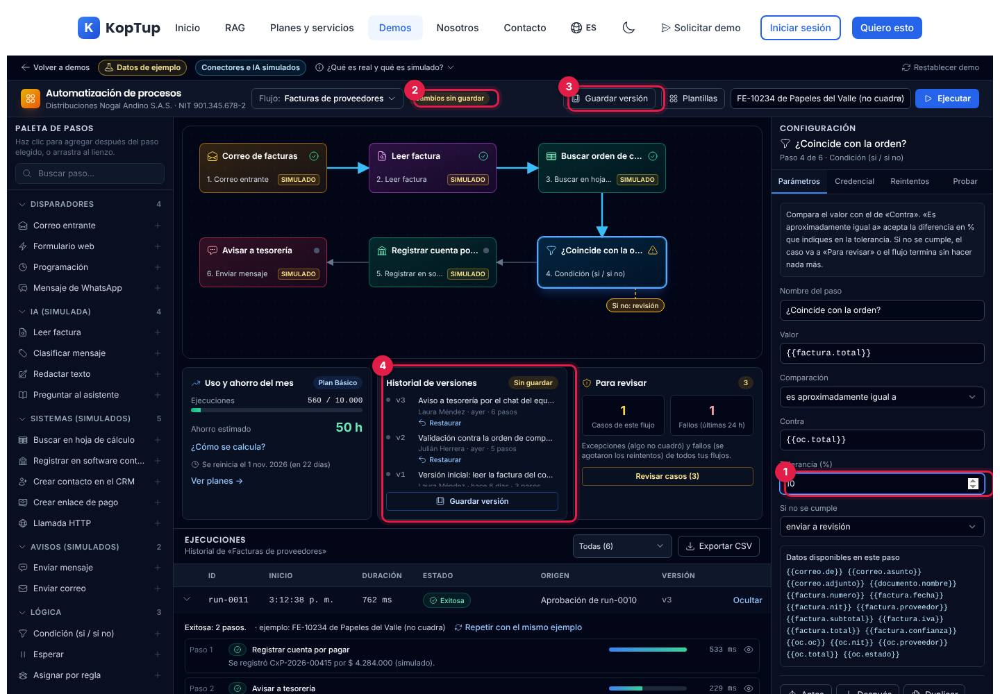

*La tolerancia en 10 %, el aviso de cambios sin guardar y el historial de versiones.*

1. **Tolerancia (%)**: el motor usa este valor en la siguiente ejecución.
2. **Cambios sin guardar**: el flujo ya no es igual a la última versión (las corridas quedan como «borrador»).
3. **Guardar versión**: pide una nota y crea la versión v4.
4. **Historial de versiones**: cada versión con nota, autor y fecha; **Restaurar** devuelve el lienzo a esa versión (con confirmación).

Cierra con el bloque azul del final de la página (**Solicitar demo guiada**): «¿Qué proceso te quita más tiempo? Lo armamos con tus sistemas».

---

## Pantallas y funciones

La demo es una sola pantalla con paleta, lienzo e inspector, más ventanas para casos, plantillas, código, JSON y confirmaciones. Todas se cierran con la X, con **Cancelar** o con la tecla Escape.

### Franja superior y barra del editor

| Elemento | Qué hace |
|---|---|
| **Volver a demos** | Lleva al catálogo `/demo`. |
| **Datos de ejemplo** · **Conectores e IA simulados** | Rótulos fijos. |
| **¿Qué es real y qué es simulado?** | Despliega tres columnas: lo real, lo simulado y el recorrido sugerido. |
| **Restablecer demo** | Con confirmación, borra lo guardado y vuelve a los datos de ejemplo del día. |
| **Flujo: …** | Menú con tus flujos (con su número de pasos), **Renombrar**, **Duplicar**, **Nuevo desde plantilla…** y **Eliminar flujo** (con confirmación; no deja eliminar el último). Se maneja con el teclado (flechas y Escape). |
| **Guardado como vN / Cambios sin guardar** | Estado del flujo frente a su última versión. |
| **Guardar versión** | Igual que en la tarjeta de versiones. |
| **Plantillas** | Abre las [plantillas](#plantillas). |
| **Ejemplo** + **Ejecutar** / **Detener** | Ejecuta el flujo con un evento de ejemplo del disparador. |

### Paleta de pasos

Veinte tipos de paso en seis grupos, con buscador. **Un clic** agrega el paso después del elegido; también se puede **arrastrar** al lienzo (aparece un punto azul donde quedará). Los disparadores reemplazan al del flujo, con confirmación, porque un flujo tiene uno solo.

| Grupo | Pasos | Qué hacen en la demo |
|---|---|---|
| Disparadores | Correo entrante, Formulario web, Programación, Mensaje de WhatsApp | Entregan el evento de ejemplo elegido (simulados). |
| IA (simulada) | Leer factura, Clasificar mensaje, Redactar texto, Preguntar al asistente | Reglas fijas: lectura del XML con confianza calculada, clasificación por palabras clave, plantilla con datos y búsqueda en cuatro políticas de ejemplo con su fuente. |
| Sistemas (simulados) | Buscar en hoja de cálculo, Registrar en software contable, Crear contacto en el CRM, Crear enlace de pago, Llamada HTTP | Buscan en las hojas de ejemplo o validan los datos y devuelven un resultado de ejemplo (número de documento, contacto, enlace `pagos.example`, eco HTTP). No salen del navegador. |
| Avisos (simulados) | Enviar mensaje (WhatsApp o chat del equipo), Enviar correo | Arman el mensaje final con los datos y validan el celular o el correo; no envían nada. |
| Lógica | Condición (si / si no), Esperar, Asignar por regla | Comparan valores (igual, distinto, mayor, menor, aproximadamente igual con tolerancia, contiene, tiene valor), registran la espera sin esperar y eligen responsable con una tabla «valor = responsable». |
| Código | Código JavaScript, Mapear campos | Ejecutan código propio en un Worker aislado o arman un objeto con «nombre = {{campo}}». |

### Lienzo

- Las flechas siguen el orden de ejecución y nunca cruzan un nodo; en el celular los pasos quedan en una sola columna.
- Cada nodo muestra nombre, número y tipo, el rótulo **Simulado** si es un conector o IA, y su estado en la última ejecución: en espera, ejecutando, listo, reintentando, falló, en revisión, terminó aquí o detenido.
- Las condiciones muestran su rama **Si no: revisión** o **Si no: termina**, que se resalta cuando se toma.
- Un clic elige el paso; se puede **arrastrar** un paso para cambiarlo de lugar y **Supr** lo elimina (con **Deshacer** en el aviso). El disparador no se mueve ni se borra.

### Inspector del paso

| Pestaña | Qué tiene |
|---|---|
| **Parámetros** | Qué hace el paso en la demo y en un proyecto real, su nombre y sus campos (con plantillas `{{campo}}`), los **Datos disponibles en este paso** (los que llegaron en la última ejecución) y **Antes**, **Después**, **Duplicar** y **Eliminar**. Todo cambio se guarda al instante y lo usa la siguiente ejecución. |
| **Credencial** | Credencial de ejemplo del conector (no hay secretos). Sin credencial, el paso falla al ejecutarse. |
| **Reintentos** | Reintentos (0 a 5), primera espera (1, 2, 5 o 10 s) y crecimiento exponencial o lineal, con el dibujo de las esperas. Si se agotan, la corrida falla y el caso queda para revisar. |
| **Probar** | Corre el flujo hasta ese paso con un ejemplo y muestra el resultado, la entrada y la salida, sin guardar la corrida. |

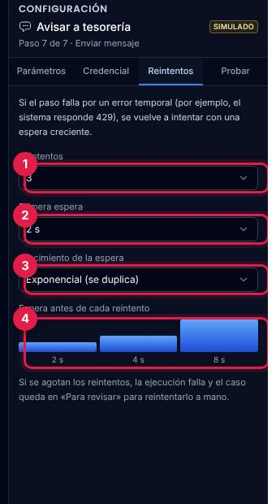

*Reintentos de «Avisar a tesorería».*

1. **Reintentos**.
2. **Primera espera**.
3. **Crecimiento de la espera**.
4. **Esperas** antes de cada reintento (por ejemplo, 2, 4 y 8 s).

El ejemplo **FE-889 de Envases del Caribe** hace que el software contable responda 429 una vez: con los reintentos por defecto la corrida queda «Exitosa con reintento» y el paso muestra «Esperó 2 s antes de reintentar». Con 0 reintentos, la misma factura falla y queda para revisar.

### Tarjetas de uso, versiones y casos

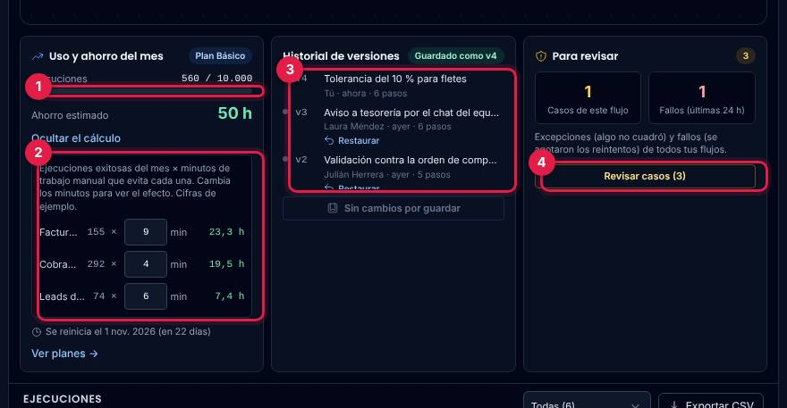

*Las tres tarjetas, con el cálculo del ahorro abierto.*

1. **Uso y ahorro del mes** (plan Básico, 10.000 ejecuciones al mes, como en el catálogo): ejecuciones del mes = un ritmo de ejemplo de cada flujo por los días corridos del mes más las que ejecutes. El conteo se reinicia el día 1 y **Ver planes** lleva a `/services#otras-soluciones`.
2. **¿Cómo se calcula?**: ahorro = ejecuciones exitosas × minutos de trabajo manual que evita cada una; los minutos se pueden cambiar por flujo.
3. **Historial de versiones** del flujo activo, con **Restaurar** y **Guardar versión**.
4. **Para revisar**: casos abiertos del flujo, fallos de las últimas 24 horas y **Revisar casos**.

### Ejecuciones

Descrito en el [paso 3](#paso-3-revisa-la-corrida-en-ejecuciones). Muestra solo las corridas del flujo activo; la más reciente se abre sola. En el celular se ocultan las columnas de duración, origen y versión (aparecen al abrir la corrida).

### Plantillas

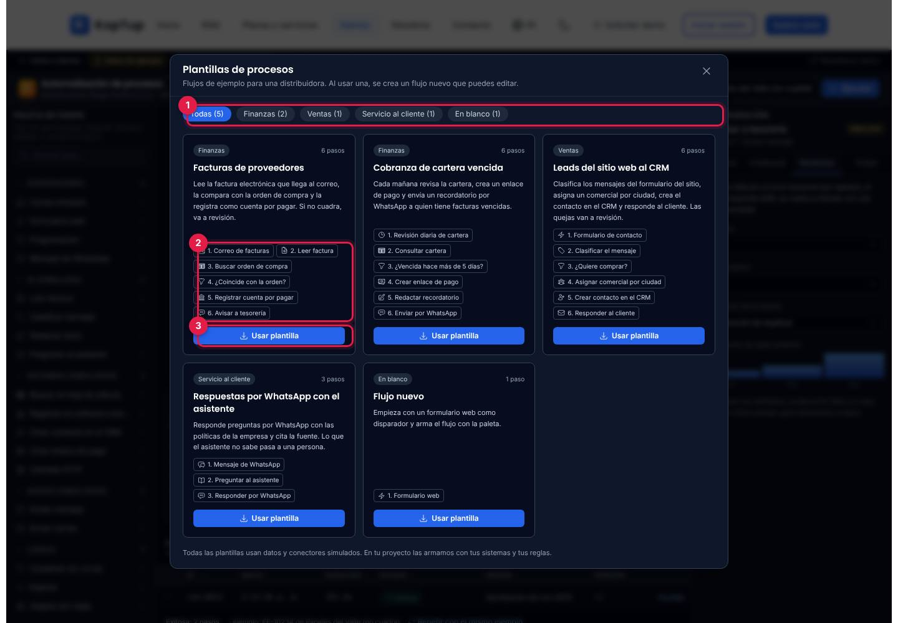

*Cinco plantillas con filtro por categoría.*

1. **Categorías**: Todas, Finanzas, Ventas, Servicio al cliente y En blanco (ninguna queda vacía).
2. **Pasos** de la plantilla.
3. **Usar plantilla**: crea un flujo nuevo con esos pasos y lo deja activo (sin versiones ni ejecuciones). La plantilla **Respuestas por WhatsApp con el asistente** no viene cargada: úsala para mostrar el asistente que cita la fuente y la pregunta que no sabe responder, que pasa a revisión.

### Editor de código

Se abre con **Abrir editor de código** en un paso de **Código JavaScript**.

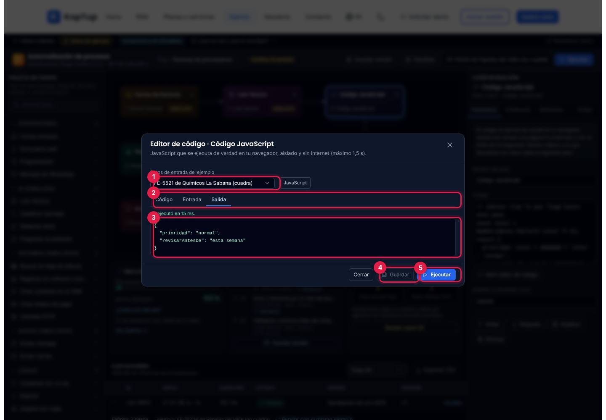

*El código de ejemplo ejecutado con la factura FE-5521.*

1. **Datos de entrada del ejemplo**: el evento con el que se calcula la entrada del paso.
2. **Código**, **Entrada** (lo que recibe `datos`) y **Salida**.
3. **Resultado** de la ejecución con su tiempo, o el error del código.
4. **Guardar**: guarda el código en el paso (si cierras con cambios, pide confirmación).
5. **Ejecutar**: corre el código de verdad en un Worker aislado, sin acceso a la página ni a internet, con un límite de 1,5 s (un ciclo infinito se corta).

### Definición del flujo (JSON)

En el pie de la demo.

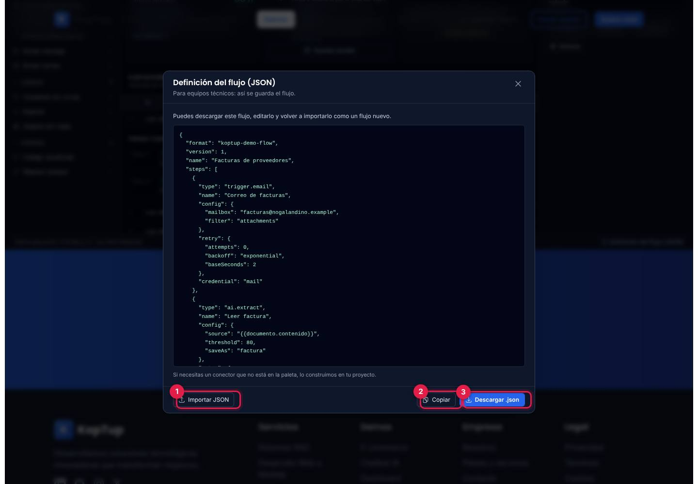

*El flujo activo en JSON.*

1. **Importar JSON**: crea un flujo nuevo desde un archivo (máximo 200 KB, 1 a 20 pasos, tipos conocidos y un disparador al inicio); si no cumple, dice por qué.
2. **Copiar** al portapapeles.
3. **Descargar .json**.

### En el celular

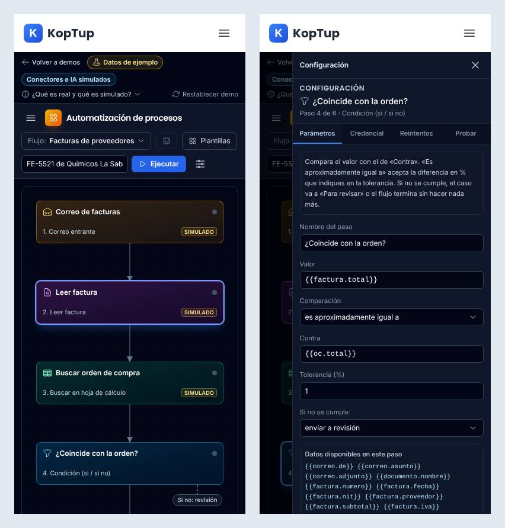

*A 390 px. Izquierda: así abre la demo. Derecha: la configuración de un paso después de tocarlo.*

- La paleta y la configuración empiezan cerradas. ☰ abre la paleta y el ícono de ajustes, la configuración; tocar un paso también la abre. Ambos paneles empiezan debajo de la barra del sitio, se cierran con la X, tocando fuera o con Escape.
- El lienzo queda en una columna y las tarjetas se apilan. No hay desbordes a lo ancho.

---

## Datos de ejemplo

Todo es ficticio: empresas, personas, NIT (con dígito de verificación válido), correos (dominio reservado `.example`) y celulares (serie 300 555 01xx). Las fechas se arman con la fecha de hoy (las facturas son de ayer o antier; la revisión de cartera corre a las 8:00 de hoy, o de ayer si aún no son las 8:15) y nunca quedan en el futuro.

| Flujo | Ejemplos | Qué pasa |
|---|---|---|
| **Facturas de proveedores** (correo) | FE-5521 de Químicos La Sabana; FE-10234 de Papeles del Valle; FE-889 de Envases del Caribe; FE-3307 de Plásticos Altiplano | Exitosa; excepción por diferencia de 7,1 % con la orden; exitosa con un reintento (429); revisión porque al XML le faltan la fecha y el IVA (confianza 67 %). |
| **Cobranza de cartera vencida** (programación diaria) | Minimercado El Trébol (12 días, $ 3.450.000); Droguería Santa Inés (3 días); Hotel Brisas del Lago (sin celular) | Enlace de pago y recordatorio por WhatsApp (simulado); sin acción porque no pasa de 5 días; fallo por falta de celular, que se corrige en la revisión. |
| **Leads del sitio web al CRM** (formulario) | Catalina Restrepo, Medellín; Mauricio Pardo, Bogotá; Diana Ospina, Cali | Compra asignada a Valentina Ríos; compra asignada a Andrés Camacho; queja que va a revisión (servicio al cliente). |
| **Respuestas por WhatsApp con el asistente** (plantilla) | Envío gratis; producto roto; algo que no se vende | Respuesta con «Política de envíos 2026, sección 2»; respuesta con la política de devoluciones; revisión porque no hay respuesta en las políticas. |

Al abrir la demo por primera vez hay ocho ejecuciones de hoy, hechas con el mismo motor, y tres casos abiertos.

---

## Qué es real y qué es simulado

| Parte | Real o simulado | Detalle |
|---|---|---|
| Ejecución del flujo | **Real (en el navegador)** | El motor arma los datos paso a paso, llena las plantillas, evalúa condiciones, busca en las hojas, aplica las reglas, reintenta con espera y deja casos para revisar. La duración de cada paso es simulada y las esperas se acortan. |
| Edición del flujo, versiones, plantillas, casos, CSV y JSON | **Real** | Se guardan en este navegador (`localStorage`, una copia por idioma) hasta restablecer la demo. |
| Código JavaScript | **Real** | Se ejecuta en un Worker aislado (sin página ni red) con límite de 1,5 s. |
| Pasos de IA | **Simulado** | Reglas fijas; no se llama a ningún modelo. |
| Conectores (correo, hojas, software contable, CRM, pasarela de pagos, HTTP, WhatsApp, correo saliente) | **Simulado** | No se conectan a nada; no se envía ni se cobra nada. Las credenciales son nombres de ejemplo. |
| Uso del mes y ahorro | **Datos de ejemplo** | Ritmo de ejemplo más tus ejecuciones; los minutos por ejecución son editables. |
| Empresa, proveedores, clientes y prospectos | **Ficticios** | Ver [Datos de ejemplo](#datos-de-ejemplo). |

---

## Acceso

- **Cómo la ve un visitante:** la demo está en modo **Abierta** (`publico`): cualquiera entra a `/demo/automatizacion` sin cuenta y sin pantalla de acceso. En el hub `/demo` aparece así:

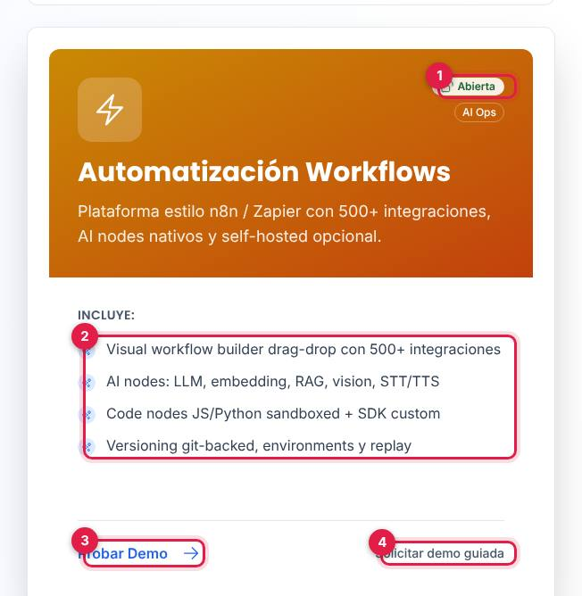

*Tarjeta «Automatización Workflows» en el hub, vista por un visitante sin sesión.*

1. Insignia **Abierta** (junto a «AI Ops»).
2. Lo que **Incluye** según la tarjeta (ver la [limitación 1](#limitaciones-conocidas)).
3. **Probar Demo** abre `/demo/automatizacion`.
4. **Solicitar demo guiada** abre `/solicitar-demo?demos=automatizacion`.

- **Cómo se solicita:** no hace falta solicitarla. Quien quiera verla con su propio proceso usa **Solicitar demo guiada** (en la tarjeta o en el bloque azul al final de la demo, que también ofrece **Solicitar Cotización** y **Ver Planes y Precios**).
- **Cómo la controla el admin:** el modo sale del catálogo del servidor y se cambia en **Admin › Catálogo de demos** (`/admin/catalogo-demos`). Si se pasa a «Con solicitud» o «Solo por invitación», los visitantes verán la pantalla de acceso y los accesos se conceden en **Admin › Solicitudes de demo** y **Admin › Accesos a demos**; si se desactiva, el visitante ve que la demo está «En mantenimiento» y el equipo de KopTup sigue entrando. Si el backend no responde, la demo sigue abierta porque así está en la tabla de respaldo. Detalle en el [Manual del administrador](Doc-06-Manual-del-Administrador.md) y en [Flujos del visitante](Doc-04-Flujos-del-Visitante.md).

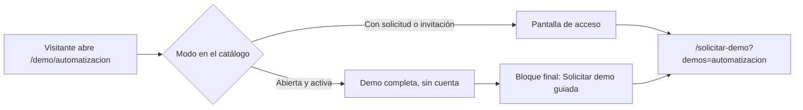

*Hoy la demo toma la rama de arriba; las otras dos aplican solo si el admin cambia el modo.*

---

## Limitaciones conocidas

1. **La tarjeta del hub todavía promete más que la demo** («500+ integraciones», nodos de «STT/TTS», «SDK custom», «Versioning git-backed» y «environments»). La demo tiene 20 tipos de paso con conectores simulados, solo JavaScript (sin Python ni SDK) y versiones guardadas en el navegador, sin Git ni entornos. El cambio de textos de la tarjeta y de la descripción para buscadores está pedido aparte; mientras tanto, presenta la demo con esta guía.
2. **Conectores e IA simulados.** Nada sale del navegador: no hay correos, mensajes, cobros ni llamadas a un modelo de IA. Los tiempos de cada paso son simulados y las esperas (paso **Esperar** y reintentos) no se hacen de verdad.
3. **Flujos lineales.** Un flujo es una secuencia de hasta 20 pasos con un solo disparador; las condiciones tienen una sola rama alterna (revisión o terminar), sin ramas en paralelo ni ciclos.
4. **Ejemplos por disparador.** Cada disparador tiene sus eventos de ejemplo; si cambias el disparador o armas un flujo con pasos que esperan otros datos, la ejecución falla diciendo qué dato falta (es el comportamiento esperado).
5. **Arrastrar y soltar** funciona con mouse; en pantallas táctiles los pasos se agregan con un toque y se mueven con **Antes** y **Después**.
6. **Lo guardado vive en este navegador**, una copia por idioma, con las últimas 120 ejecuciones; a los 21 días se vuelven a armar los datos de ejemplo. Otro navegador o una ventana privada empiezan de cero.
7. **El editor siempre se ve oscuro**, también con el sitio en modo claro (como la mayoría de editores de flujos).
