# Guía de la demo: Chatbot RAG con tus documentos

> Ruta `/demo/chatbot` · Modo de acceso: **Abierta** · Tipo: **IA real** (búsqueda y respuesta en el servidor; las empresas y sus documentos son de ejemplo) · Plan del producto: [Sistemas RAG (producto principal)](Producto-chatbot-rag-ia.md)

**Resumen.** Es la demo del producto principal de KopTup, pensada para empresas que quieren un asistente que responda con **sus propios documentos** (políticas, manuales, contratos). El asistente responde **solo con los documentos cargados**, cita la fuente de cada dato y dice «no encontré» cuando la respuesta no está. Tiene tres modos: **Prueba el asistente** (cuatro empresas ficticias, sin registro), **Prueba con tu documento** (tu PDF, DOCX o TXT, con email) y **Configura el tuyo** (tu propio bot con tus archivos o páginas web, su widget y el código para insertar). Sirve para que un gerente vea en 5 minutos qué es un sistema RAG y para que un desarrollador vea el pipeline real paso a paso.

**Contenido:** [Recorrido sugerido](#recorrido-sugerido-demo-comercial-de-5-minutos) · [Pantallas y funciones](#pantallas-y-funciones) · [Qué es real y qué es simulado](#qué-es-real-y-qué-es-simulado) · [Acceso](#acceso) · [Limitaciones conocidas](#limitaciones-conocidas)

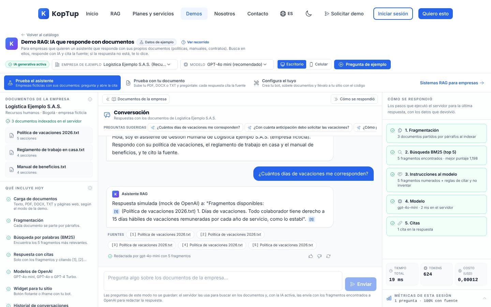

*Modo «Prueba el asistente» con una respuesta: documentos a la izquierda, conversación con citas al centro y «Cómo se respondió» a la derecha.*

> **Sobre las capturas:** el texto de las respuestas lo produjo el modelo simulado del entorno de pruebas (por eso empieza con «Respuesta simulada…»). Con la clave real de OpenAI lo redacta el modelo elegido. La búsqueda, las citas, los fragmentos, los pasos y las métricas que ves sí son el comportamiento real del código.

---

## Recorrido sugerido (demo comercial de 5 minutos)

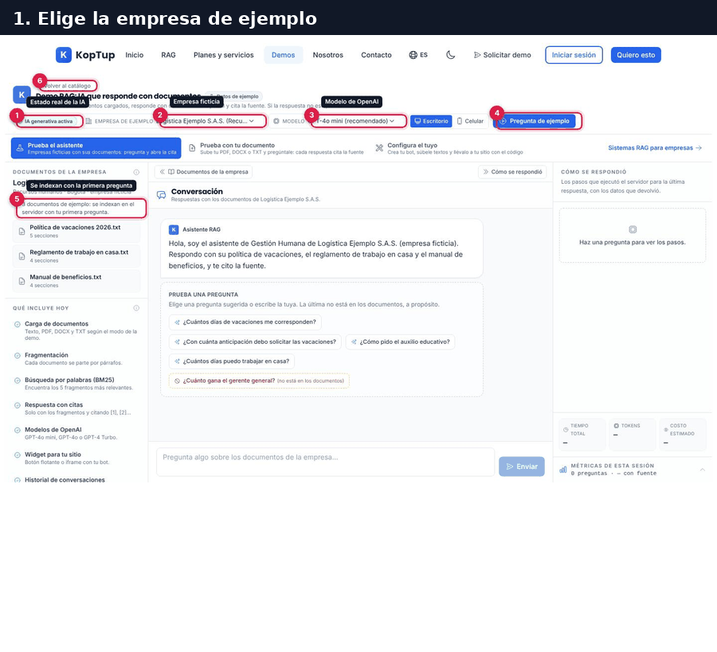

*Los ocho momentos del recorrido, en orden: empresa de ejemplo, respuesta con citas, fragmento citado, documento completo, «no encontré», tu propio documento, el widget real y los documentos del bot.*

La primera visita abre un recorrido de 5 pasos; se puede volver a ver con **Ver recorrido** (junto al título).

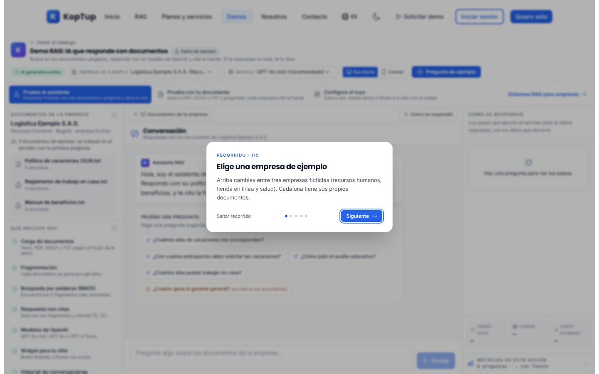

### Paso 1 · Elige la empresa de ejemplo (≈ 30 s)

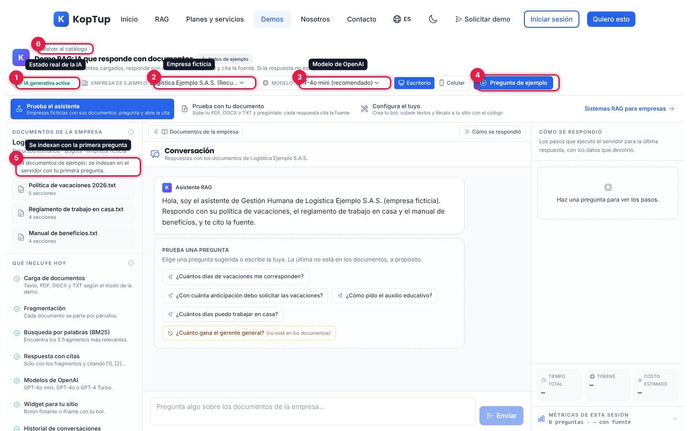

*Barra superior del modo «Prueba el asistente» y documentos de la empresa elegida.*

1. **Estado de la IA**: lo consulta al servidor al abrir la página (`GET /api/chatbot/models`). «IA generativa activa» significa que hay clave de OpenAI; si no, dice «Modo extractivo (sin clave de IA)» o «Servidor no disponible».
2. **Empresa de ejemplo**: cuatro empresas ficticias, cada una con sus documentos: *Logística Ejemplo S.A.S.* (recursos humanos, Bogotá), *Hogar Ejemplo Tienda en Línea* (servicio al cliente, Medellín), *IPS Ejemplo Salud* (salud, Cali: pacientes y área de cuentas médicas, con un «Manual de cuentas médicas (ejemplo)» de radicación y glosas) y *Firma Ejemplo Abogados S.A.S.* (legal, Bogotá: un contrato modelo de prestación de servicios y un manual interno de expedientes). Elige la que se parezca al cliente. Las landings por sector abren la demo con su empresa ya elegida: `/demo/chatbot?empresa=salud` (desde `/rag/salud`), `?empresa=legal` (desde `/rag/legal`) y `?empresa=tienda` (desde `/rag/soporte`); al cambiar de empresa, la dirección cambia con ella.
3. **Modelo de IA**: GPT-4o mini (recomendado), GPT-4o o GPT-4 Turbo. El servidor solo acepta esos tres; el tooltip dice que se puede dejar el recomendado. La marca «requiere clave de API» aparece solo si el servidor dice que no tiene clave. En el celular el selector no se muestra (queda el recomendado) para que la conversación suba.
4. **Pregunta de ejemplo**: envía la siguiente pregunta sugerida que aún no se ha hecho.
5. **Documentos de la empresa**: lo único que consulta el asistente. Al abrir la página no se crea nada en el servidor; dice «3 documentos de ejemplo: se preparan en el servidor con tu primera pregunta». Con la primera pregunta el servidor prepara el **bot de ejemplo compartido** de esa empresa (el primer visitante lo crea e indexa; los demás lo reutilizan) y pasa a «3 documentos indexados en el servidor». Clic en un documento para leerlo completo.
6. **Ver recorrido**: vuelve a abrir el recorrido de bienvenida.

**Qué decir:** «Esto es lo único que consulta el asistente: tres documentos internos. Lo que no esté aquí, no lo va a inventar». Con un cliente de salud, elige la IPS y pregunta «¿Cuál es el plazo interno para responder una glosa?»; con una firma de abogados, la firma de ejemplo y su última pregunta («¿Qué dice la Corte Suprema en sentencias recientes?»), que responde «no encontré» en lugar de inventar una sentencia.

### Paso 2 · Haz una pregunta sugerida (≈ 1 min)

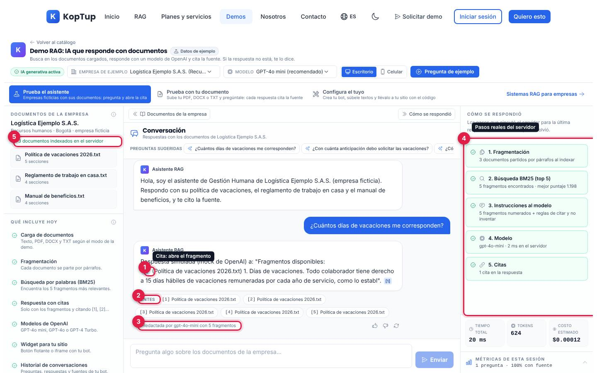

*Respuesta a «¿Cuántos días de vacaciones me corresponden?» con sus citas y los cinco pasos que ejecutó el servidor.*

1. **Cita [1]** dentro del texto: al pasar el mouse muestra el fragmento; al hacer clic lo abre completo.
2. **Fragmentos consultados (n)**: los fragmentos que el servidor encontró (hasta 5), con el nombre del documento. Los que la respuesta usa con [n] van primero y llevan la etiqueta **citado**; los demás los encontró la búsqueda, pero la respuesta no se basó en ellos (el tooltip de la etiqueta lo explica).
3. **Quién la redactó**: «Redactada por gpt-4o-mini con 5 fragmentos» (o «Modo extractivo…» si no hubo modelo). Al lado están «Respuesta útil» (pulgar arriba), «Respuesta a mejorar» (pulgar abajo) y «Volver a preguntar».
4. **Cómo se respondió**: el subtítulo aclara que es «para equipos técnicos» y que no hace falta mirarlo para usar el asistente. Muestra los pasos reales de la última respuesta: 1) división en fragmentos, 2) búsqueda por palabras (BM25), con cuántos fragmentos encontró (máximo 5) y la mejor coincidencia, 3) instrucciones al modelo, 4) modelo y milisegundos en el servidor, 5) citas. Abajo: tiempo total medido en tu navegador, tokens y **costo de IA (USD)**, cuyo tooltip explica que es lo que KopTup le paga a OpenAI por esa respuesta, no un cobro para el cliente (los planes se cobran por preguntas). Los números van con el formato del idioma (en español, «1,198» y «1.023»).

### Paso 3 · Abre la fuente (≈ 1 min)

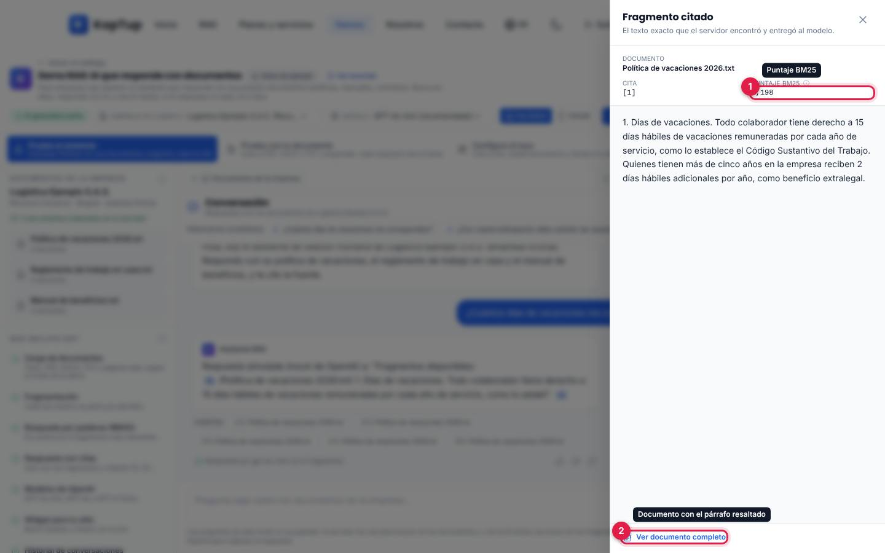

*Panel «Fragmento citado» que se abre al hacer clic en una cita.*

1. **Coincidencia de palabras (BM25)**: qué tanto coinciden las palabras de la pregunta con ese fragmento (más alto = más relevante).
2. **Ver documento completo**: abre el documento con el fragmento citado resaltado.

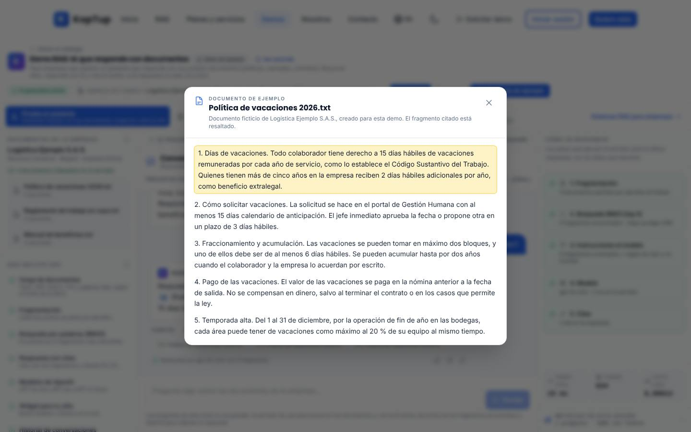

*Visor del documento de ejemplo: el párrafo citado aparece resaltado y se aclara que el documento es ficticio. Escape o la X lo cierran.*

**Qué decir:** «Cada dato se puede auditar: el usuario ve de qué párrafo salió».

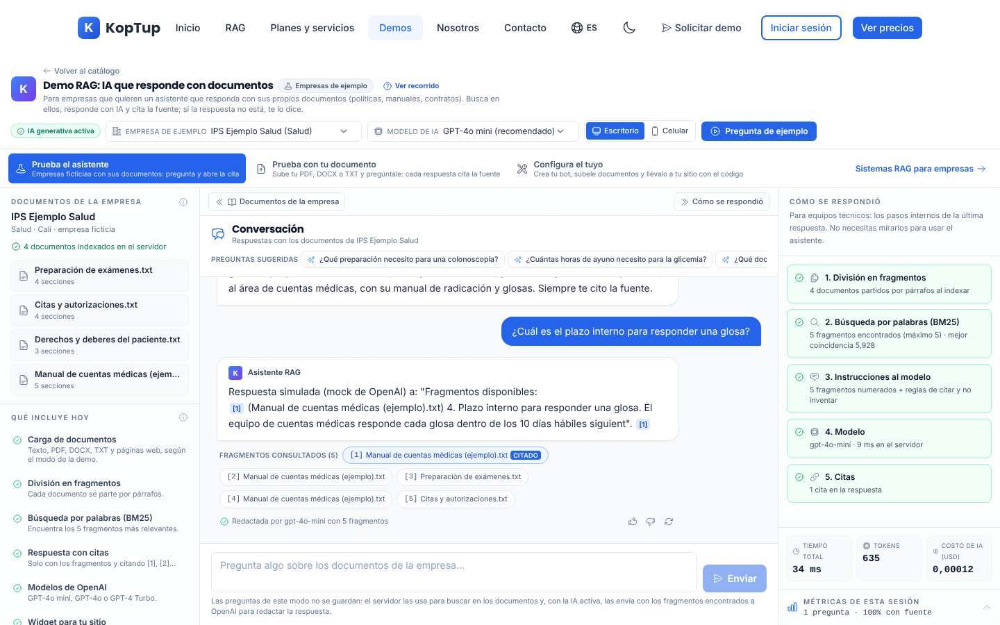

*IPS Ejemplo Salud (abierta desde `/rag/salud` con `?empresa=salud`): «¿Cuál es el plazo interno para responder una glosa?» cita el «Manual de cuentas médicas (ejemplo)». Bajo la respuesta, «Fragmentos consultados (5)» muestra primero el citado, con la etiqueta «citado». La respuesta viene del mock de OpenAI de la prueba local.*

### Paso 4 · Pregunta algo que no esté (≈ 1 min)

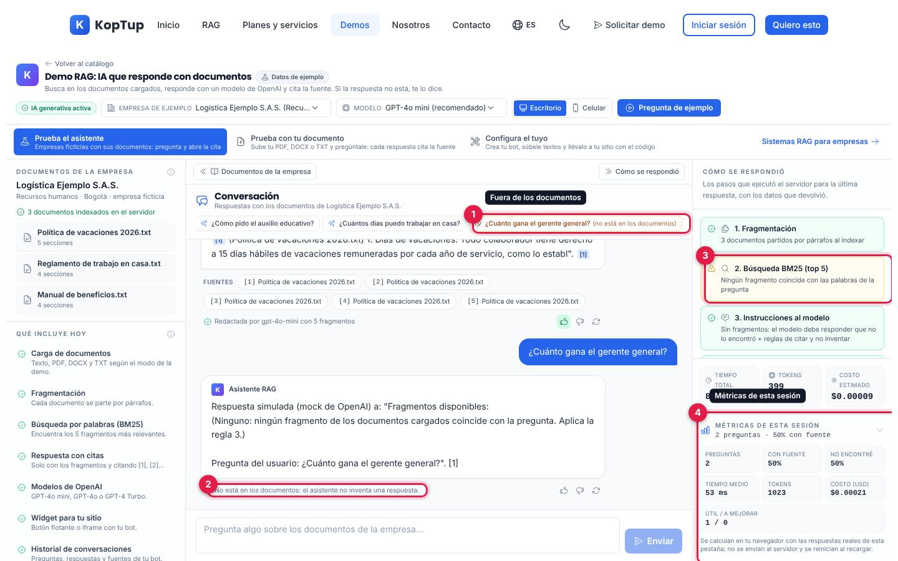

*La última pregunta sugerida está fuera de los documentos a propósito.*

1. **Pregunta fuera de los documentos**: va marcada con borde punteado y la nota «no está en los documentos» (por ejemplo «¿Cuánto gana el gerente general?»).
2. **No inventa**: debajo de la respuesta aparece «No está en los documentos: el asistente no inventa una respuesta».
3. **Paso 2 en ámbar**: «Ningún fragmento coincide con las palabras de la pregunta»; el paso 5 dice «Respuesta «no encontré»: sin citas».
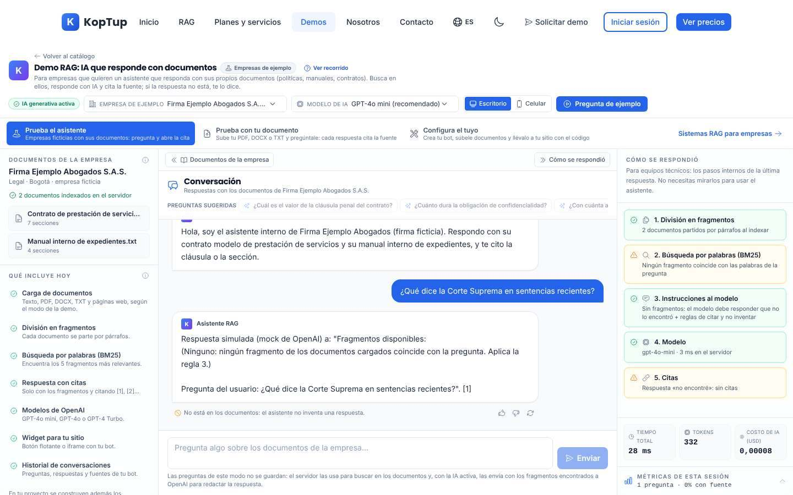

*Firma Ejemplo Abogados: «¿Qué dice la Corte Suprema en sentencias recientes?» no comparte palabras con sus documentos, así que la búsqueda no trae fragmentos y la respuesta es «no encontré» (no se inventa una sentencia).*

4. **Métricas de esta sesión**: al pie de «Cómo se respondió». Muestra preguntas, con fuente, «no encontré», tiempo medio, tokens, costo de IA (USD) y valoraciones. Suman las respuestas de **todas las empresas** que probaste en la pestaña (al cambiar de empresa no se pierden), se calculan en tu navegador con las respuestas reales, no se envían al servidor y se reinician al recargar.

### Paso 5 · Llévalo a su caso (≈ 1 min 30 s)

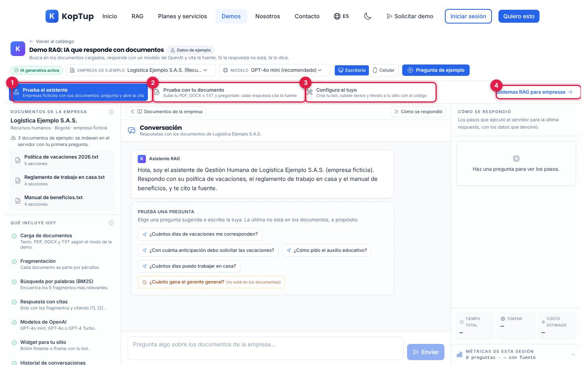

*Pestañas de modo debajo de la barra superior.*

1. **Prueba el asistente**: lo que acabas de mostrar.
2. **Prueba con tu documento**: el prospecto sube su propio PDF, DOCX o TXT (ver [más abajo](#prueba-con-tu-documento)).
3. **Configura el tuyo**: crea su bot, le sube documentos o páginas web, lo prueba con el widget real y copia el código para su web (ver [más abajo](#configura-el-tuyo)).
4. **Sistemas RAG para empresas**: lleva a la landing `/rag`.

Para cerrar: el recuadro **«¿Lo quieres con los documentos de tu empresa?»** de la columna de documentos, con **Pedir una demo guiada** (abre `/contact?service=sistema-rag&motivo=demo-guiada`, con el mensaje «Hola, quiero ver una demo guiada del asistente RAG con mi caso» ya escrito: la demo es abierta, así que no pasa por el formulario de acceso a demos) y **Cotizar el piloto** (abre `/contact` con el plan Piloto RAG ya elegido: «Estás cotizando Sistema RAG — Plan Piloto RAG», con su precio y duración), el enlace **Ver planes RAG** (`/services#planes-rag`) o el cierre de la página (Solicitar demo guiada, que también abre el contacto de demo guiada; Cotizar el piloto; Ver planes y precios).

---

## Pantallas y funciones

### Barra superior

- **Volver al catálogo**: enlace a `/demo`.
- **Título y subtítulo**: qué es, para quién y qué hace («Para empresas que quieren un asistente que responda con sus propios documentos…»). El subtítulo se oculta en el celular.
- **Rótulo «Empresas de ejemplo»**: solo en «Prueba el asistente» (con tu documento o tu bot los datos son tuyos). El tooltip aclara que las empresas y documentos son ficticios, pero las respuestas las genera el servidor real.
- **Ver recorrido**: vuelve a abrir el recorrido de 5 pasos (si estás en otro modo, primero cambia a «Prueba el asistente»). «Saltar recorrido», «Empezar» o Escape lo cierran y queda guardado en el navegador.
- **Escritorio / Celular**: cambia el marco de la conversación para ver cómo se vería en un teléfono (solo en pantallas medianas o grandes).
- **Enlace de la URL**: el modo queda en la dirección (`?mode=upload` o `?mode=builder`) y, en «Prueba el asistente», la empresa (`?empresa=salud|tienda|legal`), así puedes compartir el enlace directo a un modo o a una empresa.

### Prueba el asistente

| Zona | Qué puedes hacer | Qué pasa |
|---|---|---|
| Documentos de la empresa | Clic en un documento | Se abre el visor con el texto completo (ficticio). |
| Qué incluye hoy | Clic en una capacidad | Se abre un panel con el detalle de lo que existe en el código (ver captura abajo). |
| Recuadro de demo guiada | «Pedir una demo guiada» / «Cotizar el piloto» | Abre `/contact?service=sistema-rag&motivo=demo-guiada` (mensaje de demo guiada ya escrito) o `/contact?service=sistema-rag&plan=piloto` (el formulario llega con el plan elegido, su precio y «Qué pasa después»). |
| Conversación | Escribir y pulsar Enter, o elegir una pregunta sugerida | La pregunta va al servidor; la respuesta trae citas y fuentes. Mientras prepara el bot dice «Indexando los documentos de la empresa…». Después de la primera pregunta, las sugeridas quedan en una fila sobre la conversación (también en el celular, deslizando de lado). Debajo de la caja: «Las preguntas de este modo no se guardan: el servidor las usa para buscar en los documentos y, con la IA activa, las envía con los fragmentos encontrados a OpenAI para redactar la respuesta». |
| Respuesta | «Respuesta útil» / «Respuesta a mejorar» | Marca la respuesta y suma a las métricas de la sesión. El aviso dice «Anotado en las métricas de esta sesión. Tu valoración no se envía al servidor.»; al quitarla, «Valoración quitada…». |
| Respuesta | «Volver a preguntar» | Reenvía la misma pregunta y reemplaza la respuesta. |
| Cita o fragmento consultado | Clic | Abre «Fragmento citado» con documento, posición, coincidencia de palabras (BM25) y texto exacto. |
| Botones «Documentos de la empresa» / «Cómo se respondió» | Clic | En escritorio ocultan o muestran las columnas; en celular y tableta abren paneles laterales (Escape o la X los cierran). |

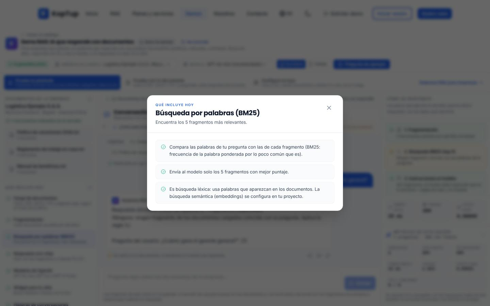

*Detalle de «Búsqueda por palabras (BM25)» en «Qué incluye hoy». Las siete capacidades: carga de documentos, división en fragmentos, búsqueda por palabras (BM25), respuesta con citas, modelos de OpenAI, widget para tu sitio e historial de conversaciones.*

Debajo de la lista, la demo aclara que en un proyecto se construyen además conectores (Google Drive, SharePoint), WhatsApp, permisos por rol y panel de métricas, con enlace a «Ver planes RAG» (`/services#planes-rag`). Esas piezas **no** están en la demo.

#### Si el servidor no puede preparar el bot

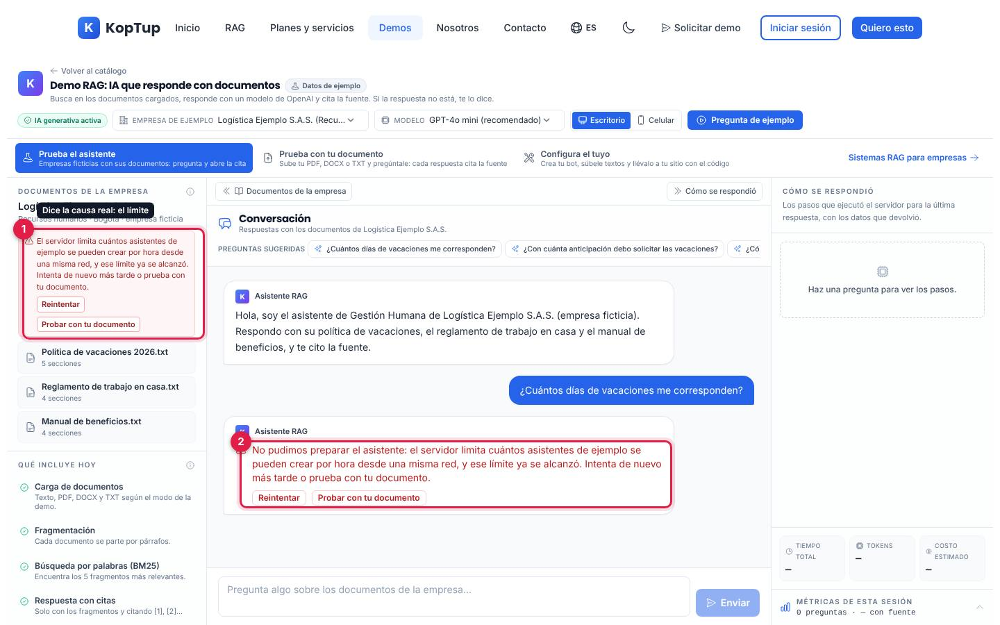

*Mensaje cuando el servidor limita la creación de asistentes desde una misma red.*

Cada error dice su causa real, en la columna de documentos y en la respuesta:

- **Límite de creación (429)**: «Desde tu red se crearon muchos asistentes en la última hora y el servidor pausó la creación de nuevos. Intenta de nuevo más tarde (el límite se renueva cada hora) o prueba con tu documento», con los botones «Reintentar» y «Probar con tu documento». Con los bots de ejemplo compartidos solo puede pasar si esa empresa todavía no tiene su bot en el servidor.
- **Demasiadas preguntas seguidas (429 del chat)**: pide esperar un minuto.
- **Pausa al abrir la página (429 al consultar el estado de la IA)**: la barra dice «Pausa por muchas consultas» (no «Servidor no disponible») y la demo lo vuelve a intentar sola cada 30 segundos. Pasa cuando muchas personas usan la demo desde la misma red.
- **Capacidad de la demo** o **servidor no disponible (503)**: lo dice así.
- **Sin conexión**: solo cuando de verdad no hubo respuesta del servidor dice «Revisa tu conexión».

**Comprobado** (revisión final, 14 de octubre de 2026, en español e inglés): el 429 real de creación con un servidor de prueba limitado a 1 bot por hora (mensaje en la columna y en la respuesta, y «Probar con tu documento» cambia de modo), «Guardar bot» con el mismo límite, el 429 del chat, el 503 y la red cortada (simulados), y «Reintentar» cuando el servidor vuelve. Sin clave de OpenAI, la barra dice «Modo extractivo (sin clave de IA)», los tres modelos aparecen con «requiere clave de API», la respuesta muestra los fragmentos con sus citas y los pasos 3 y 4 de «Cómo se respondió» quedan como «No aplica» y «Sin modelo».

### Prueba con tu documento

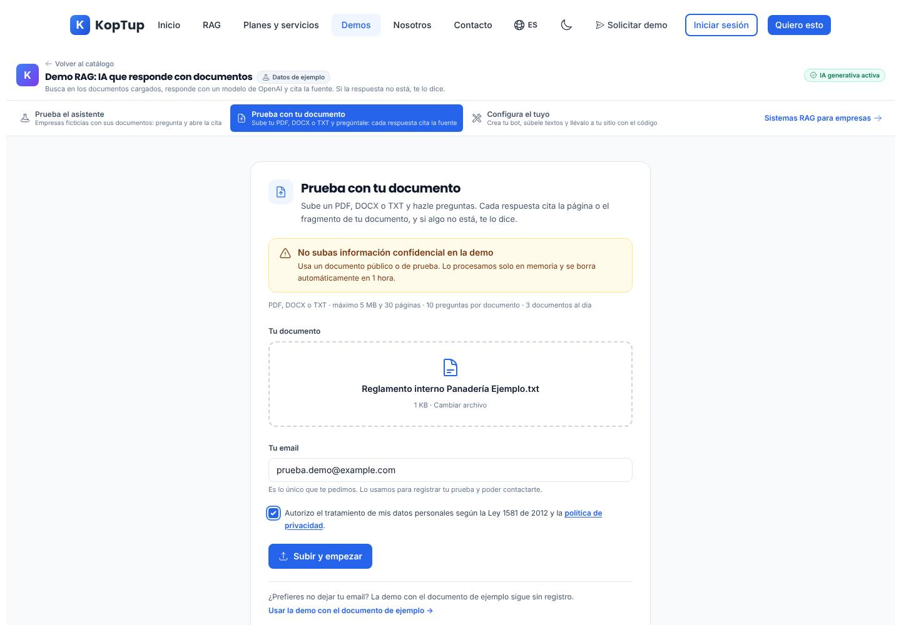

*Formulario con un PDF de prueba de una empresa ficticia, el email y la autorización de datos.*

- Pide **solo** el archivo (PDF, DOCX o TXT, hasta 5 MB y 30 páginas), el **email** y la casilla de **autorización de datos (Ley 1581 de 2012)** con enlace a la política de privacidad. Si falta algo lo dice («Elige un documento para subir.», «Escribe un email válido.», «…debes autorizar el tratamiento de tus datos personales»).
- Muestra el aviso «No subas información confidencial en la demo» (el documento se procesa solo en memoria, se borra a la hora y los fragmentos que responden cada pregunta se envían a OpenAI) y los límites: 10 preguntas por documento y 3 documentos al día **por red** (el cupo es por IP: en una oficina que sale a internet por la misma IP lo comparten todos).
- Cada rechazo dice su causa: formato no permitido, más de 5 MB, más de 30 páginas, **demasiado texto** (más de 400.000 caracteres, por ejemplo un PDF de 30 páginas con letra diminuta), PDF escaneado sin texto, documento dañado o con contraseña, o el **cupo de 3 documentos al día por red** («Desde tu red ya se usaron los 3 documentos de hoy (el límite es por red, no por persona)…», con «Pide una demo guiada»). Los documentos rechazados no gastan el cupo.
- Al subir, el servidor procesa el documento **solo en memoria** y lo borra a la hora. El email queda registrado como contacto con origen `demo-rag` (el mismo canal del formulario de contacto), para que el equipo comercial pueda escribirle.
- Si la función está apagada o se acabó el cupo del mes, muestra «La prueba con tu documento no está disponible en este momento» (o «Alcanzamos el cupo de pruebas de este mes») con «Pide una demo guiada» (`/contact?service=sistema-rag&motivo=demo-guiada`) y «Usar la demo con el documento de ejemplo».
- Al subir el documento, la página baja sola hasta la cabecera del chat (nombre, «Preguntas: 0/10», hora de borrado y «Listo, ya leí…»): antes el scroll se quedaba donde estaba el formulario y el chat parecía vacío.

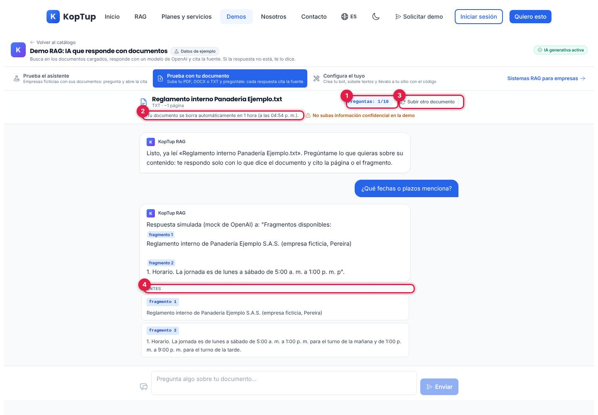

*Chat sobre un PDF de 5 páginas (empresa ficticia): contador, aviso de borrado, botón para subir otro y fuente con la página.*

1. **Contador** «Preguntas: 2/10».
2. **Aviso de borrado**: «Tu documento se borra automáticamente en 1 hora (a las …)».
3. **Subir otro documento**: borra el actual y vuelve al formulario.
4. **Fuentes**: en PDF cita la página (`p. 2`); en DOCX y TXT, el fragmento (`fragmento 2`), con el extracto.

Trae tres preguntas sugeridas («¿De qué trata el documento?», «¿Qué fechas o plazos menciona?», «¿Qué requisitos u obligaciones establece?»). Al llegar a 10 preguntas dice «Usaste las 10 preguntas de este documento», deshabilita la caja e invita a «Pide una demo guiada» o a «Ver planes RAG». El chat tiene altura fija: el contador y la caja de preguntas quedan siempre a la vista.

**Comprobado de punta a punta** (revisión final, 14 de octubre de 2026, en español e inglés, 1440 y 390 px): un PDF real de 5 páginas («Manual del empleado», empresa ficticia) citó la página 4 para la pregunta del permiso por calamidad y la 5 para la del curso de alturas, y llegó a 10/10 con la caja deshabilitada; un DOCX real de 3 páginas y un TXT citaron «fragmento 3»; el 4.º documento del día mostró el aviso del cupo. Los errores de formato (.xlsx), tamaño (6 MB), email, autorización, PDF escaneado, 31 páginas y texto demasiado largo mostraron cada uno su mensaje. Con la función apagada se vio «La prueba con tu documento no está disponible en este momento» con sus dos salidas.

### Configura el tuyo

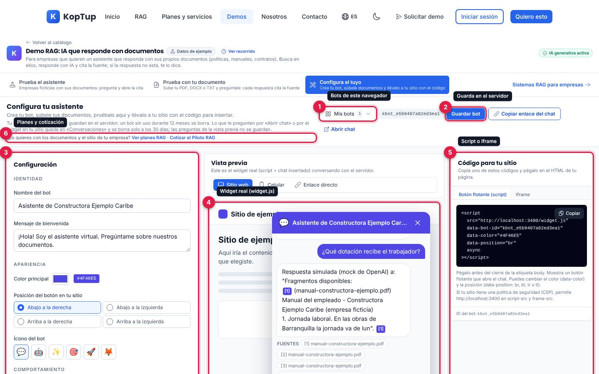

*Bot «Asistente de Constructora Ejemplo Caribe» (empresa ficticia) guardado, con el widget real respondiendo en el sitio de ejemplo y, arriba, la salida a planes y cotización.*

Arriba, el subtítulo aclara que el modo es «para equipos técnicos» y que «en un proyecto, esta configuración la hacemos nosotros»; la demo dice dónde queda cada cosa y ofrece la salida comercial («¿Lo quieres con los documentos y el sitio de tu empresa? Ver planes RAG · Cotizar el piloto»): «Tu bot y sus documentos se guardan en el servidor; un bot sin uso durante 12 meses se borra. Lo que le pregunten por «Abrir chat» o por el widget en tu sitio queda en «Conversaciones» y se borra solo a los 30 días; las preguntas de la vista previa no se guardan.»

1. **Mis bots**: los bots que este navegador puede editar. El menú explica que se guardan en el servidor y que el navegador tiene la llave para editarlos (desde otro equipo no aparecen). Permite cargar uno, crear uno nuevo o eliminarlo (con confirmación dentro de la página).
2. **Guardar bot**: crea o actualiza el bot en el servidor. Al lado aparecen el ID, «Copiar enlace del chat» y «Abrir chat» (página pública `/embed/chatbot/<id>`). Si el servidor no puede guardarlo, el aviso dice la causa real: límite de bots nuevos por hora desde tu red, capacidad de la demo, servidor no disponible o sin conexión.
3. **Configuración**: nombre, bienvenida, color, posición del botón (4 esquinas), ícono, instrucciones y tono (Profesional, Amigable, Técnico, Cercano).
4. **Vista previa**: el **widget real** (el mismo `widget.js` que se pega en otro sitio) conversando con el servidor. Tiene tres vistas: «Sitio web», «Celular» y «Enlace directo». Sin guardar, solo muestra la apariencia y pide guardar para conversar.
5. **Código para tu sitio**: dos pestañas, «Botón flotante (script)» e «Iframe», con «Copiar» y la nota de CSP.
6. **Planes y cotización**: «Ver planes RAG» (`/services#planes-rag`) y «Cotizar el piloto» (`/contact` con el plan elegido).

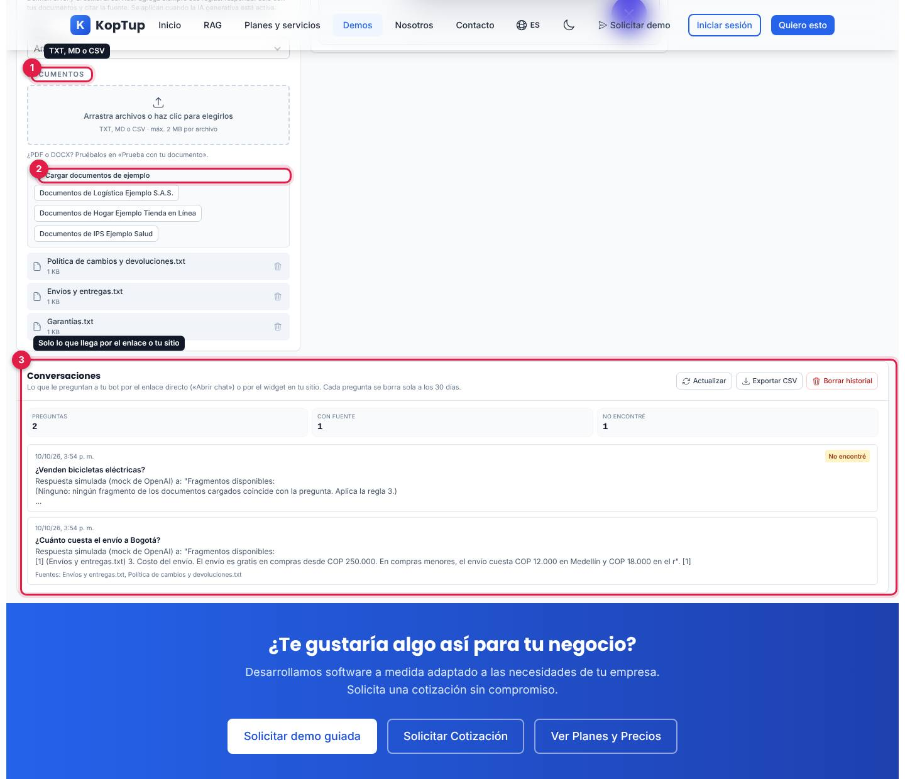

*Parte baja de «Configura el tuyo»: documentos del bot (tres archivos y la página example.com), el campo para agregar una página web y el historial de conversaciones.*

1. **Aviso de confidencialidad** (recuadro ámbar sobre «Documentos»): «No subas información confidencial. Los documentos de tu bot quedan en el servidor de la demo hasta que los quitas o eliminas el bot (o tras 12 meses sin uso), y cualquiera con el enlace del chat o que visite la página donde pegues el widget puede hacerle preguntas.» A diferencia de «Prueba con tu documento», aquí los documentos no se borran a la hora.
2. **Documentos subidos**: TXT, MD, CSV, **PDF o DOCX** de hasta 2 MB (arrastrar o elegir) y **páginas web**; cada uno se puede quitar. Si el bot aún no existe, subir un archivo lo guarda primero. Si un archivo no se puede leer (por ejemplo, un PDF escaneado sin texto), lo dice con su nombre y sube los demás. Las citas del bot muestran el documento (o el nombre del sitio) y el fragmento, no la página.
3. **O agrega una página web pública**: el servidor descarga la página (solo direcciones públicas por http o https, HTML o texto, hasta 2 MB), le quita el HTML y la indexa con el nombre del sitio. Si escribes la dirección sin `https://`, la demo lo agrega. Si no puede leerla, dice el motivo: dirección privada o interna, dominio que no existe, página que no responde o responde con error, más de 2 MB, no es HTML (por ejemplo, un PDF: se sube como archivo) o casi no tiene texto (páginas que se arman con JavaScript).
4. **Cargar documentos de ejemplo**: sube los documentos de una de las cuatro empresas ficticias (si ya están en el bot, lo dice y no los duplica).
5. **Conversaciones**: lo que le preguntan al bot por «Abrir chat» o por el widget en otro sitio (las preguntas de la vista previa no se guardan), con preguntas, «con fuente» y «no encontré»; «Actualizar», «Exportar CSV» y «Borrar historial» (pide confirmación; Escape la cancela). Cada pregunta se borra sola a los 30 días.

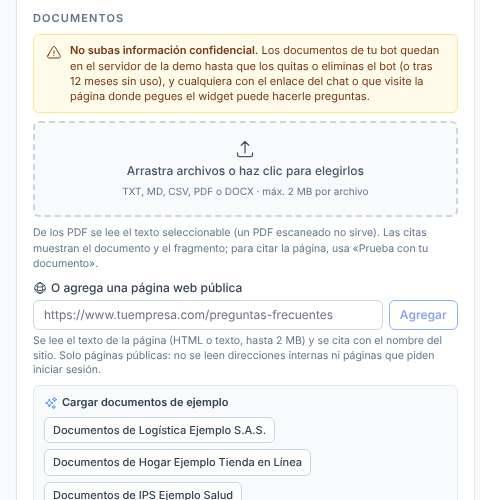

*Recuadro ámbar sobre «Documentos»: aquí los documentos se quedan en el servidor y el chat es público para quien tenga el enlace.*

#### Si abres un bot de otro navegador

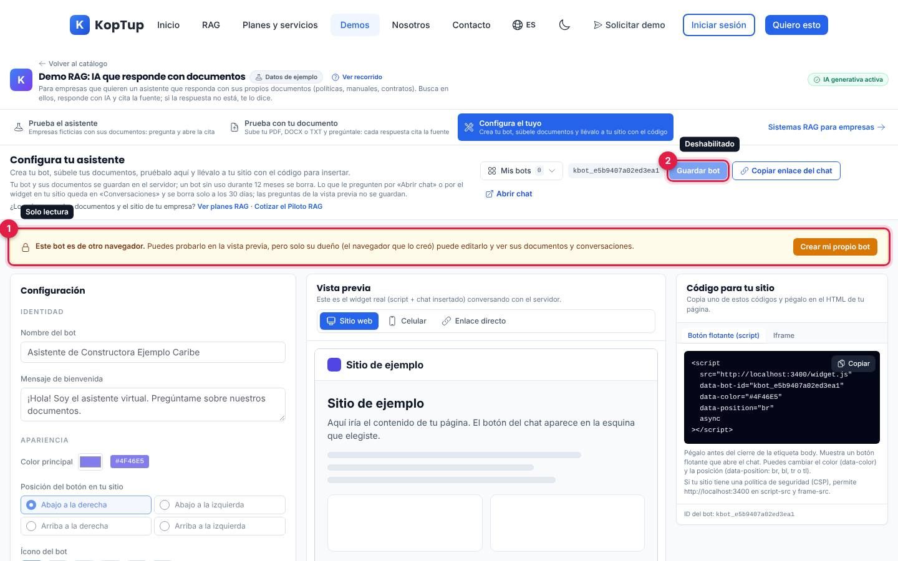

*El enlace `?mode=builder&botId=…` abierto en otro navegador: se ve el bot, pero en solo lectura.*

La llave para editar un bot vive en el navegador que lo creó. Si alguien abre el enlace del Builder de un bot ajeno (o borró los datos del navegador), la demo lo dice con el aviso **«Este bot es de otro navegador»**: puede probarlo en la vista previa, pero la configuración, los documentos y «Guardar bot» quedan deshabilitados, la lista de documentos muestra cuántos tiene el bot («solo su dueño ve la lista») y «Conversaciones» explica que solo el dueño puede verlas. **Crear mi propio bot** empieza uno nuevo. El servidor rechaza igual cualquier cambio sin la llave.

**Comprobado de punta a punta** (revisión final, 14 de octubre de 2026, en español e inglés, 1440 y 390 px): bot creado y personalizado (nombre, bienvenida, color, posición arriba a la izquierda, ícono y tono técnico; el servidor guardó cada campo); un PDF, un DOCX, un TXT, un MD y un CSV indexados y un PDF escaneado informado con su nombre; `https://example.com` indexada como página web y `http://127.0.0.1` rechazada por ser una dirección interna; pregunta en la vista previa con el widget real (con fuentes, no quedó en el historial); pregunta por «Abrir chat» y pregunta desde el **widget pegado en una página de prueba servida en otro puerto** (las dos quedaron en «Conversaciones»); CSV con las 2 preguntas; desde otro navegador, solo lectura y la API respondió 401 a editar y a leer conversaciones; historial borrado y bot eliminado del servidor (404).

#### El chat insertado (widget, iframe y «Abrir chat»)

`/embed/chatbot/<id>` es la página que muestran `widget.js`, el iframe y «Abrir chat». Se pinta **solo el chat**: sin el menú, el pie ni el banner de cookies de KopTup, y sin etiquetas de medición (GA4, Google Ads, LinkedIn), aunque el visitante haya aceptado cookies en koptup.com: KopTup no mide a los visitantes de sus clientes. Si una pregunta falla, el mensaje dice la causa: «Llegaron muchas preguntas seguidas…» (429), «El asistente no está disponible en este momento…» (servidor caído o sin capacidad), «No pudimos conectar con el servidor» (sin conexión) o «No pudimos responder tu pregunta» (otro error), con «Reintentar». Si el bot se borró, dice «Este asistente no está disponible». Sin clave de IA, la respuesta empieza con la nota del modo extractivo.

**Comprobado** (verificación final, 14 de octubre de 2026): prueba e2e `embed-chatbot.spec.ts` (sin `nav`, `footer` ni banner, un solo enlace, respuesta con fuente y canal `widget`; 429 y 503 con su mensaje) y, con un build que tiene etiquetas configuradas, ninguna petición a Google ni a LinkedIn desde el chat aunque el visitante haya aceptado cookies.

### En el celular

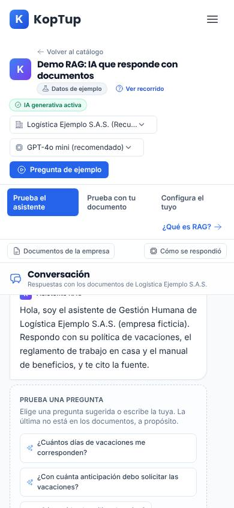

*Vista en un teléfono de 390 px después de la primera pregunta: la conversación ocupa casi toda la pantalla y arriba quedan las preguntas sugeridas, que se deslizan de lado.*

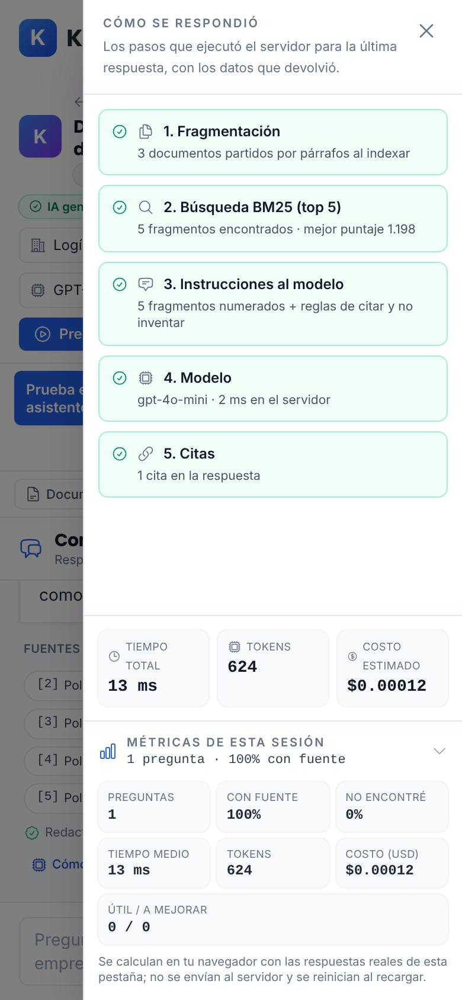

*Panel «Cómo se respondió» en un teléfono, con las métricas de la sesión abiertas.*

- Los documentos se abren con **Documentos de la empresa** y «Cómo se respondió» con el botón de la barra o con el que aparece debajo de cada respuesta. Ambos son paneles laterales que se cierran con la X, tocando fuera o con Escape.
- El panel de «Cómo se respondió» trae al pie las **métricas de esta sesión**.

**Comprobado** (pasada de claridad, 14 de octubre de 2026, con un build de producción propio, 1440 y 390 px): `/rag/salud` → «Probar la demo con una IPS de ejemplo» abre la IPS ya elegida y la pregunta de glosas cita el manual (1 de 5 fragmentos marcado «citado»); la pregunta fuera de los documentos de la firma de ejemplo responde «no encontré»; tras subir un PDF, «Listo, ya leí…» y «Preguntas: 0/10» quedan a la vista; el aviso de confidencialidad de «Configura el tuyo» se ve; «Solicitar demo guiada» abre `/contact` con el mensaje de demo guiada. Sin errores de consola ni de página. E2E `rag-upload`, `embed-chatbot` y la entrada de `/demo/chatbot` de `demos.spec.ts` en verde.

---

## Qué es real y qué es simulado

| Elemento | Real o simulado | Detalle |
|---|---|---|
| Empresas y documentos del modo «Prueba el asistente» | **Datos de ejemplo** | Cuatro empresas ficticias (recursos humanos, tienda, IPS y firma de abogados) con textos en español e inglés, definidos en el código de la demo. Los «Ejemplo ilustrativo» de `/rag/salud`, `/rag/legal` y `/rag/soporte` citan estos mismos documentos (una prueba de Jest lo comprueba). |
| Indexación | **Real** | Con la primera pregunta, el navegador pide al servidor el bot de ejemplo compartido de esa empresa (`POST /api/chatbot/sample-bots`). El servidor lo identifica por la huella de su contenido: el primer visitante lo crea e indexa y los siguientes lo reutilizan, sin crear bots nuevos. Si el servidor no ofrece esa ruta, el navegador crea su propio bot de ejemplo y lo reutiliza en sus siguientes visitas. |
| Búsqueda | **Real** | BM25 en el servidor; se envían los 5 mejores fragmentos. |
| Redacción de la respuesta | **Real** | Modelo de OpenAI (GPT-4o mini, GPT-4o o GPT-4 Turbo) con reglas de citar y no inventar. Sin clave de IA o sin presupuesto del mes, pasa a **modo extractivo**: muestra los fragmentos tal cual, precedidos de una nota que lo explica («Modo extractivo: la IA no está configurada…»), también en el widget de un cliente. |
| Citas, fuentes y puntajes | **Real** | Salen de la respuesta del servidor. |
| «Cómo se respondió», tokens y costo | **Real** | Datos de la respuesta; el tiempo total se mide en el navegador y el costo es una estimación del servidor en USD. |
| Métricas de esta sesión | **Real, solo local** | Se calculan en la pestaña con las respuestas reales; se borran al recargar. |
| Valoración útil / a mejorar | **Solo local, y lo dice** | Suma a las métricas de la sesión; la demo avisa que no se envía al servidor. |
| Preguntas de «Prueba el asistente» y de la vista previa | **No se guardan** | El servidor las usa para buscar y responder; no quedan en ningún historial. |
| Vista «Celular» del modo de ejemplo | **Simulado** | Es un marco visual del tamaño de un teléfono. |
| Prueba con tu documento | **Real** | API `/api/demo-rag`: el documento vive en memoria 1 hora; el email se registra como contacto. |
| Configura el tuyo | **Real** | Bot propio guardado en MongoDB, documentos TXT/MD/CSV/PDF/DOCX y páginas web públicas, widget real (`/widget.js` + `/embed/chatbot/<id>`), historial real (30 días) y exportación CSV. |

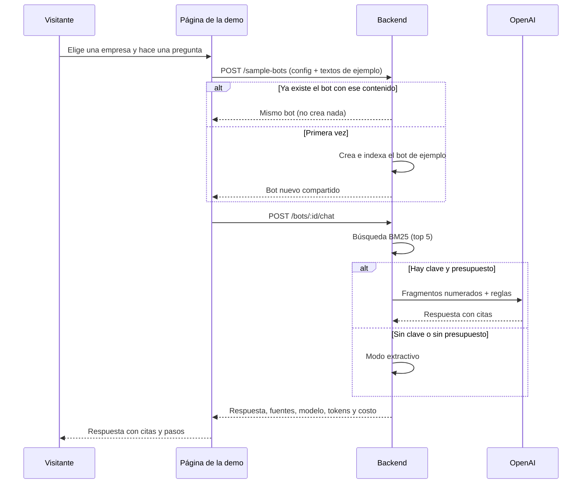

*Cómo viaja una pregunta del modo «Prueba el asistente».*

---

## Acceso

- **Cómo la ve un visitante:** la demo está en modo **Abierta** (`publico`): cualquiera entra a `/demo/chatbot` sin cuenta y sin pasar por la pantalla de acceso. El modo «Prueba con tu documento» es lo único que pide un dato (email + autorización).
- **Cómo se solicita:** no hace falta solicitarla. Si alguien quiere verla con su caso, usa «Pedir una demo guiada» (dentro de la demo), «Solicitar demo guiada» al pie de la página o «Pide una demo guiada» en «Prueba con tu documento»: todos abren `/contact?service=sistema-rag&motivo=demo-guiada` con el mensaje ya escrito. El cierre al pie de la página habla del piloto RAG: «Solicitar demo guiada», «Cotizar el piloto» (`/contact` con el servicio y el plan piloto ya elegidos) y «Ver planes y precios».
- **Cómo la controla el admin:** el modo de acceso sale del catálogo del servidor y se cambia en **Admin › Catálogo de demos** (`/admin/catalogo-demos`). Si un día se pasa a «Con solicitud» o «Solo por invitación», los visitantes verán la pantalla de acceso y los accesos se conceden en **Admin › Solicitudes de demo** y **Admin › Accesos a demos**. Los emails de «Prueba con tu documento» llegan a **Admin › Contactos**. Detalle en el [Manual del administrador](Doc-06-Manual-del-Administrador.md) y en [Flujos del visitante](Doc-04-Flujos-del-Visitante.md).

---

## Limitaciones conocidas

- **La búsqueda es por palabras (BM25), no por significado.** Si la pregunta usa sinónimos que no están en el documento, puede responder «no encontré». La demo lo advierte en «Qué incluye hoy», `/rag` lo explica en la pregunta frecuente «¿Entiende sinónimos?», y las preguntas sugeridas usan palabras de los documentos (una prueba de Jest comprueba que la pregunta «fuera de los documentos» de cada empresa no comparte palabras con ellos).
- **Límite de 30 bots nuevos por hora por IP** (configurable). Con los bots de ejemplo compartidos, «Prueba el asistente» ya no crea un bot por navegador: solo cuenta la primera vez que una empresa (en un idioma) se prepara en el servidor. El límite sí aplica a los bots de «Configura el tuyo» y a otras demos que crean bots (por ejemplo «Redactar con IA» del helpdesk). Cuando se alcanza, la demo dice la causa real y ofrece «Probar con tu documento».
- **La valoración útil / a mejorar no se guarda en el servidor.** La demo lo dice en el aviso y en el tooltip; se pierde al recargar.
- **Bots en la base de datos (MongoDB).** Sobreviven a reinicios y despliegues. Un bot de «Configura el tuyo» sin uso se borra a los 12 meses, con sus documentos y su historial, y desaparece de «Mis bots» con el aviso «ya no existe en el servidor». Los bots de ejemplo sin uso se borran a los 30 días y se vuelven a crear solos con la siguiente pregunta.
- **«Mis bots» depende del navegador.** La propiedad del bot va en un token guardado en este navegador; desde otro equipo el bot se ve en **solo lectura** (aviso «Este bot es de otro navegador») y no se pueden editar su configuración ni sus documentos ni ver sus conversaciones. La demo lo explica en el menú y en el aviso.
- **«Configura el tuyo» acepta archivos de hasta 2 MB y páginas web públicas, y cita por fragmento.** PDF y DOCX se leen por su texto (un PDF escaneado no sirve); de una página web se lee el HTML que entrega el servidor, así que una página que arma su contenido con JavaScript casi no trae texto. Para citas por página está «Prueba con tu documento», que tiene sus propios límites: 3 documentos al día por IP, 10 preguntas por documento y borrado a la hora.
- **Los textos que escribe el servidor sin modelo salen en español o inglés, nada más.** «No encontré esa información…» y las notas del modo extractivo siguen el idioma de la página de la demo; en el widget de un cliente, el primer idioma configurado del bot. Un bot en otro idioma recibe esos textos en español (el modelo, cuando hay clave, responde en el idioma de la pregunta).
- **Depende del servidor.** Si el backend no responde, la barra muestra «Servidor no disponible» y no se puede preparar el bot ni preguntar. En producción la demo solo funciona cuando el backend de Railway está arriba.
- **Botones:** en la revisión final (14 de octubre de 2026) la sonda automática hizo clic en todos los elementos visibles de los tres modos, en escritorio y a 390 px, con el navegador en español y en inglés y con el sitio en inglés (14 corridas), y **ninguno quedó sin efecto**: los únicos que marcó fueron la pestaña del modo que ya estaba abierto, los selectores nativos en el celular, y el ícono y la pestaña de código que ya estaban elegidos (comprobados a mano). Sin errores de página ni de hidratación (además, 96 cargas seguidas con el navegador y el sitio en español e inglés, en claro y oscuro). Los únicos registros de consola fueron respuestas 429 del límite de consultas por minuto por red, provocadas por la propia sonda al recargar la página decenas de veces por minuto desde la misma máquina. Desde la verificación final, ese límite es de 180 consultas por minuto (GET /models ya no cuenta) y las preguntas tienen su propio cupo de 60 por minuto; un 429 en «Conversaciones», al subir o quitar un documento o al agregar una página web dice «espera un minuto» en vez de un error genérico.
