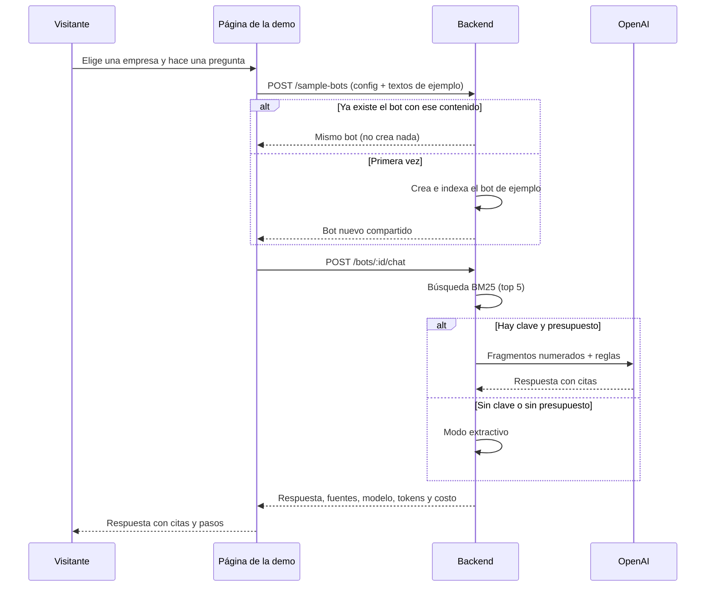

# Guía de la demo: Chatbot RAG con tus documentos

> Ruta `/demo/chatbot` · Modo de acceso: **Abierta** · Tipo: **IA real** (búsqueda y respuesta en el servidor; las empresas y sus documentos son de ejemplo) · Plan del producto: [Sistemas RAG (producto principal)](Producto-chatbot-rag-ia.md)

**Resumen.** Es la demo del producto principal de KopTup, pensada para empresas que quieren un asistente que responda con **sus propios documentos** (políticas, manuales, contratos). El asistente responde **solo con los documentos cargados**, cita la fuente de cada dato y dice «no encontré» cuando la respuesta no está. Tiene tres modos: **Prueba el asistente** (tres empresas ficticias, sin registro), **Prueba con tu documento** (tu PDF, DOCX o TXT, con email) y **Configura el tuyo** (tu propio bot con su widget y código para insertar). Sirve para que un gerente vea en 5 minutos qué es un sistema RAG y para que un desarrollador vea el pipeline real paso a paso.

**Contenido:** [Recorrido sugerido](#recorrido-sugerido-demo-comercial-de-5-minutos) · [Pantallas y funciones](#pantallas-y-funciones) · [Qué es real y qué es simulado](#qué-es-real-y-qué-es-simulado) · [Acceso](#acceso) · [Limitaciones conocidas](#limitaciones-conocidas)

*Modo «Prueba el asistente» con una respuesta: documentos a la izquierda, conversación con citas al centro y «Cómo se respondió» a la derecha.*

> **Sobre las capturas:** el texto de las respuestas lo produjo el modelo simulado del entorno de pruebas (por eso empieza con «Respuesta simulada…»). Con la clave real de OpenAI lo redacta el modelo elegido. La búsqueda, las citas, los fragmentos, los pasos y las métricas que ves sí son el comportamiento real del código.

---

## Recorrido sugerido (demo comercial de 5 minutos)

*Los ocho momentos del recorrido, en orden.*

La primera visita abre un recorrido de 5 pasos; se puede volver a ver con **Ver recorrido** (junto al título).

### Paso 1 · Elige la empresa de ejemplo (≈ 30 s)

*Barra superior del modo «Prueba el asistente» y documentos de la empresa elegida.*

1. **Estado de la IA**: lo consulta al servidor al abrir la página (`GET /api/chatbot/models`). «IA generativa activa» significa que hay clave de OpenAI; si no, dice «Modo extractivo (sin clave de IA)» o «Servidor no disponible».
2. **Empresa de ejemplo**: tres empresas ficticias, cada una con sus documentos: *Logística Ejemplo S.A.S.* (recursos humanos, Bogotá), *Hogar Ejemplo Tienda en Línea* (servicio al cliente, Medellín) e *IPS Ejemplo Salud* (salud, Cali). Elige la que se parezca al cliente.
3. **Modelo**: GPT-4o mini (recomendado), GPT-4o o GPT-4 Turbo. El servidor solo acepta esos tres. La marca «requiere clave de API» aparece solo si el servidor dice que no tiene clave.
4. **Pregunta de ejemplo**: envía la siguiente pregunta sugerida que aún no se ha hecho.
5. **Documentos de la empresa**: lo único que consulta el asistente. Al abrir la página no se crea nada en el servidor; dice «3 documentos de ejemplo: se preparan en el servidor con tu primera pregunta». Con la primera pregunta el servidor prepara el **bot de ejemplo compartido** de esa empresa (el primer visitante lo crea e indexa; los demás lo reutilizan) y pasa a «3 documentos indexados en el servidor». Clic en un documento para leerlo completo.
6. **Ver recorrido**: vuelve a abrir el recorrido de bienvenida.

**Qué decir:** «Esto es lo único que consulta el asistente: tres documentos internos. Lo que no esté aquí, no lo va a inventar».

### Paso 2 · Haz una pregunta sugerida (≈ 1 min)

*Respuesta a «¿Cuántos días de vacaciones me corresponden?» con sus citas y los cinco pasos que ejecutó el servidor.*

1. **Cita [1]** dentro del texto: al pasar el mouse muestra el fragmento; al hacer clic lo abre completo.
2. **Fuentes**: los fragmentos que el servidor encontró (hasta 5), con el nombre del documento.
3. **Quién la redactó**: «Redactada por gpt-4o-mini con 5 fragmentos» (o «Modo extractivo…» si no hubo modelo). Al lado están «Respuesta útil» (pulgar arriba), «Respuesta a mejorar» (pulgar abajo) y «Volver a preguntar».
4. **Cómo se respondió**: los pasos reales de la última respuesta: 1) fragmentación, 2) búsqueda BM25 (top 5) con el mejor puntaje, 3) instrucciones al modelo, 4) modelo y milisegundos en el servidor, 5) citas. Abajo: tiempo total medido en tu navegador, tokens y costo (USD) estimado por el servidor. Los números van con el formato del idioma (en español, «1,198» y «1.023»).

### Paso 3 · Abre la fuente (≈ 1 min)

*Panel «Fragmento citado» que se abre al hacer clic en una cita.*

1. **Puntaje BM25**: qué tanto coinciden las palabras de la pregunta con ese fragmento (más alto = más relevante).
2. **Ver documento completo**: abre el documento con el fragmento citado resaltado.

*Visor del documento de ejemplo: el párrafo citado aparece resaltado y se aclara que el documento es ficticio. Escape o la X lo cierran.*

**Qué decir:** «Cada dato se puede auditar: el usuario ve de qué párrafo salió».

### Paso 4 · Pregunta algo que no esté (≈ 1 min)

*La última pregunta sugerida está fuera de los documentos a propósito.*

1. **Pregunta fuera de los documentos**: va marcada con borde punteado y la nota «no está en los documentos» (por ejemplo «¿Cuánto gana el gerente general?»).
2. **No inventa**: debajo de la respuesta aparece «No está en los documentos: el asistente no inventa una respuesta».
3. **Paso 2 en ámbar**: «Ningún fragmento coincide con las palabras de la pregunta»; el paso 5 dice «Respuesta «no encontré»: sin citas».
4. **Métricas de esta sesión**: al pie de «Cómo se respondió». Muestra preguntas, con fuente, «no encontré», tiempo medio, tokens, costo (USD) y valoraciones. Se calculan en tu navegador con las respuestas reales de la pestaña, no se envían al servidor y se reinician al recargar.

### Paso 5 · Llévalo a su caso (≈ 1 min 30 s)

*Pestañas de modo debajo de la barra superior.*

1. **Prueba el asistente**: lo que acabas de mostrar.
2. **Prueba con tu documento**: el prospecto sube su propio PDF, DOCX o TXT (ver [más abajo](#prueba-con-tu-documento)).
3. **Configura el tuyo**: crea su bot, le sube documentos, lo prueba con el widget real y copia el código para su web (ver [más abajo](#configura-el-tuyo)).
4. **Sistemas RAG para empresas**: lleva a la landing `/rag`.

Para cerrar: el recuadro **«¿Lo quieres con los documentos de tu empresa?» → Solicitar demo guiada** (columna de documentos, abre `/solicitar-demo?demos=chatbot`) o el cierre de la página (Solicitar demo guiada, Solicitar cotización, Ver planes y precios).

---

## Pantallas y funciones

### Barra superior

- **Volver al catálogo**: enlace a `/demo`.
- **Título y subtítulo**: qué es, para quién y qué hace («Para empresas que quieren un asistente que responda con sus propios documentos…»). El subtítulo se oculta en el celular.
- **Rótulo «Datos de ejemplo»**: el tooltip aclara que las empresas y documentos son ficticios, pero las respuestas las genera el servidor real.
- **Ver recorrido**: vuelve a abrir el recorrido de 5 pasos (si estás en otro modo, primero cambia a «Prueba el asistente»). «Saltar recorrido», «Empezar» o Escape lo cierran y queda guardado en el navegador.
- **Escritorio / Celular**: cambia el marco de la conversación para ver cómo se vería en un teléfono (solo en pantallas medianas o grandes).
- **Enlace de la URL**: el modo queda en la dirección (`?mode=upload` o `?mode=builder`), así puedes compartir el enlace directo a un modo.

### Prueba el asistente

| Zona | Qué puedes hacer | Qué pasa |
|---|---|---|
| Documentos de la empresa | Clic en un documento | Se abre el visor con el texto completo (ficticio). |
| Qué incluye hoy | Clic en una capacidad | Se abre un panel con el detalle de lo que existe en el código (ver captura abajo). |
| Recuadro de demo guiada | «Solicitar demo guiada» | Abre `/solicitar-demo?demos=chatbot`. |
| Conversación | Escribir y pulsar Enter, o elegir una pregunta sugerida | La pregunta va al servidor; la respuesta trae citas y fuentes. Mientras prepara el bot dice «Indexando los documentos de la empresa…». Debajo de la caja: «Las preguntas de este modo no se guardan». |
| Respuesta | «Respuesta útil» / «Respuesta a mejorar» | Marca la respuesta y suma a las métricas de la sesión. El aviso dice «Anotado en las métricas de esta sesión. Tu valoración no se envía al servidor.»; al quitarla, «Valoración quitada…». |
| Respuesta | «Volver a preguntar» | Reenvía la misma pregunta y reemplaza la respuesta. |
| Cita o fuente | Clic | Abre «Fragmento citado» con documento, posición, puntaje BM25 y texto exacto. |
| Botones «Documentos de la empresa» / «Cómo se respondió» | Clic | En escritorio ocultan o muestran las columnas; en celular y tableta abren paneles laterales (Escape o la X los cierran). |

*Detalle de «Búsqueda por palabras (BM25)» en «Qué incluye hoy». Las siete capacidades: carga de documentos, fragmentación, búsqueda BM25, respuesta con citas, modelos de OpenAI, widget para tu sitio e historial de conversaciones.*

Debajo de la lista, la demo aclara que en un proyecto se construyen además conectores (Google Drive, SharePoint), WhatsApp, permisos por rol y panel de métricas, con enlace a «Ver planes RAG» (`/services#planes-rag`). Esas piezas **no** están en la demo.

#### Si el servidor no puede preparar el bot

*Mensaje cuando el servidor limita la creación de asistentes desde una misma red.*

Cada error dice su causa real, en la columna de documentos y en la respuesta:

- **Límite de creación (429)**: «Desde tu red se crearon muchos asistentes en la última hora y el servidor pausó la creación de nuevos. Intenta de nuevo más tarde (el límite se renueva cada hora) o prueba con tu documento», con los botones «Reintentar» y «Probar con tu documento». Con los bots de ejemplo compartidos solo puede pasar si esa empresa todavía no tiene su bot en el servidor.
- **Demasiadas preguntas seguidas (429 del chat)**: pide esperar un minuto.
- **Capacidad de la demo** o **servidor no disponible (503)**: lo dice así.
- **Sin conexión**: solo cuando de verdad no hubo respuesta del servidor dice «Revisa tu conexión».

### Prueba con tu documento

*Formulario con un PDF de prueba de una empresa ficticia, el email y la autorización de datos.*

- Pide **solo** el archivo (PDF, DOCX o TXT, hasta 5 MB y 30 páginas), el **email** y la casilla de **autorización de datos (Ley 1581 de 2012)** con enlace a la política de privacidad. Si falta algo lo dice («Elige un documento para subir.», «Escribe un email válido.», «…debes autorizar el tratamiento de tus datos personales»).
- Muestra el aviso «No subas información confidencial en la demo» y los límites: 10 preguntas por documento y 3 documentos al día.
- Al subir, el servidor procesa el documento **solo en memoria** y lo borra a la hora. El email queda registrado como contacto con origen `demo-rag` (el mismo canal del formulario de contacto), para que el equipo comercial pueda escribirle.
- Si la función está apagada o se acabó el cupo del mes, muestra «La prueba con tu documento no está disponible en este momento» (o «Alcanzamos el cupo de pruebas de este mes») con «Agenda una demo con nosotros» (`/solicitar-demo?demos=chatbot`) y «Usar la demo con el documento de ejemplo».

*Chat sobre un PDF de 3 páginas: contador, aviso de borrado, botón para subir otro y fuente con la página.*

1. **Contador** «Preguntas: 2/10».
2. **Aviso de borrado**: «Tu documento se borra automáticamente en 1 hora (a las …)».
3. **Subir otro documento**: borra el actual y vuelve al formulario.
4. **Fuentes**: en PDF cita la página (`p. 2`); en DOCX y TXT, el fragmento (`fragmento 2`), con el extracto.

Trae tres preguntas sugeridas («¿De qué trata el documento?», «¿Qué fechas o plazos menciona?», «¿Qué requisitos u obligaciones establece?»). Al llegar a 10 preguntas dice «Usaste las 10 preguntas de este documento», deshabilita la caja e invita a «Agenda una demo con nosotros». El chat tiene altura fija: el contador y la caja de preguntas quedan siempre a la vista.

**Comprobado de punta a punta** (14 de octubre de 2026): un PDF real de 3 páginas («Reglamento interno», empresa ficticia) citó la página 2 para la pregunta del crédito y llegó a 10/10 con la caja deshabilitada; un DOCX real citó «fragmento 2» con el texto de la garantía.

### Configura el tuyo

*Bot «Asistente de Distribuidora Andina» (empresa ficticia) guardado, con el widget real abierto en el sitio de ejemplo.*

Arriba, la demo dice dónde queda cada cosa: «Tu bot y sus documentos se guardan en el servidor; un bot sin uso durante 12 meses se borra. Lo que le pregunten por «Abrir chat» o por el widget en tu sitio queda en «Conversaciones» y se borra solo a los 30 días; las preguntas de la vista previa no se guardan.»

1. **Mis bots**: los bots que este navegador puede editar. El menú explica que se guardan en el servidor y que el navegador tiene la llave para editarlos (desde otro equipo no aparecen). Permite cargar uno, crear uno nuevo o eliminarlo (con confirmación dentro de la página).
2. **Guardar bot**: crea o actualiza el bot en el servidor. Al lado aparecen el ID, «Copiar enlace del chat» y «Abrir chat» (página pública `/embed/chatbot/<id>`). Si el servidor no puede guardarlo, el aviso dice la causa real: límite de bots nuevos por hora desde tu red, capacidad de la demo, servidor no disponible o sin conexión.
3. **Configuración**: nombre, bienvenida, color, posición del botón (4 esquinas), ícono, instrucciones y tono (Profesional, Amigable, Técnico, Cercano).
4. **Vista previa**: el **widget real** (el mismo `widget.js` que se pega en otro sitio) conversando con el servidor. Tiene tres vistas: «Sitio web», «Celular» y «Enlace directo». Sin guardar, solo muestra la apariencia y pide guardar para conversar.
5. **Código para tu sitio**: dos pestañas, «Botón flotante (script)» e «Iframe», con «Copiar» y la nota de CSP.

*Parte baja de «Configura el tuyo»: documentos del bot y su historial de conversaciones.*

1. **Documentos subidos**: TXT, MD, CSV, **PDF o DOCX** de hasta 2 MB (arrastrar o elegir); cada uno se puede quitar. Si el bot aún no existe, subir un archivo lo guarda primero. Si un archivo no se puede leer (por ejemplo, un PDF escaneado sin texto), lo dice con su nombre y sube los demás. Las citas del bot muestran el documento y el fragmento, no la página.
2. **Cargar documentos de ejemplo**: sube los documentos de una de las tres empresas ficticias.
3. **Conversaciones**: lo que le preguntan al bot por «Abrir chat» o por el widget en otro sitio (las preguntas de la vista previa no se guardan), con preguntas, «con fuente» y «no encontré»; «Actualizar», «Exportar CSV» y «Borrar historial» (pide confirmación; Escape la cancela). Cada pregunta se borra sola a los 30 días.

**Comprobado de punta a punta** (14 de octubre de 2026): bot creado, un TXT, un PDF y un DOCX indexados (un PDF sin texto se informó), pregunta en la vista previa con el widget real (con fuentes, no quedó en el historial), pregunta por «Abrir chat» (sí quedó), CSV descargado, código copiado, historial borrado y bot eliminado del servidor.

### En el celular

*Vista en un teléfono de 390 px: la barra se apila y la conversación ocupa casi toda la pantalla al bajar.*

*Panel «Cómo se respondió» en un teléfono, con las métricas de la sesión abiertas.*

- Los documentos se abren con **Documentos de la empresa** y «Cómo se respondió» con el botón de la barra o con el que aparece debajo de cada respuesta. Ambos son paneles laterales que se cierran con la X, tocando fuera o con Escape.
- El panel de «Cómo se respondió» trae al pie las **métricas de esta sesión**.

---

## Qué es real y qué es simulado

| Elemento | Real o simulado | Detalle |
|---|---|---|
| Empresas y documentos del modo «Prueba el asistente» | **Datos de ejemplo** | Tres empresas ficticias con textos en español e inglés, definidos en el código de la demo. |
| Indexación | **Real** | Con la primera pregunta, el navegador pide al servidor el bot de ejemplo compartido de esa empresa (`POST /api/chatbot/sample-bots`). El servidor lo identifica por la huella de su contenido: el primer visitante lo crea e indexa y los siguientes lo reutilizan, sin crear bots nuevos. Si el servidor no ofrece esa ruta, el navegador crea su propio bot de ejemplo y lo reutiliza en sus siguientes visitas. |
| Búsqueda | **Real** | BM25 en el servidor; se envían los 5 mejores fragmentos. |
| Redacción de la respuesta | **Real** | Modelo de OpenAI (GPT-4o mini, GPT-4o o GPT-4 Turbo) con reglas de citar y no inventar. Sin clave de IA o sin presupuesto del mes, pasa a **modo extractivo** (muestra los fragmentos tal cual). |
| Citas, fuentes y puntajes | **Real** | Salen de la respuesta del servidor. |
| «Cómo se respondió», tokens y costo | **Real** | Datos de la respuesta; el tiempo total se mide en el navegador y el costo es una estimación del servidor en USD. |
| Métricas de esta sesión | **Real, solo local** | Se calculan en la pestaña con las respuestas reales; se borran al recargar. |
| Valoración útil / a mejorar | **Solo local, y lo dice** | Suma a las métricas de la sesión; la demo avisa que no se envía al servidor. |
| Preguntas de «Prueba el asistente» y de la vista previa | **No se guardan** | El servidor las usa para buscar y responder; no quedan en ningún historial. |
| Vista «Celular» del modo de ejemplo | **Simulado** | Es un marco visual del tamaño de un teléfono. |
| Prueba con tu documento | **Real** | API `/api/demo-rag`: el documento vive en memoria 1 hora; el email se registra como contacto. |
| Configura el tuyo | **Real** | Bot propio guardado en MongoDB, documentos TXT/MD/CSV/PDF/DOCX, widget real (`/widget.js` + `/embed/chatbot/<id>`), historial real (30 días) y exportación CSV. |

*Cómo viaja una pregunta del modo «Prueba el asistente».*

---

## Acceso

- **Cómo la ve un visitante:** la demo está en modo **Abierta** (`publico`): cualquiera entra a `/demo/chatbot` sin cuenta y sin pasar por la pantalla de acceso. El modo «Prueba con tu documento» es lo único que pide un dato (email + autorización).
- **Cómo se solicita:** no hace falta solicitarla. Si alguien quiere verla con su caso, usa «Solicitar demo guiada» (dentro de la demo o al pie de la página), «Agenda una demo con nosotros» en «Prueba con tu documento» o «Solicitar demo» del menú.
- **Cómo la controla el admin:** el modo de acceso sale del catálogo del servidor y se cambia en **Admin › Catálogo de demos** (`/admin/catalogo-demos`). Si un día se pasa a «Con solicitud» o «Solo por invitación», los visitantes verán la pantalla de acceso y los accesos se conceden en **Admin › Solicitudes de demo** y **Admin › Accesos a demos**. Los emails de «Prueba con tu documento» llegan a **Admin › Contactos**. Detalle en el [Manual del administrador](Doc-06-Manual-del-Administrador.md) y en [Flujos del visitante](Doc-04-Flujos-del-Visitante.md).

---

## Limitaciones conocidas

- **La búsqueda es por palabras (BM25), no por significado.** Si la pregunta usa sinónimos que no están en el documento, puede responder «no encontré». La demo lo advierte en «Qué incluye hoy», y las preguntas sugeridas usan palabras de los documentos.
- **Límite de 30 bots nuevos por hora por IP** (configurable). Con los bots de ejemplo compartidos, «Prueba el asistente» ya no crea un bot por navegador: solo cuenta la primera vez que una empresa (en un idioma) se prepara en el servidor. El límite sí aplica a los bots de «Configura el tuyo» y a otras demos que crean bots (por ejemplo «Redactar con IA» del helpdesk). Cuando se alcanza, la demo dice la causa real y ofrece «Probar con tu documento».
- **El chat insertado (`/embed/chatbot/<id>`) todavía muestra «No pudimos conectar con el servidor» ante cualquier error**, también si la causa es un límite de preguntas o el servidor caído. Corregirlo es de la pista de plataforma (la página está fuera de la carpeta de la demo; los textos ya existen en la demo).
- **La valoración útil / a mejorar no se guarda en el servidor.** La demo lo dice en el aviso y en el tooltip; se pierde al recargar.
- **Bots en la base de datos (MongoDB).** Sobreviven a reinicios y despliegues. Un bot de «Configura el tuyo» sin uso se borra a los 12 meses, con sus documentos y su historial, y desaparece de «Mis bots» con el aviso «ya no existe en el servidor». Los bots de ejemplo sin uso se borran a los 30 días y se vuelven a crear solos con la siguiente pregunta.
- **«Mis bots» depende del navegador.** La propiedad del bot va en un token guardado en este navegador; desde otro equipo no se puede editar el bot ni ver sus conversaciones («Solo el dueño del bot puede ver sus conversaciones»). La demo lo explica en el menú.
- **«Configura el tuyo» acepta archivos de hasta 2 MB y cita por fragmento.** PDF y DOCX se leen por su texto (un PDF escaneado no sirve); para citas por página está «Prueba con tu documento», que tiene sus propios límites: 3 documentos al día por IP, 10 preguntas por documento y borrado a la hora.
- **Depende del servidor.** Si el backend no responde, la barra muestra «Servidor no disponible» y no se puede preparar el bot ni preguntar. En producción la demo solo funciona cuando el backend de Railway está arriba.
- **Botones:** la sonda automática (14 de octubre de 2026) hizo clic en todos los elementos visibles de los tres modos, en escritorio, a 390 px, con el navegador en inglés y con el sitio en inglés, y **ninguno quedó sin efecto**: los únicos que marcó fueron la pestaña del modo que ya estaba abierto, los selectores nativos en el celular (se comprobaron a mano) y un ícono del bot que la sonda confundió al cambiar el orden de los botones tras guardar (también comprobado). Sin errores de consola ni de hidratación (24 cargas con el navegador en español e inglés).
