# Guía de la demo: CRM con IA

> Ruta `/demo/crm-ia` · Modo de acceso: **Abierta** · Tipo: **datos de ejemplo** con una función de **IA real** (todo corre en el navegador, salvo «Mejorar con IA» del asistente, que llama al backend) · Plan del producto: [CRM con IA](Producto-crm-ia.md)

**Resumen.** Es el CRM de una empresa de logística ficticia (Logística Quindara S.A.S.) con 20 negocios de ejemplo (13 abiertos, 4 ganados y 3 perdidos) repartidos entre tres vendedores. Responde a «a quién llamar hoy, qué decirle y cuánto vas a facturar»: un embudo que se arrastra, un puntaje de cada contacto explicado factor por factor, el pronóstico en pesos frente a la meta del mes y del trimestre, borradores de WhatsApp y correo, análisis de llamadas de ejemplo y una secuencia de seguimiento. Está pensada para gerentes comerciales y equipos de venta B2B en Colombia que hoy llevan sus clientes en Excel y WhatsApp. El puntaje sale de reglas y los borradores de plantillas (la demo lo dice en el encabezado); el botón **Mejorar con IA** del asistente sí envía el borrador a un modelo de lenguaje real a través del backend de KopTup, con tope de gasto y cupo por conexión. Los cambios se guardan solo en el navegador de quien la usa. Al entrar, un **recorrido sugerido de 5 pasos** dice por dónde empezar y se marca solo a medida que lo haces.

**En esta página:** [Recorrido sugerido](#recorrido-sugerido-demo-comercial-de-5-minutos) · [Pantallas y funciones](#pantallas-y-funciones) · [Qué es real y qué es simulado](#qué-es-real-y-qué-es-simulado) · [Acceso](#acceso) · [Limitaciones conocidas](#limitaciones-conocidas)

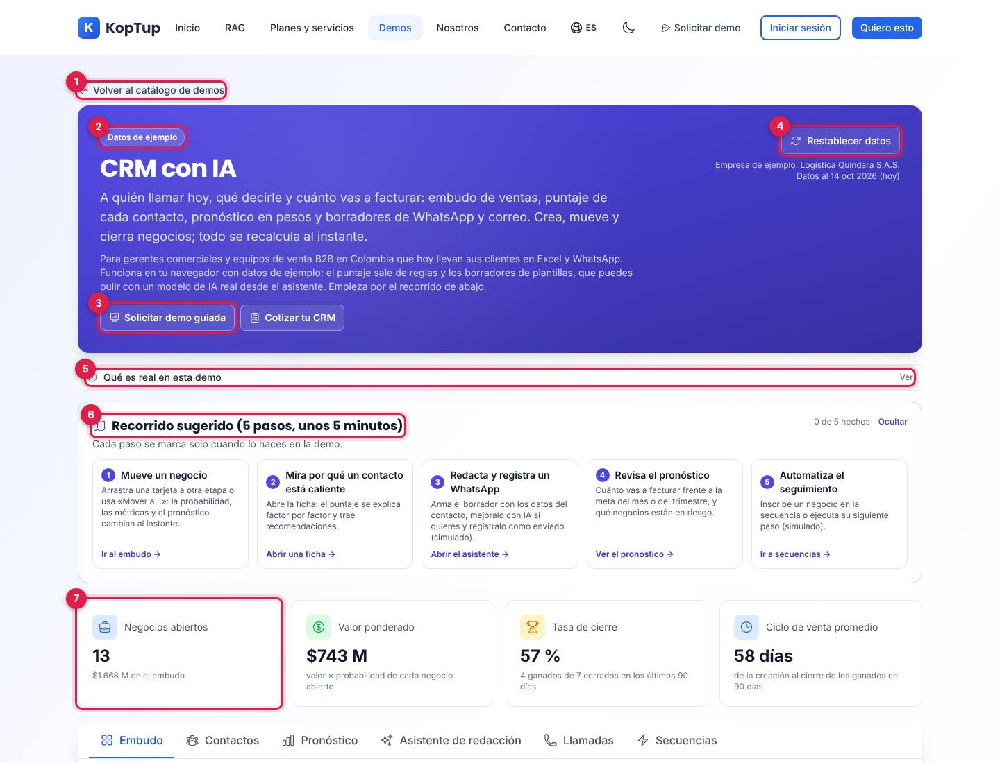

*Lo primero que ve cualquier visitante: el encabezado con qué es, para quién y las salidas, y debajo el recorrido sugerido y las métricas.*

1. **Volver al catálogo de demos** (`/demo`).
2. **Datos de ejemplo**: al pasar el mouse dice que la empresa, las personas, los NIT, los correos, los teléfonos y las cifras son inventados. Debajo del título, una línea dice para quién es y que el puntaje sale de reglas y los borradores de plantillas, que se pueden pulir con un modelo de IA real desde el asistente.
3. **Solicitar demo guiada** (`/solicitar-demo?demos=crm-ia`, con esta demo ya elegida) y **Cotizar tu CRM** (`/contact?service=crm-ia`, con «CRM con IA» prellenado).
4. **Restablecer datos** (pide confirmación en una ventana), la empresa de ejemplo y la fecha de los datos: «Datos al 14 oct 2026 (hoy)».
5. **Qué es real en esta demo**: desplegable con lo que se calcula de verdad, cómo funcionan las fechas, lo simulado y lo que cambia en un proyecto.
6. **Recorrido sugerido (5 pasos, unos 5 minutos)**: cada tarjeta tiene su botón (cambia de pestaña o abre la ficha o el asistente), se marca «Hecho» sola y arriba lleva la cuenta «n de 5 hechos». **Ocultar** lo pliega (el navegador lo recuerda). En el celular cada paso muestra solo el título y el botón.
7. **Las cuatro métricas** del embudo (ver [Encabezado y métricas](#encabezado-y-métricas)).

Al final de la página está el cierre común de las demos (demo guiada, cotización y planes).

> **Sobre las fechas y las cifras de las capturas.** La fecha de corte de la demo es **hoy en Colombia**: los datos de ejemplo se corren para que «ayer», «hace 3 días», los vencimientos y el periodo del pronóstico tengan sentido el día que la abras. Las capturas son del 14 de octubre de 2026; otro día cambian las fechas, los nombres de los meses y, al cambiar de mes o de trimestre, lo que cae en cada periodo del pronóstico.

---

## Recorrido sugerido (demo comercial de 5 minutos)

La idea que vende: «a quién llamar hoy, qué decirle y cuánto vas a facturar». Los 5 pasos de esta guía son las 5 tarjetas del recorrido de la demo, en el mismo orden, así que el prospecto puede seguirlo solo. Empieza con los datos limpios: si alguien ya usó la demo en ese navegador, pulsa **Restablecer datos** › **Sí, restablecer**; el recorrido vuelve a «0 de 5 hechos».

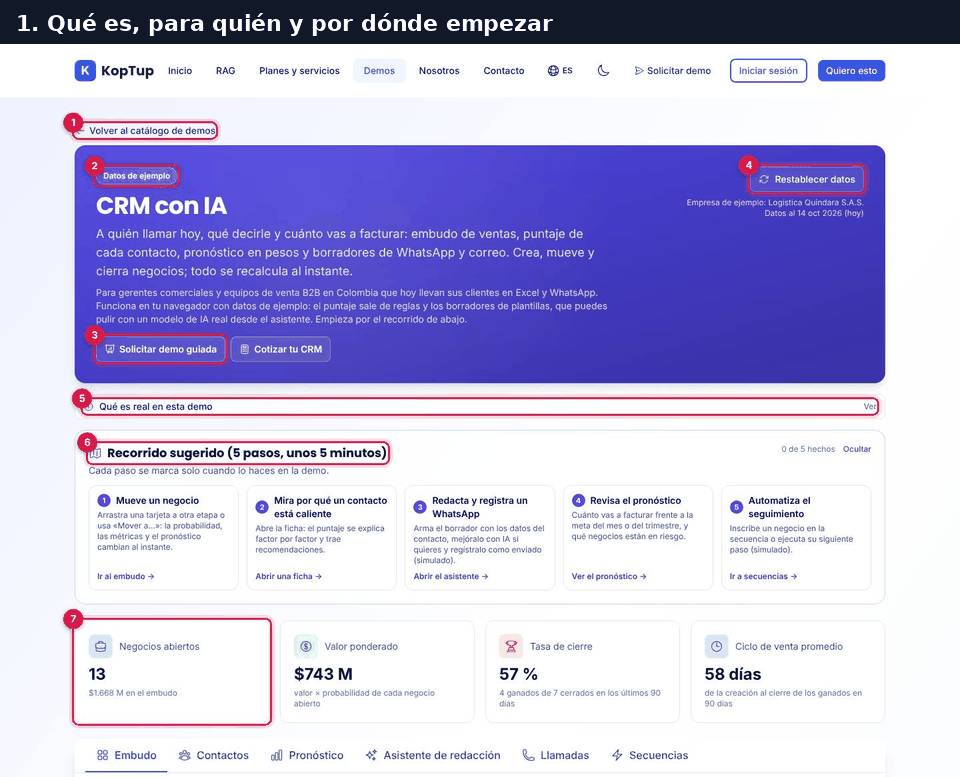

*Recorrido completo: encabezado, embudo, ficha, borrador, negocio ganado, pronóstico, secuencia y cierre del recorrido.*

### Paso 1. Mueve un negocio

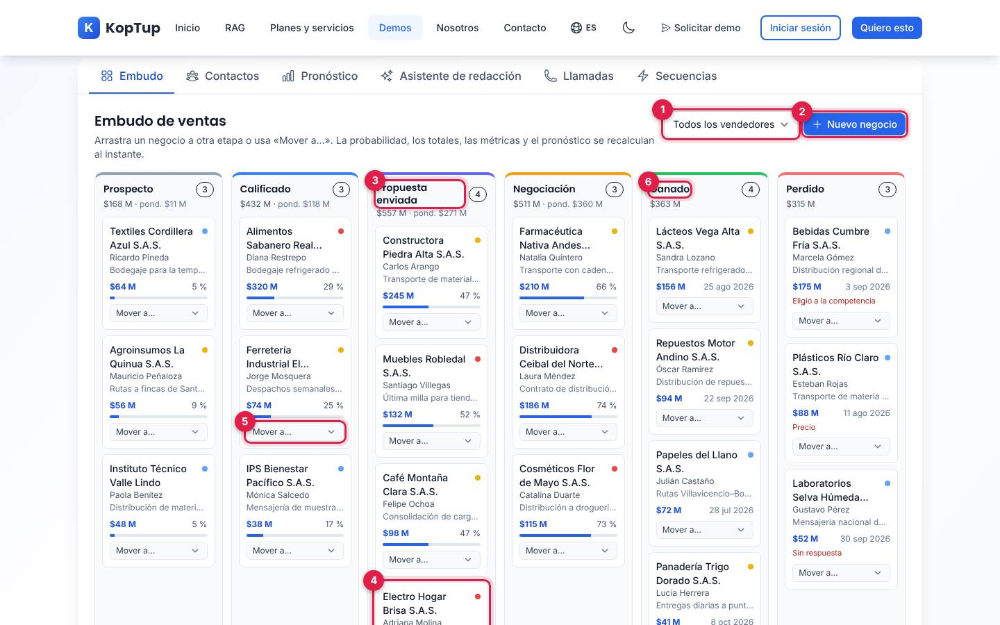

*Pestaña Embudo después de pasar Electro Hogar Brisa de Calificado a Propuesta enviada con «Mover a…».*

1. **Filtrar por vendedor**: todos, Valentina Ríos, Andrés Cárdenas o Juliana Ospina.
2. **Nuevo negocio**: abre el formulario (ver [Nuevo negocio](#nuevo-negocio)).
3. **Encabezado de la etapa**: cuántos negocios hay, cuánto suman y su valor ponderado («pond.»). Propuesta enviada pasó a 4 negocios y $557 M.
4. **La tarjeta movida**: empresa, contacto, nombre del negocio, valor, probabilidad de cierre y su barra. El punto de color es la temperatura: rojo = caliente (puntaje de 75 o más), amarillo = tibio (50 a 74), azul = frío (menos de 50). Un clic abre la ficha.
5. **Mover a…**: cambia la etapa sin arrastrar (es la forma cómoda en el celular y con teclado).
6. **Ganado** y **Perdido**: arrastra una tarjeta aquí para cerrar el negocio. En estas columnas la tarjeta muestra la fecha de cierre y, si se perdió, el motivo.

Qué decir: «Cada vez que mueves un negocio, la probabilidad, las métricas y el pronóstico se recalculan al instante».

### Paso 2. Mira por qué un contacto está caliente

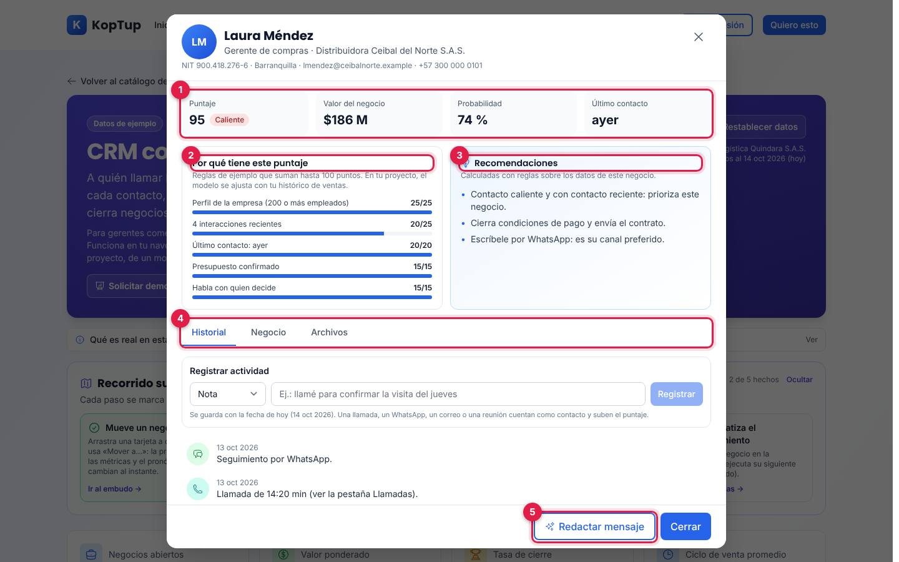

*Ficha de Laura Méndez (Distribuidora Ceibal del Norte S.A.S.), abierta con «Abrir una ficha» del recorrido.*

1. **Puntaje, valor, probabilidad y último contacto**: 95 (Caliente), $186 M, 74 % y «ayer».
2. **Por qué tiene este puntaje**: cinco factores que suman hasta 100 puntos: perfil de la empresa por tamaño (hasta 25), interacciones de los últimos 30 días (5 puntos cada una, hasta 25), qué tan reciente fue el último contacto (hasta 20), presupuesto confirmado (15) y si habla con quien decide (15).
3. **Recomendaciones**: salen de reglas sobre el negocio (contacto reciente, presupuesto, quién decide, siguiente paso de la etapa y canal preferido).
4. **Historial · Negocio · Archivos**: registrar una actividad y ver la línea de tiempo; ver y **editar los datos** del negocio o cambiar la etapa; descargar la cotización en PDF. Las pestañas se recorren con las flechas del teclado.
5. **Redactar mensaje**: cierra la ficha y abre el asistente con este contacto ya elegido.

Qué decir: «El puntaje no es una caja negra: el vendedor ve por qué un cliente está caliente».

### Paso 3. Redacta y registra un WhatsApp

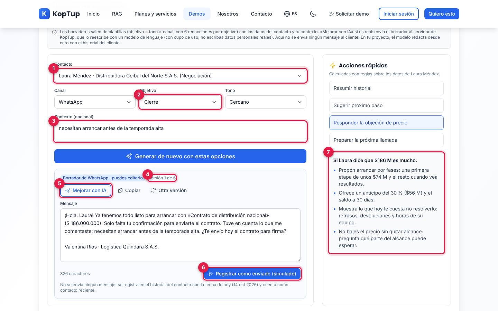

*Asistente de redacción con un borrador de WhatsApp de cierre en tono Cercano, el botón «Mejorar con IA» y la respuesta a la objeción de precio.*

1. **Contacto**: llega elegido desde la ficha; se puede cambiar.
2. **Canal, objetivo y tono**: WhatsApp o Correo; Primer contacto, Seguimiento, Enviar propuesta, Reactivar o Cierre; Profesional, Cercano, Directo o Consultivo. Al elegir un contacto, la demo propone su canal y un objetivo según la etapa (aquí, Cierre).
3. **Contexto (opcional)**: una frase que el borrador incluye («necesitan arrancar antes de la temporada alta» queda como «Tuve en cuenta lo que me comentaste: …»).
4. **Borrador editable** con «Versión 1 de 6»: usa el nombre, el negocio, el valor y el vendedor. **Otra versión** recorre 6 redacciones distintas por objetivo (3 cuerpos × 2 cierres) y vuelve a la primera. También tiene **Copiar** y el contador de caracteres; en correo agrega el asunto.
5. **Mejorar con IA**: es la parte con **IA real**. Envía el texto del borrador al backend de KopTup (`POST /api/content/improve`, el mismo servicio del gestor de contenido), que lo reescribe con un modelo de lenguaje y lo devuelve en el mismo cuadro. Mientras trabaja dice «Mejorando…»; al terminar aparece «Redacción mejorada por un modelo de IA real. Revísala antes de usarla.» con **Deshacer**, que recupera el texto de la plantilla. «Otra versión» o cambiar de contacto descartan la mejora. Si el servidor no responde, no tiene clave del modelo, se agotó el cupo mensual o se llegó al límite por conexión, muestra un aviso en rojo y el borrador de plantilla queda intacto.
6. **Registrar como enviado (simulado)**: no envía nada; deja el mensaje en el historial con la fecha de hoy y cuenta como contacto reciente (sube el puntaje). Marca el paso 3 del recorrido.
7. **Acciones rápidas**: Resumir historial, Sugerir próximo paso, Responder la objeción de precio (fases, anticipo del 30 %, costo de no resolverlo) y Preparar la próxima llamada. Son reglas sobre los datos del contacto, no IA.

Qué decir, con honestidad: «El borrador sale de plantillas y "Mejorar con IA" lo pule con un modelo de lenguaje real; en tu proyecto el modelo lo redacta desde cero con el historial del cliente». La nota gris de la pestaña lo dice.

### Paso 4. Gana el negocio y revisa el pronóstico

Antes de abrir el pronóstico, vuelve al embudo y arrastra Distribuidora Ceibal del Norte a **Ganado**:

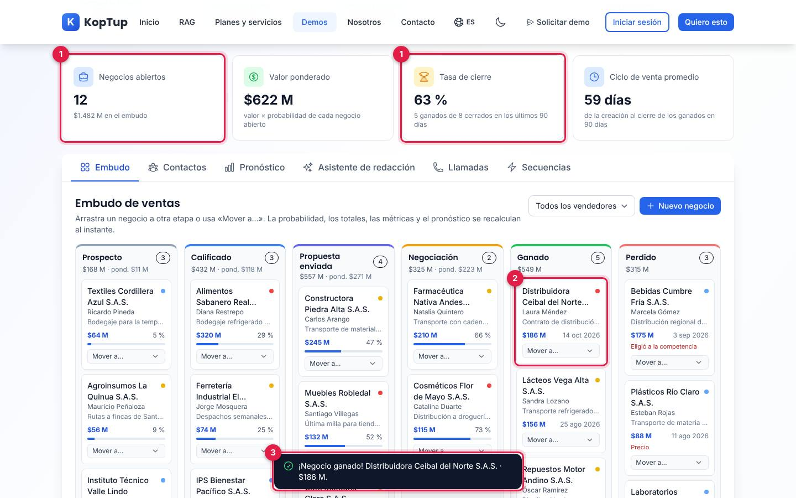

*Después de arrastrar Distribuidora Ceibal del Norte a Ganado.*

1. **Las métricas cambian**: negocios abiertos de 13 a 12 ($1.482 M en el embudo), tasa de cierre de 57 % a 63 % (5 ganados de 8 cerrados) y ciclo de venta de 58 a 59 días; el valor ponderado baja a $622 M.
2. **La tarjeta pasa a Ganado** con la fecha de hoy como fecha de cierre. Su próxima acción cambia a «Agendar el inicio de la operación» (en Contactos y en el CSV).
3. **Aviso**: «¡Negocio ganado! Distribuidora Ceibal del Norte S.A.S. · $186 M.»

Si lo mueves a **Perdido**, primero pregunta el motivo (Precio, Eligió a la competencia, No es el momento o Sin respuesta) y la próxima acción pasa a «Volver a contactar en tres meses». Ganar o perder un negocio termina su secuencia de seguimiento, si tenía una. Si lo vuelves a abrir, recupera su próxima acción y su cierre estimado pasa a 30 días después de hoy.

Luego abre **Pronóstico** («Ver el pronóstico» en el recorrido):

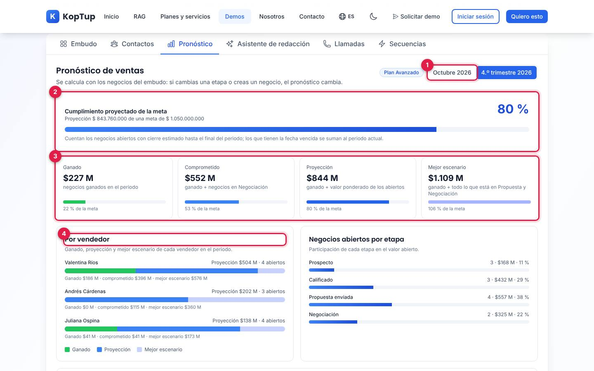

*Pestaña Pronóstico, periodo 4.º trimestre 2026, ya con el negocio ganado.*

1. **Periodo**: el mes actual (meta $350 M) o el trimestre actual (meta $1.050 M, el predeterminado). Los rótulos salen de la fecha de hoy: «Octubre 2026» y «4.º trimestre 2026» en las capturas.
2. **Cumplimiento proyectado**: proyección frente a la meta (80 % en el ejemplo: $ 843.760.000 de $ 1.050.000.000).
3. **Cuatro cifras**: Ganado ($227 M), Comprometido (ganado + Negociación, $552 M), Proyección (ganado + valor ponderado de los abiertos, $844 M) y Mejor escenario (ganado + todo lo que está en Propuesta y Negociación, $1.109 M), cada una con su porcentaje de la meta.
4. **Por vendedor**: ganado, proyección y mejor escenario de cada uno. Al lado, la participación de cada etapa en el valor abierto.

Más abajo están el gráfico y las alertas:

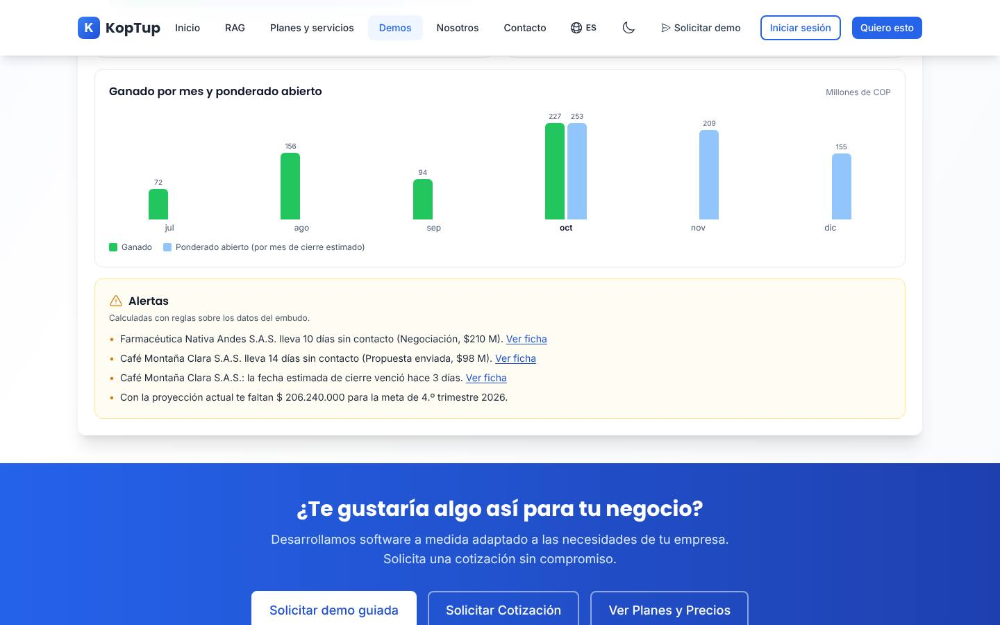

*Ganado por mes (los tres meses anteriores y el actual, resaltado) y ponderado abierto por mes de cierre (el actual y los dos siguientes), y las alertas con su enlace «Ver ficha».*

Las alertas avisan de negocios en Propuesta o Negociación con 7 días o más sin contacto, de fechas de cierre vencidas y de cuánto falta (o sobra) para la meta del periodo.

Qué decir: «El gerente ve hoy cuánto va a facturar este mes y qué negocios están en riesgo».

### Paso 5. Automatiza el seguimiento

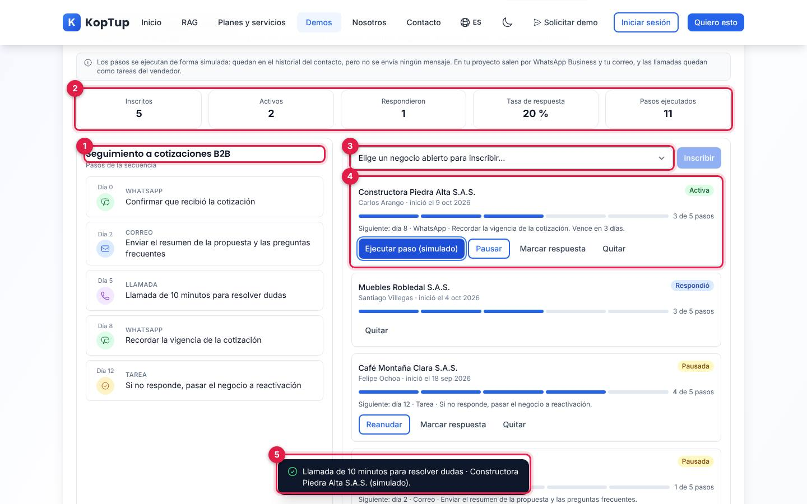

*Pestaña Secuencias después de inscribir Electro Hogar Brisa y ejecutar un paso de Constructora Piedra Alta.*

1. **Cadencia «Seguimiento a cotizaciones B2B»**: día 0 WhatsApp, día 2 correo, día 5 llamada, día 8 WhatsApp y día 12 tarea de reactivación.
2. **Métricas**: inscritos, activos, respondieron, tasa de respuesta y pasos ejecutados.
3. **Inscribir**: lista los negocios abiertos que aún no están en la secuencia.
4. **Cada inscripción**: estado (Activa, Pausada, Respondió, Terminada), avance «3 de 5 pasos», el siguiente paso con su vencimiento y los botones **Ejecutar paso (simulado)**, **Pausar**/**Reanudar**, **Marcar respuesta** (detiene la secuencia) y **Quitar**. El nombre de la empresa abre su ficha.
5. **Aviso** del paso ejecutado: «Llamada de 10 minutos para resolver dudas · Constructora Piedra Alta S.A.S. (simulado).»

Qué decir: «El vendedor no tiene que acordarse de cada seguimiento; en tu proyecto los mensajes salen por WhatsApp Business y tu correo».

### Cierre del recorrido

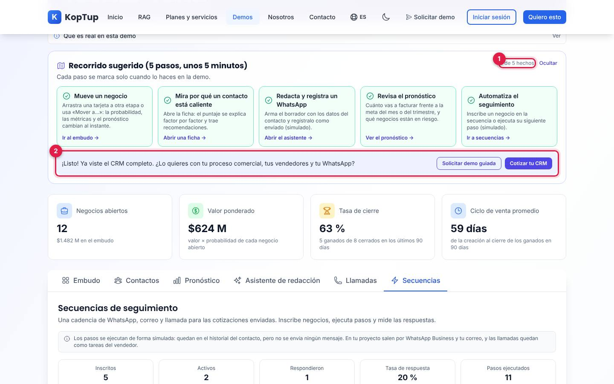

*Con los 5 pasos hechos, el recorrido muestra la salida comercial.*

1. **5 de 5 hechos**: las cinco tarjetas en verde.
2. **«¡Listo! Ya viste el CRM completo…»** con **Solicitar demo guiada** y **Cotizar tu CRM**.

---

## Pantallas y funciones

Todas las pestañas leen el mismo estado. Cuando cambias algo en una, las demás lo reflejan.

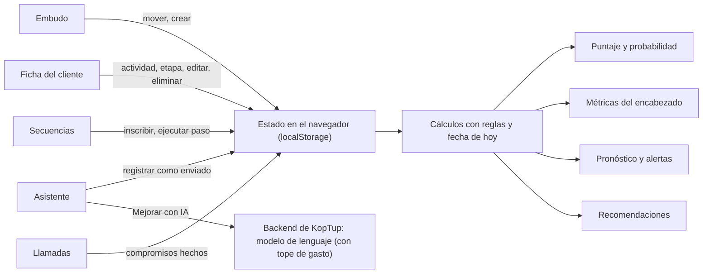

*De dónde sale cada número: todo se recalcula en el navegador; solo «Mejorar con IA» sale al servidor.*

### Encabezado y métricas

Arriba están **Volver al catálogo de demos**, la insignia **Datos de ejemplo**, el título con para quién es, **Solicitar demo guiada**, **Cotizar tu CRM**, **Restablecer datos** (abre una ventana de confirmación y borra los cambios de ese navegador; el recorrido vuelve a empezar) y la línea «Datos al … (hoy)». Debajo, el desplegable **Qué es real en esta demo** y el recorrido.

| Métrica | Cómo se calcula |
|---|---|
| Negocios abiertos | Negocios en Prospecto, Calificado, Propuesta enviada o Negociación, y su valor total |
| Valor ponderado | Suma de valor × probabilidad de cada negocio abierto |
| Tasa de cierre | Ganados sobre cerrados (ganados + perdidos) en los últimos 90 días |
| Ciclo de venta promedio | Días entre la creación y el cierre de los ganados en los últimos 90 días |

La **probabilidad** de un negocio abierto es la base de su etapa (Prospecto 10 %, Calificado 25 %, Propuesta enviada 45 %, Negociación 65 %) ajustada por el puntaje: entre −10 y +12 puntos, y siempre entre 5 % y 95 %.

### Fechas

La fecha de corte es **hoy en hora de Colombia**, calculada en el navegador después de cargar (el servidor no la usa, así que no hay diferencias de hidratación). Los datos de ejemplo están escritos contra una fecha base y se corren completos a la de hoy; lo que hayas guardado otro día también se corre entero (negocios, actividades y secuencias), así que «ayer», «hace 3 días» y los vencimientos siguen teniendo sentido. El pronóstico usa el mes y el trimestre calendario de hoy, y el gráfico muestra los tres meses anteriores, el actual y los dos siguientes (también al cambiar de año). La cotización en PDF lleva el año de hoy en su número (`COT-2026-D2`).

### Embudo

Ver el [paso 1](#paso-1-mueve-un-negocio) y el [paso 4](#paso-4-gana-el-negocio-y-revisa-el-pronóstico). Se puede arrastrar con el mouse o usar «Mover a…» en cada tarjeta. Al pasar un negocio a una etapa abierta, si estaba cerrado o su cierre estimado ya pasó, la demo le pone como cierre estimado 30 días después de hoy.

### Contactos

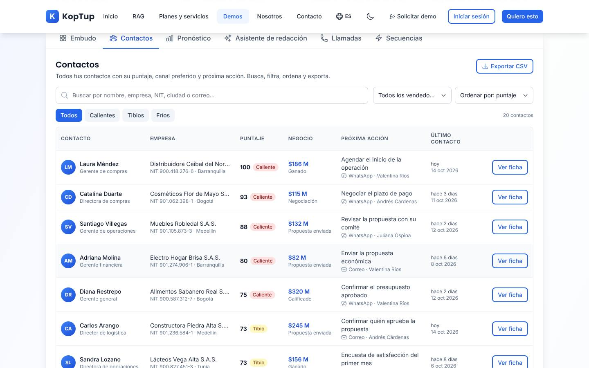

*Lista de contactos ordenada por puntaje, con búsqueda, filtros y exportación. Distribuidora Ceibal del Norte, ya ganada, muestra su nueva próxima acción.*

- **Buscar** por nombre, empresa, NIT, ciudad o correo (sin importar tildes); filtrar por vendedor y por temperatura (Todos, Calientes, Tibios, Fríos); ordenar por puntaje, valor, último contacto o nombre.
- Cada fila muestra contacto y cargo, empresa con NIT y ciudad, puntaje, valor y etapa del negocio, próxima acción con canal y vendedor, y último contacto. **Ver ficha** abre la ficha del cliente.
- **Exportar CSV** descarga `contactos-crm-ejemplo.csv` (separado por punto y coma; en inglés, por coma) con las filas visibles: contacto, cargo, empresa, NIT, ciudad, correo, teléfono, canal, vendedor, etapa, valor, probabilidad, puntaje, último contacto (AAAA-MM-DD) y próxima acción.
- La lista incluye todos los negocios, también los ganados y los perdidos.

### Ficha del cliente

Ver el [paso 2](#paso-2-mira-por-qué-un-contacto-está-caliente). Sus tres pestañas:

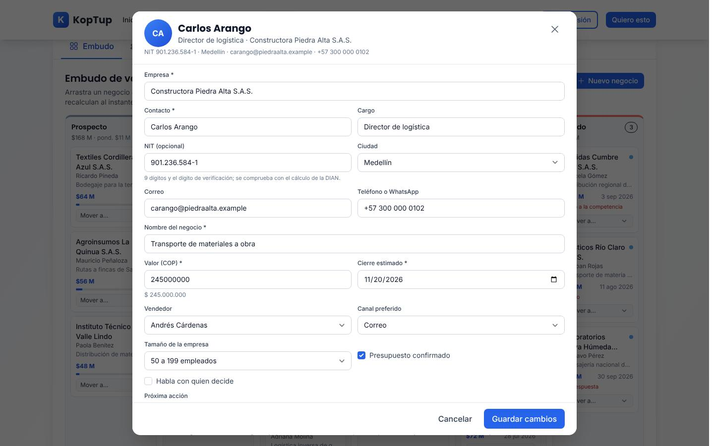

*Ficha de Carlos Arango (Constructora Piedra Alta), pestaña Negocio › Editar datos.*

| Pestaña | Qué puedes hacer | Qué pasa |
|---|---|---|
| Historial | Registrar una actividad (Nota, Llamada, WhatsApp, Correo o Reunión) con un texto | Queda en la línea de tiempo con la fecha de hoy; todo menos la nota cuenta como contacto y sube el puntaje |
| Negocio | Ver negocio, vendedor, valor, fechas, origen, canal, tamaño, presupuesto, quién decide y próxima acción; cambiar la **Etapa**; **Editar datos**; **Eliminar negocio** (pide confirmación) | **Editar datos** abre el mismo formulario de «Nuevo negocio» con empresa, NIT, contacto, cargo, ciudad, correo, teléfono, nombre del negocio, valor, cierre estimado (en un negocio cerrado se muestra la fecha de cierre, sin cambiarla), vendedor, canal, tamaño, presupuesto confirmado, habla con quien decide y próxima acción. **Guardar cambios** guarda solo lo que cambió, recalcula el puntaje (presupuesto, quién decide y tamaño lo mueven) y deja en el historial «Datos actualizados: valor, NIT». Eliminar borra el negocio, su historial y su secuencia de este navegador |
| Archivos | **Descargar PDF** de la cotización `COT-<año>-<ID>` | Se genera en el navegador `cotizacion-ejemplo-<ID>.pdf` con la marca «Documento de ejemplo», cliente, alcance, valor antes de impuestos, pago 30 % / 70 % y asesor. Solo existe desde «Propuesta enviada» y no para negocios perdidos |

La ficha y las demás ventanas se cierran con **Escape** (si hay una ventana encima de otra, por ejemplo el motivo de pérdida sobre la ficha, Escape cierra solo la de arriba), mantienen el foco del teclado adentro y lo devuelven al botón que las abrió.

### Asistente de redacción

Ver el [paso 3](#paso-3-redacta-y-registra-un-whatsapp). Lleva la insignia **Plan Avanzado**: la redacción de mensajes está incluida desde ese plan del producto. **Mejorar con IA** envía como máximo 2.000 caracteres del borrador y nada más (ni el historial ni los datos del CRM); por eso la nota pide no escribir datos personales reales en el contexto.

### Pronóstico

Ver el [paso 4](#paso-4-gana-el-negocio-y-revisa-el-pronóstico). Lleva la insignia **Plan Avanzado**. Los negocios abiertos con fecha de cierre vencida se cuentan en el periodo actual.

### Llamadas

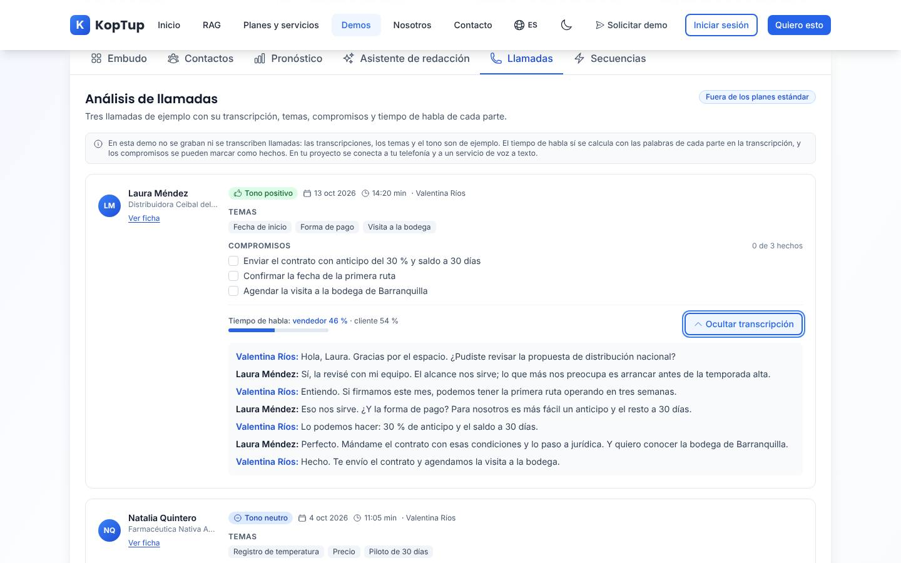

*Llamada de ejemplo con Laura Méndez, con la transcripción abierta.*

Tres llamadas de ejemplo (Laura Méndez con tono positivo, Natalia Quintero neutro y Felipe Ochoa negativo). Cada una muestra fecha, duración y vendedor, **Temas**, **Compromisos** (casillas que puedes marcar como hechos; se guardan), **Tiempo de habla** de vendedor y cliente (calculado con las palabras de cada uno en la transcripción) y **Ver transcripción**. **Ver ficha** abre la ficha del cliente. La insignia **Fuera de los planes estándar** indica que la grabación y el análisis de llamadas se cotizan aparte.

### Secuencias

Ver el [paso 5](#paso-5-automatiza-el-seguimiento). Los pasos por WhatsApp, correo o llamada cuentan como contacto en el historial; la tarea del día 12 no.

### Nuevo negocio

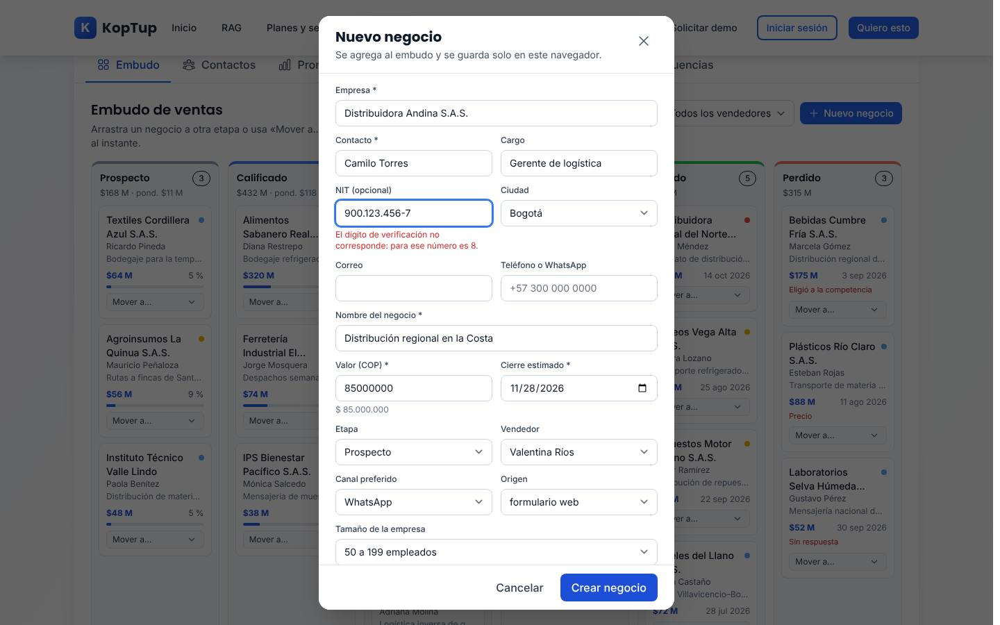

*Formulario para crear un negocio, con un NIT cuyo dígito de verificación no corresponde.*

Pide empresa, contacto, cargo, NIT (opcional), ciudad, correo, teléfono o WhatsApp, nombre del negocio, valor en pesos, cierre estimado, etapa, vendedor, canal preferido, origen, tamaño de la empresa, **Presupuesto confirmado**, **Habla con quien decide** y próxima acción. Son obligatorios empresa, contacto, nombre del negocio, valor (mayor que cero) y cierre estimado (desde hoy). El correo se valida por formato y el **NIT por formato y por dígito de verificación** (cálculo de la DIAN): con `900.123.456-7` dice «El dígito de verificación no corresponde: para ese número es 8.»; un NIT escrito sin puntos se guarda con formato (`9001234568` → `900.123.456-8`). Si hay errores, el foco va al primer campo con error. **Crear negocio** lo agrega a la etapa elegida con el contacto «hoy» y muestra «Distribuidora Andina S.A.S. se agregó a «Prospecto».».

### En el celular

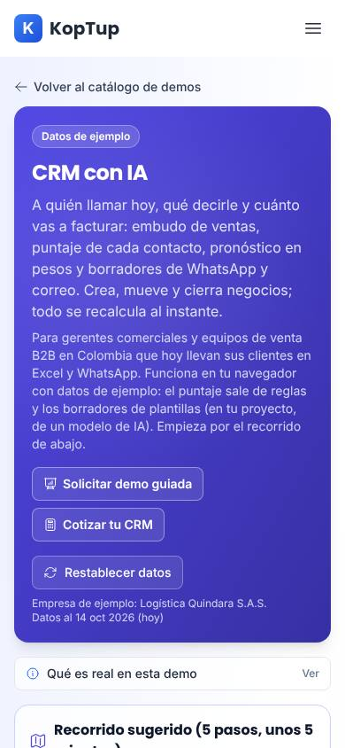

*La demo en un teléfono (390 px): encabezado, salidas y comienzo del recorrido.*

Los botones del encabezado se apilan, el recorrido muestra solo el título y el botón de cada paso, las métricas pasan a dos columnas, las pestañas se desplazan de lado y las etapas del embudo se apilan una debajo de otra. Para mover un negocio usa **Mover a…**.

### Teclado

Las pestañas del CRM y las de la ficha se recorren con las flechas, Inicio y Fin; todos los controles tienen foco visible y etiqueta; las ventanas se cierran con Escape.

---

## Qué es real y qué es simulado

| Parte | Real o simulado | Detalle |
|---|---|---|
| Embudo, ficha, contactos, secuencias | **Funciona de verdad, en el navegador** | Crear, mover, editar y eliminar negocios funciona; se guarda en `localStorage` de ese navegador (clave `koptup-demo-crm-ia:v1`). |
| Puntaje, probabilidad, métricas, pronóstico, alertas y recomendaciones | **Reglas de ejemplo** | Cálculos fijos y explicables en el navegador; no hay modelo de IA ni aprendizaje con histórico. |
| Borradores y acciones rápidas | **Plantillas y reglas** | Combinan objetivo × tono × canal (6 redacciones por objetivo) con los datos del contacto. |
| Mejorar con IA | **IA real** | El backend de KopTup reescribe el borrador con un modelo de lenguaje; tiene tope de gasto mensual y cupo por conexión, y sin servidor o sin cupo muestra un aviso honesto. |
| Envíos de WhatsApp y correo, pasos de la secuencia | **Simulados** | Solo quedan en el historial; no sale ningún mensaje. |
| Llamadas | **Datos de ejemplo** | Transcripciones, temas y tono escritos a mano; el tiempo de habla sí se calcula con la transcripción. |
| Cotización en PDF y CSV de contactos | **Real, con datos ficticios** | Se generan en el navegador con los datos actuales. |
| Validación del NIT | **Real** | Formato y dígito de verificación con el algoritmo de la DIAN; no se consulta el RUT ni el RUES. |
| Fechas | **Reales (hoy en Colombia)** | Los datos de ejemplo se corren a la fecha de hoy. |
| Empresas, personas, NIT, correos y teléfonos | **Ficticios** | NIT con dígito de verificación válido, correos con dominio `.example` y teléfonos de la serie +57 300 000 0xxx. |
| Servidor | **Solo para «Mejorar con IA»** | Además de la verificación de acceso común a todas las demos, la única llamada es la del botón «Mejorar con IA». Todo lo demás funciona aunque el backend no responda. |

---

## Acceso

- **Cómo la ve un visitante:** la demo está en modo **Abierta** (`publico`): cualquiera entra a `/demo/crm-ia` sin cuenta y sin pantalla de acceso. En el hub `/demo` aparece así:

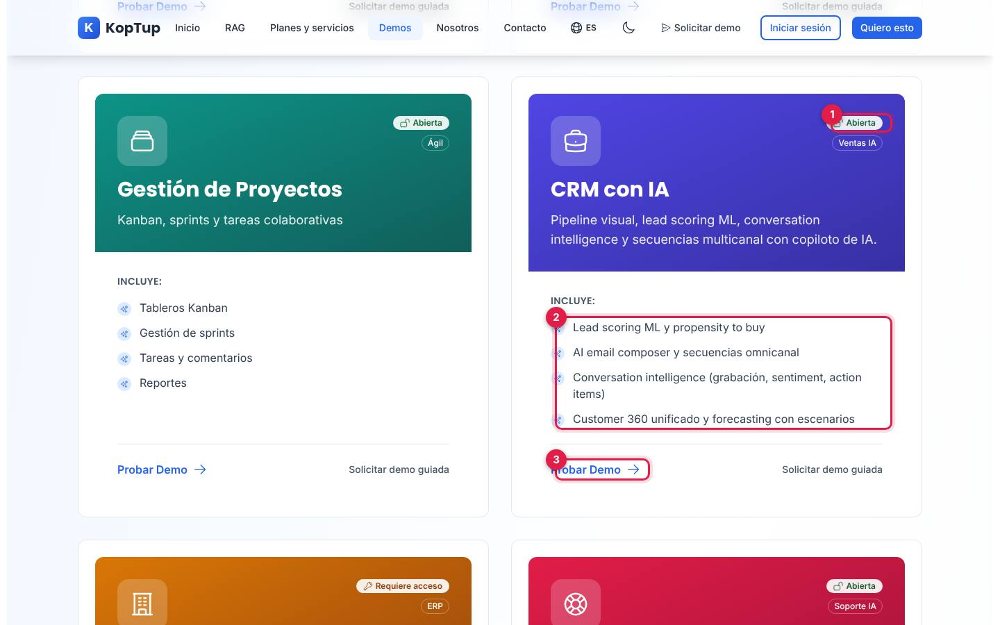

*Tarjeta «CRM con IA» en el hub, vista por un visitante sin sesión.*

1. Insignia **Abierta** (junto a «Ventas IA»).
2. Lo que **Incluye** según la tarjeta (ver la limitación 1).
3. **Probar Demo** abre `/demo/crm-ia`; a la derecha, **Solicitar demo guiada** abre `/solicitar-demo?demos=crm-ia`.

- **Cómo se solicita:** no hace falta solicitarla. Quien quiera verla con su propio proceso usa **Solicitar demo guiada** (en el encabezado de la demo, al terminar el recorrido, en la tarjeta o en el bloque azul al final) o **Cotizar tu CRM**.
- **Cómo la controla el admin:** el modo sale del catálogo del servidor y se cambia en **Admin › Catálogo de demos** (`/admin/catalogo-demos`). Si se pasa a «Con solicitud» o «Solo por invitación», los visitantes verán la pantalla de acceso y los accesos se conceden en **Admin › Solicitudes de demo** y **Admin › Accesos a demos**; si se desactiva, el visitante ve que la demo está en mantenimiento y el equipo sigue entrando. Si el backend no responde, la demo sigue abierta porque así está en la tabla de respaldo. Detalle en el [Manual del administrador](Doc-06-Manual-del-Administrador.md) y en [Flujos del visitante](Doc-04-Flujos-del-Visitante.md).

---

## Limitaciones conocidas

1. **La tarjeta del hub todavía promete más que la demo.** Dice «Lead scoring ML y propensity to buy», «AI email composer» y «Conversation intelligence (grabación, sentiment, action items)»; dentro, el puntaje es de reglas, los borradores son plantillas y las llamadas son de ejemplo. La demo lo dice en su encabezado y en las notas grises de cada pestaña. El texto nuevo de la tarjeta (honesto y en español) está pedido a la pista del catálogo.
2. **Los cambios viven solo en ese navegador.** Otra persona (o tú en otro equipo o en una ventana privada) ve los datos de ejemplo. No hay forma de compartir el estado del CRM con el vendedor.
3. **La foto del CRM se mueve entera con los días.** Si vuelves otro día, todo se corre a la fecha de hoy, también lo que registraste: una actividad registrada ayer aparece hoy con la fecha de hoy. Es lo que permite que los datos de ejemplo no se vuelvan viejos.
4. **El bloque azul común del final no conoce el producto.** «Ver Planes y Precios» lleva a `/services#planes-rag` (planes RAG) y «Solicitar Cotización» a `/contact` sin el CRM elegido; la demo ofrece arriba y al cerrar el recorrido **Cotizar tu CRM** con el producto ya elegido. El cambio del bloque común está pedido a la pista de plataforma.
5. **El origen del negocio no se edita** después de crearlo (es un dato histórico de cómo llegó el contacto).
6. **«Mejorar con IA» usa el acceso y el cupo del gestor de contenido.** Llama al mismo servicio de la demo `/demo/gestor-contenido`: si esa demo pasa a «Con solicitud» o «Solo por invitación», o se agota su cupo mensual, el botón muestra que la IA no está disponible y quedan los borradores de plantilla. Un acceso y un cupo propios del CRM están pedidos a la pista de plataforma.
7. **La IA solo pule el borrador.** El puntaje, las recomendaciones, el pronóstico y las acciones rápidas siguen siendo reglas explicables; no hay un modelo entrenado con histórico ni redacción desde cero con el historial del cliente (eso es lo que se construye en el proyecto).
