# Guía de la demo: Sistema experto para salud

> Ruta `/demo/cuentas-medicas` · Modo de acceso: **Solo por invitación** · Tipo: **IA real** (backend real con datos de ejemplo) · Plan del producto: [Auditoría de cuentas médicas con IA](Demo-cuentas-medicas.md)

**Resumen.** Es la demo de auditoría de cuentas médicas: subes una factura de una IPS en PDF (o usas la factura de ejemplo), el servidor lee el texto, un modelo de IA extrae los datos, el motor compara cada código CUPS con un tarifario de ejemplo y propone glosas (objeciones al pago). Tú, como auditor, confirmas, ajustas o descartas cada glosa; cuando las decides todas, la factura queda «Glosada» o «Aceptada», y descargas el informe en PDF o CSV. Está pensada para firmas de auditoría de cuentas médicas, IPS y pagadores (EPS y aseguradoras), y solo la abren las personas que invita un administrador.

**En esta página:** [Recorrido sugerido](#recorrido-sugerido-demo-comercial-de-5-minutos) · [Pantallas y funciones](#pantallas-y-funciones) · [Qué es real y qué es simulado](#qué-es-real-y-qué-es-simulado) · [Acceso](#acceso) · [Limitaciones conocidas](#limitaciones-conocidas)

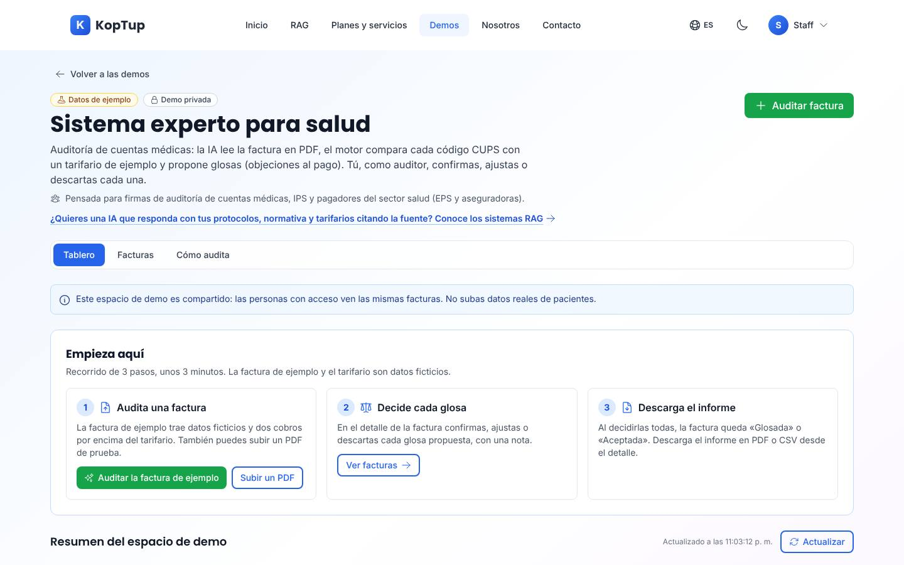

*Tablero de la demo después de auditar la factura de ejemplo y decidir sus glosas: encabezado con qué es y para quién, tarjeta «Empieza aquí» con los 3 pasos y el resumen del espacio.*

---

## Recorrido sugerido (demo comercial de 5 minutos)

Este guion sirve para mostrarle la demo a un cliente en una llamada. Lo ideal es empezar con el espacio vacío (si hay facturas de otras personas, puedes eliminarlas en **Facturas** o seguir con ellas). La tarjeta **Empieza aquí** del tablero resume los mismos pasos para quien entra solo.

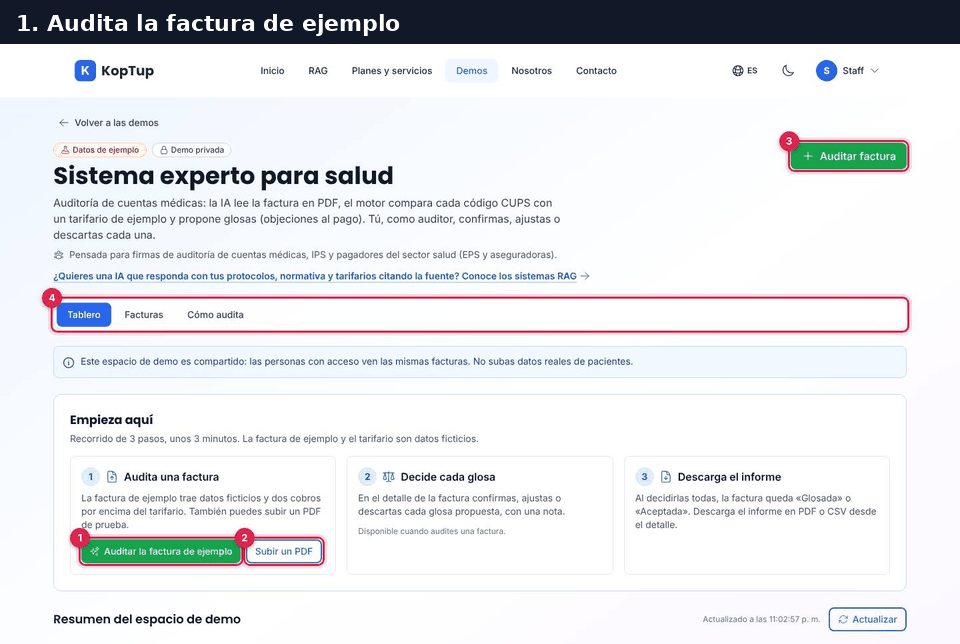

*Recorrido completo en 6 pasos: auditar la factura de ejemplo, revisar el resultado, decidir las glosas y ver el tablero actualizado.*

### Paso 1. Audita la factura de ejemplo

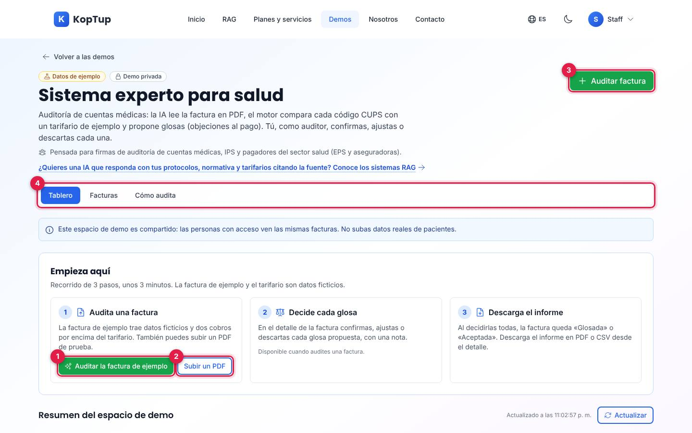

*Tablero sin facturas: la tarjeta «Empieza aquí» ofrece auditar la factura de ejemplo con un clic.*

1. **Auditar la factura de ejemplo**: la demo genera en tu navegador un PDF ficticio («Clínica Demo Los Andes», Medellín, NIT ficticio con dígito de verificación válido, fecha de hace 12 días, 5 procedimientos) y lo envía de una vez al servidor. El número de la factura es `FEDL-` más cinco cifras que cambian cada minuto, para que dos auditorías del ejemplo no choquen. Es la opción más rápida para una demo en vivo.
2. **Subir un PDF**: abre la ventana para cargar tus propios PDF de prueba.
3. **Auditar factura**: el mismo botón verde está siempre arriba a la derecha, en cualquier pestaña.
4. **Pestañas**: Tablero, Facturas y Cómo audita. Volver a pulsar la pestaña abierta vuelve a pedir los datos al servidor y muestra el aviso «Datos actualizados».

Qué decir: «La IA lee la factura tal como llega en PDF; no hay que digitar nada».

### Paso 2. Mira el resultado de la auditoría

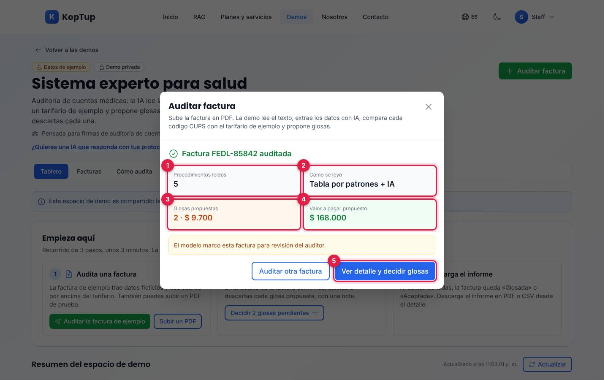

*Ventana de resultado: procedimientos leídos, cómo se leyó, glosas propuestas y valor a pagar propuesto.*

1. **Procedimientos leídos**: 5.
2. **Cómo se leyó**: «Tabla por patrones + IA».
3. **Glosas propuestas**: 2 glosas por $ 9.700 (la consulta de urgencias y el hemograma superan el tarifario de ejemplo).
4. **Valor a pagar propuesto**: $ 168.000. Si el modelo pide revisión humana, aparece un aviso debajo.
5. **Ver detalle y decidir glosas**: abre el detalle de la factura. «Auditar otra factura» deja la ventana lista para otra.

### Paso 3. Revisa cada glosa propuesta

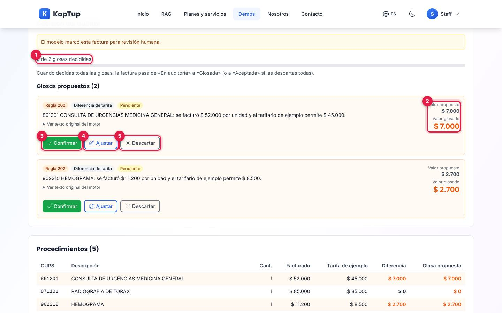

*Detalle de la factura, sección «Decisión del auditor»: cada glosa trae la regla, el motivo y los valores.*

1. **Avance**: «0 de 2 glosas decididas», una barra de progreso y el aviso de que la factura pasa de «En auditoría» a «Glosada» (o a «Aceptada» si las descartas todas).
2. **Valor propuesto y valor glosado** de la glosa.
3. **Confirmar**: acepta la glosa con el valor propuesto.
4. **Ajustar**: cambia el valor glosado (entre 0 y el valor facturado del procedimiento) con una nota opcional.
5. **Descartar**: anula la glosa; exige escribir una nota.

Qué decir: «La IA propone, el auditor decide. Cada glosa explica por qué: se facturó $ 52.000 y el tarifario permite $ 45.000».

### Paso 4. Confirma una glosa y ajusta la otra

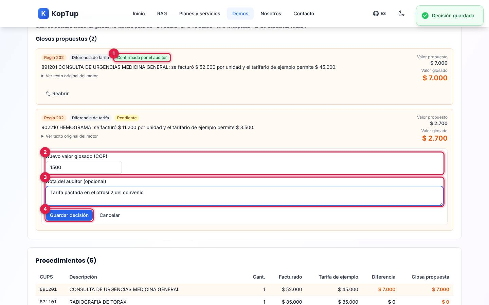

*La primera glosa ya está confirmada; la segunda se está ajustando con un valor nuevo y una nota.*

1. La glosa confirmada cambia a **Confirmada por el auditor** y muestra **Reabrir** para deshacer la decisión.
2. **Nuevo valor glosado (COP)**: en el ejemplo, 1500 en lugar de 2700. Al abrir el formulario el cursor queda en este campo; Escape lo cierra sin guardar.
3. **Nota del auditor (opcional)**: queda guardada y sale en el informe. Al descartar, el rótulo cambia a «obligatoria para descartar».
4. **Guardar decisión**: el servidor guarda la decisión y recalcula los totales de la factura. Aparece el aviso «Decisión guardada».

### Paso 5. Revisión completa e informes

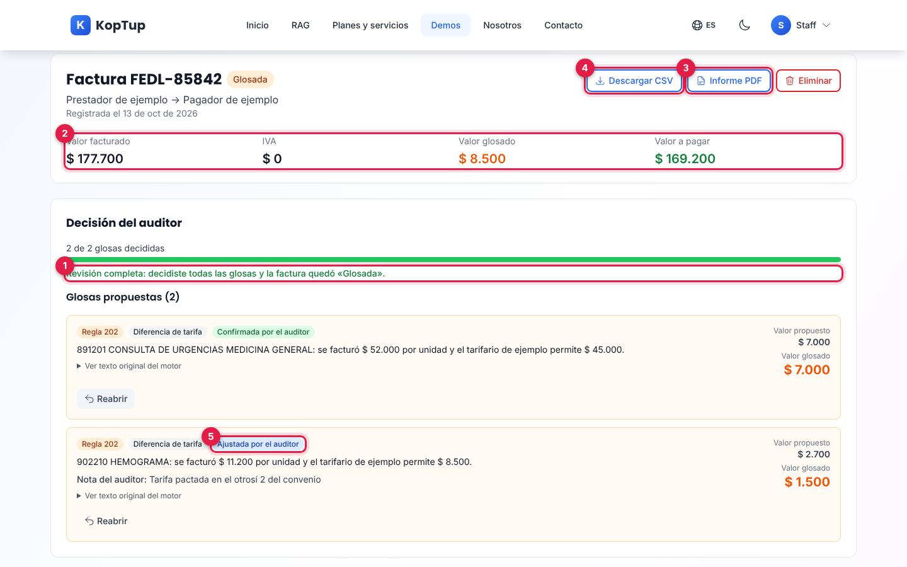

*Con las dos glosas decididas, la factura queda «Glosada» y muestra los valores recalculados.*

1. **Revisión completa: decidiste todas las glosas y la factura quedó «Glosada»** (la etiqueta de estado junto al número también cambia).
2. **Valores** recalculados: valor glosado $ 8.500 (7.000 confirmados + 1.500 ajustados) y valor a pagar $ 169.200.
3. **Informe PDF**: descarga un informe con valores, procedimientos, glosas con la decisión y la propuesta del modelo (ver [Informe PDF y CSV](#informe-pdf-y-csv)).
4. **Descargar CSV**: el mismo detalle en una hoja de cálculo.
5. La segunda glosa queda como **Ajustada por el auditor**, con su nota.

### Paso 6. Vuelve al tablero

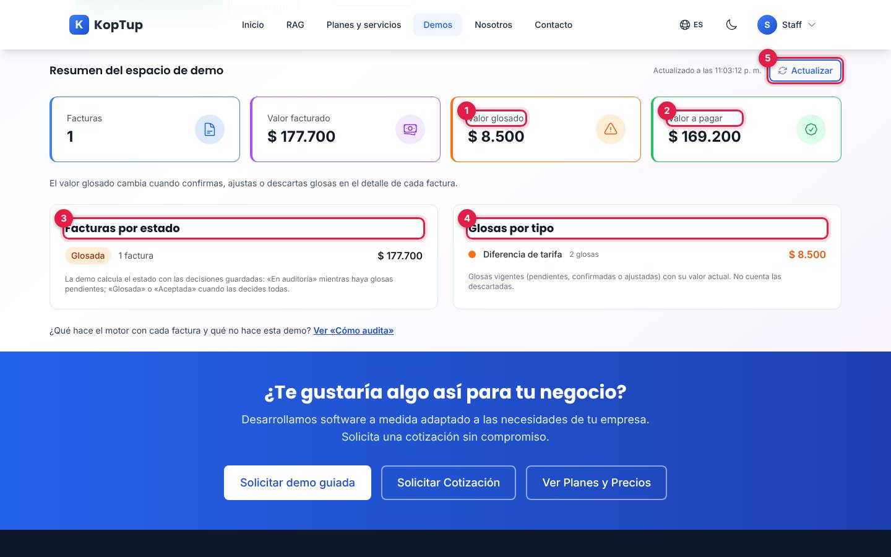

*El resumen del espacio refleja las decisiones del auditor.*

1. **Valor glosado**: $ 8.500.
2. **Valor a pagar**: $ 169.200.
3. **Facturas por estado**: la factura aparece como «Glosada».
4. **Glosas por tipo**: glosas vigentes (pendientes, confirmadas o ajustadas) con su valor; las descartadas no cuentan.
5. **Actualizar**: vuelve a pedir los datos y muestra la hora de la última actualización.

Cierre sugerido: abrir **Cómo audita** para mostrar con honestidad qué hace la demo y qué se construye en el proyecto del cliente, y terminar con **Solicitar demo guiada** o **Solicitar cotización** (franja azul al final de la página).

---

## Pantallas y funciones

### Encabezado y pestañas

Siempre visibles: **Volver a las demos** (va a `/demo`), las insignias **Datos de ejemplo** y **Demo privada**, el título, una frase de qué hace la demo, la línea **Pensada para** (firmas de auditoría de cuentas médicas, IPS y pagadores), el enlace a los sistemas RAG (`/rag`), el botón verde **Auditar factura** y las pestañas **Tablero**, **Facturas** y **Cómo audita**. Debajo hay un aviso fijo: «Este espacio de demo es compartido: las personas con acceso ven las mismas facturas. No subas datos reales de pacientes». Al final de la página, como en todas las demos, está la franja con **Solicitar demo guiada** (abre `/solicitar-demo?demos=cuentas-medicas`), **Solicitar cotización** y **Ver planes y precios**.

### Tablero

Ver la [vista general](#guía-de-la-demo-sistema-experto-para-salud) y el [paso 6](#paso-6-vuelve-al-tablero).

| Elemento | Qué muestra | De dónde sale |
|---|---|---|
| Empieza aquí | Los 3 pasos (auditar, decidir cada glosa, descargar el informe) con **Auditar la factura de ejemplo**, **Subir un PDF** y **Decidir N glosas pendientes** (o **Ver facturas**) | Texto fijo; el número de glosas pendientes sale de las facturas guardadas |
| Resumen del espacio de demo | Hora de la última actualización y **Actualizar** | — |
| Facturas, Valor facturado, Valor glosado, Valor a pagar | Totales de las facturas del espacio compartido | Suma de las facturas que devuelve `GET /api/auditoria/facturas` |
| Facturas por estado | Número y valor de facturas por estado de la revisión | Calculado con las glosas guardadas de cada factura (ver [Qué es real](#qué-es-real-y-qué-es-simulado)) |
| Glosas por tipo | Número y valor de las glosas vigentes por tipo | Mismas glosas |
| ¿Qué hace el motor…? Ver «Cómo audita» | Enlace a la pestaña Cómo audita | — |

Sin facturas, el resumen dice «Aún no hay facturas en este espacio. Empieza por el paso 1» ([paso 1](#paso-1-audita-la-factura-de-ejemplo)).

### Ventana «Auditar factura»

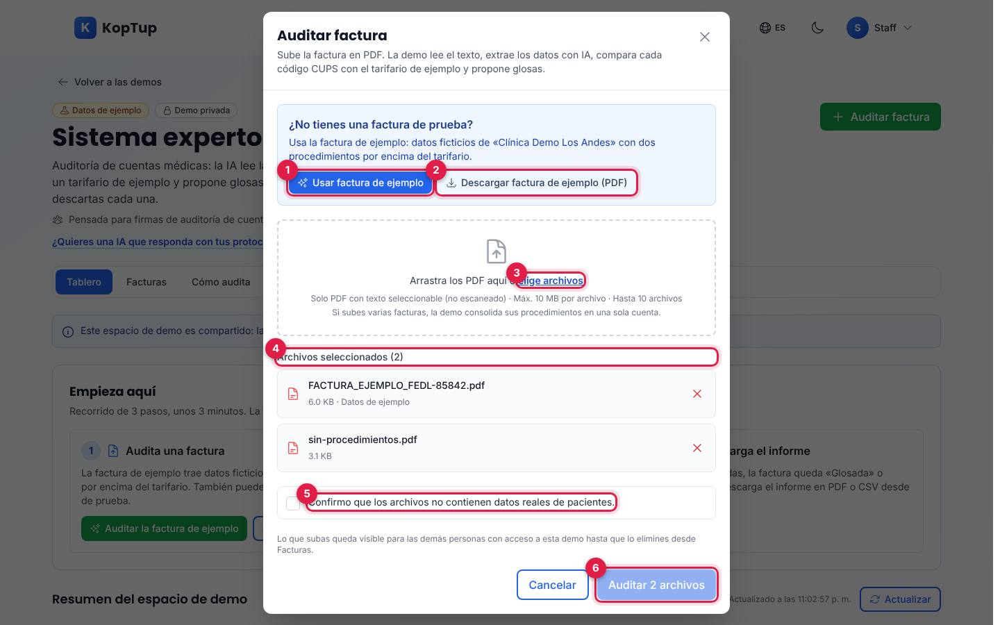

*Ventana para cargar PDF con la factura de ejemplo y un PDF propio de prueba: aparece la casilla de consentimiento.*

1. **Usar factura de ejemplo**: agrega a la lista el PDF ficticio (no audita todavía).
2. **Descargar factura de ejemplo (PDF)**: guarda en tu equipo `FACTURA_EJEMPLO_FEDL-xxxxx.pdf`, útil para mostrar el documento de origen.
3. **Elige archivos** (o arrastra los PDF a la zona punteada). Límites: solo PDF con texto seleccionable, máximo 10 MB por archivo y hasta 10 archivos. Si un archivo no es PDF, avisa «notas.txt no es un PDF».
4. **Archivos seleccionados**: cada uno con su tamaño y una **X** para quitarlo. La factura de ejemplo lleva la marca «Datos de ejemplo».
5. **Consentimiento**: aparece solo si subes un PDF propio. Sin marcarlo no se puede auditar.
6. **Auditar N archivos**: envía todo al servidor. Si subes varias facturas, la demo junta sus procedimientos en una sola cuenta.

Mientras procesa muestra «Leyendo el PDF y consultando el modelo de IA… puede tardar hasta un minuto» y no deja cerrar la ventana. Si algo falla, muestra «No se pudo auditar» con el motivo y **Reintentar**:

| Situación | Mensaje |
|---|---|
| El PDF no tiene una factura legible (escaneado, o sin tabla de procedimientos) | «La demo no encontró una factura legible en los archivos…» (el servidor no guarda nada) |
| Se acabó el cupo diario de IA de la cuenta | «Llegaste al límite diario de auditorías con IA de tu cuenta…» |
| Se acabó el cupo mensual de IA de la demo | «Esta demo alcanzó su cupo mensual de IA. Escríbenos…» |
| La IA no responde | «La IA no está disponible en este momento…» |
| Demasiadas solicitudes seguidas | «Hiciste muchas solicitudes en poco tiempo. Espera unos minutos…» |
| Sin conexión con el servidor | «No pudimos conectar con el servidor de la demo…» |
| Otro error del servidor | «El servidor no pudo procesar los archivos. Revisa que sean facturas en PDF con texto seleccionable…» |

La ventana se cierra con la X, con **Cancelar** o con la tecla Escape, y el foco vuelve al botón que la abrió.

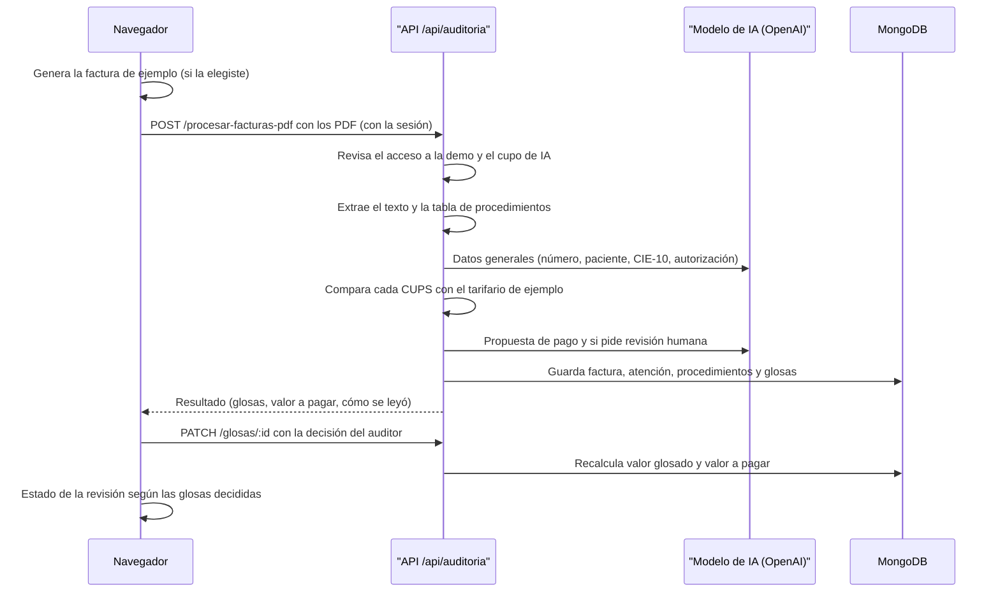

*Qué pasa al auditar una factura y al decidir una glosa.*

### Facturas

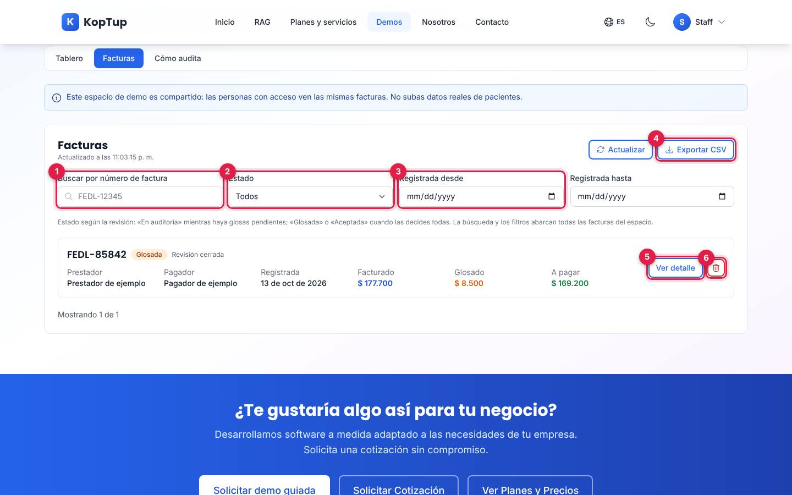

*Lista de facturas del espacio compartido con buscador, filtros y exportación.*

1. **Buscar por número de factura**.
2. **Estado**: Radicada, En auditoría, Auditada, Glosada, Aceptada, Pagada o Rechazada (el estado de la revisión, el mismo que muestra cada factura).
3. **Registrada desde / hasta**: rango de fechas (hora de Colombia). Con cualquier filtro activo aparece **Limpiar filtros**.
4. **Exportar CSV**: descarga las facturas que coinciden con los filtros (`facturas-auditoria-demo.csv`), con su estado y glosas pendientes. Al lado, **Actualizar** vuelve a pedir la lista y muestra la hora.
5. **Ver detalle**: abre el detalle de la factura.
6. **Papelera**: pide confirmar («¿Eliminar la factura FEDL-xxxxx y sus glosas?» con **Sí, eliminar** / **No**; el foco queda en **No** y Escape cancela) y la borra del servidor para todos.

La búsqueda y los filtros abarcan todas las facturas del espacio (hasta 500). La lista muestra 20 por vez; si hay más aparece **Cargar más**. Cada factura muestra su estado y cuántas glosas le quedan pendientes («Revisión cerrada» cuando no queda ninguna).

### Detalle de la factura

La parte de arriba (valores y decisión del auditor) se ve en los [pasos 3 a 5](#paso-3-revisa-cada-glosa-propuesta). Más abajo:

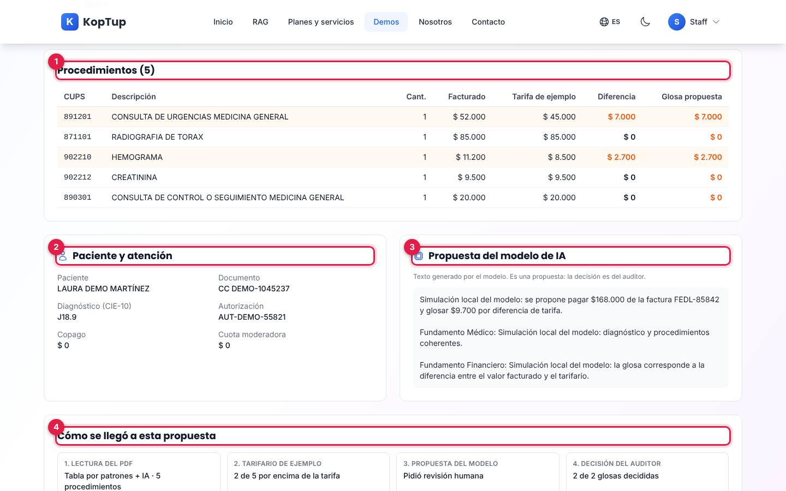

*Resto del detalle: tabla de procedimientos, datos del paciente, propuesta del modelo y cómo se llegó a la propuesta.*

1. **Procedimientos**: código CUPS, descripción, cantidad, valor facturado, tarifa de ejemplo, diferencia y glosa propuesta. Las filas con glosa se resaltan. Si el código no está en el tarifario dice «No está en el tarifario».
2. **Paciente y atención**: nombre, documento, diagnóstico CIE-10, autorización, copago y cuota moderadora, tal como los leyó la IA («No leído» si no los encontró).
3. **Propuesta del modelo de IA**: el texto que redactó el modelo, con la advertencia «Es una propuesta: la decisión es del auditor». *En las capturas el texto empieza por «Simulación local del modelo» porque el entorno de capturas usa un modelo simulado; con el servicio de OpenAI el texto lo redacta el modelo.*
4. **Cómo se llegó a esta propuesta**: lectura del PDF, tarifario de ejemplo (cuántos procedimientos superan la tarifa), propuesta del modelo (pidió o no revisión humana) y decisión del auditor (avance).

Otros detalles: **Ver texto original del motor** (en cada glosa) despliega el texto técnico que guardó el servidor; **Reabrir** devuelve una glosa a «Pendiente» (y la factura a «En auditoría»); **Eliminar** (arriba a la derecha) borra la factura con confirmación y vuelve a la lista; **Volver a facturas** regresa a la lista.

### Informe PDF y CSV

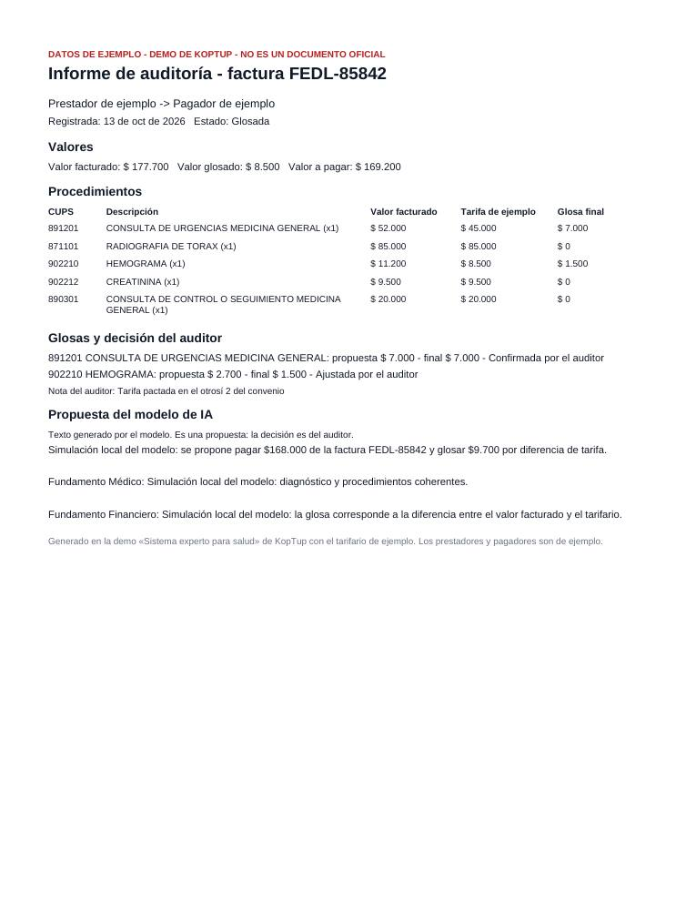

*Informe PDF generado en el navegador después de decidir las glosas.*

- **Informe PDF** (`auditoria-demo-<número>.pdf`): franja «DATOS DE EJEMPLO - DEMO DE KOPTUP - NO ES UN DOCUMENTO OFICIAL», estado de la revisión, valores, procedimientos con la glosa final, cada glosa con «propuesta» y «final» y la decisión del auditor con su nota, y la propuesta del modelo.
- **Descargar CSV** (`auditoria-demo-<número>.csv`, separado por punto y coma en español y por coma en inglés, abre en Excel): una fila por procedimiento con valor facturado, tarifa de ejemplo, diferencia, glosa propuesta, glosa final, decisión y nota, y una fila de totales.
- Ambos archivos se generan en el navegador con los datos que devuelve el servidor, y muestran el prestador y el pagador como «de ejemplo».

### Cómo audita

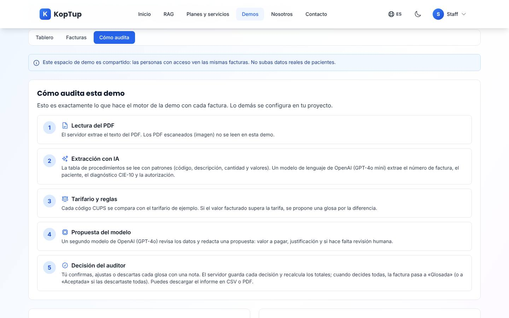

*Pestaña «Cómo audita»: los 5 pasos del motor, las reglas que aplica y lo que no hace la demo.*

- **Cómo audita esta demo**: lectura del PDF, extracción con IA (patrones para la tabla y GPT-4o mini para los datos generales), tarifario y reglas, propuesta del modelo (GPT-4o) y decisión del auditor.
- **Reglas que aplica**: glosa por diferencia de tarifa (regla 202 de la demo) y glosa provisional del 30 % para códigos que no están en el tarifario.
- **Qué no hace esta demo**: RIPS, validar autorizaciones con el pagador, pertinencia clínica, duplicidades, tomar prestador y pagador del PDF, convenios por pagador, PDF escaneados (OCR) y separar datos por cliente. Debajo, el enlace **Solicitar una demo guiada con tus facturas y convenios**.
- **Tarifario de ejemplo**: 14 códigos CUPS con su valor de ejemplo y un buscador por código o nombre.
- **Pruébalo con la factura de ejemplo**: botón que audita la factura de ejemplo sin volver al tablero.

### Si el acceso deja de estar activo

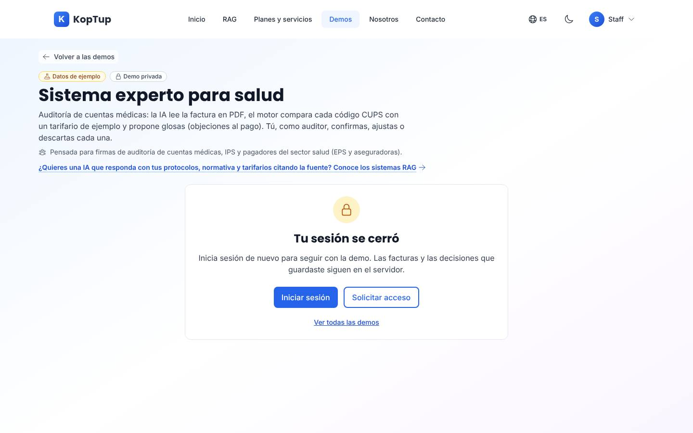

*Si la sesión se cierra con la demo abierta, la demo oculta las pestañas y explica qué hacer.*

Si el servidor responde que no hay sesión o que ya no hay acceso, la demo oculta las pestañas y muestra una tarjeta con el motivo concreto:

| Motivo | Título | Botones |
|---|---|---|
| Sesión cerrada o vencida | «Tu sesión se cerró» | **Iniciar sesión** (vuelve a la demo) y **Solicitar acceso** |
| Acceso vencido | «Tu acceso a esta demo venció» | **Solicitar acceso** |
| Acceso cerrado por el equipo | «Tu acceso a esta demo se cerró» | **Solicitar acceso** |
| Cuenta sin acceso | «Tu cuenta no tiene acceso a esta demo» | **Iniciar sesión** y **Solicitar acceso** |
| Demo desactivada | «Esta demo no está disponible en este momento» | **Escríbenos** (`/contact`) |

**Solicitar acceso** abre `/solicitar-demo?demos=cuentas-medicas` con la demo ya elegida, y todas las tarjetas tienen **Ver todas las demos**.

### En el celular

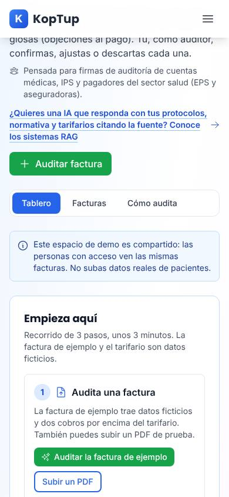

*La demo en un teléfono (390 px): el encabezado, el botón Auditar factura, las pestañas y la tarjeta Empieza aquí se apilan.*

En pantallas pequeñas las tarjetas del tablero van en una columna, la tabla de procedimientos se desplaza de lado dentro de su tarjeta y la ventana de carga ocupa el ancho de la pantalla. La demo se probó en claro y oscuro, en español y en inglés.

---

## Qué es real y qué es simulado

| Parte | Real o simulado | Detalle |
|---|---|---|
| Lectura del PDF y tabla de procedimientos | **Real** | El servidor extrae el texto del PDF y lee la tabla con patrones. |
| Datos generales y propuesta del modelo | **IA real** | Modelos de OpenAI (GPT-4o mini y GPT-4o) a través del backend, con tope de gasto mensual de la función de salud y cupo diario por cuenta. En el entorno de capturas se usa un modelo simulado. |
| Tarifario | **Datos de ejemplo** | Tabla fija de 14 códigos en el servidor; no corresponde a ningún contrato ni manual real. |
| Reglas de glosa | **Real, pero limitadas** | Solo diferencia de tarifa y la regla provisional del 30 %. |
| Factura de ejemplo | **Datos ficticios** | Se genera en el navegador (Clínica Demo Los Andes, Medellín, paciente «Laura Demo Martínez», fecha de hace 12 días). |
| Prestador y pagador | **De ejemplo** | El servidor guarda siempre el mismo prestador y pagador; la pantalla y los informes los muestran como «Prestador de ejemplo» y «Pagador de ejemplo». |
| Facturas, glosas y decisiones | **Real (persisten)** | Se guardan en la base de datos y las ven todas las personas con acceso. |
| Estado de la revisión («En auditoría», «Glosada», «Aceptada») | **Real, calculado en la demo** | Sale de las decisiones guardadas en el servidor, así que todas las personas con acceso ven el mismo estado (ver la limitación 2). |
| Totales del tablero | **Real** | Suma de las facturas guardadas (los mismos valores que la lista y el detalle). |
| Informe PDF y CSV | **Real** | Se generan en el navegador con los datos guardados. |
| «Cómo se leyó» en el detalle | **Solo en tu navegador** | Se recuerda en el navegador donde auditaste la factura; en otro equipo solo se ve el número de procedimientos. |

---

## Acceso

**Cómo lo ve un visitante.** La demo está en `/demo`, sección **Más demos**, con la insignia «Solo por invitación» (ver la captura en la [guía del Motor de reglas del auditor](Guia-Demo-sistema-experto.md#acceso)). Si alguien abre `/demo/cuentas-medicas` sin sesión o sin invitación, la web muestra en la misma dirección la pantalla de acceso:

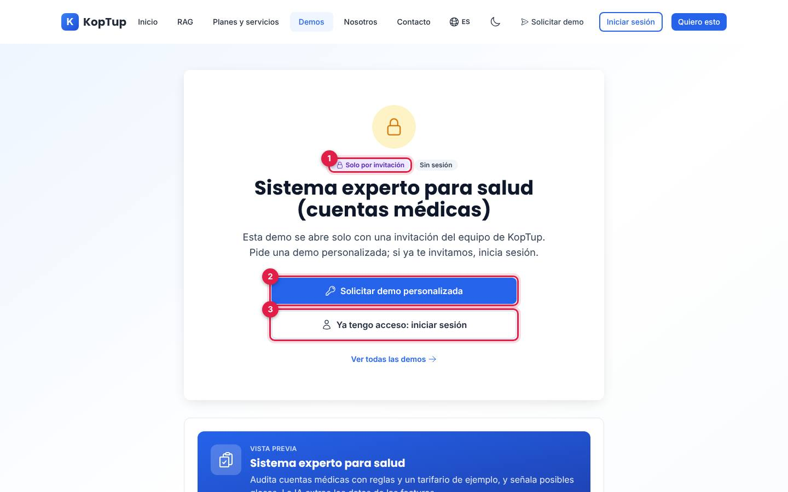

*Lo que ve un visitante sin sesión: «Solo por invitación», «Sin sesión», y los botones para pedir la demo o iniciar sesión.*

1. **Solo por invitación** y **Sin sesión**: el modo de acceso y la situación de la persona.
2. **Solicitar demo personalizada** abre `/solicitar-demo?demos=cuentas-medicas` con la demo ya elegida (las demos por invitación solo aparecen en el formulario cuando llegas desde su botón).
3. **Ya tengo acceso: iniciar sesión** lleva a `/login` y, al entrar, vuelve a la demo.

Debajo hay una vista previa con lo que incluye la demo.

**Cómo se concede.** La solicitud llega a **Admin › Solicitudes de demo**. Solo una persona con rol **admin** puede aprobar el acceso a una demo «Solo por invitación» (el servidor lo rechaza para otros roles). Al aprobar, se crea o se reutiliza la cuenta del prospecto, el acceso dura 14 días por defecto (se puede extender o revocar en **Admin › Accesos a demos**) y la persona recibe un correo con la decisión (con el enlace de activación si su cuenta es nueva). El equipo de KopTup (roles admin, manager, sales y developer) abre la demo sin invitación. El modo de acceso se cambia en **Admin › Catálogo de demos**. Detalle paso a paso en el [Manual del administrador](Doc-06-Manual-del-Administrador.md) y en [Flujos del visitante](Doc-04-Flujos-del-Visitante.md).

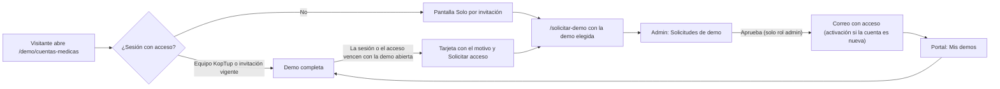

*Camino de un visitante hasta la demo.*

**Si el acceso vence durante el uso.** Todas las llamadas de la demo van con la sesión de la persona (y la renuevan si venció). Si el servidor responde que la sesión se cerró, que el acceso venció o se cerró, o que la demo se desactivó, la demo lo explica con el motivo concreto ([Si el acceso deja de estar activo](#si-el-acceso-deja-de-estar-activo)).

---

## Limitaciones conocidas

1. **Espacio compartido.** Todas las personas con acceso ven las mismas facturas y cualquiera puede eliminarlas. No hay separación por cliente ni un botón para vaciar el espacio: se limpia eliminando las facturas.
2. **El estado de la revisión lo calcula la demo.** Al decidir todas las glosas, la demo muestra la factura como «Glosada» o «Aceptada» para todas las personas con acceso, pero el campo de estado que guarda el servidor no cambia (sigue con el que propuso el modelo al auditar). Solo importa a quien consulte la API directamente.
3. **Solo una clase de glosa.** La demo propone glosas por diferencia de tarifa (y el 30 % provisional para códigos fuera del tarifario). No revisa RIPS, autorizaciones, pertinencia, duplicidades ni soportes.
4. **Solo PDF con texto.** Un PDF escaneado (imagen) o sin tabla de procedimientos no se audita; la demo responde «La demo no encontró una factura legible…».
5. **Prestador y pagador fijos.** No se toman del PDF; siempre se muestran como «de ejemplo».
6. **Fecha «Registrada».** Es la fecha de la factura si el modelo la lee; si no, la del día en que se auditó (en las capturas, con el modelo simulado, aparece la fecha del día).
7. **«Cómo se leyó» depende del navegador.** Se guarda solo en el navegador que auditó la factura (hasta 50 facturas).
8. **Hasta 500 facturas.** El tablero, la búsqueda y los filtros trabajan con las 500 facturas más recientes del espacio (si hay más, la lista lo avisa). Para saber el estado de cada factura la demo lee sus glosas; las recuerda en el navegador mientras la factura no cambie, para no repetir peticiones.
9. **Límite de solicitudes.** El servidor limita cuántas solicitudes hace cada cuenta en 15 minutos; si se supera, la demo pide esperar unos minutos. El uso normal de una demo comercial queda muy por debajo.
10. **No enlaza con el Motor de reglas.** Esta demo no tiene acceso directo a [`/demo/sistema-experto`](Guia-Demo-sistema-experto.md), las reglas guardadas allí no cambian esta auditoría, y los códigos no coinciden: aquí la «regla 202» es diferencia de tarifa y en el Motor de reglas 202 es «Autorización incompleta o vencida» (la pestaña Cómo audita lo aclara).
