# Guía de la demo: Tablero ejecutivo

> Ruta `/demo/dashboard-ejecutivo` · Modo de acceso: **Abierta** · Tipo: **datos de ejemplo** (todo se calcula en el navegador; no llama a un modelo de IA ni guarda nada en el servidor) · Plan del producto: [Dashboard ejecutivo con IA](Producto-bi-dashboard.md)

**Resumen.** Es el tablero de gerencia de una empresa colombiana ficticia (por defecto, la Distribuidora Cumbre Andina S.A.S.; también hay una clínica y una firma de consultoría). Muestra ventas frente a la meta, margen bruto, estado de resultados, cartera por edades, flujo de caja a 13 semanas, clientes por segmento, preguntas guiadas, alertas por reglas, la vista previa de un resumen semanal por WhatsApp o correo y un informe en PDF. Todo sale de las mismas facturas, así que las cifras cuadran entre vistas. El visitante puede cargar su propio CSV de ventas, que no sale del navegador. Está pensada para gerentes generales, gerentes financieros y dueños de empresa que hoy arman sus informes a mano en Excel. En el hub `/demo` aparece como «Dashboard Ejecutivo».

**Fechas.** El corte de los datos de ejemplo es siempre el **último mes cerrado en Colombia** y los datos se corren solos cada mes (24 meses de historia que terminan en el corte). Las cifras y capturas de esta guía corresponden al corte del **30 de septiembre de 2026** (vista del 14 de octubre de 2026); en otro mes los montos cambian, pero la historia es la misma: ventas un 6 % bajo la meta por Cali, margen de lácteos a la baja, caja que pasa por debajo del mínimo y cuatro clientes en riesgo (hay pruebas automáticas que lo verifican para cualquier mes).

**En esta página:** [Recorrido sugerido](#recorrido-sugerido-demo-comercial-de-5-minutos) · [Pantallas y funciones](#pantallas-y-funciones) · [Qué es real y qué es simulado](#qué-es-real-y-qué-es-simulado) · [Acceso](#acceso) · [Limitaciones conocidas](#limitaciones-conocidas)

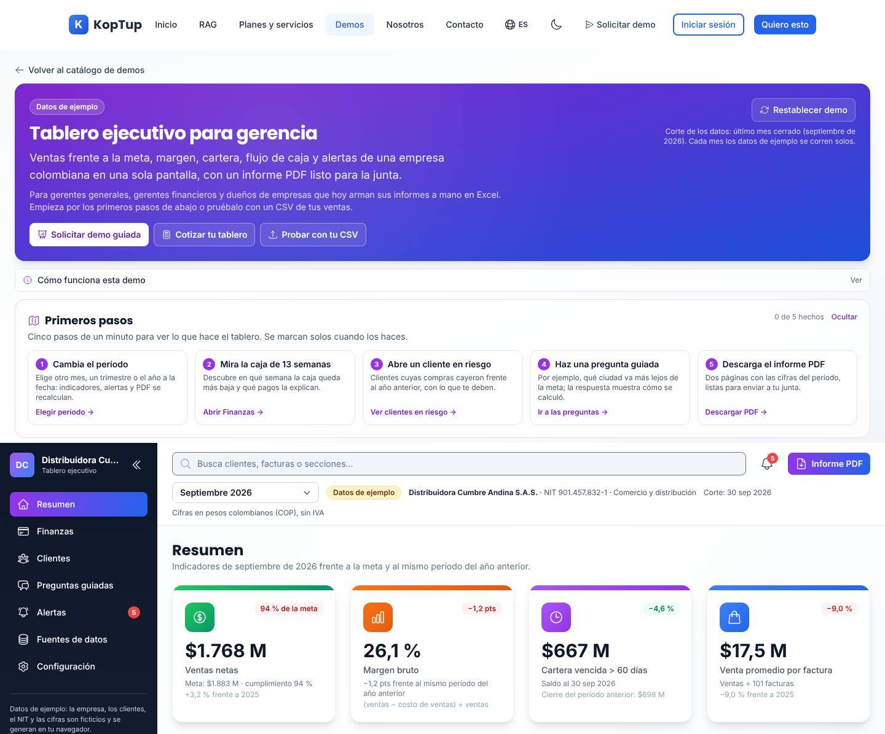

*Al entrar: «Volver al catálogo de demos», el encabezado (qué es, para quién, «Solicitar demo guiada», «Cotizar tu tablero», «Probar con tu CSV», «Restablecer demo» y el corte), «Cómo funciona esta demo», los «Primeros pasos» y, debajo, el tablero con su menú lateral.*

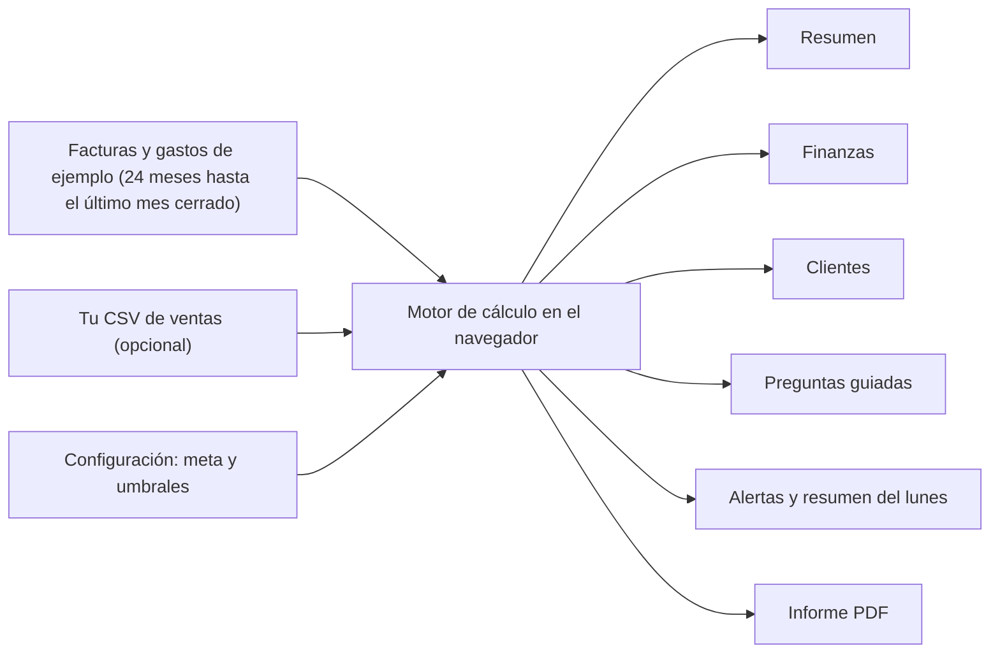

*De dónde salen las cifras: una sola lista de facturas alimenta todas las vistas y el PDF.*

---

## Recorrido sugerido (demo comercial de 5 minutos)

La propia demo trae el recorrido: el bloque **Primeros pasos** propone cinco acciones de un minuto y cada una se marca sola cuando la haces (cambiar el período, revisar la caja, abrir un cliente en riesgo, hacer una pregunta guiada y descargar el PDF). Cada botón lleva al lugar exacto. Abajo está el guion completo, con dos pasos más (alertas y prueba con CSV). Empieza con la demo recién cargada; si alguien la usó antes en ese navegador, pulsa **Restablecer demo**.

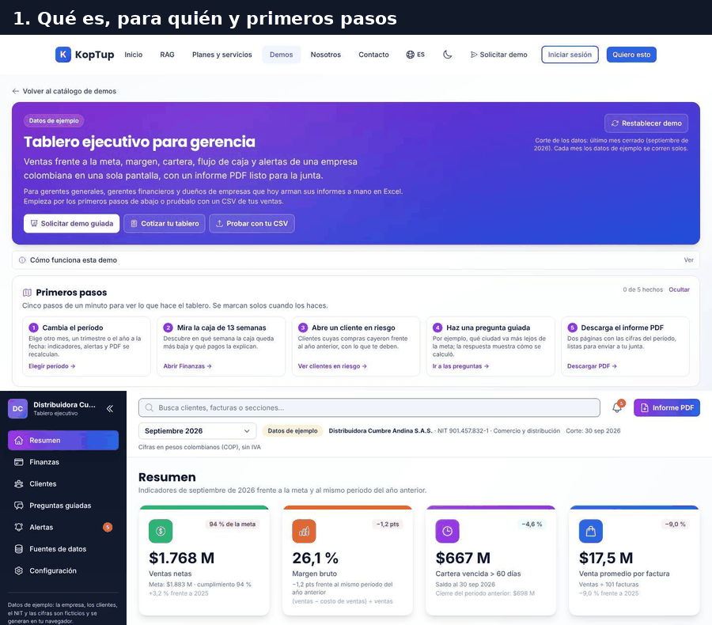

*Recorrido completo: encabezado y primeros pasos, indicadores, flujo de caja, clientes en riesgo, ficha de un cliente, preguntas, alertas, resumen del lunes, prueba con un CSV y cierre de los primeros pasos.*

### Paso 1. Cómo va el mes frente a la meta (primer paso de la demo: «Cambia el período»)

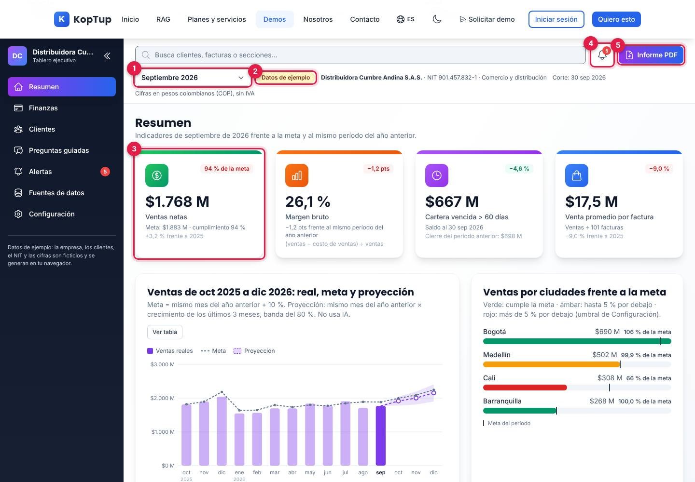

*Resumen de septiembre de 2026 de la Distribuidora Cumbre Andina S.A.S.*

1. **Período**: los últimos 12 meses (de octubre de 2025 a septiembre de 2026), los trimestres que caben en ellos (T4 2025 a T3 2026) y «2026 a la fecha». Todas las vistas, las alertas y el PDF cambian con él, y el navegador lo recuerda mientras no cambie el mes de corte. «Elegir período» en los primeros pasos lleva el foco a este selector.
2. **Datos de ejemplo**: al pasar el mouse explica que la empresa y las cifras son ficticias. Al lado, empresa, NIT con dígito de verificación (901.457.832-1), sector, fecha de corte (30 sep 2026) y «Cifras en pesos colombianos (COP), sin IVA».
3. **Ventas netas**: $1.768 M, el 94 % de la meta ($1.883 M), y +3,2 % frente a septiembre de 2025. La meta es el mismo mes del año anterior más el crecimiento configurado (10 % en comercio).
4. **Campana**: el número de alertas activas (5). Abre la lista; cada alerta lleva a su vista y «Ver todas las alertas» abre Alertas.
5. **Informe PDF**: descarga el informe del período (ver [Informe PDF](#informe-pdf)).

Los otros tres indicadores son **Margen bruto** (26,1 %, −1,2 pts frente al año anterior), **Cartera vencida > 60 días** ($667 M al 30 sep 2026, frente a $698 M al cierre del período anterior) y **Venta promedio por factura** ($17,5 M, ventas ÷ 101 facturas). Al elegir T3 2026 las ventas pasan a $5.387 M.

Qué decir: «En una pantalla sabes si vas a cumplir el mes, sin esperar el cierre contable».

### Paso 2. Dónde está el problema y qué dice el resumen automático

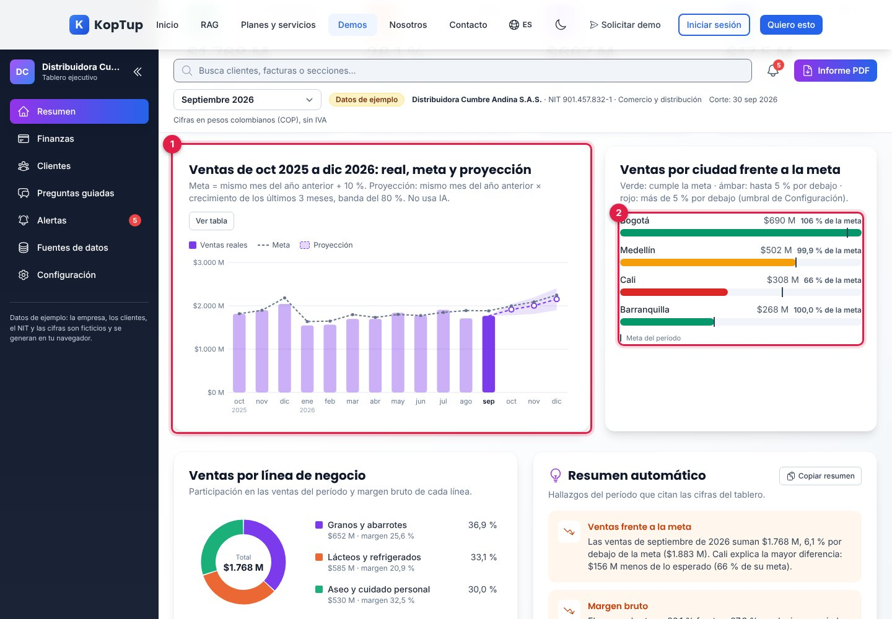

*Ventas de los últimos 12 meses con meta y proyección, y ventas por ciudad frente a la meta.*

1. **Ventas de oct 2025 a dic 2026: real, meta y proyección**: barras con las ventas de cada mes (el período elegido resaltado), línea punteada con la meta y, de octubre a diciembre de 2026, la proyección con su banda del 80 %. Debajo de los meses va el año donde cambia. Pasar el mouse (o el foco del teclado) por un mes muestra sus cifras; **Ver tabla** muestra lo mismo en una tabla. La proyección es estadística y la página lo dice: «No usa IA». Si eliges un mes anterior, el gráfico muestra los 12 meses que terminan en ese mes, sin proyección.
2. **Ventas por ciudad**: Cali va en el 66 % de su meta (en rojo). Verde cumple la meta, ámbar está hasta 5 % por debajo y rojo más de 5 % por debajo; el 5 % es el umbral de Configuración. Cerca del 100 % se muestra un decimal (Medellín va en 99,9 %, ámbar).

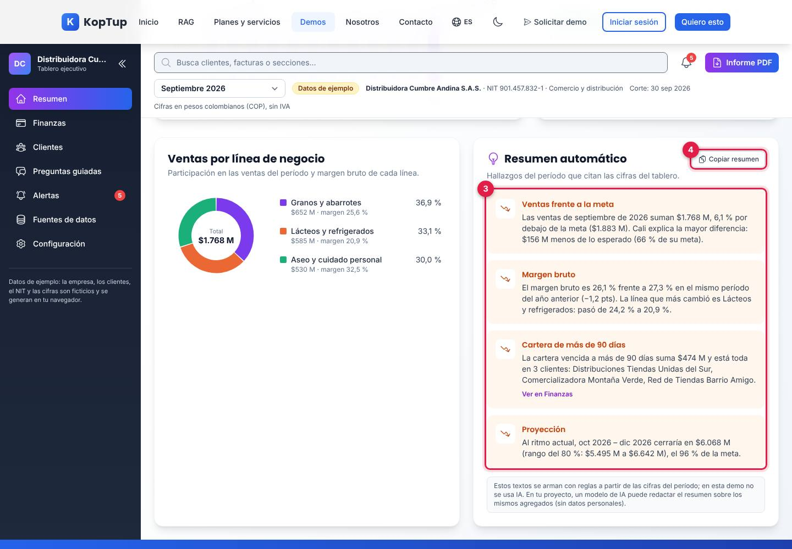

3. **Resumen automático**: cuatro hallazgos redactados con reglas a partir de las cifras: ventas 6,1 % bajo la meta y Cali $156 M por debajo de lo esperado; margen de 27,3 % a 26,1 % con lácteos de 24,2 % a 20,9 %; cartera a más de 90 días de $474 M, toda en tres clientes (con **Ver en Finanzas**), y la proyección de octubre a diciembre ($6.068 M, el 96 % de la meta).
4. **Copiar resumen**: copia los hallazgos al portapapeles, en viñetas, para pegarlos en un correo o un chat.

Debajo del gráfico está **Ventas por línea de negocio** (dona con la participación y el margen de cada línea: granos y abarrotes 37 %, lácteos y refrigerados 33 %, aseo y cuidado personal 30 %).

Qué decir: «El tablero no solo muestra números: te dice qué cambió y dónde mirar».

### Paso 3. La caja de las próximas 13 semanas (primer paso: «Mira la caja de 13 semanas»)

«Abrir Finanzas» en los primeros pasos abre Finanzas y baja hasta el flujo de caja.

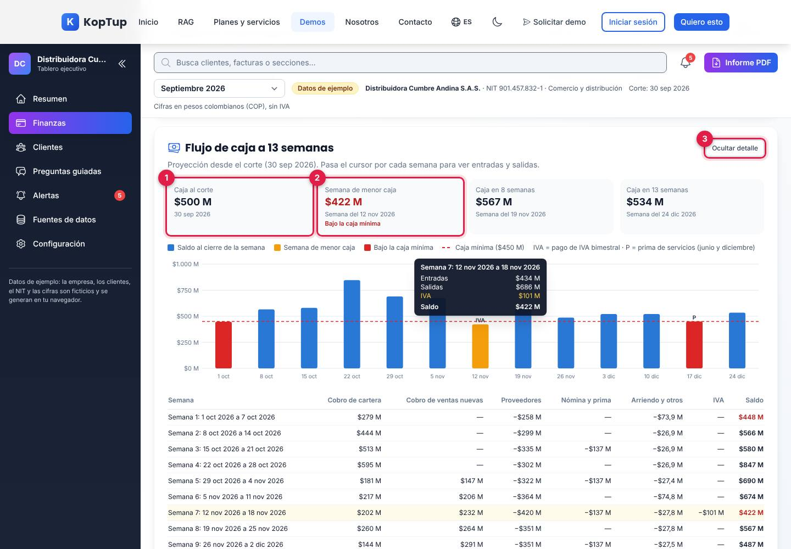

*Flujo de caja proyectado desde el 30 sep 2026, con el detalle de la semana 7 (12 al 18 nov 2026), la de menor caja.*

1. **Caja al corte**: $500 M, sobre la caja mínima ($450 M).
2. **Semana de menor caja**: $422 M en la semana del 12 nov 2026, marcada «Bajo la caja mínima». Esa semana coinciden el pago del IVA bimestral ($101 M), la nómina y los proveedores. Las otras dos cifras son la caja en 8 semanas ($567 M) y en 13 semanas ($534 M).
3. **Ver detalle semanal / Ocultar detalle**: tabla de las 13 semanas con cobro de cartera, cobro de ventas nuevas, proveedores, nómina y prima, arriendo y otros, IVA y saldo (un guion donde la semana no tiene ese movimiento).

En el gráfico, azul es el saldo de cierre de cada semana, ámbar la de menor caja, rojo las que quedan bajo la caja mínima (aquí también la semana 1 y la de la prima, del 17 dic) y la línea roja punteada es la caja mínima. Las marcas «IVA» y «P» señalan el pago de IVA y la prima de servicios. La nota «Cómo se calcula» explica los supuestos (cobro según el atraso promedio de cada cliente, proveedores a 45 días, nómina quincenal, prima en junio y diciembre, arriendo el día 5, y que lo vencido a más de 180 días, $109 M, no se proyecta).

Qué decir: «Ves hoy que a mediados de noviembre la caja queda por debajo de tu mínimo, con tiempo para actuar».

### Paso 4. Qué clientes están comprando menos (primer paso: «Abre un cliente en riesgo»)

«Ver clientes en riesgo» abre Clientes con el filtro **En riesgo** ya puesto.

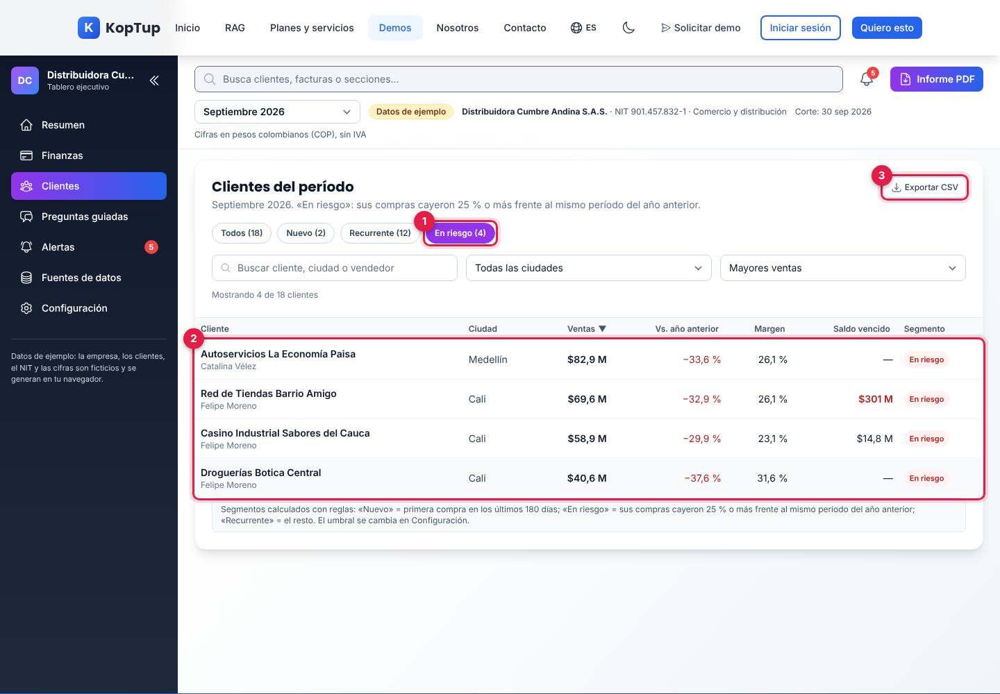

*Los cuatro clientes «En riesgo» de septiembre de 2026: tres de Cali y uno de Medellín.*

1. **En riesgo (4)**: sus compras cayeron 25 % o más frente al mismo período del año anterior (el porcentaje se cambia en Configuración).
2. **Tabla**: ventas del período, variación frente al año anterior, margen, saldo vencido y segmento: La Economía Paisa (−33,6 %), Red de Tiendas Barrio Amigo (−32,9 %), Casino Industrial Sabores del Cauca (−29,9 %) y Droguerías Botica Central (−37,6 %).
3. **Exportar CSV**: descarga la lista filtrada.

Pulsa el nombre de **Red de Tiendas Barrio Amigo** para abrir su ficha:

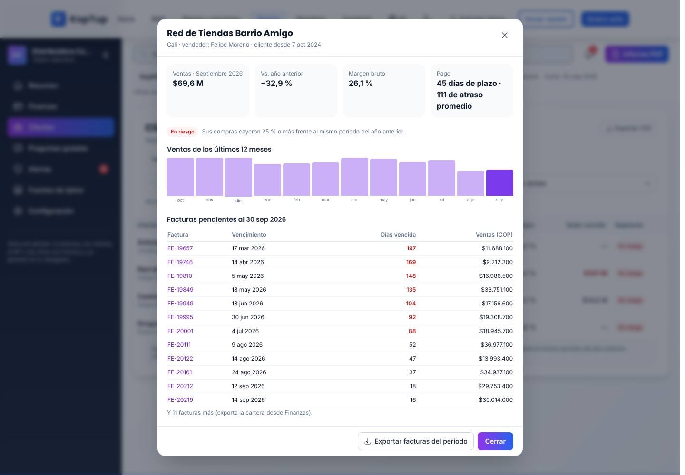

*Ficha de Red de Tiendas Barrio Amigo: −32,9 % frente al año anterior, 45 días de plazo y 111 días de atraso promedio, ventas de 12 meses y facturas pendientes.*

Cada número de factura abre su detalle (fecha, ciudad, línea, vendedor, valor sin IVA, costo, margen, vencimiento y estado al corte), con **Ver cliente** para volver. **Exportar facturas del período** descarga un CSV. Escape cierra solo la ventana de arriba, Tab no se sale de la ventana abierta y, al cerrarla, el foco vuelve al nombre que la abrió.

Qué decir: «Antes de perder un cliente, el tablero te avisa que dejó de comprar y que además te debe».

### Paso 5. Preguntas guiadas (primer paso: «Haz una pregunta guiada»)

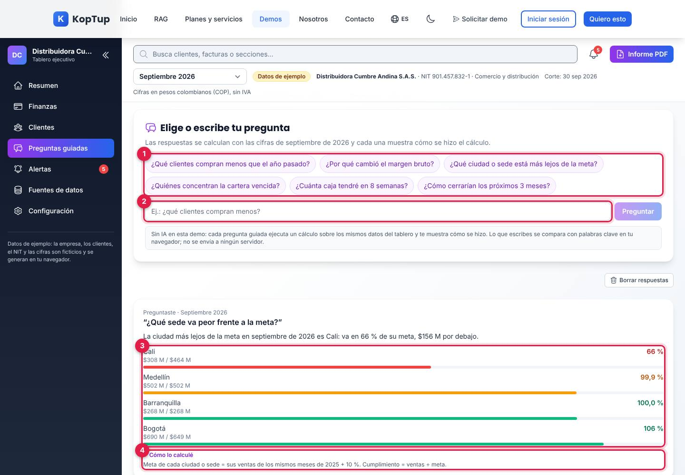

*Pregunta escrita «¿Qué sede va peor frente a la meta?» con su respuesta y el «Cómo lo calculé» abierto.*

1. **Preguntas guiadas**: seis botones (clientes que compran menos, margen, ciudad más lejos de la meta, cartera vencida, caja en 8 semanas y proyección de los próximos 3 meses).
2. **Campo de texto**: también puedes escribir la pregunta. La demo la compara con palabras clave (por ejemplo «sede» y «meta») y responde la pregunta guiada que más se parece. Si no reconoce nada, lo dice: «Esta demo solo responde las preguntas guiadas de arriba…».
3. **Respuesta**: una frase con las cifras del período y una lista con barras (aquí, Cali 66 %, Medellín 99,9 %, Barranquilla 100,0 % y Bogotá 106 %).
4. **Cómo lo calculé**: la fórmula usada.

Las respuestas se acumulan (hasta 10, la más reciente arriba) y **Borrar respuestas** las quita. La nota de la página aclara que no hay IA y que lo escrito no sale del navegador.

Qué decir: «Pregunta como le preguntarías a tu financiero; en tu proyecto, las preguntas libres las responde un modelo de IA sobre tus datos».

### Paso 6. Alertas y el resumen del lunes

Abre **Alertas** en el menú lateral.

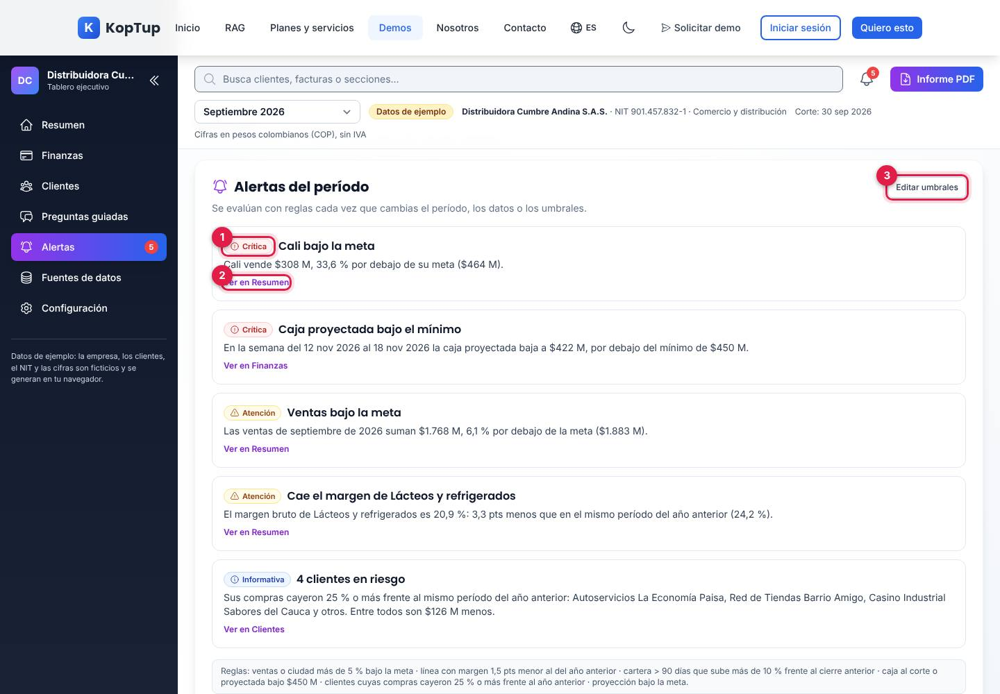

*Las cinco alertas de septiembre de 2026, ordenadas por gravedad.*

1. **Gravedad y título**: Crítica, Atención o Informativa. En el ejemplo: Cali bajo la meta y caja proyectada bajo el mínimo (críticas), ventas bajo la meta y caída del margen de lácteos (atención) y 4 clientes en riesgo (informativa).
2. **Ver en …**: lleva a la vista donde está el detalle; la de caja baja hasta el flujo de caja y la de clientes abre Clientes con el filtro «En riesgo».
3. **Editar umbrales**: abre Configuración.

Debajo de la lista, la nota «Reglas» resume cuándo salta cada alerta. Más abajo está la vista previa del resumen semanal:

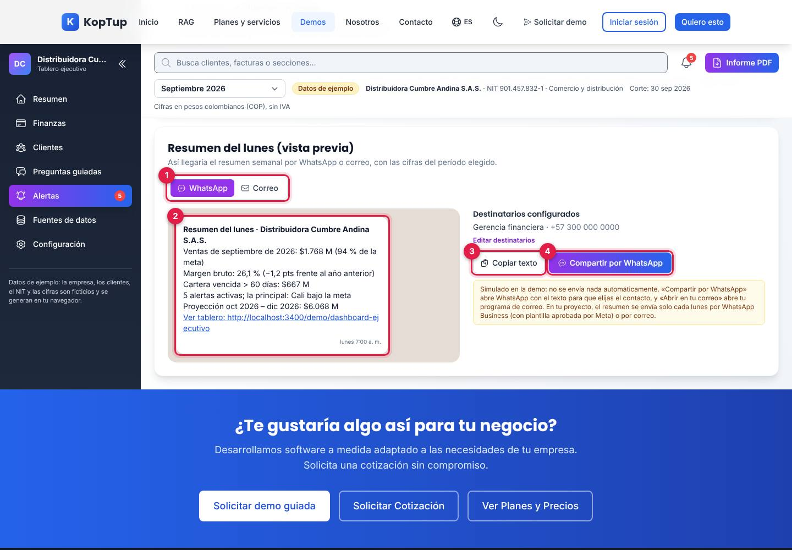

*Vista previa por WhatsApp del «Resumen del lunes» con ventas, margen, cartera, alertas, proyección y el enlace.*

1. **WhatsApp / Correo**: cambian la vista previa.
2. **Vista previa**: el mismo texto que se copia o se comparte, incluido el enlace «Ver tablero: …» (la dirección de esta demo).
3. **Copiar texto**: copia el mensaje.
4. **Compartir por WhatsApp**: abre WhatsApp con el texto para que elijas el contacto. En Correo, **Abrir en tu correo** abre tu programa de correo con los destinatarios de correo, el asunto y el texto.

La nota amarilla aclara que en la demo no se envía nada solo.

Qué decir: «Cada lunes a las 7 llega esto a tu WhatsApp, sin abrir el tablero».

### Paso 7. Pruébalo con tus propios números

Pulsa **Probar con tu CSV** en el encabezado (o abre **Fuentes de datos**) y, en **Prueba con tu CSV**, pulsa **Elegir archivo CSV** o arrastra el archivo. En la prueba se usó un CSV ficticio de una ferretería con 487 ventas de octubre de 2024 a septiembre de 2026 en Pasto, Neiva y Popayán.

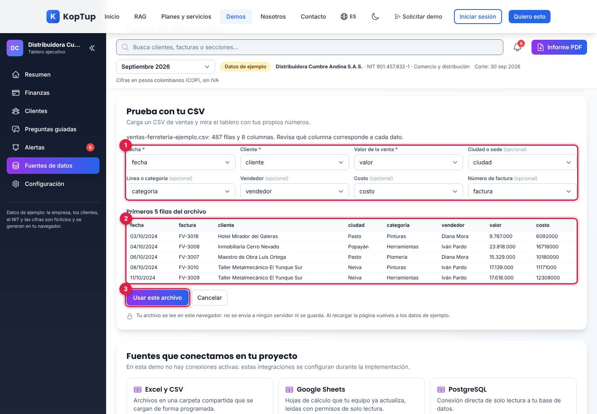

*El archivo leído: 487 filas y 8 columnas, con las columnas reconocidas solas.*

1. **Qué columna es cada dato**: fecha, cliente y valor son obligatorias (con asterisco); ciudad o sede, línea o categoría, vendedor, costo y número de factura son opcionales. La demo adivina la columna por el nombre del encabezado («fecha», «cliente», «valor», «ciudad», «categoria»…), y se puede corregir.
2. **Primeras 5 filas** del archivo.
3. **Usar este archivo**: recalcula el tablero y vuelve al Resumen con el aviso «Tablero recalculado con 487 filas de …».

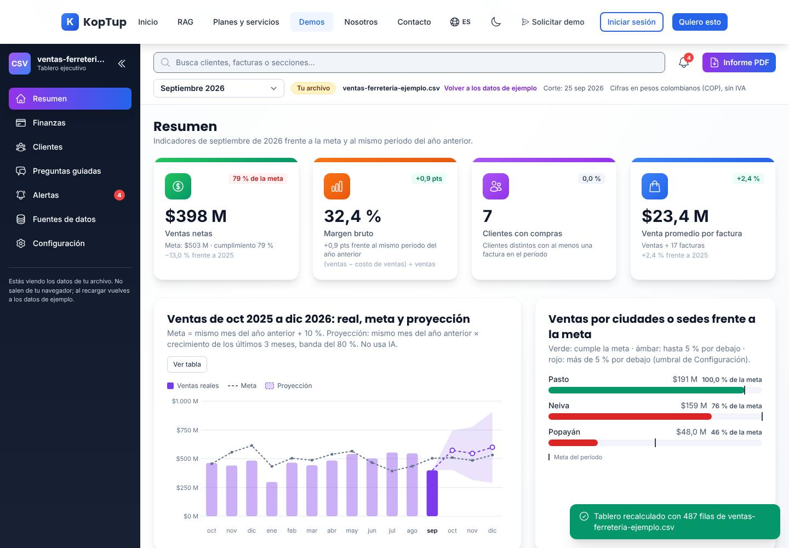

*El Resumen con el archivo de la ferretería: insignia «Tu archivo», «Volver a los datos de ejemplo», «Clientes con compras» en lugar de la cartera y 4 alertas de ventas.*

Con el archivo cargado, el tablero muestra tus ventas, meta, proyección, ciudades, clientes y alertas de ventas. Finanzas solo muestra la utilidad bruta (no hay gastos, cartera ni caja en un CSV de ventas). Al recargar la página vuelves a los datos de ejemplo.

Qué decir: «Esto lo ves hoy con tu Excel; en el proyecto, el tablero se conecta a tu software contable y se actualiza solo».

### Cierre

Al completar los cinco primeros pasos aparece el cierre con **Solicitar demo guiada** y **Cotizar tu tablero**:

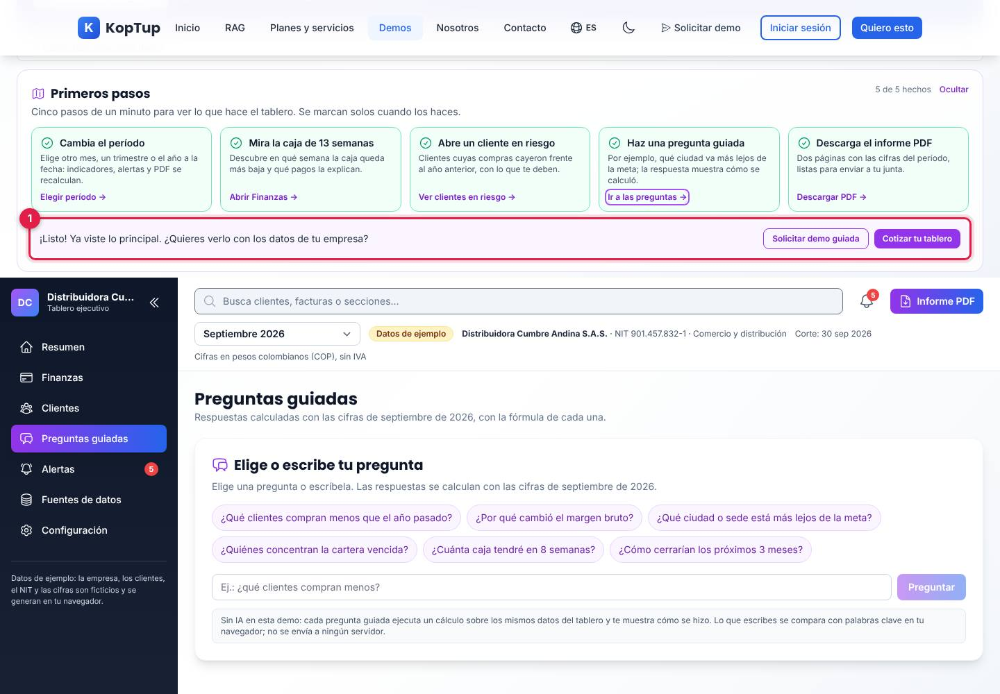

*«5 de 5 hechos» y el cierre comercial de los primeros pasos.*

---

## Pantallas y funciones

### Encabezado de la demo

| Elemento | Qué hace |
|---|---|
| **Volver al catálogo de demos** | Vuelve a `/demo`. |
| **Datos de ejemplo** | Insignia; al pasar el mouse explica que la empresa y las cifras son ficticias. |
| **Tablero ejecutivo para gerencia** | Título, qué muestra y para quién es. |
| **Solicitar demo guiada** | Abre `/solicitar-demo?demos=dashboard-ejecutivo` (la demo ya elegida). |
| **Cotizar tu tablero** | Abre `/contact?service=bi-dashboard` con el producto «Dashboard ejecutivo con IA» ya elegido. |
| **Probar con tu CSV** | Abre Fuentes de datos y baja hasta «Prueba con tu CSV». |
| **Restablecer demo** | Pide confirmación y vuelve a los datos de ejemplo, la empresa ficticia, metas y umbrales por defecto, el último mes y los primeros pasos sin marcar. |
| **Corte de los datos** | «Último mes cerrado (septiembre de 2026)». |
| **Cómo funciona esta demo** | Se despliega con cinco notas: de dónde salen las cifras, el corte, que no hay IA, qué es simulado y qué se guarda en el navegador. |
| **Primeros pasos** | Cinco pasos con su botón; se marcan solos, el avance se recuerda en el navegador y el bloque se puede ocultar. |

### Barra del tablero y menú lateral

| Elemento | Qué hace |
|---|---|
| **Menú lateral** | Resumen, Finanzas, Clientes, Preguntas guiadas, Alertas (con el número de alertas), Fuentes de datos y Configuración. La doble flecha lo contrae a solo íconos. Abajo, una nota recuerda que los datos son ficticios. En el celular se abre con el botón **Secciones**. |
| **Buscador** | Busca secciones, clientes (por nombre, ciudad o vendedor) y, desde 3 caracteres, números de factura (hasta 5). Muestra hasta 10 resultados; se navega con las flechas y Enter. Un cliente abre su ficha; una factura, su detalle. |
| **Campana** | Lista de alertas del período con su gravedad; cada una lleva a su vista. |
| **Informe PDF** | Genera y descarga el PDF del período. Mientras tanto dice «Generando…». |
| **Período** | Los últimos 12 meses, sus trimestres y el año a la fecha. |
| **Insignia** | «Datos de ejemplo» o «Tu archivo». |

### Resumen

Ver los [pasos 1 y 2](#paso-1-cómo-va-el-mes-frente-a-la-meta-primer-paso-de-la-demo-cambia-el-período). Cuatro indicadores (ventas netas, margen bruto, cartera vencida a más de 60 días y venta promedio por factura; con un CSV sin cartera, la tercera tarjeta pasa a «Clientes con compras»), el gráfico de ventas de los últimos 12 meses con meta y proyección (o su tabla), ventas por ciudad o sede frente a la meta, ventas por línea de negocio y el resumen automático con **Copiar resumen**.

La proyección usa «mismo mes del año anterior × crecimiento de los últimos 3 meses» cuando hay 15 meses o más de datos, y una tendencia lineal cuando hay entre 4 y 14. La banda del 80 % sale del error que habría tenido el mismo método en los meses ya conocidos.

### Finanzas

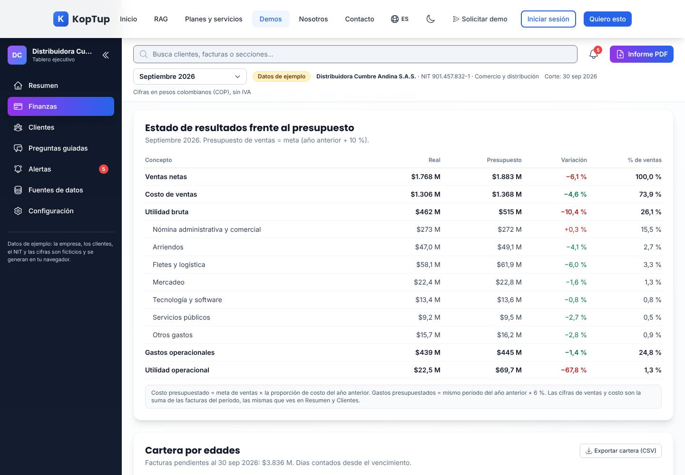

*Estado de resultados de septiembre de 2026 frente al presupuesto.*

- **Estado de resultados frente al presupuesto**: ventas, costo de ventas, utilidad bruta, cada gasto operacional, total de gastos y utilidad operacional, con real, presupuesto, variación (verde si es favorable) y % de ventas. El presupuesto de ventas es la meta; el de costo, la meta por la proporción de costo del año anterior; el de gastos, el mismo período del año anterior + 6 %.
- **Cartera por edades**: barra con Por vencer, 1 a 30, 31 a 60, 61 a 90 y más de 90 días ($3.836 M pendientes al 30 sep 2026), los clientes con saldo vencido a más de 60 días (cada nombre abre su ficha) y **Exportar cartera (CSV)** (en la prueba, 219 facturas pendientes).
- **Flujo de caja a 13 semanas**: ver el [paso 3](#paso-3-la-caja-de-las-próximas-13-semanas-primer-paso-mira-la-caja-de-13-semanas). Las cuatro cifras se ponen en rojo con «Bajo la caja mínima» cuando quedan por debajo del mínimo, también la caja al corte.
- **Movimientos relevantes**: cobros grandes, nómina, arriendo e IVA pagados en el período, con fecha y valor.

Con un CSV propio, Finanzas solo muestra ventas, costo y utilidad bruta (si el archivo trae costo) y el botón para volver a los datos de ejemplo.

### Clientes

Ver el [paso 4](#paso-4-qué-clientes-están-comprando-menos-primer-paso-abre-un-cliente-en-riesgo).

- **Segmentos**: Todos (18), Nuevo (2), Recurrente (12) y En riesgo (4) en septiembre de 2026. «Nuevo» es primera compra en los últimos 180 días; «En riesgo», compras que cayeron 25 % o más frente al mismo período del año anterior; «Recurrente», el resto.
- **Buscador** (cliente, ciudad o vendedor), filtro por ciudad y orden (mayores ventas, mayor caída, mayor crecimiento, mayor margen, mayor saldo vencido o nombre). Los encabezados de la tabla también ordenan.
- **Exportar CSV**: descarga la lista filtrada.
- **Ficha del cliente**: ventas del período, variación, margen, plazo y atraso promedio, ventas de los últimos 12 meses, hasta 12 facturas pendientes y las últimas 8 facturas del período, con **Exportar facturas del período**.

### Preguntas guiadas

Ver el [paso 5](#paso-5-preguntas-guiadas-primer-paso-haz-una-pregunta-guiada). Las preguntas que necesitan cartera o caja no aparecen cuando se usa un CSV propio.

### Alertas

Ver el [paso 6](#paso-6-alertas-y-el-resumen-del-lunes).

| Alerta | Cuándo salta (valores por defecto en comercio) | Gravedad |
|---|---|---|
| Ventas bajo la meta | Ventas más de 5 % por debajo de la meta | Atención; crítica si es más de 10 % |
| Ciudad o sede bajo la meta | Igual, por ciudad o sede | Atención o crítica |
| Cae el margen de una línea | La línea pierde 1,5 pts o más frente al año anterior | Atención |
| Sube la cartera de más de 90 días | Sube 10 % o más frente al cierre del período anterior | Atención |
| Caja proyectada bajo el mínimo | La caja al corte o alguna semana del flujo de caja queda por debajo de $450 M. Si la caja al corte ya está por debajo, el texto lo dice | Crítica |
| Clientes en riesgo | Hay clientes cuyas compras cayeron 25 % o más frente al mismo período del año anterior | Informativa |
| La proyección queda bajo la meta | El próximo trimestre proyectado queda más de 5 % por debajo de su meta | Informativa |

Las alertas se recalculan al cambiar el período, los datos o los umbrales: en la prueba, con T3 2026 había 4 alertas (las ventas del trimestre van en el 96 % de la meta), con «2026 a la fecha» 4 (aparece Medellín) y con la caja mínima en $300 M, 4.

### Fuentes de datos

- **Fuente de datos activa**: «Datos de ejemplo de Distribuidora Cumbre Andina S.A.S. (Comercio y distribución) · 2.183 facturas · 18 clientes · oct 2024 a sep 2026 · corte 30 sep 2026», con **Descargar CSV de ejemplo** (sirve de plantilla para la prueba con CSV).
- **Prueba con tu CSV**: ver el [paso 7](#paso-7-pruébalo-con-tus-propios-números). Acepta `.csv` o `.txt` de hasta 5 MB y 50.000 filas, separados por punto y coma, coma o tabulador; fechas como 2026-09-30 o 30/09/2026 y valores como 1.250.000, 1250000 o $ 1.250.000. Las filas con fecha, valor o cliente inválidos se ignoran y el aviso dice cuántas.
- **Fuentes que conectamos en tu proyecto**: seis tarjetas informativas (Excel y CSV, Google Sheets, PostgreSQL, Siigo, SAP Business One y HubSpot) con la etiqueta «Se configura en tu proyecto». No son botones: en la demo no hay conexiones.

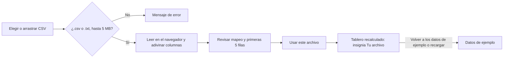

*La prueba con CSV: el archivo nunca sale del navegador.*

### Configuración

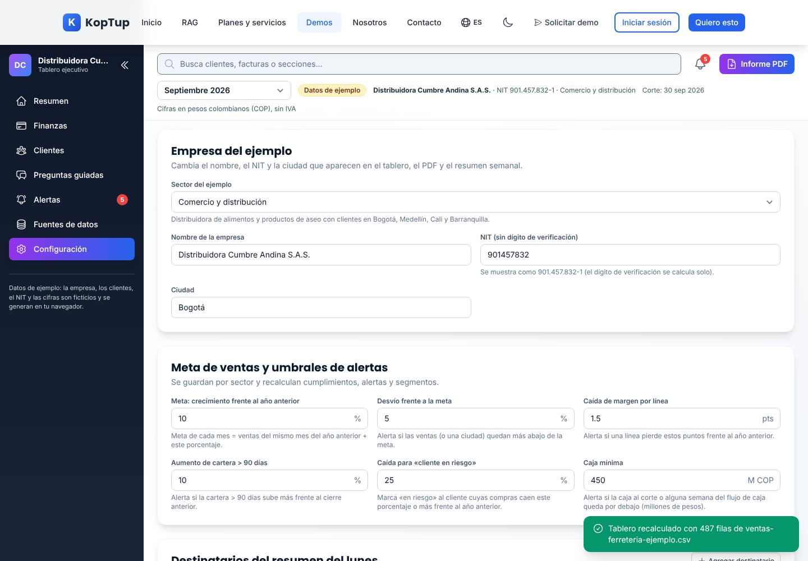

*Empresa del ejemplo y el inicio de «Meta de ventas y umbrales de alertas».*

- **Sector del ejemplo**: Comercio y distribución (Distribuidora Cumbre Andina S.A.S., clientes en Bogotá, Medellín, Cali y Barranquilla), Salud (IPS) (Clínica Ambulatoria Brisas del Río S.A.S., sedes Usaquén, Kennedy, Chía y Soacha) o Servicios profesionales (Meridiano Consultores Asociados S.A.S., oficinas en Bogotá, Medellín, Bucaramanga y Pereira). Cada sector trae sus propias facturas, líneas y gastos.
- **Empresa**: nombre, NIT y ciudad. El dígito de verificación se calcula solo; si lo escribes con guion (por ejemplo 901457832-0) y no corresponde, al guardar avisa «El dígito de verificación no corresponde: para el NIT 901457832 es 1.». Aparecen en el tablero, el PDF y el resumen semanal.
- **Meta y umbrales**: crecimiento de la meta frente al año anterior (10 % en comercio, 12 % en salud y servicios) y cinco umbrales: desvío frente a la meta (5 %), caída de margen por línea (1,5 pts), aumento de cartera a más de 90 días (10 %), caída para «cliente en riesgo» (25 %) y caja mínima (450, 200 o 150 millones según el sector). Se guardan por sector.
- **Destinatarios del resumen del lunes**: nombre o cargo, canal (correo o WhatsApp) y dirección; hasta 10. Por defecto: Gerencia general por correo y Gerencia financiera por WhatsApp, con datos de ejemplo.
- **Guardar cambios** valida los datos (nombre no vacío, NIT de 6 a 10 dígitos y su dígito de verificación, meta entre −50 % y 100 %, correo válido, celular de al menos 10 dígitos) y avisa «Configuración guardada en este navegador». **Descartar cambios** vuelve a lo guardado. **Restablecer todo** abre la misma confirmación que «Restablecer demo».

La configuración se guarda solo en este navegador (sobrevive a recargar la página); nadie más la ve.

### Informe PDF

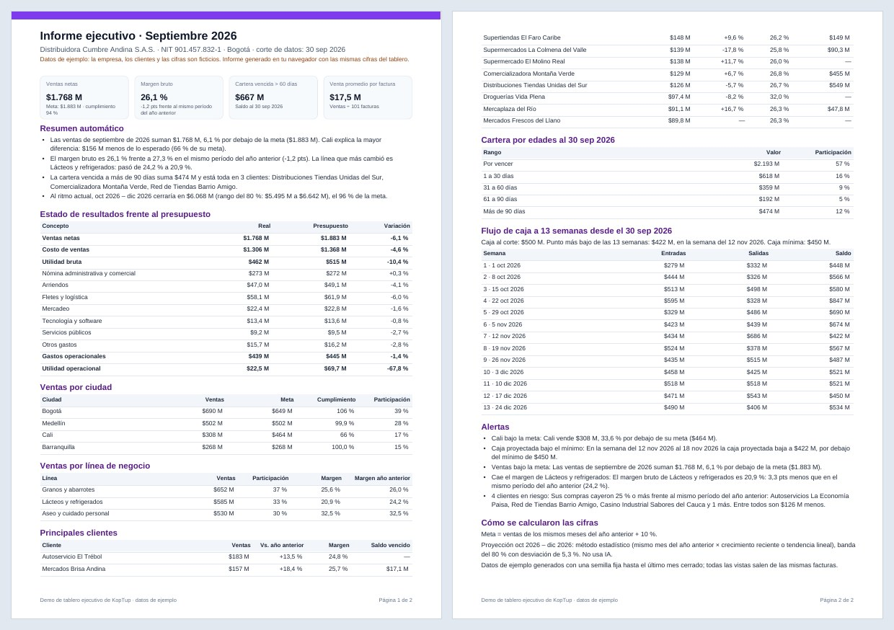

*Las dos páginas A4 del informe de septiembre de 2026.*

El PDF se arma en el navegador con las mismas cifras del tablero: encabezado con la empresa, el NIT, la ciudad y el corte; aviso de datos de ejemplo; los cuatro indicadores; resumen automático; estado de resultados; ventas por ciudad y por línea; principales clientes; cartera por edades; flujo de caja a 13 semanas (con la caja al corte, el punto más bajo y la caja mínima); alertas y «Cómo se calcularon las cifras». El archivo se llama, por ejemplo, `informe-ejecutivo-distribuidora-cumbre-andina-s-a-s-m-2026-09.pdf`.

### En el celular

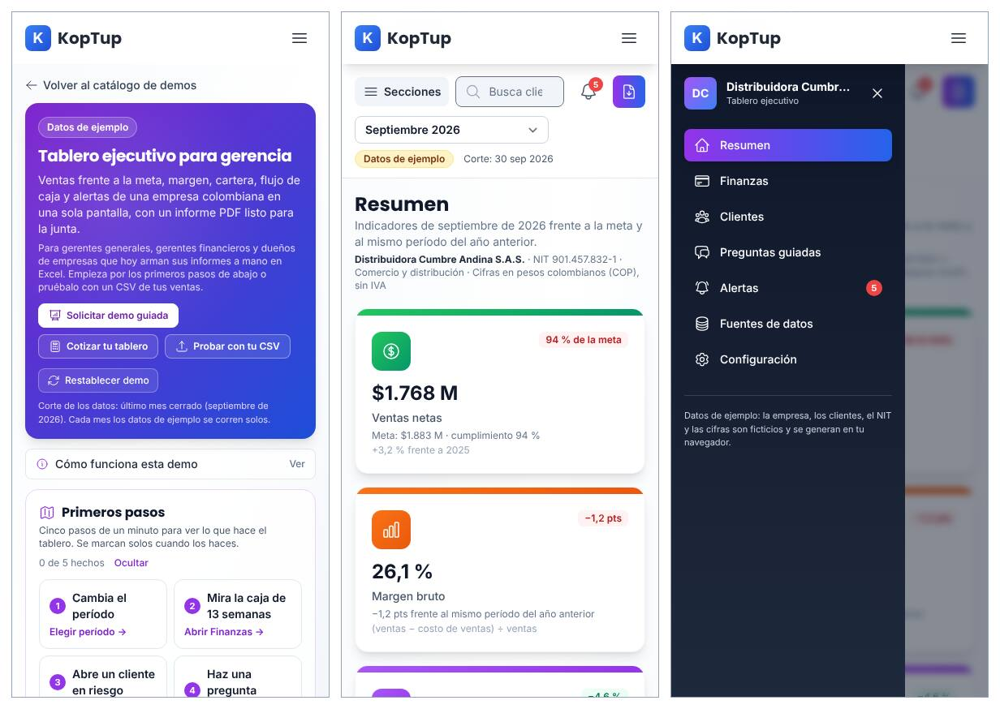

*A 390 px: el encabezado de la demo, la barra del tablero con el botón «Secciones» y el menú de secciones abierto.*

El menú lateral se abre con **Secciones** (distinto del menú del sitio, el de las tres rayas arriba a la derecha); al abrirlo el foco entra al menú, Escape lo cierra y el foco vuelve al botón. La barra fija del tablero ocupa 141 px (búsqueda, campana, PDF, período, insignia y corte) y la empresa y la moneda pasan al subtítulo de cada sección. Los primeros pasos se ven en dos columnas, los indicadores se apilan y Clientes pasa de tabla a tarjetas. En la prueba, ninguna sección se desbordó a lo ancho, en claro ni en oscuro.

---

## Qué es real y qué es simulado

| Parte | Real o simulado | Detalle |
|---|---|---|
| Empresas, NIT, clientes, vendedores, facturas y gastos | **Datos de ejemplo** | Se generan con una semilla fija: con el mismo mes de corte siempre son los mismos. Los nombres son inventados. |
| Fechas | **Real (relativas a hoy)** | El corte es el último mes cerrado en Colombia, calculado en el servidor en cada visita; los datos se corren un mes cada mes. |
| KPIs, estado de resultados, cartera, flujo de caja, segmentos y ranking | **Real (en el navegador)** | Se calculan con las facturas de ejemplo o con tu CSV, y cuadran entre vistas (hay pruebas automáticas que lo verifican). |
| Proyección | **Real, estadística** | Método estacional o tendencia lineal con banda del 80 %. No usa IA. |
| Resumen automático y alertas | **Real, con reglas** | Textos armados con plantillas a partir de las cifras. No usa IA. |
| Preguntas guiadas | **Real, con palabras clave** | Solo responde 6 preguntas guiadas; no entiende preguntas libres. Lo escrito no se envía a ningún servidor. |
| Primeros pasos | **Real** | Cada paso se marca con lo que hiciste de verdad (cambiar el período, abrir Finanzas, abrir una ficha, responder una pregunta, descargar el PDF). |
| Prueba con tu CSV | **Real (en el navegador)** | El archivo se lee en el navegador; no se sube ni se guarda. |
| Exportaciones CSV e informe PDF | **Real** | Se descargan de verdad, generados en el navegador. |
| Resumen del lunes | **Vista previa** | No se envía nada solo. «Compartir por WhatsApp» y «Abrir en tu correo» abren WhatsApp o tu correo con el texto. |
| Conectores (Siigo, SAP Business One, HubSpot…) | **Informativo** | Solo describen lo que se configura en un proyecto. |
| Dónde se guardan tus cambios | **Solo en este navegador** | Configuración, período y avance de los primeros pasos en `localStorage`; el CSV cargado se pierde al recargar. La demo no guarda nada en el servidor. |

---

## Acceso

**Cómo la ve un visitante.** La demo es **Abierta** (`publico`): cualquiera entra a `/demo/dashboard-ejecutivo` sin cuenta y sin pantalla de acceso (en la prueba, `GET /api/demo-access/dashboard-ejecutivo` respondió `allowed: true`, `reason: publico`). En el hub `/demo` su tarjeta se llama «Dashboard Ejecutivo» (insignias «Abierta» y «KPIs», «Panel con KPIs, finanzas y reportes») y tiene **Probar Demo** (abre la demo) y **Solicitar demo guiada** (`/solicitar-demo?demos=dashboard-ejecutivo`). Dentro de la demo, el encabezado tiene **Solicitar demo guiada** y **Cotizar tu tablero** (`/contact?service=bi-dashboard`), y al final está el bloque del sitio «¿Te gustaría algo así para tu negocio?» con **Solicitar demo guiada**, **Solicitar Cotización** (`/contact`) y **Ver Planes y Precios** (`/services#planes-rag`).

**Cómo se solicita.** No hace falta solicitarla. Quien quiera verla con sus propios datos usa **Solicitar demo guiada**; la solicitud llega a **Admin › Solicitudes de demo** como cualquier otra y sirve para agendar la reunión.

**Cómo la controla el admin.** El modo sale del catálogo del servidor y se cambia en **Admin › Catálogo de demos**. Si se pasa a «Con solicitud» o «Solo por invitación», los visitantes verán la pantalla de acceso y los accesos se conceden en **Admin › Solicitudes de demo** y **Admin › Accesos a demos**; si se desactiva, el visitante ve que la demo está en mantenimiento y el equipo sigue entrando. Si el backend no responde, la demo sigue abierta porque así está en la tabla de respaldo de la web, y como todo se calcula en el navegador funciona completa. Detalle en el [Manual del administrador](Doc-06-Manual-del-Administrador.md) y en [Flujos del visitante](Doc-04-Flujos-del-Visitante.md).

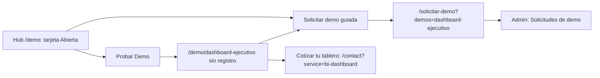

*Tres caminos: probarla de una vez, pedir una demo guiada o cotizar.*

---

## Limitaciones conocidas

1. **No hay IA.** El plan del producto se llama «Dashboard ejecutivo con IA», pero la demo no usa ningún modelo: el resumen y las alertas salen de reglas, la proyección es estadística y las preguntas guiadas solo reconocen seis preguntas por palabras clave. La demo lo dice en el encabezado («Cómo funciona esta demo») y en cada sección, así que no hay que prometer otra cosa en la presentación.
2. **Las cifras cambian cada mes.** Como el corte es el último mes cerrado, los montos de esta guía (corte del 30 sep 2026) no serán los mismos en otro mes; la historia sí (las pruebas automáticas lo comprueban para 12 cortes seguidos). El período que eligió el visitante se olvida cuando cambia el mes de corte.
3. **El selector cubre 12 meses.** Se pueden revisar los últimos 12 meses, sus trimestres y el año a la fecha; los 12 meses anteriores existen en los datos, pero solo se usan como comparación (meta y variación frente al año anterior).
4. **Con tu CSV, parte del tablero no aplica**: Finanzas solo muestra la utilidad bruta, no hay cartera ni flujo de caja, y desaparecen las preguntas y alertas que dependen de ellos. Al recargar, el archivo se descarta (es a propósito y la página lo avisa).
5. **El resumen del lunes no se envía solo.** Es una vista previa; el enlace que lleva es el de esta demo.
6. **Todo vive en el navegador**: la configuración y el avance de los primeros pasos no viajan a otro equipo y el vendedor no ve lo que hizo el prospecto.
7. **No encontramos botones muertos.** La sonda de botones probó los controles visibles al entrar (25 a 1440 px, también en inglés y en oscuro, y 17 a 390 px), con la demo limpia en cada carga: todos hacen lo que dicen. Solo marca dos falsos positivos: el selector de período (la sonda no ve el cambio de un `select` nativo) y «Resumen» cuando ya estás en Resumen (es la sección actual).
