# Guía de la demo: Facturación electrónica DIAN (simulador)

> Ruta `/demo/facturacion-electronica` · Modo de acceso: **Abierta** · Tipo: **datos de ejemplo** (simulador en el navegador; nada se envía a la DIAN ni a un servidor) · Plan del producto: [Facturación electrónica](Producto-facturacion-electronica.md)

**Resumen.** Es un simulador de facturación electrónica para Colombia: emites facturas, notas crédito y débito y documento equivalente POS con un emisor ficticio (Ceibalto Software S.A.S.), la demo valida el NIT con su dígito de verificación, calcula IVA y retenciones, genera un CUFE de ejemplo, el PDF con QR y el XML; además respondes facturas de proveedores con eventos RADIAN y exportas los libros del período. Está pensada para empresas que facturan desde su propio sistema (tienda en línea, ERP, punto de venta o software de salud) y para su equipo contable. Cualquier visitante la abre sin registrarse. Las fechas de los datos de ejemplo se calculan a partir de **hoy en Colombia**, así que siempre son coherentes con el día en que se abre la demo.

**En esta página:** [Recorrido sugerido](#recorrido-sugerido-demo-comercial-de-5-minutos) · [Pantallas y funciones](#pantallas-y-funciones) · [Qué es real y qué es simulado](#qué-es-real-y-qué-es-simulado) · [Acceso](#acceso) · [Limitaciones conocidas](#limitaciones-conocidas)

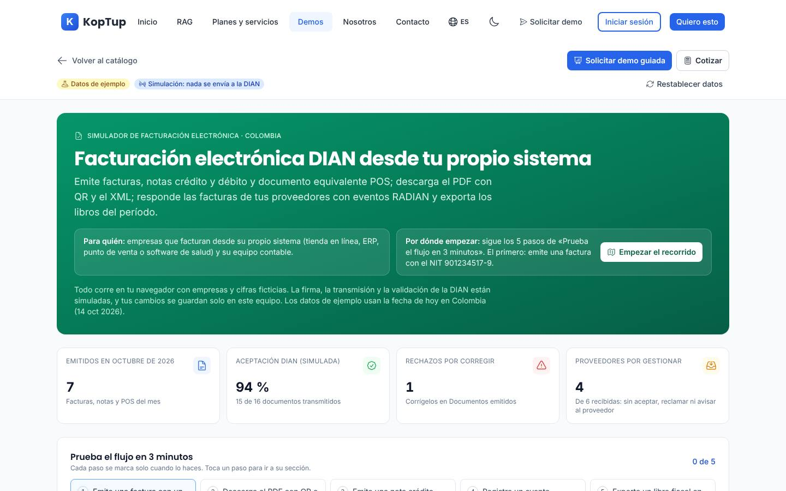

*Vista inicial: encabezado con «Volver al catálogo», «Solicitar demo guiada», «Cotizar» y los rótulos de simulación; presentación con «Para quién» y «Por dónde empezar»; los cuatro indicadores.*

> Las capturas y las cifras de esta guía se tomaron con la fecha del 14 de octubre de 2026. Con otra fecha cambian los días y el mes que aparecen, no el funcionamiento.

---

## Recorrido sugerido (demo comercial de 5 minutos)

La demo trae su propio recorrido de 5 pasos (**Prueba el flujo en 3 minutos**): cada paso se marca en verde solo cuando lo haces, el siguiente pendiente lleva el rótulo **Siguiente paso** y tocar un paso baja hasta su sección (los de emisión abren además la pestaña que toca). **Empezar el recorrido**, en la presentación, baja hasta los pasos y deja el foco en el siguiente. Este guion lo sigue (los pasos 1 y 2 de esta guía son el paso 1 de la demo). Si alguien ya usó la demo en ese navegador, empieza con **Restablecer datos** (arriba a la derecha).

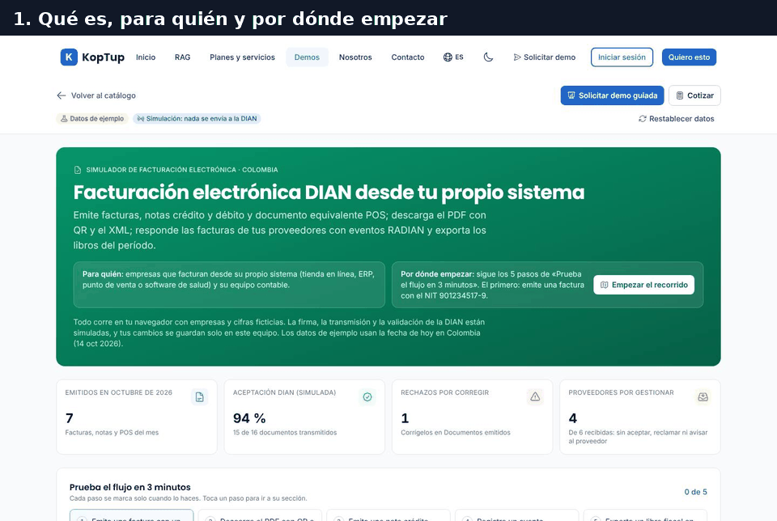

*Recorrido completo: emitir una factura, descargar su PDF, emitir una nota crédito, responder facturas de proveedores y exportar un libro fiscal.*

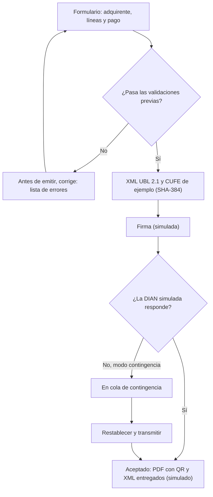

*Qué pasa al pulsar «Emitir»: todo ocurre en el navegador; la firma, la transmisión y la respuesta de la DIAN son simuladas.*

### Paso 1. Arma la factura y valida el NIT

En **Emisión de documentos**, pestaña **Factura de venta**, escribe en el NIT `901234517` (sin el dígito de verificación). El formulario ya trae tres líneas de ejemplo.

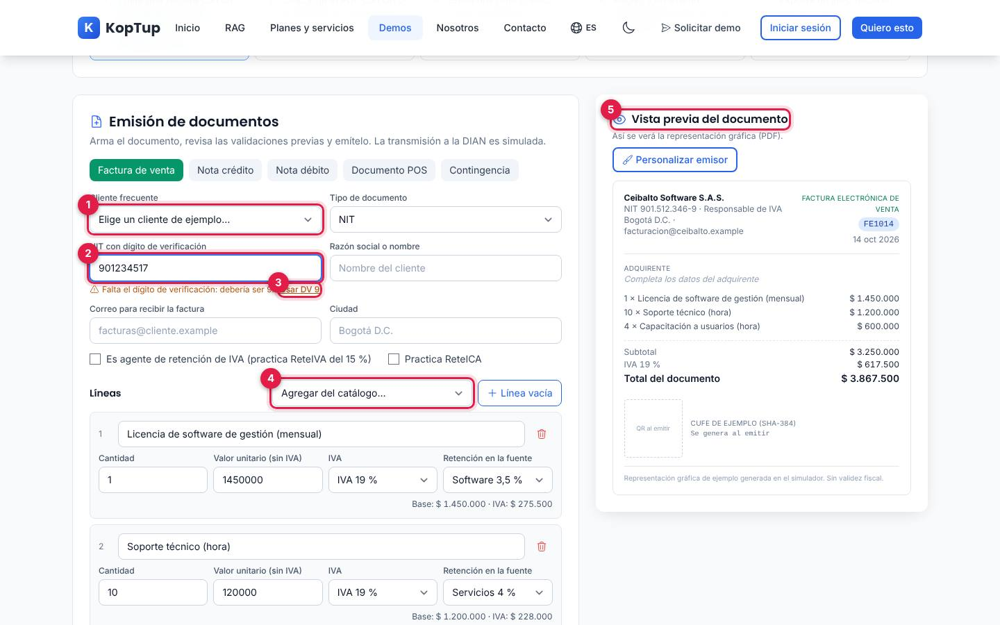

*Formulario de la factura con el NIT incompleto y la vista previa a la derecha.*

1. **Cliente frecuente**: completa todo el adquirente con uno de los 5 clientes de ejemplo.
2. **NIT con dígito de verificación**: el DV se valida con el algoritmo de la DIAN mientras escribes («DV correcto», «Falta el dígito de verificación: debería ser 9», «El DV no corresponde…»).
3. **Usar DV 9**: corrige el NIT con un clic. Como el NIT coincide con un cliente frecuente, la demo completa razón social, correo y ciudad («Cliente frecuente encontrado…»).
4. **Agregar del catálogo…** (6 productos y servicios de ejemplo) o **Línea vacía**. Cada línea tiene cantidad, valor sin IVA, tarifa de IVA y retención en la fuente.
5. **Vista previa del documento**: así se verá el PDF; cambia mientras editas y lleva la fecha de hoy.

Más abajo están la forma y el medio de pago (con la fecha de vencimiento: a 30 días, «Vence el 13 nov 2026»), el resumen (subtotal, base e IVA por tarifa, total), las retenciones informativas, la resolución de numeración de ejemplo con el siguiente número (`FE1014`) y la lista **Antes de emitir, corrige:** con lo que falta. **Emitir factura** queda desactivado hasta que no haya errores.

Qué decir: «El sistema no deja emitir con un NIT mal escrito: el error se corrige antes, no cuando la DIAN rechaza».

### Paso 2. Emite y mira la factura aceptada

Pulsa **Emitir factura**. Las cinco fases se marcan en unos dos segundos.

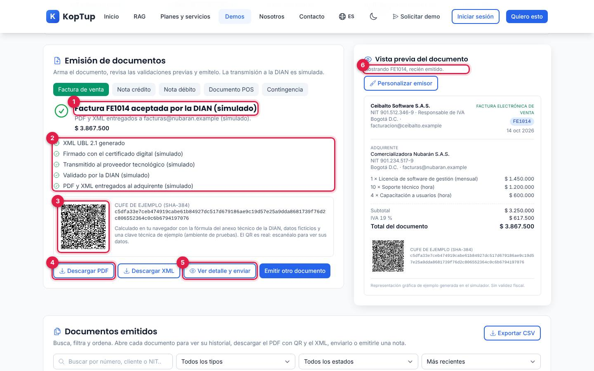

*Resultado de la emisión: la factura FE1014 aceptada (simulado), con su CUFE de ejemplo y su QR.*

1. **Factura FE1014 aceptada por la DIAN (simulado)**, el correo al que se «entregó» y el total ($ 3.867.500).
2. **Fases**: XML UBL 2.1 generado, firmado, transmitido al proveedor tecnológico, validado por la DIAN y entregado al adquirente (todas simuladas salvo el XML).
3. **CUFE de ejemplo (SHA-384) y QR**: el CUFE se calcula en el navegador con la fórmula del anexo técnico, datos ficticios y una clave técnica de ejemplo; el QR es real y se puede escanear.
4. **Descargar PDF** y **Descargar XML**.
5. **Ver detalle y enviar**: abre el detalle del documento (ver [Detalle del documento](#detalle-del-documento)). Al lado, **Emitir otro documento** limpia el formulario.
6. **Vista previa**: ahora muestra «Mostrando FE1014, recién emitido».

El documento sale con la fecha y la hora actuales de Colombia (por ejemplo, «Emitido el 14 oct 2026 a las 01:50»). Como el resultado es más corto que el formulario, al terminar la página sube hasta él y el foco queda en su título, así no se pierde de vista (ni con el teclado o un lector de pantalla).

### Paso 3. Descarga el PDF con QR o el XML

Baja a **Documentos emitidos** (paso 2 del recorrido). La factura nueva está de primera.

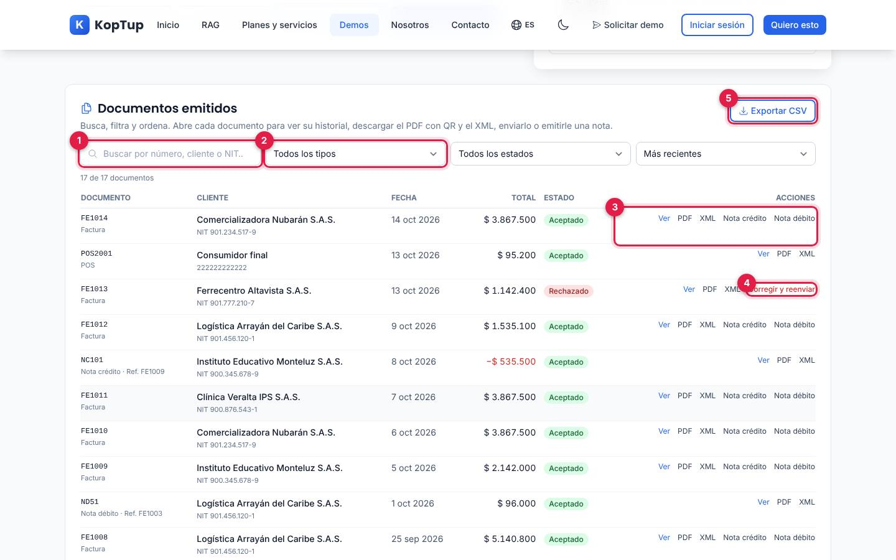

*Lista de documentos con búsqueda, filtros y acciones por fila.*

1. **Buscar** por número, cliente o NIT, con o sin el dígito de verificación (`901.234.517-9` o `901234517`); Escape borra la búsqueda.
2. **Filtros**: tipo (factura, nota crédito, nota débito, POS), estado (aceptado, rechazado, en contingencia) y orden (más recientes, más antiguos, mayor o menor valor).
3. **Acciones**: **Ver**, **PDF**, **XML** y, en las facturas aceptadas, **Nota crédito** y **Nota débito**. Pulsa **PDF**: se descarga `FE1014.pdf` (ver el [PDF de ejemplo](#pdf-y-xml)).
4. **Corregir y reenviar**: solo en la factura rechazada de los datos de ejemplo (`FE1013`).
5. **Exportar CSV**: descarga los documentos filtrados (`documentos-AAAA-MM-DD.csv`).

### Paso 4. Emite una nota crédito

En la fila de una factura pulsa **Nota crédito** (en la prueba, `FE1012`). La demo sube al formulario con la pestaña **Nota crédito** y la factura ya elegida.

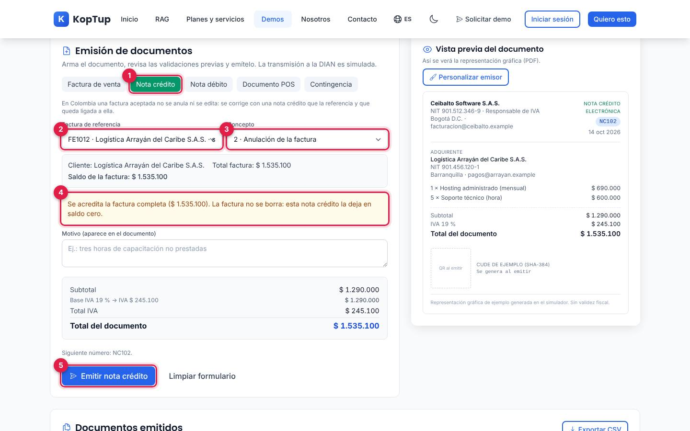

*Nota crédito por anulación de la factura FE1012.*

1. **Nota crédito**: la pestaña explica que en Colombia una factura aceptada no se anula ni se edita; se corrige con una nota crédito ligada a ella.
2. **Factura de referencia**: lista las facturas aceptadas con su saldo.
3. **Concepto**: los 6 conceptos de nota crédito (devolución parcial, anulación, rebaja, ajuste de precio, pronto pago y volumen).
4. Con **2 · Anulación**, la nota acredita la factura completa («La factura no se borra: esta nota crédito la deja en saldo cero»). Con **1 · Devolución** pide las cantidades por línea; con los demás, el valor y el IVA de la nota.
5. **Emitir nota crédito**: sale como `NC102` («Nota crédito NC102 aceptada por la DIAN (simulado)») y queda en el historial de la factura.

Qué decir: «La nota crédito queda amarrada a la factura y el saldo se actualiza solo».

### Paso 5. Responde las facturas de tus proveedores (RADIAN)

Baja a **Facturas de proveedores (RADIAN)**.

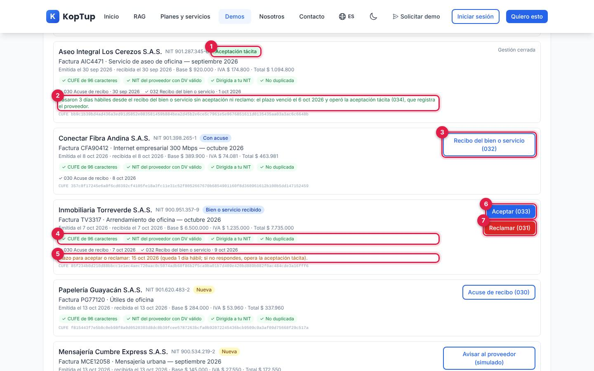

*Facturas recibidas de proveedores, con sus validaciones, los eventos registrados y los plazos.*

1. **Aceptación tácita**: la factura de Aseo Integral Los Cerezos tiene el recibo del bien o servicio (032) de hace más de 3 días hábiles y nadie la aceptó ni la reclamó.
2. La demo lo explica: «el plazo venció el 6 oct 2026 y operó la aceptación tácita (034), que registra el proveedor».
3. Los eventos van en orden: **Acuse de recibo (030)** → **Recibo del bien o servicio (032)** → aceptar o reclamar.
4. **Validaciones** de cada factura: CUFE de 96 caracteres, NIT del proveedor con DV válido, dirigida a tu NIT y no duplicada.
5. **Plazo para aceptar o reclamar**: 3 días hábiles después del recibo del bien o servicio, sin fines de semana ni festivos de Colombia (en la de Inmobiliaria Torreverde, «15 oct 2026 (queda 1 día hábil…)»). Si pasa el plazo sin respuesta, la factura pasa sola a **Aceptación tácita**.
6. **Aceptar (033)**: registra la aceptación expresa. Pulsa este botón: la factura pasa a **Aceptada** y «Por gestionar» baja de 4 a 3.
7. **Reclamar (031)**: despliega el motivo (01 a 04) y **Registrar reclamo**.

Con el teclado, al registrar un evento el foco pasa a la siguiente acción de la misma factura (por ejemplo, de **Acuse de recibo (030)** a **Recibo del bien o servicio (032)** y luego a **Aceptar (033)**).

Más abajo, la factura de Mensajería Cumbre Express viene **dirigida a otro NIT**:

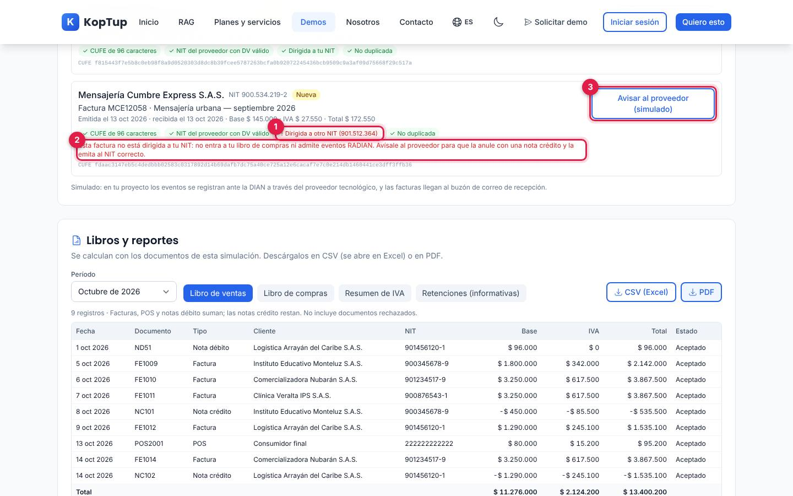

*Una factura que no es para tu empresa no admite eventos RADIAN: se le avisa al proveedor.*

1. La validación **Dirigida a otro NIT (901.512.364)** sale en rojo.
2. La demo explica que no entra a tu libro de compras, que no puedes registrarle eventos RADIAN y que el proveedor debe anularla con una nota crédito y emitirla al NIT correcto. Desde que llega, ni la factura ni su IVA cuentan en el libro de compras ni en el resumen de IVA.
3. **Avisar al proveedor (simulado)**: la factura queda **Devuelta al proveedor** y sale de «Por gestionar». No es un evento RADIAN ni sale ningún mensaje.

### Paso 6. Exporta un libro fiscal

Baja a **Libros y reportes**.

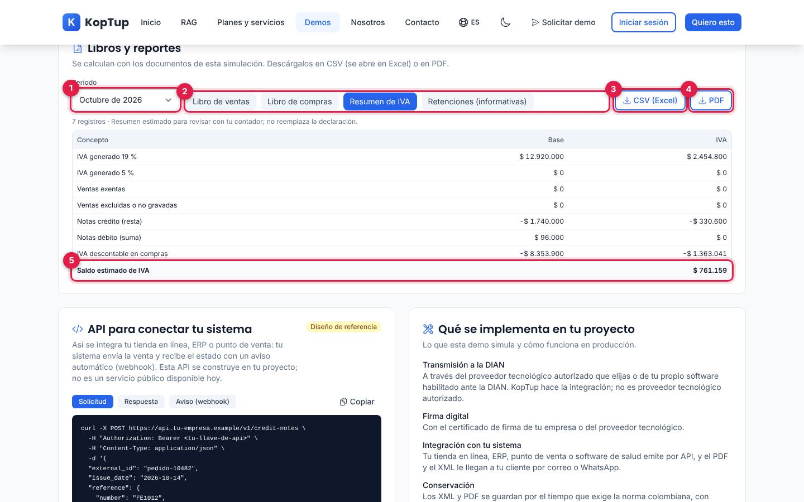

*Resumen de IVA de octubre de 2026 calculado con los documentos de la simulación.*

1. **Período**: los meses con movimientos (el mes en curso y los anteriores del historial de ejemplo; con la fecha de la captura, octubre, septiembre y agosto de 2026) o **Todos los meses**. Arranca en el mes en curso; en los primeros días de un mes, si aún no hay documentos, arranca en el anterior.
2. **Libros**: Libro de ventas, Libro de compras, Resumen de IVA y Retenciones (informativas). Las pestañas se recorren también con las flechas del teclado.
3. **CSV (Excel)**: descarga el libro (por ejemplo `resumen-iva-2026-10.csv`; con todos los meses, `resumen-iva-2026-08-a-2026-10.csv`).
4. **PDF**: el mismo libro en PDF, con la franja «Datos de ejemplo del simulador de KopTup. No es un reporte oficial».
5. **Saldo estimado de IVA**: IVA generado menos notas crédito e IVA descontable en compras («para revisar con tu contador; no reemplaza la declaración»).

Al descargar, el recorrido queda en **5 de 5** y aparece «¡Completaste el recorrido! ¿Quieres verlo con los datos y el sistema de tu empresa?» con el enlace **Solicitar demo guiada**. Arriba, «Emitidos en octubre de 2026» pasa de 7 a 9 y «Proveedores por gestionar» baja según lo que respondiste. Cierre sugerido: bajar a **API para conectar tu sistema** y **Qué se implementa en tu proyecto** para explicar qué es simulado y qué se construye.

---

## Pantallas y funciones

La demo es una sola página larga, sin pestañas de navegación: encabezado, presentación, indicadores, recorrido, emisión con vista previa, documentos emitidos, facturas de proveedores, libros y reportes, API y «Qué se implementa en tu proyecto». Al final está el bloque común de las demos («¿Te gustaría algo así para tu negocio?»).

### Encabezado, presentación, indicadores y recorrido

| Elemento | Qué hace |
|---|---|
| **Volver al catálogo** | Va a `/demo`. |
| **Solicitar demo guiada** | Va a `/solicitar-demo?demos=facturacion-electronica` (la demo queda elegida). |
| **Cotizar** | Va a `/contact?service=facturacion-electronica` (el formulario de contacto llega con «Facturación electrónica» como servicio). |
| **Datos de ejemplo** y **Simulación: nada se envía a la DIAN** | Rótulos fijos. |
| **Restablecer datos** | Pregunta «¿Borrar tus cambios y volver a los datos de ejemplo?» con **Sí, restablecer** y **Cancelar**. |
| Presentación | Qué es, **Para quién** (empresas que facturan desde su propio sistema y su equipo contable) y **Por dónde empezar** con el botón **Empezar el recorrido**. Aclara que todo corre en el navegador con empresas ficticias y que los datos de ejemplo usan la fecha de hoy en Colombia. |
| **Emitidos en {mes}** | Facturas, notas y POS del mes en curso (7 al empezar, con la fecha de la captura) y cuántos hay en cola de contingencia. |
| **Aceptación DIAN (simulada)** | Porcentaje de aceptados sobre transmitidos (94 %: 15 de 16 al empezar). |
| **Rechazos por corregir** | Documentos rechazados (1 al empezar: `FE1013`). |
| **Proveedores por gestionar** | Facturas de proveedores sin aceptar, reclamar ni avisar al proveedor («De 6 recibidas…»; 4 al empezar). |
| **Prueba el flujo en 3 minutos** | Los 5 pasos del recorrido con su avance («0 de 5») y, al terminar, la invitación a la demo guiada. |

Mientras se arman los datos de ejemplo (un instante después de cargar), la página muestra «Preparando los datos de ejemplo con la fecha de hoy…». Si lo guardado en ese navegador era de otro mes, la demo vuelve a armar los datos con la fecha de hoy, conserva el emisor personalizado y lo avisa («Actualizamos los datos de ejemplo a octubre de 2026: lo que habías hecho en septiembre de 2026 se descartó…»).

### Datos de ejemplo y fechas

Los documentos de ejemplo cubren unos dos meses (46 días hábiles) hasta el día hábil anterior a hoy: 13 facturas, una nota débito (`ND51`, intereses sobre `FE1003`), una nota crédito (`NC101`, sobre `FE1009`), un documento POS y la factura rechazada `FE1013`. Todos caen en días hábiles de Colombia (los festivos se calculan para cualquier año, incluidos los que se trasladan al lunes y los de Semana Santa). La resolución de numeración de ejemplo se expidió nueve meses antes y vence un año después, así que siempre está vigente.

### Emisión de documentos

Pestañas **Factura de venta**, **Nota crédito**, **Nota débito**, **Documento POS** y **Contingencia** (también con las flechas, Inicio y Fin del teclado). La factura se ve en los [pasos 1 y 2](#paso-1-arma-la-factura-y-valida-el-nit) y la nota crédito en el [paso 4](#paso-4-emite-una-nota-crédito).

- **Adquirente**: NIT (8 a 10 dígitos más DV) o cédula (6 a 10 dígitos), razón social, correo y ciudad; casillas «Es agente de retención de IVA (practica ReteIVA del 15 %)» y «Practica ReteICA» (con tarifa por mil de ejemplo).
- **Líneas**: IVA 19 %, 5 %, exento o excluido; retención en la fuente sin retención, servicios 4 %, honorarios 11 %, compras 2,5 % o software 3,5 %.
- **Pago**: contado o crédito (15 a 90 días, con la fecha de vencimiento) y medio de pago (transferencia, efectivo o tarjeta).
- **Retenciones informativas**: ReteFuente, ReteIVA y ReteICA que te practicaría el comprador y el neto estimado a recibir. No restan del total del documento.
- **Nota débito**: factura de referencia, concepto (intereses, gastos por cobrar, cambio del valor u otros), valor e IVA. Sale con prefijo `ND`.
- **Documento POS**: «Consumidor final (222222222222)» o «Con datos del comprador», líneas y medio de pago; sale con prefijo `POS`. Tiene el enlace **Ver la demo de POS** (`/demo/pos`).
- **Validaciones de las notas**: no deja pasar del saldo de la factura, devolver más de lo facturado ni anular una factura que ya tiene notas crédito.
- **Limpiar formulario** vuelve a los valores de ejemplo de la pestaña. Al pasar de una nota a **Factura de venta** se limpian la factura de referencia y el concepto.

### Contingencia

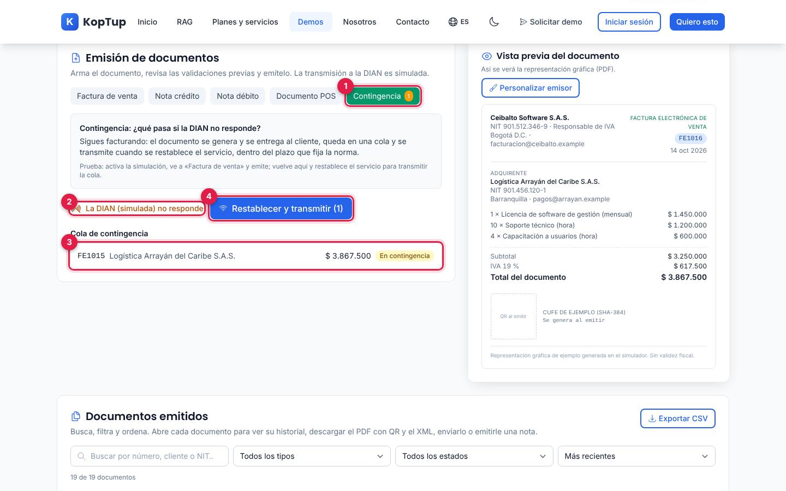

*Modo contingencia activo: la factura FE1015 quedó en cola y espera a que se restablezca el servicio.*

1. Pulsa **Simular que la DIAN no responde**. En las demás pestañas aparece el aviso «Modo contingencia activo…» y el botón de emitir cambia a **Emitir en contingencia**. La pestaña **Contingencia** muestra cuántos documentos hay en cola.
2. Emite una factura: queda **En contingencia** («Factura FE1015 en cola de contingencia»), con el mensaje «Ya puedes entregarlo al cliente; se transmitirá cuando restablezcas el servicio».
3. La **Cola de contingencia** lista lo pendiente.
4. **Restablecer y transmitir (N)** transmite la cola y los documentos pasan a **Aceptado** («1 documento transmitido y aceptado (simulado)»).

### Vista previa y emisor

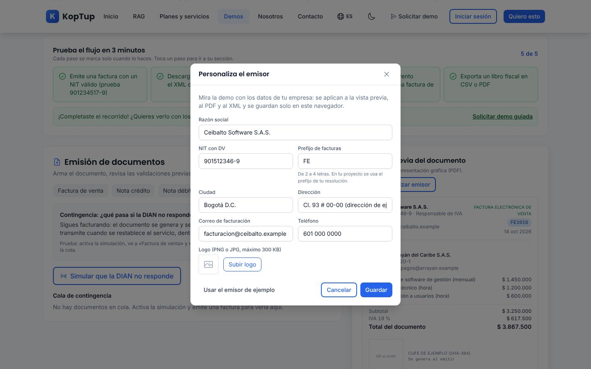

*Ventana «Personaliza el emisor»: los datos se aplican a la vista previa, al PDF y al XML.*

- La **vista previa** muestra emisor, tipo y número, fecha, adquirente, hasta 5 líneas («+ N líneas más»), totales, el QR y el CUFE (antes de emitir dicen «Se genera al emitir»).
- **Personalizar emisor**: razón social, NIT con DV, prefijo de facturas (2 a 4 letras), ciudad, dirección, correo, teléfono y logo PNG o JPG de hasta 300 KB. **Usar el emisor de ejemplo** vuelve a Ceibalto Software S.A.S. Sirve para mostrarle la demo al prospecto con los datos de su empresa; se guarda solo en ese navegador. Si cambias el NIT, la demo recalcula los CUFE de ejemplo.
- Las ventanas se cierran con **Escape** o con la X; mientras están abiertas, el tabulador no sale de ellas y, al cerrarlas, el foco vuelve al botón que las abrió.

### Detalle del documento

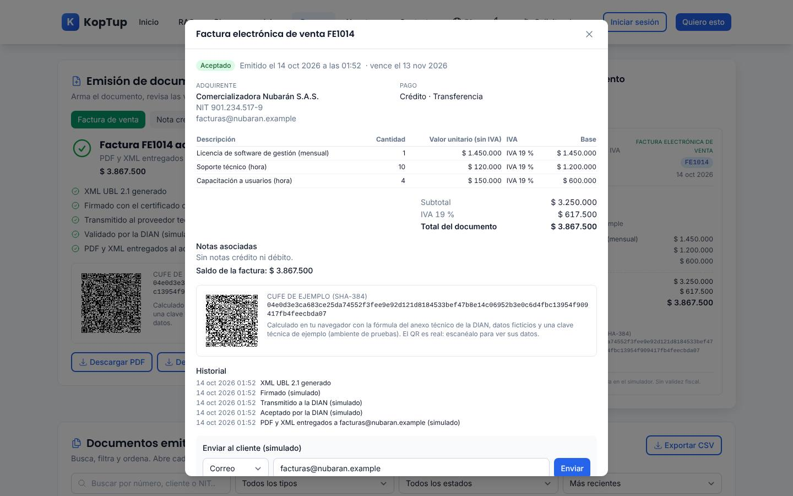

*Detalle de la factura FE1014: adquirente, pago, líneas, notas asociadas, CUFE con QR e historial.*

- Estado, fecha y hora de emisión, vencimiento, adquirente y forma de pago.
- Líneas y totales, **Notas asociadas** y **Saldo de la factura**.
- CUFE (o CUDE en notas y POS) con su QR.
- **Historial**: XML generado, firmado, transmitido, aceptado, entregado, reenvíos, correcciones y notas emitidas, con fecha y hora.
- **Enviar al cliente (simulado)**: canal correo o WhatsApp y destino (valida el correo o el celular). No sale ningún mensaje: queda registrado en el historial («Reenviado a … (simulado)»).
- Botones **PDF**, **XML**, **Nota crédito** y **Nota débito**.

### Corregir un rechazo

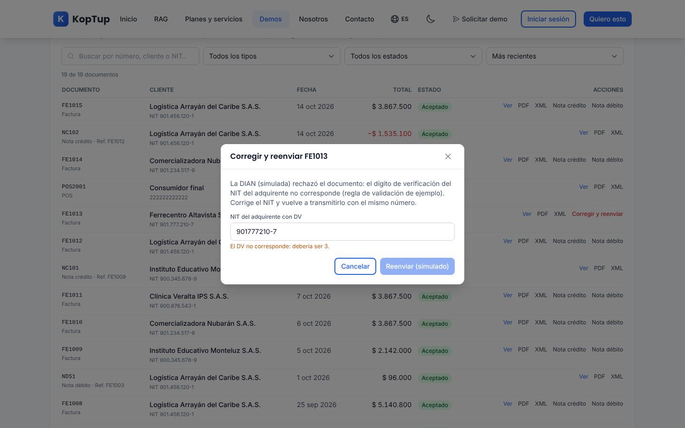

*La factura FE1013 de los datos de ejemplo fue rechazada (simulado) porque el DV del NIT del adquirente no corresponde.*

Escribe el NIT con el DV correcto (la ventana indica cuál debería ser) y pulsa **Reenviar (simulado)**; el botón está desactivado mientras el DV siga mal. La factura se reenvía con el mismo número, pasa a **Aceptado** y el indicador «Rechazos por corregir» baja a 0.

### PDF y XML

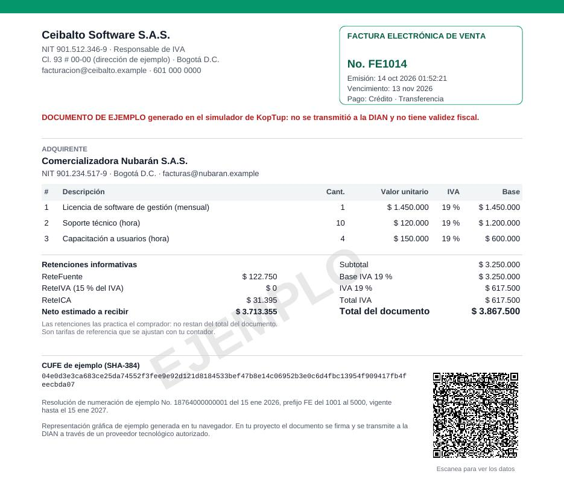

*Página del `FE1014.pdf` generado en el navegador: marca de agua «EJEMPLO», retenciones informativas, CUFE, resolución de ejemplo y QR.*

- **PDF**: representación gráfica con la franja «DOCUMENTO DE EJEMPLO generado en el simulador de KopTup: no se transmitió a la DIAN y no tiene validez fiscal», marca de agua y QR escaneable. Las notas muestran la factura de referencia, el concepto y el motivo.
- **XML**: estructura UBL 2.1 simplificada con un comentario que aclara que no tiene firma digital, extensiones DIAN ni validez fiscal.

### Facturas de proveedores (RADIAN)

Ver el [paso 5](#paso-5-responde-las-facturas-de-tus-proveedores-radian). Los datos traen 6 facturas: una ya aceptada (Energía del Altiplano), una en aceptación tácita (Aseo Integral Los Cerezos), una con acuse (Conectar Fibra Andina), una con recibo del bien o servicio y 1 día hábil de plazo (Inmobiliaria Torreverde), una nueva (Papelería Guayacán) y una dirigida a otro NIT (Mensajería Cumbre Express).

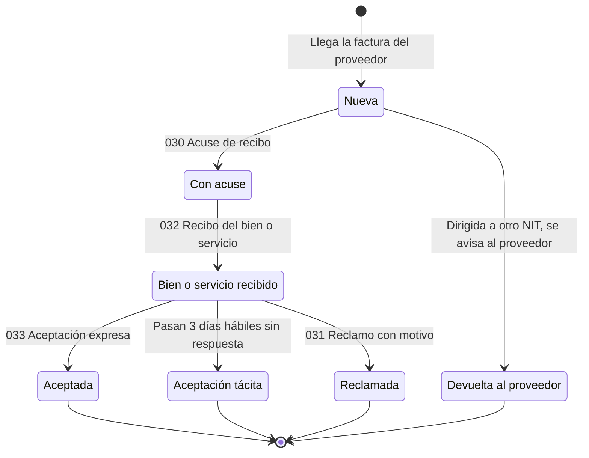

*Estados de una factura de proveedor en la demo y lo que la mueve.*

### Libros y reportes

Ver el [paso 6](#paso-6-exporta-un-libro-fiscal).

| Libro | Qué incluye |
|---|---|
| Libro de ventas | Facturas, POS y notas débito suman; las notas crédito restan. No incluye rechazados. |
| Libro de compras | Facturas de proveedores dirigidas a tu NIT; no incluye las reclamadas ni las dirigidas a otro NIT (con o sin aviso al proveedor). |
| Resumen de IVA | IVA generado por tarifa, exentas, excluidas, notas, IVA descontable y saldo estimado. |
| Retenciones (informativas) | ReteFuente, ReteIVA y ReteICA que te practicarían tus clientes, por factura. |

Cada libro muestra el número de registros, una fila de total y se descarga en CSV o PDF.

### API y «Qué se implementa en tu proyecto»

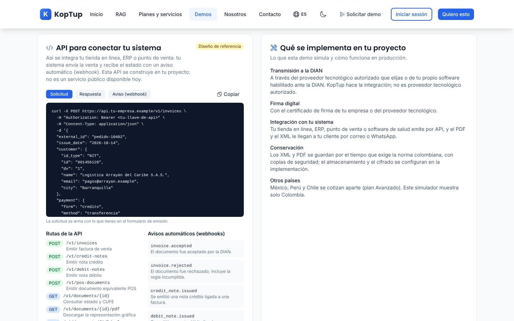

*Panel «API para conectar tu sistema» (diseño de referencia) y lo que se implementa en el proyecto real.*

- **API para conectar tu sistema** lleva el rótulo **Diseño de referencia** y dice: «Esta API se construye en tu proyecto; no es un servicio público disponible hoy». Las pestañas **Solicitud**, **Respuesta** y **Aviso (webhook)** muestran ejemplos; la solicitud (`curl`) se arma con lo que tengas en el formulario de emisión (solo las notas llevan el bloque `reference` de la factura de referencia) y con la fecha de hoy. **Copiar** la copia al portapapeles. Debajo, 10 **Rutas de la API** (el libro de ventas pide el mes en curso) y 6 **Avisos automáticos (webhooks)** de ejemplo. Los valores de relleno (dominio, llave, identificadores) salen en el idioma de la página.
- **Qué se implementa en tu proyecto**: transmisión por el proveedor tecnológico autorizado que elijas o por tu propio software habilitado («KopTup hace la integración; no es proveedor tecnológico autorizado»), firma digital con certificado, integración por API, conservación de XML y PDF, y otros países (México, Perú y Chile se cotizan aparte; el simulador muestra solo Colombia).

### En el celular

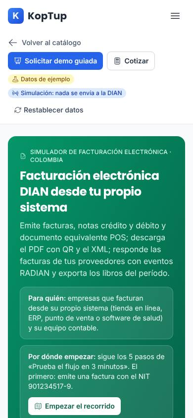

*Encabezado y presentación en un teléfono (390 px).*

En pantallas pequeñas los botones del encabezado, los rótulos y **Restablecer datos** pasan a varias filas, las pestañas de emisión también, los campos van en una columna, la vista previa queda debajo del formulario, la lista de documentos pasa a tarjetas y las tablas de los libros se desplazan de lado. La página no se desborda a lo ancho, en claro ni en oscuro.

---

## Qué es real y qué es simulado

| Parte | Real o simulado | Detalle |
|---|---|---|
| Emisor, clientes, proveedores, documentos y cifras | **Datos de ejemplo** | Empresas ficticias; los correos usan dominios `.example`. |
| Fechas de los datos de ejemplo | **Relativas a hoy** | Se calculan con la fecha de hoy en Colombia, en días hábiles y con los festivos colombianos. |
| Validación del NIT con su DV | **Real** | Algoritmo de la DIAN, calculado en el navegador. |
| Cálculo de IVA, retenciones, saldos, plazos y libros | **Real (en el navegador)** | Con tarifas de referencia que se ajustan con el contador. El libro de compras y el IVA descontable solo toman facturas dirigidas a tu NIT y sin reclamo. |
| CUFE / CUDE | **De ejemplo** | SHA-384 con la fórmula del anexo técnico, pero con datos ficticios y una clave técnica de ejemplo. |
| QR | **Real** | Se puede escanear; contiene los datos del documento de ejemplo. |
| PDF y XML | **Reales, sin validez fiscal** | Se generan en el navegador; XML UBL 2.1 simplificado, sin firma. |
| Firma, transmisión y respuesta de la DIAN | **Simuladas** | Siempre aceptan (salvo la contingencia que tú activas). |
| Envío por correo o WhatsApp | **Simulado** | Solo queda en el historial. |
| Eventos RADIAN y aviso al proveedor | **Simulados** | Se registran en la página; no llegan a la DIAN ni al proveedor. |
| API y webhooks | **Diseño de referencia** | No existen como servicio; son ejemplos de cómo sería la integración. |
| Dónde se guardan tus cambios | **Solo en este navegador** | `localStorage`; si no hay espacio (por ejemplo, un logo pesado) la demo lo avisa y sigue funcionando sin recordar. |

---

## Acceso

**Cómo lo ve un visitante.** La demo es **Abierta**: en `/demo` su tarjeta lleva la insignia «Abierta» con **Probar Demo** (abre `/demo/facturacion-electronica` directamente) y **Solicitar demo guiada** (`/solicitar-demo?demos=facturacion-electronica`). No hay pantalla de acceso ni hace falta cuenta, y la demo en sí no usa el backend. Dentro de la demo, el encabezado lleva **Solicitar demo guiada** y **Cotizar**; al final de la página está el bloque «¿Te gustaría algo así para tu negocio?» con **Solicitar demo guiada**, **Solicitar Cotización** y **Ver Planes y Precios**.

**Cómo se solicita una demo guiada y cómo la gestiona el admin.** La solicitud del formulario llega a **Admin › Solicitudes de demo** como cualquier otra. Como la demo es abierta, no hace falta conceder acceso para usarla; la solicitud sirve para agendar la demo guiada. Un admin puede cambiar el modo de acceso en **Admin › Catálogo de demos** (por ejemplo, a «Con solicitud»); en ese caso empezaría a mostrarse la pantalla de acceso. Detalle en el [Manual del administrador](Doc-06-Manual-del-Administrador.md) y en [Flujos del visitante](Doc-04-Flujos-del-Visitante.md).

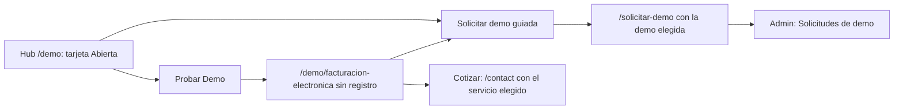

*Tres caminos: probarla de una vez, pedir una demo guiada o cotizar.*

---

## Limitaciones conocidas

1. **La tarjeta del hub todavía promete más que la demo.** Dice «Facturación Electrónica Multi-país», «8 países LatAm: CO, MX, AR, CL, PE, UY, PY, EC», «Recepción de proveedores con OCR» y «API + SDKs + plugins ERP/POS + modo white-label». La demo muestra solo Colombia (lo dice en «Otros países»), no tiene OCR y la API es un diseño de referencia. El texto nuevo de la tarjeta está propuesto al catálogo y falta aplicarlo.
2. **Todo es simulado**: no hay firma, transmisión ni respuesta real de la DIAN; el CUFE usa una clave técnica de ejemplo y los documentos no tienen validez fiscal.
3. **Los cambios viven solo en el navegador.** Otro equipo o navegador ve los datos de ejemplo. Al cambiar de mes, la demo vuelve a armar los datos con la fecha de hoy y descarta lo emitido el mes anterior (conserva el emisor personalizado y lo avisa).
4. **Un solo caso de rechazo, por diseño.** Solo la factura `FE1013` de los datos de ejemplo llega rechazada: las validaciones previas impiden emitir documentos nuevos con errores. Para repetir la corrección, usa **Restablecer datos**.
5. **RADIAN simplificado.** Aceptar (033) o reclamar (031) exige antes el acuse (030) y el recibo del bien o servicio (032), como pide la norma para la factura como título valor. La aceptación tácita se muestra cuando vence el plazo, pero el evento 034 no se registra en la demo (en la realidad lo registra el proveedor).
6. **En inglés, los documentos siguen en español.** La interfaz está traducida, pero los datos de los documentos (productos, conceptos de los proveedores, razones sociales, el texto del QR y del XML) quedan en español, como en una factura colombiana, y los valores en pesos usan el formato colombiano (`$ 1.450.000`).
