# Guía de la demo: Firma electrónica

> Ruta `/demo/firma-electronica` · Modo de acceso: **Abierta** · Tipo: **datos de ejemplo** (todo corre en el navegador y se guarda en ese navegador; no llama al servidor, no envía mensajes ni usa IA) · Plan del producto: [Firma electrónica](Producto-firma-electronica.md)

**Resumen.** Muestra cómo funcionaría una plataforma de firma electrónica para una empresa colombiana, con el caso ficticio de **Cordillera Servicios Temporales S.A.S.** (NIT 901.537.284-9, Bogotá). En **Inicio** se ven ocho sobres de ejemplo (contrato de trabajo, otrosí, acta de dotación, consentimiento informado, arrendamiento, autorización de datos, orden de compra y paz y salvo) con indicadores que se calculan con esa lista. **Nuevo sobre** arma un sobre en cuatro pasos desde una plantilla con variables o desde un PDF propio; la **Vista del firmante** recorre lo que vería cada persona: abre el enlace, recibe un código (que la demo muestra en pantalla), firma con el mouse o el dedo y acepta. Cada paso queda en la **Evidencia**, una cadena de hashes SHA-256 que se verifica de verdad en el navegador, y se descargan el certificado de evidencia y el documento firmado en PDF de ejemplo. También hay plantillas propias, envío masivo desde CSV, un ejemplo de API con webhook firmado e integraciones descritas. La demo **no firma con validez legal** y lo dice en el encabezado. Lo que hace el visitante se guarda en su navegador; **Restablecer demo** vuelve al ejemplo.

**En esta página:** [Recorrido sugerido](#recorrido-sugerido-demo-comercial-de-5-minutos) · [Pantallas y funciones](#pantallas-y-funciones) · [Qué es real y qué es simulado](#qué-es-real-y-qué-es-simulado) · [Acceso](#acceso) · [Limitaciones conocidas](#limitaciones-conocidas)

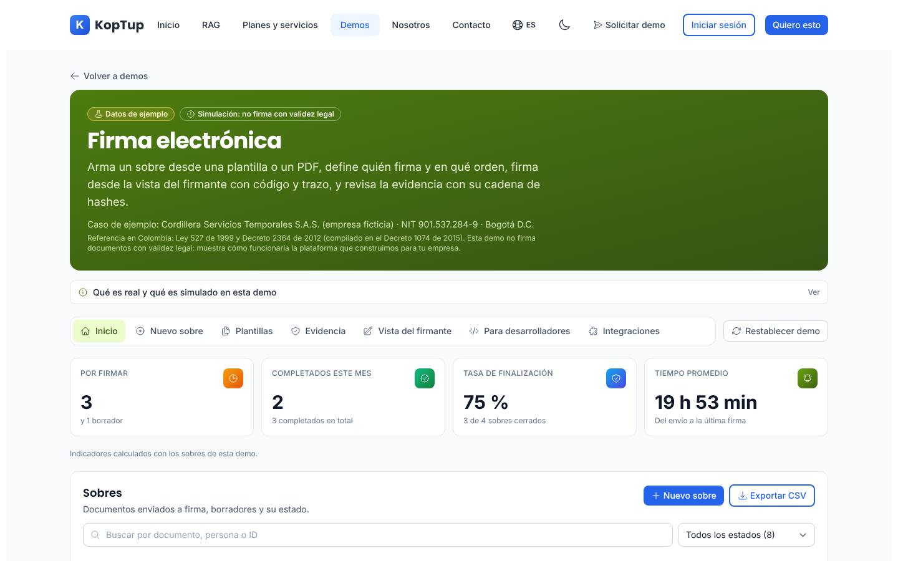

*Vista inicial: «Volver a demos», los rótulos «Datos de ejemplo» y «Simulación: no firma con validez legal», el caso de ejemplo con su NIT, la referencia a la Ley 527 de 1999 y al Decreto 2364 de 2012, el desplegable «Qué es real y qué es simulado», las siete pestañas y «Restablecer demo».*

---

## Recorrido sugerido (demo comercial de 5 minutos)

El mismo guion está dentro de la demo, en el desplegable **Qué es real y qué es simulado en esta demo › Recorrido sugerido**. Antes de empezar conviene pulsar **Restablecer demo** para partir de los ocho sobres de ejemplo.

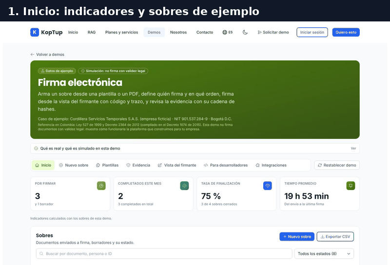

*Recorrido completo: Inicio, evidencia de un contrato firmado, los cuatro pasos de «Nuevo sobre», el sobre enviado en la lista, la firma en la vista del firmante y la evidencia del sobre completado.*

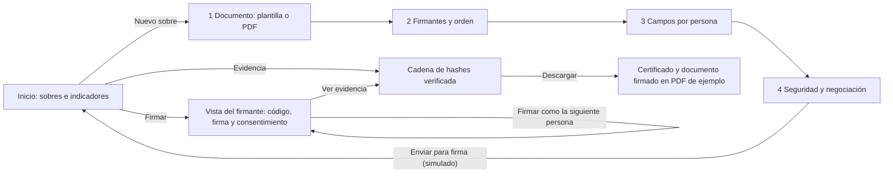

*El sobre que se envía aparece en Inicio; cada persona firma en su turno y la evidencia suma un evento encadenado por cada paso.*

### Paso 1. Muestra Inicio: indicadores y sobres

La demo abre en **Inicio**.

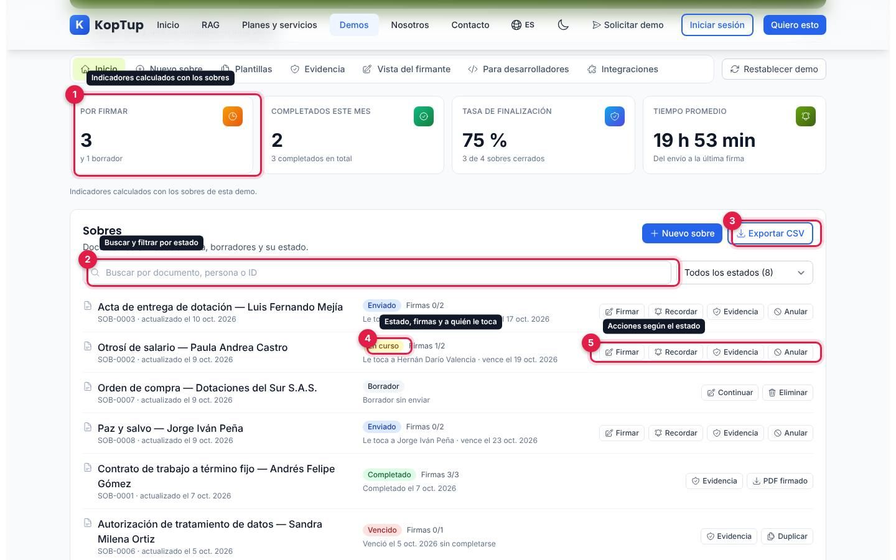

*Indicadores, buscador y la lista de sobres con su estado y sus acciones.*

1. **Indicadores**: Por firmar (3, y 1 borrador), Completados este mes, Tasa de finalización (completados sobre sobres cerrados) y Tiempo promedio (del envío a la última firma). Se calculan con la lista: cambian al enviar, firmar, anular o cuando un sobre vence.
2. **Buscar** por documento, persona o ID, y **filtrar por estado** (Borrador, Enviado, En curso, Completado, Vencido, Anulado).
3. **Exportar CSV**: descarga la lista filtrada (`sobres-firma-ejemplo.csv`, separada por punto y coma en español).
4. **Estado y avance** de cada sobre: firmas hechas, a quién le toca y cuándo vence.
5. **Acciones según el estado**: Firmar, Recordar, Evidencia y Anular en los pendientes; Continuar y Eliminar en el borrador; Evidencia y PDF firmado en los completados; Evidencia y Duplicar en los vencidos o anulados. **Recordar** deja un evento «Recordatorio … (simulado)» en la evidencia y avisa que no se envió ningún mensaje.

Las fechas de los sobres se calculan a partir del día en que se abre la demo (hora de Colombia), así que siempre son recientes.

Qué decir: «Desde aquí ves en qué va cada documento, a quién le toca firmar y cuánto se demoran en firmar».

### Paso 2. Abre la evidencia del contrato firmado

En la fila **Contrato de trabajo a término fijo — Andrés Felipe Gómez** pulsa **Evidencia** y luego **Verificar integridad**.

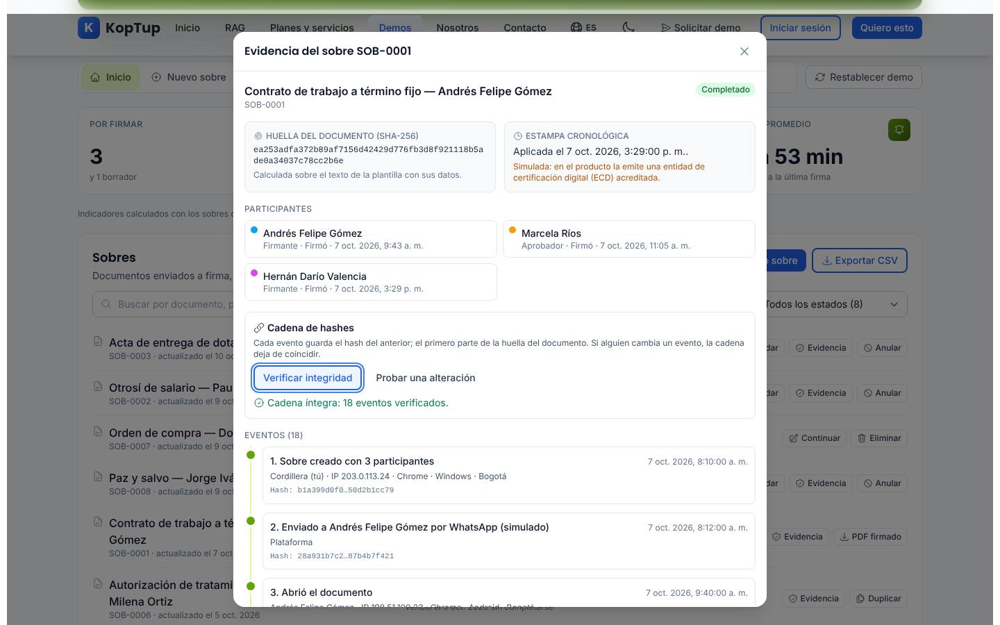

*Ventana de evidencia del sobre SOB-0001 con la cadena verificada.*

- **Huella del documento (SHA-256)**: calculada sobre el texto de la plantilla con sus datos.
- **Estampa cronológica**: aplicada al completar el sobre, marcada como **simulada**.
- **Participantes** con su rol, estado y hora de firma.
- **Cadena de hashes**: **Verificar integridad** recalcula todos los hashes y dice «Cadena íntegra: N eventos verificados». **Probar una alteración** cambia la hora de un evento en una copia y muestra en qué evento falla la verificación (la evidencia real no se toca).
- **Eventos** con fecha y hora, quién, IP de ejemplo, navegador, ciudad y hash abreviado.
- **Descargar certificado (PDF)** y, si está completado, **Descargar documento firmado (PDF)**: ambos con la marca «EJEMPLO - SIN VALIDEZ LEGAL».

La ventana se cierra con la **×**, con Escape o tocando fuera.

Qué decir: «Cada paso queda registrado y encadenado: si alguien cambia un dato, la verificación lo detecta».

### Paso 3. Crea un sobre: el documento

Pulsa **Nuevo sobre** (en Inicio o en la pestaña).

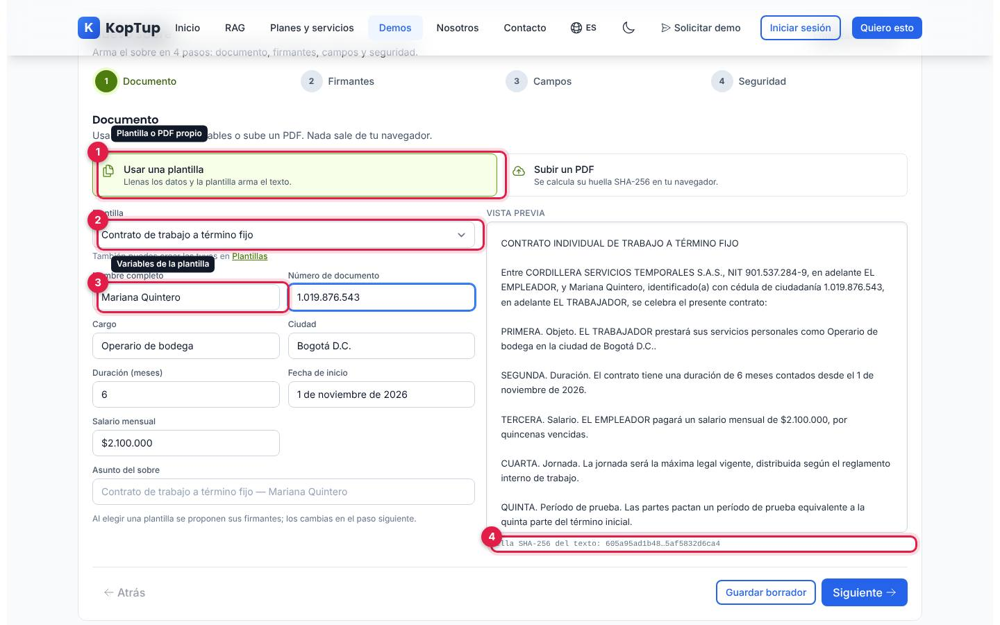

*Paso «Documento» con la plantilla de contrato de trabajo y el nombre cambiado.*

1. **Origen**: **Usar una plantilla** o **Subir un PDF**.
2. **Plantilla**: ocho de ejemplo y las que crees en **Plantillas**.
3. **Variables**: nombre, cédula, cargo, salario, fechas (las de ejemplo se calculan con la fecha de hoy), etc. La vista previa se arma con lo que escribas.
4. **Huella SHA-256 del texto**: cambia con cada letra.

Con **Subir un PDF** solo se aceptan PDF de hasta 25 MB (se revisa la firma `%PDF` del archivo, no solo la extensión); la demo calcula su huella SHA-256 y cuenta sus páginas en el navegador. El PDF no se muestra ni se guarda: quedan su nombre, tamaño, páginas y huella.

**Siguiente** no avanza si falta el documento o una variable; **Guardar borrador** lo deja en Inicio como borrador; **Empezar de nuevo** limpia el asistente (pide confirmación).

### Paso 4. Revisa los firmantes y el orden

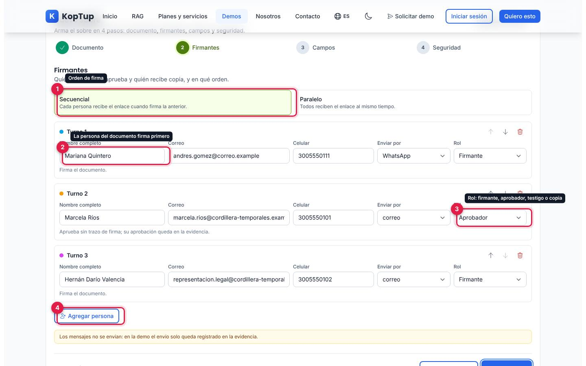

*Paso «Firmantes» con el orden secuencial y los firmantes propuestos por la plantilla.*

1. **Orden de firma**: **Secuencial** (cada persona recibe el enlace cuando firma la anterior) o **Paralelo**.
2. **La persona del documento firma primero**; su nombre sigue a la variable del paso 1.
3. **Rol**: Firmante, Aprobador (aprueba sin trazo), Testigo o Recibe copia (no firma).
4. **Agregar persona** (máximo 6). Las flechas cambian el orden y la papelera quita a la persona.

Cada persona tiene nombre, correo, celular y canal (correo, SMS o WhatsApp). Se valida: nombre completo, correo válido y no repetido, y celular colombiano de 10 dígitos que empiece por 3 cuando el canal es SMS o WhatsApp.

### Paso 5. Ubica los campos

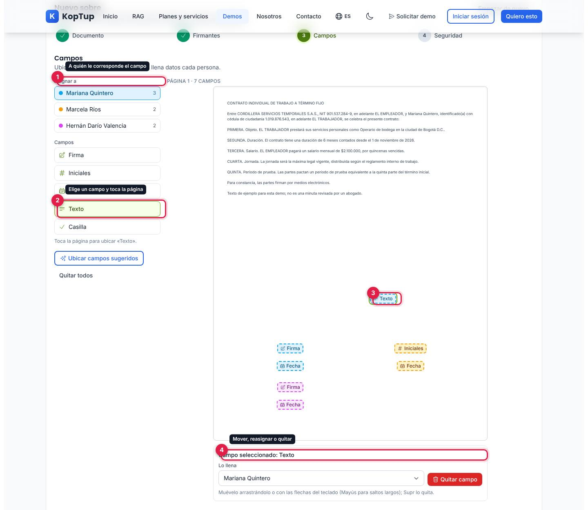

*Paso «Campos»: la persona a la que se asignan, la paleta y un campo de texto recién ubicado y seleccionado.*

1. **Asignar a**: cada persona tiene un color y un contador de campos.
2. **Paleta**: Firma, Iniciales, Fecha, Texto y Casilla. Se elige un campo y se **toca la página** (funciona en el celular) o se arrastra con el mouse.
3. **El campo en la página**, con el color de su persona. Se mueve arrastrándolo (mouse o dedo) o con las flechas del teclado; Supr lo quita.
4. **Campo seleccionado**: cambiar a quién le corresponde o **Quitar campo**.

Al entrar al paso se proponen campos de firma y fecha para cada persona (**Ubicar campos sugeridos** los vuelve a poner; **Quitar todos** los borra). La página muestra el texto real de la plantilla; con un PDF subido es una vista esquemática. No se avanza si un firmante o testigo no tiene campo de firma.

### Paso 6. Configura la seguridad y envía

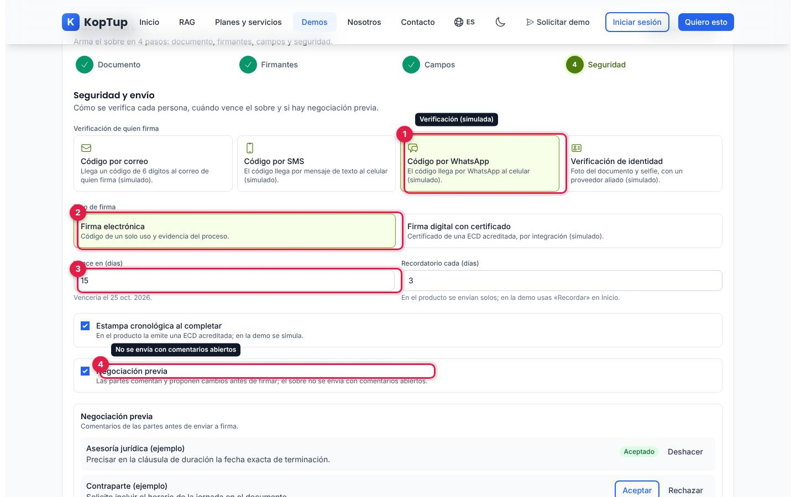

*Paso «Seguridad» con código por WhatsApp, firma electrónica y la negociación previa activada.*

1. **Verificación de quien firma**: código por correo, SMS o WhatsApp, o verificación de identidad con documento y selfie. Todas son **simuladas** y lo dicen.
2. **Tipo de firma**: **Firma electrónica** o **Firma digital con certificado** (de una ECD acreditada, por integración; simulada).
3. **Vence en (días)** (1 a 90, muestra la fecha) y **Recordatorio cada (días)** (antes del vencimiento).
4. **Negociación previa**: al activarla aparecen dos comentarios de ejemplo con **Aceptar**, **Rechazar** y **Deshacer**, y un cuadro para agregar comentarios (salen como «Cordillera (tú)»). El sobre **no se envía con comentarios abiertos**.

También está la casilla **Estampa cronológica al completar** (simulada) y un **Resumen**. **Enviar para firma** vuelve a Inicio con el sobre nuevo resaltado (SOB-0009), su evidencia con «Sobre creado» y «Enviado a … (simulado)», y los indicadores actualizados. Un aviso aclara que no se mandó ningún mensaje.

Qué decir: «Antes de firmar las partes pueden proponer cambios; cuando todo está resuelto, sale el sobre con la verificación que elijas».

### Paso 7. Firma como cada persona

En la fila del sobre nuevo pulsa **Firmar** (o abre la pestaña **Vista del firmante**).

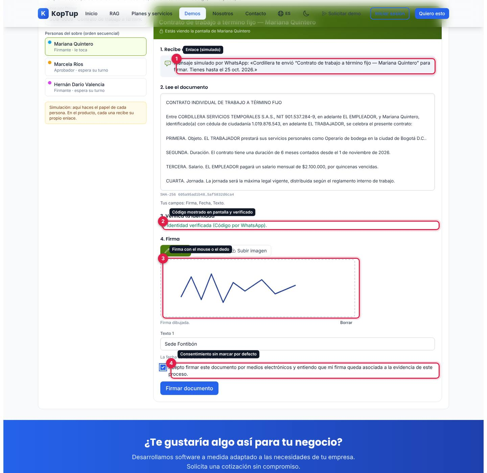

*Vista del firmante: el mensaje simulado, la identidad verificada, la firma dibujada con el mouse y el consentimiento.*

1. **Recibe el enlace**: el mensaje simulado por el canal de la persona; **Abrir el documento** registra «Abrió el documento».
2. **Verifica tu identidad**: **Enviar código** muestra un código de 6 dígitos en pantalla (en el producto llegaría al celular o al correo); se escribe y se pulsa **Verificar**. Un código equivocado se rechaza. Con verificación de identidad hay un botón **Simular verificación de identidad**.
3. **Firma**: **Dibujar** (mouse, lápiz o dedo), **Escribir** (el nombre en letra manuscrita) o **Subir imagen** (PNG o JPG de hasta 2 MB). El aprobador solo aprueba. Si la persona tiene campos de texto o casillas, hay que llenarlos.
4. **Consentimiento**: la casilla viene **desmarcada**; **Firmar documento** se activa cuando no falta nada (debajo dice qué falta).

Después de firmar aparece la confirmación con la firma, **Firmar como** la siguiente persona, **Descargar certificado (PDF)** y **Ver evidencia**. En orden secuencial, la lista de la izquierda muestra quién «espera su turno». Al firmar la última persona el sobre queda **Completado**, se aplica la estampa cronológica simulada y se ofrece **Descargar documento firmado (PDF)** con las firmas.

### Paso 8. Cierra con la evidencia

**Ver evidencia** abre la pestaña **Evidencia** con el sobre elegido.

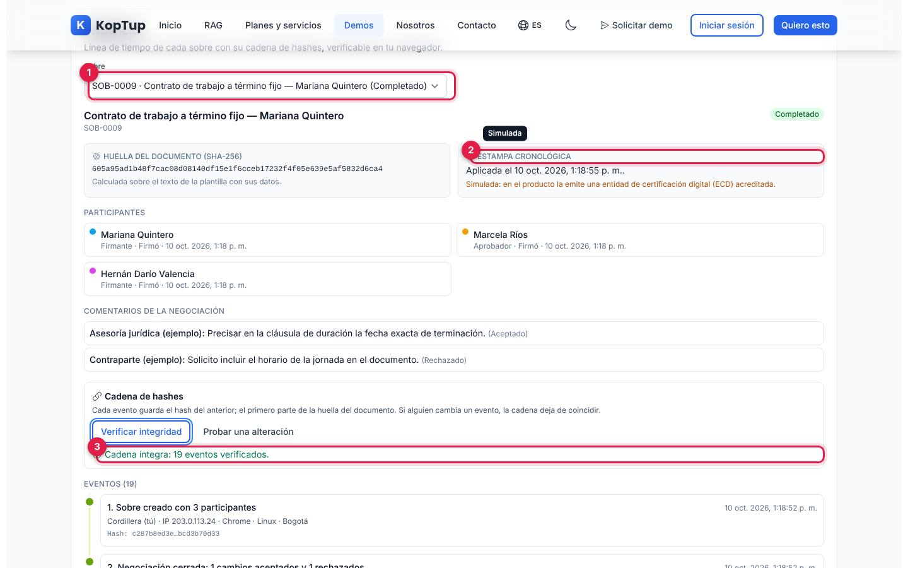

*Evidencia del sobre SOB-0009 completado: estampa cronológica simulada, comentarios de la negociación, cadena íntegra y eventos.*

1. **Sobre**: cualquier sobre enviado.
2. **Estampa cronológica** aplicada (simulada).
3. **Cadena íntegra** tras **Verificar integridad**.
4. **Sobre completado: firmaron todos** en la línea de tiempo.

Cierre sugerido: bajar al bloque «¿Te gustaría algo así para tu negocio?» y pulsar **Solicitar demo guiada**.

---

## Pantallas y funciones

La demo es una sola página con encabezado, el desplegable «Qué es real y qué es simulado», siete pestañas (**Inicio**, **Nuevo sobre**, **Plantillas**, **Evidencia**, **Vista del firmante**, **Para desarrolladores** e **Integraciones**) y **Restablecer demo**. Todo lo que cambias se conserva al pasar de una pestaña a otra y al recargar (en el navegador del visitante). Los datos de ejemplo se regeneran con fechas nuevas pasados 14 días o con **Restablecer demo** (pide confirmación).

### Encabezado

| Elemento | Qué hace |
|---|---|
| **Volver a demos** | Va a `/demo`. |
| Rótulos **Datos de ejemplo** y **Simulación: no firma con validez legal** | Fijos; el primero explica al pasar el mouse que empresa, personas y documentos son ficticios. |
| Caso de ejemplo | «Cordillera Servicios Temporales S.A.S. (empresa ficticia) · NIT 901.537.284-9 · Bogotá D.C.» (el dígito de verificación es correcto). |
| Referencia legal | Ley 527 de 1999 y Decreto 2364 de 2012 (compilado en el Decreto 1074 de 2015), con la aclaración de que la demo no firma con validez legal. |
| **Qué es real y qué es simulado en esta demo** | Desplegable con lo que funciona de verdad, lo simulado y el recorrido sugerido. |

### Inicio

Ver los [pasos 1 y 2](#paso-1-muestra-inicio-indicadores-y-sobres). Debajo de la lista está **¿Qué tipo de firma usar?**: firma electrónica, firma digital y estampa cronológica, con lo que hace la demo con cada una y la nota de que no reemplaza una asesoría jurídica. **Anular** y **Eliminar** (borrador) piden confirmación; **Duplicar** copia un sobre vencido o anulado en **Nuevo sobre** para reenviarlo; **Continuar** abre el borrador en el asistente.

### Nuevo sobre

Ver los [pasos 3 a 6](#paso-3-crea-un-sobre-el-documento). Los pasos ya hechos se pueden volver a abrir tocando su número; **Atrás** retrocede. Lo que llevas armado se conserva aunque cambies de pestaña o recargues (salvo el PDF, del que quedan sus datos).

### Plantillas

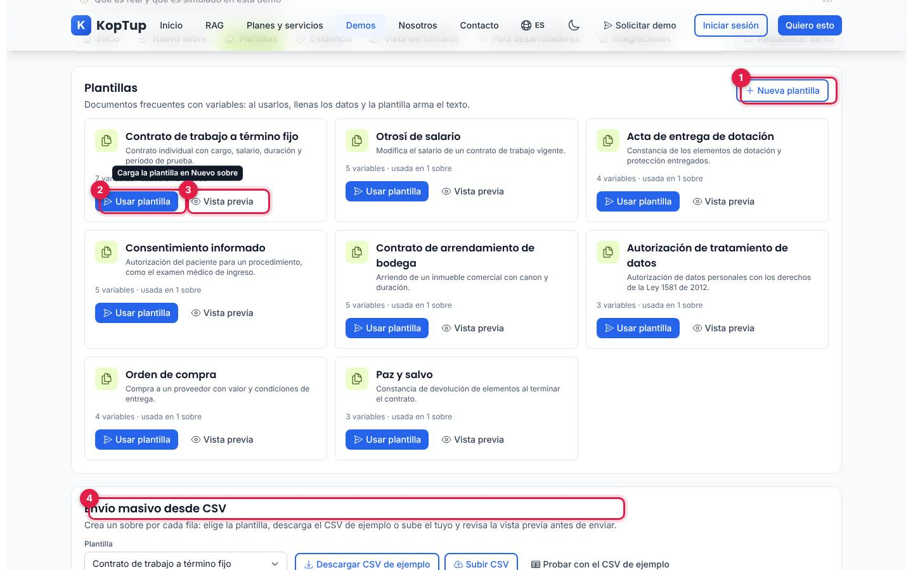

*Las ocho plantillas de ejemplo y el bloque de envío masivo.*

1. **Nueva plantilla**: nombre y texto; las palabras entre llaves (`{nombre}`, `{cargo}`) se detectan como variables. Las plantillas propias se pueden usar y eliminar (si ningún sobre las usa).
2. **Usar plantilla**: la carga en **Nuevo sobre** con sus datos de ejemplo y sus firmantes.
3. **Vista previa**: el texto con los datos de ejemplo.
4. **Envío masivo desde CSV** (abajo).

Cada tarjeta dice cuántas variables tiene y en cuántos sobres de la demo se usó (cifras de la demo, no inventadas). Los textos de las plantillas son de ejemplo y lo dicen al final: no son minutas revisadas por un abogado.

### Envío masivo

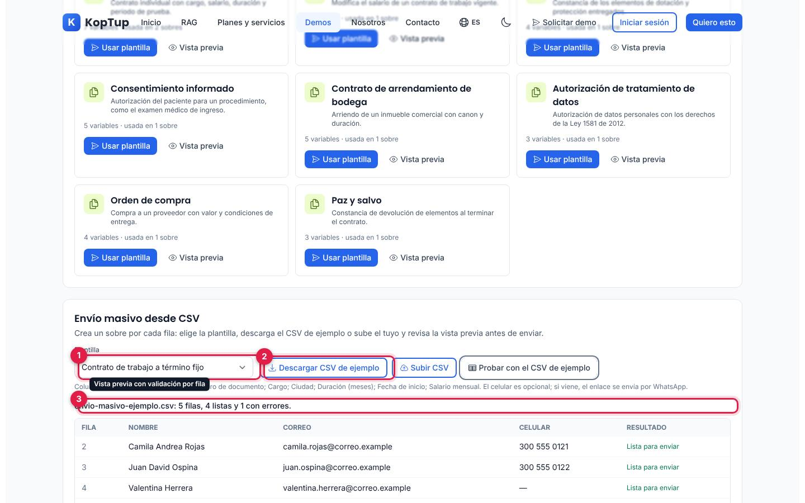

*Vista previa del CSV de ejemplo: cuatro filas listas y una con correo inválido.*

1. **Plantilla** con la que se crea un sobre por fila.
2. **Descargar CSV de ejemplo**: cinco personas ficticias con las columnas de la plantilla (la cuarta trae un correo inválido a propósito). **Subir CSV** lee un archivo (`;` o `,`, hasta 512 KB y 50 filas) y **Probar con el CSV de ejemplo** lo carga sin descargarlo.
3. **Vista previa** con el resultado de cada fila: lista para enviar o qué falla (nombre corto, correo inválido o repetido, celular inválido, variable vacía). Si faltan columnas, lo dice.
4. **Enviar N sobres**: crea y envía (simulado) un sobre por cada fila válida; aparecen en Inicio marcados «envío masivo». Si la fila trae celular, el canal es WhatsApp.

### Evidencia

Ver los [pasos 2 y 8](#paso-8-cierra-con-la-evidencia). La pestaña tiene un selector con todos los sobres enviados. Los eventos posibles son: sobre creado, enviado, recordatorio, abrió el documento, código enviado, identidad verificada, firmó, aprobó, negociación cerrada, sobre completado, estampa cronológica aplicada, copia enviada, anulado y vencido. Los envíos, recordatorios, códigos y copias dicen «(simulado)».

### Vista del firmante

Ver el [paso 7](#paso-7-firma-como-cada-persona). A la izquierda se elige el sobre por firmar y la persona (con su rol y si le toca, espera o ya firmó); un aviso aclara que aquí se hace el papel de cada persona y que en el producto cada una recibe su enlace. Si no hay sobres pendientes, lo dice y ofrece **Crear un sobre**.

### Para desarrolladores

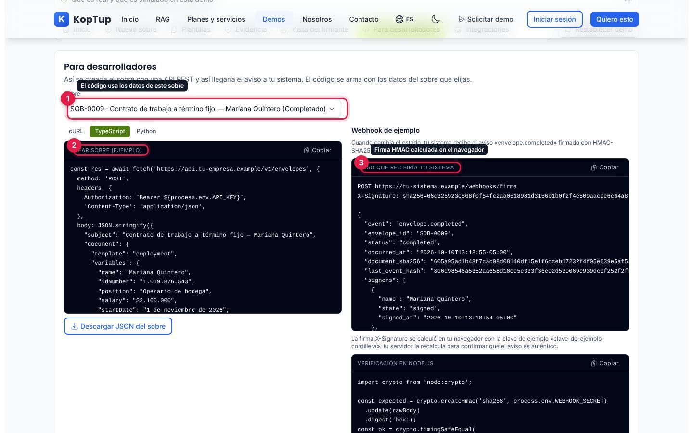

*Código para crear el sobre elegido y el webhook firmado que recibiría tu sistema.*

1. **Sobre**: el código se arma con los datos del sobre elegido (asunto, plantilla y variables o archivo, huella, orden, verificación, firmantes y campos).
2. **Crear sobre (ejemplo)** en cURL, TypeScript o Python, con **Copiar**, y **Descargar JSON del sobre** (`SOB-000N.json`).
3. **Webhook de ejemplo**: el aviso que recibiría tu sistema según el estado del sobre, con la cabecera `X-Signature` calculada de verdad con HMAC-SHA256 y una clave de ejemplo, y el código para verificarla en Node.js.

Abajo, **Firma dentro de tu aplicación** muestra cómo se vería la firma embebida; **Abrir en la vista del firmante** lleva a firmar ese sobre (si ya no admite firmas, lo dice). Un aviso aclara que la API, el webhook y las direcciones `.example` no existen todavía: se construyen en el proyecto, y la pestaña no hace llamadas a internet.

### Integraciones

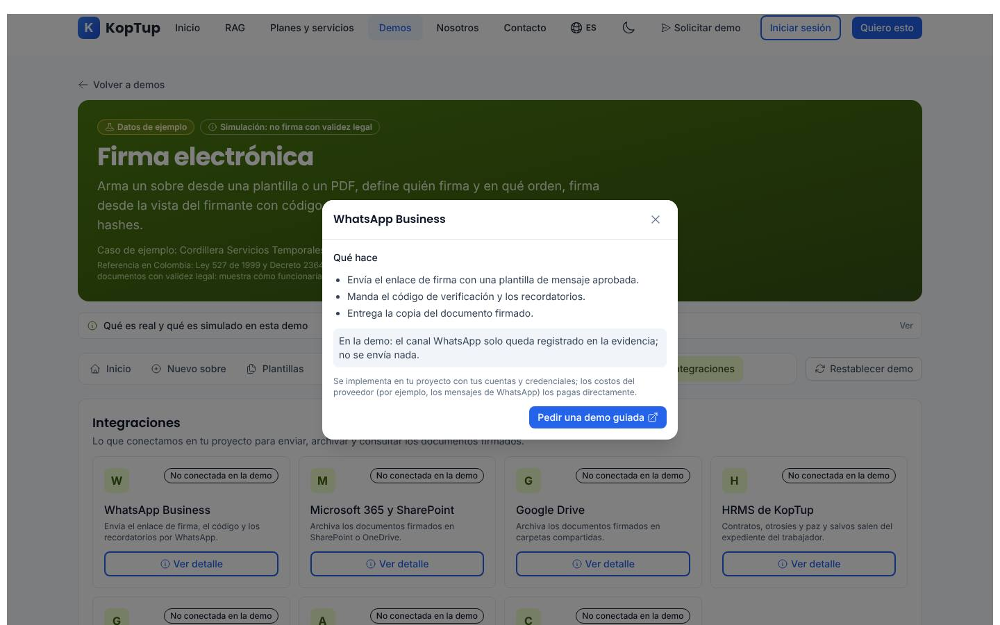

*Ficha de WhatsApp Business abierta con «Ver detalle».*

WhatsApp Business, Microsoft 365 y SharePoint, Google Drive, HRMS de KopTup, Gestor documental de KopTup, API REST y webhooks, y CRM o ERP por API. Cada tarjeta dice **No conectada en la demo**; **Ver detalle** abre una ficha con qué hace la integración, qué se ve de ella en la demo y la nota de que se implementa en el proyecto con las cuentas del cliente, más **Pedir una demo guiada** (`/solicitar-demo?demos=firma-electronica`).

### En el celular

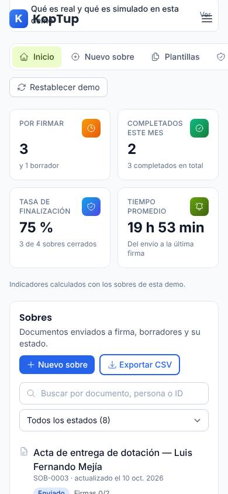

*La demo en un teléfono (390 px): indicadores de a dos y la lista de sobres en tarjetas.*

Las pestañas se desplazan de lado, los indicadores quedan de a dos y cada sobre se muestra como tarjeta con sus acciones debajo. Todo el recorrido se puede hacer con el dedo: los campos se ubican tocando la página y la firma se dibuja con el dedo. La página no se desborda a lo ancho, en modo claro ni oscuro.

---

## Qué es real y qué es simulado

| Parte | Real o simulado | Detalle |
|---|---|---|
| Sobres, personas, empresa y textos de plantillas | **Datos de ejemplo** | Ficticios (correos `.example`, IP de rangos de documentación, NIT con dígito de verificación válido). Las fechas se calculan con el día en que se abre la demo. |
| Lista, filtros, indicadores, borradores, anular, duplicar, recordar | **Reales en el navegador** | Se calculan y guardan en el navegador del visitante (`localStorage`). |
| Asistente: plantillas con variables, validaciones, firmantes, orden, campos por persona | **Real en el navegador** | Ubicar, mover y quitar campos funciona con mouse, teclado y dedo. |
| PDF subido | **Real en el navegador** | Valida que sea PDF de hasta 25 MB, calcula su SHA-256 y cuenta sus páginas; no se muestra ni sale del navegador. |
| Huella del documento y cadena de evidencia | **Real** | SHA-256 calculado en el navegador; «Verificar integridad» recalcula toda la cadena y «Probar una alteración» demuestra que detecta cambios. |
| Firma dibujada, escrita o subida y consentimiento | **Real en el navegador** | La firma queda como imagen en el sobre y en el PDF. |
| Envío de enlaces, códigos, recordatorios y copias (correo, SMS, WhatsApp) | **Simulado** | No se envía nada; el código se muestra en pantalla y la evidencia dice «(simulado)». |
| Verificación de identidad, firma digital con certificado y estampa cronológica | **Simuladas** | En el producto las hacen un proveedor aliado y una ECD acreditada. |
| Certificado de evidencia y documento firmado | **PDF de ejemplo reales** | Se generan y descargan; llevan la marca «EJEMPLO - SIN VALIDEZ LEGAL». |
| CSV de sobres, CSV de envío masivo y JSON del sobre | **Reales** | Se generan y descargan en el navegador. |
| API, webhook e integraciones | **Ilustrativos** | La firma HMAC del webhook se calcula de verdad; la API y las direcciones no existen todavía. Las integraciones solo se describen. |
| Validez legal | **No tiene** | El encabezado, el bloque de tipos de firma y los PDF lo dicen. |
| Backend, IA y almacenamiento en servidor | **No se usan** | La página no hace llamadas al servidor. |

---

## Acceso

**Cómo lo ve un visitante.** La demo es **Abierta**: en `/demo` su tarjeta tiene **Probar Demo**, que abre `/demo/firma-electronica` directamente, y **Solicitar demo guiada**, que lleva a `/solicitar-demo?demos=firma-electronica`. No hay pantalla de acceso ni hace falta cuenta. Al final de la página está el bloque «¿Te gustaría algo así para tu negocio?» con **Solicitar demo guiada** (la misma solicitud, con esta demo ya elegida), **Solicitar Cotización** (`/contact`) y **Ver Planes y Precios**.

**Cómo se solicita una demo guiada y cómo la gestiona el admin.** La solicitud llega a **Admin › Solicitudes de demo** como cualquier otra (y también a Contactos). Como la demo es abierta, no hace falta conceder acceso para usarla: la solicitud sirve para agendar la presentación. Un admin puede cambiar el modo en **Admin › Catálogo de demos** (por ejemplo, a «Con solicitud»); desde ese momento el visitante sin acceso verá la pantalla de acceso en lugar de la demo. Detalle en el [Manual del administrador](Doc-06-Manual-del-Administrador.md) y en [Flujos del visitante](Doc-04-Flujos-del-Visitante.md).

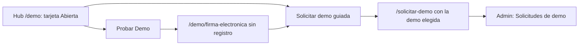

*Dos caminos: probarla de una vez o pedir una demo guiada.*

---

## Limitaciones conocidas

Son de diseño (es una demo con datos de ejemplo) o dependen de textos compartidos del sitio que no están en la demo:

1. **La tarjeta del hub, los metadatos y la oferta todavía prometen de más.** La tarjeta de `/demo` dice «Simple, avanzada y cualificada (eIDAS, Ley 527 CO)», «KYC firmante: … video, biometría», «blockchain timestamp» y «bulk send»; la descripción para buscadores habla de «validez legal» y «tiempo real»; la oferta del catálogo promete «eIDAS cualificada multi-país» y «KYC biométrico». La demo ya no dice nada de eso; el cambio de esos textos compartidos está pendiente en el catálogo y en la plataforma.
2. **No hay firma con validez legal.** No hay entidad de certificación, estampa cronológica real, verificación de identidad ni envío de mensajes; todo eso es simulado y se integra en el proyecto con los proveedores que elija el cliente.
3. **El PDF subido no se ve en pantalla.** La política de seguridad del sitio no permite mostrar dentro de la página archivos abiertos en el navegador, así que la demo calcula su huella y cuenta sus páginas, ubica los campos sobre una página esquemática y genera una constancia (no modifica el PDF original). Con plantillas, en cambio, el texto se ve completo.
4. **Lo que haces vive solo en tu navegador** (`localStorage`): no se comparte con el equipo comercial ni entre dispositivos; a los 14 días (o con «Restablecer demo») vuelve el ejemplo con fechas nuevas. El PDF subido no se guarda.
5. **Los recordatorios automáticos no corren solos**: el plazo se configura, pero en la demo los recordatorios se registran con **Recordar**. Los sobres sí vencen solos al pasar su fecha límite.
6. **Se firma en una sola pantalla haciendo el papel de cada persona**; no hay enlaces individuales, correo de invitación ni rechazo del documento por parte de quien firma.
7. **Los textos de las plantillas no fueron revisados por un abogado** y el glosario de tipos de firma es orientativo, como lo dice la demo.
8. **«Ver Planes y Precios»** del bloque azul del final lleva a los planes RAG, como en las demás demos (ver [Limitaciones comunes](Doc-07-Guia-de-Demos.md#limitaciones-comunes)).
