# Guía de la demo: Gestor documental con IA

> Ruta `/demo/gestor-documentos` · Modo de acceso: **Abierta** · Tipo: **datos de ejemplo** en el navegador (sin sesión y sin llamar al servidor) y **backend real + IA real** en «Mis documentos» (con sesión) · Plan del producto: [Gestor documental con IA](Producto-gestor-documental.md)

**Resumen.** La demo tiene dos fuentes de documentos, que se eligen arriba a la derecha:

- **Datos de ejemplo** (lo que ve cualquier visitante): el archivo de **Constructora Altos del Río S.A.S.** (empresa ficticia, NIT 901.482.376-1, Rionegro, Antioquia) con 16 documentos en seis carpetas: contratos, facturas escaneadas, actas, licencias y pólizas, hojas de vida y presupuesto. Se pueden buscar en su texto, filtrar, ordenar, marcar como favoritos, renombrar, mover, crear carpetas, mandar a la papelera, restaurar y eliminar; además se detectan las cláusulas de un contrato con su nivel de riesgo, se comparan dos versiones palabra por palabra, se ve la lectura OCR de una factura escaneada, se aplica retención por carpeta (con retención legal que bloquea la papelera) y se descargan el inventario, un paquete para auditoría y una copia en PDF con marca de agua. Todo corre y se guarda en el navegador; **Restablecer datos de ejemplo** vuelve al estado inicial.
- **Mis documentos** (con sesión): el visitante sube sus propios PDF, DOCX, TXT o CSV; el servidor extrae el texto, la IA genera resumen, etiquetas y palabras clave, y se puede buscar por significado y pedir **Explicar con IA**. Cada cuenta ve solo sus documentos. Sin sesión, esta pestaña invita a **iniciar sesión o solicitar acceso** (no muestra errores ni llama a la API).

**En esta página:** [Recorrido sugerido](#recorrido-sugerido-demo-comercial-de-5-minutos) · [Pantallas y funciones](#pantallas-y-funciones) · [Qué es real y qué es simulado](#qué-es-real-y-qué-es-simulado) · [Acceso](#acceso) · [Limitaciones conocidas](#limitaciones-conocidas)

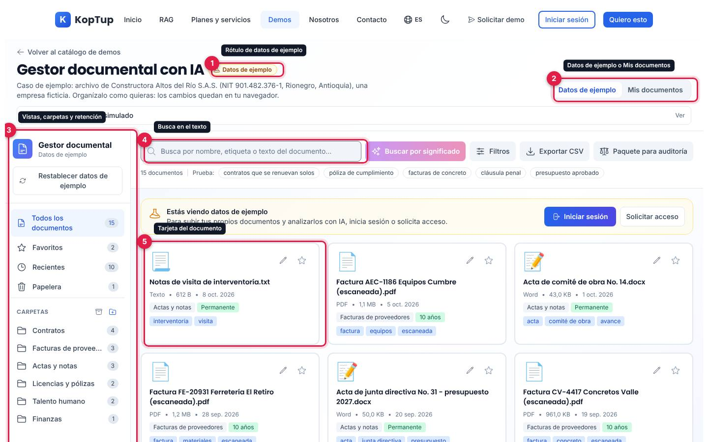

*Vista inicial: (1) rótulo «Datos de ejemplo», (2) selector «Datos de ejemplo / Mis documentos», (3) barra lateral con vistas, carpetas y retención, (4) búsqueda en el texto y (5) una tarjeta de documento con su carpeta, su política de retención y sus etiquetas.*

---

## Recorrido sugerido (demo comercial de 5 minutos)

El mismo guion está dentro de la demo, en el desplegable **Qué es real y qué es simulado › Recorrido sugerido**. Antes de empezar conviene pulsar **Restablecer datos de ejemplo** (barra lateral) para partir del archivo original.

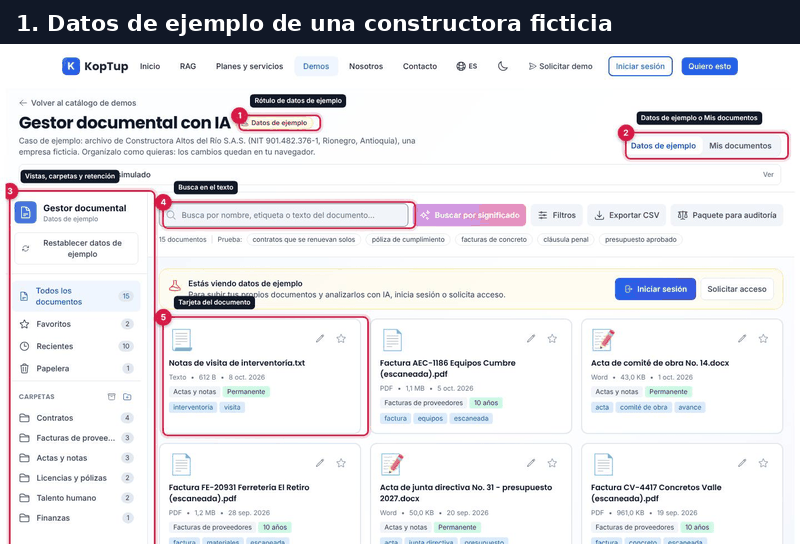

*Recorrido completo: búsqueda en el texto, panel del contrato, cláusulas, versiones, lectura OCR, retención legal, paquete para auditoría y «Mis documentos» sin y con sesión.*

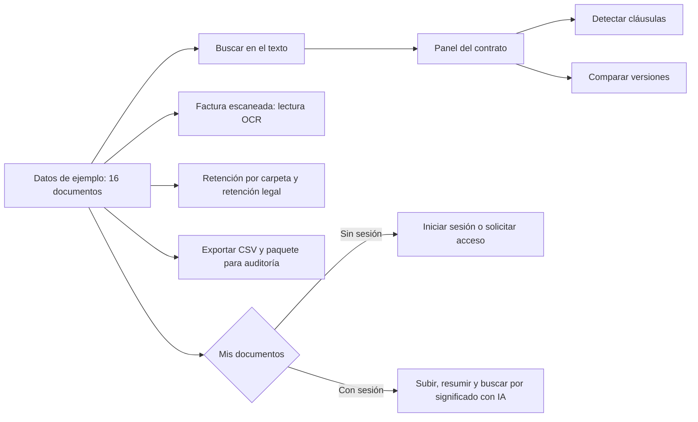

*Todo lo de los datos de ejemplo se calcula en el navegador; solo «Mis documentos» usa el servidor y la IA.*

### Paso 1. Busca en el texto de los documentos

Escribe **cláusula penal** en la barra de búsqueda (o pulsa una de las sugerencias de «Prueba:»).

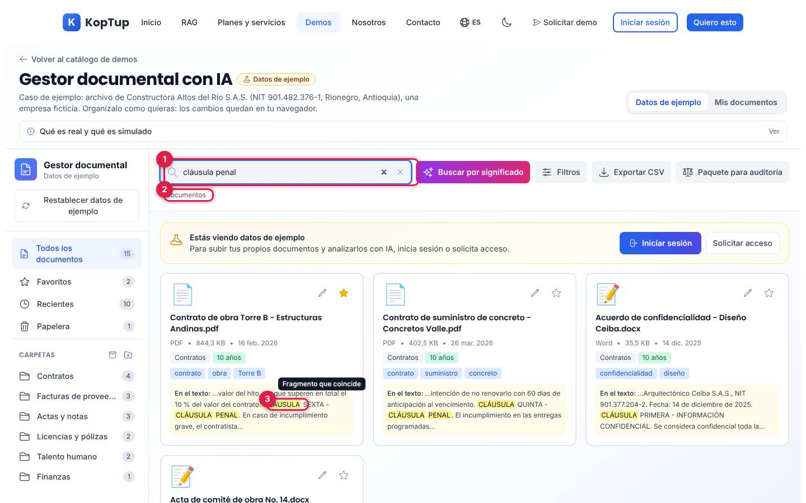

*(1) La búsqueda, (2) el número de documentos que coinciden y (3) el fragmento del texto con las palabras resaltadas.*

1. La lista se filtra al instante y se ordena por relevancia (ranking BM25 sobre el nombre, las etiquetas, las palabras clave, el resumen y el texto completo, sin distinguir tildes ni plurales).
2. Cada tarjeta muestra **En el texto:** con el fragmento donde aparecen las palabras.
3. **Filtros** abre tipo (PDF, Word, Texto, CSV), fecha (últimos 7, 30 o 365 días), etiqueta y orden (relevancia, más recientes, más antiguos, nombre o tamaño), con **Quitar filtros**.

Qué decir: «No buscas solo por el nombre del archivo: buscas dentro de lo que dicen los documentos».

### Paso 2. Abre el contrato de obra

Haz clic en **Contrato de obra Torre B - Estructuras Andinas.pdf** y pulsa **Ver explicación**.

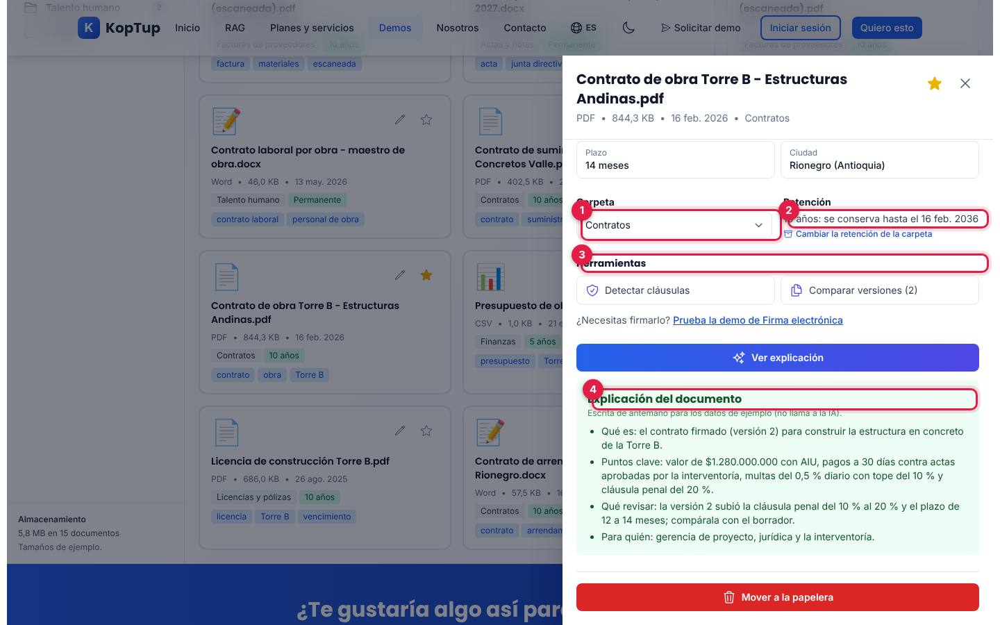

*(1) Mover a otra carpeta, (2) hasta cuándo se conserva según la política de su carpeta, (3) las herramientas del documento y (4) la explicación.*

- Arriba: el **texto del documento**, el **resumen**, las **palabras clave** y los **datos encontrados** (empresa, NIT, valor, fecha, plazo, ciudad).
- **Carpeta** mueve el documento; **Retención** muestra «10 años: se conserva hasta el …», calculado con la fecha del documento.
- **Ver explicación** muestra una explicación escrita de antemano para los datos de ejemplo (lo dice debajo del título; no llama a la IA).

### Paso 3. Detecta las cláusulas y compara las versiones

En el mismo panel pulsa **Detectar cláusulas**.

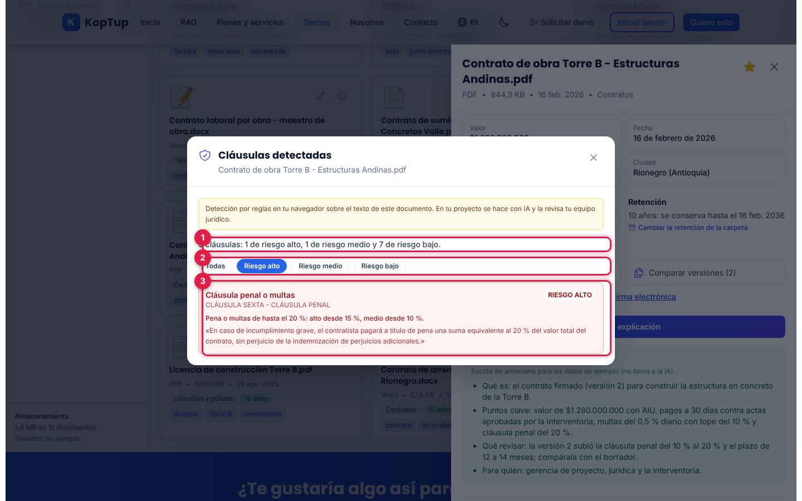

*(1) Resumen: 9 cláusulas, 1 de riesgo alto, 1 medio y 7 bajo; (2) filtro por riesgo (en la captura, «Riesgo alto»); (3) la cláusula penal del 20 %.*

La detección corre en el navegador sobre el texto del contrato abierto: separa las cláusulas por su encabezado, las clasifica (pago, cláusula penal o multas, prórroga automática, terminación, confidencialidad, indemnidad, garantías, plazo, controversias) y asigna el riesgo con reglas que se leen en cada tarjeta («Pena o multas de hasta el 20 %: alto desde 15 %, medio desde 10 %», «Se renueva sola: revisa con cuánto tiempo hay que avisar», «Responsabilidad sin límite de cuantía»…). Cada documento da un resultado distinto: el contrato de suministro muestra la prórroga automática y el pago a 60 días; el acuerdo de confidencialidad, la indemnidad sin límite.

Cierra con **Escape** y pulsa **Comparar versiones (2)**.

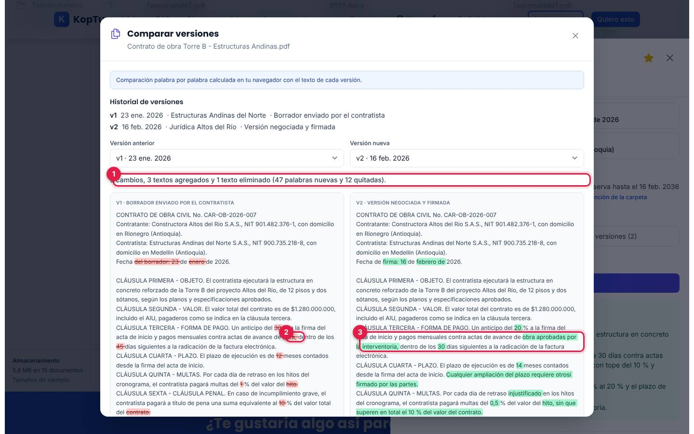

*(1) Resumen calculado de la comparación, (2) texto eliminado de la v1 y (3) texto agregado en la v2.*

El historial muestra la v1 (borrador del contratista) y la v2 (versión firmada). La comparación palabra por palabra se calcula en el navegador: el anticipo pasó del 30 % al 20 %, el pago de 45 a 30 días, el plazo de 12 a 14 meses, la cláusula penal del 10 % al 20 % y se agregó el tope de multas.

Qué decir: «Antes de firmar ves qué cambió y qué cláusulas pesan; en tu proyecto lo hace la IA y lo revisa tu equipo jurídico».

### Paso 4. Muestra la lectura OCR de una factura escaneada

Abre **Factura CV-4417 Concretos Valle (escaneada).pdf** y pulsa **Ver lectura OCR**.

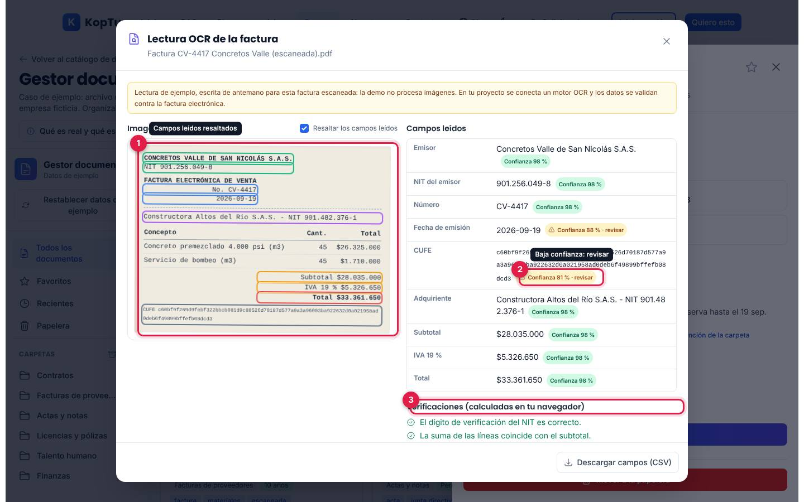

*(1) La imagen escaneada con los campos leídos resaltados, (2) un campo de baja confianza marcado para revisar y (3) las verificaciones.*

- La lectura es **de ejemplo**, escrita de antemano para esa factura (el aviso amarillo lo dice): emisor, NIT, número, fecha, CUFE, adquiriente, subtotal, IVA 19 % y total, cada uno con su confianza; los de menos de 90 % salen con «revisar».
- Las **verificaciones** sí se calculan en el navegador: el dígito de verificación del NIT, la suma de las líneas contra el subtotal y subtotal más IVA contra el total.
- **Descargar campos (CSV)** baja los campos y las líneas.

### Paso 5. Retención por carpeta y retención legal

Pulsa el icono de archivo junto a **CARPETAS** (Retención por carpeta).

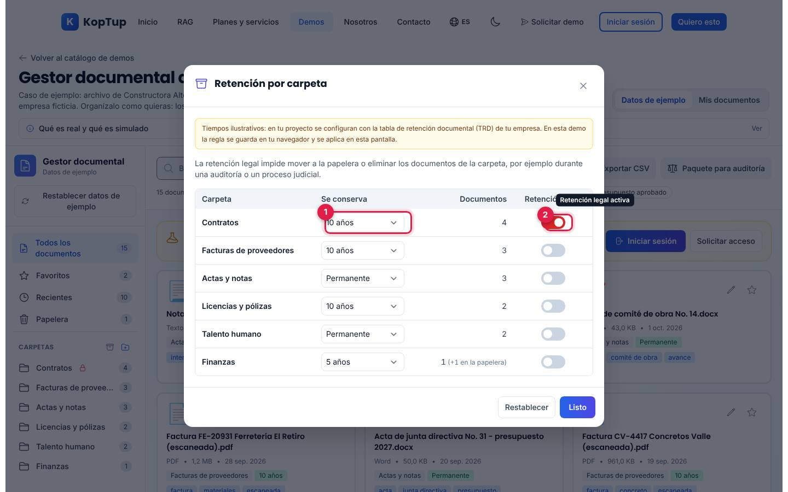

*(1) Cuánto se conserva cada carpeta y (2) el interruptor de retención legal.*

1. Cada carpeta tiene un tiempo de conservación (sin política, 1, 3, 5 o 10 años, o permanente). Son **tiempos ilustrativos**: en un proyecto real se configuran con la tabla de retención documental (TRD) de la empresa.
2. Activa la **retención legal** de **Contratos** y pulsa **Listo**. La carpeta muestra un candado y sus tarjetas, la insignia «Retención legal».

Abre un contrato:

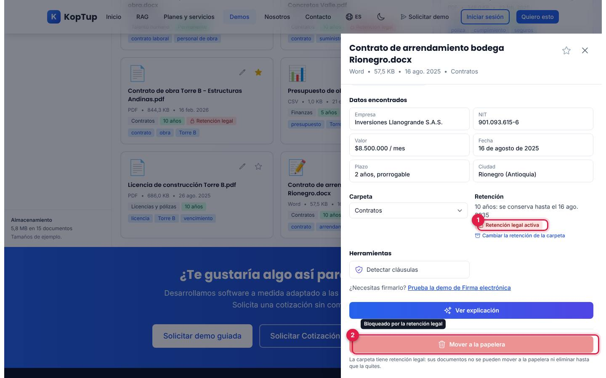

*(1) «Retención legal activa» y (2) «Mover a la papelera» bloqueado.*

Mientras la retención legal esté activa, los documentos de esa carpeta no se pueden mover a la papelera ni eliminar (tampoco al vaciar la papelera).

### Paso 6. Exporta para una auditoría

Pulsa **Paquete para auditoría**.

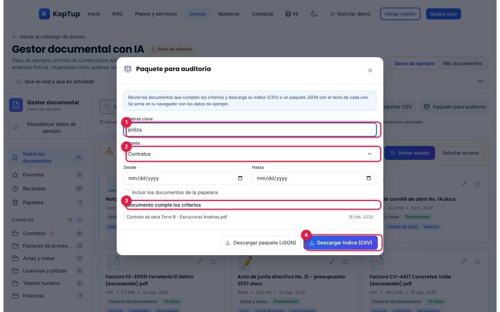

*(1) Palabras clave, (2) carpeta, (3) cuántos documentos cumplen y (4) la descarga del índice.*

Los criterios (palabras clave en el nombre, las etiquetas y el texto; carpeta; desde y hasta; incluir la papelera) filtran en vivo. **Descargar índice (CSV)** baja nombre, carpeta, tipo, tamaño, fecha, estado, etiquetas, «se conserva hasta» y retención legal; **Descargar paquete (JSON)** agrega el resumen y el texto de cada documento. **Exportar CSV** (barra de búsqueda) baja el mismo inventario de la lista que se ve en pantalla.

Qué decir: «Para una auditoría, en minutos tienes el índice de lo que piden, con sus tiempos de conservación».

### Paso 7. Cierra con «Mis documentos»

Pulsa **Mis documentos**. Sin sesión se ve:

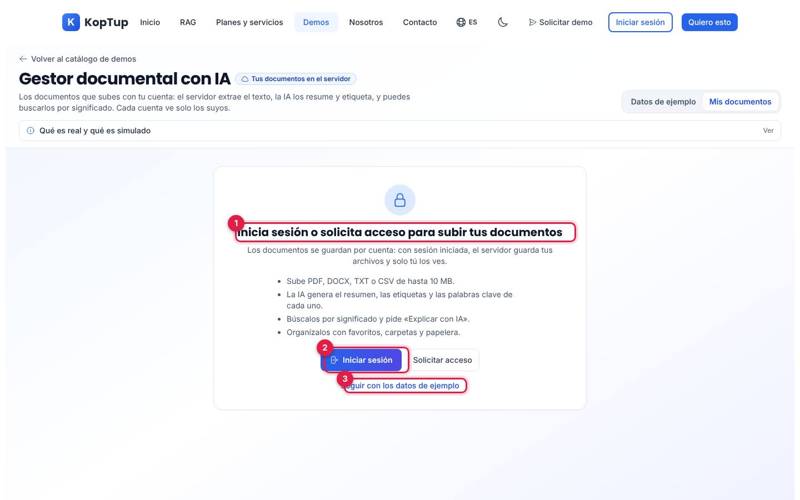

*(1) «Inicia sesión o solicita acceso para subir tus documentos», (2) **Iniciar sesión** (junto a **Solicitar acceso**) y (3) volver a los datos de ejemplo.*

Con sesión iniciada, el mismo espacio permite subir archivos y analizarlos con IA (ver [Mis documentos](#mis-documentos-con-sesión)).

---

## Pantallas y funciones

### Encabezado

- **Volver al catálogo de demos** lleva a `/demo`.
- El título, el rótulo **Datos de ejemplo** (o **Tus documentos en el servidor**) y la línea del caso de ejemplo con el NIT.
- El selector **Datos de ejemplo / Mis documentos**; la demo recuerda el último elegido en ese navegador.
- El desplegable **Qué es real y qué es simulado**, con lo que funciona de verdad, lo que es de ejemplo, el recorrido sugerido y lo que se implementa en un proyecto (OCR real, entrada por correo, celular, Google Drive, SharePoint o API, permisos por carpeta, auditoría de accesos y TRD, conexión con el asistente RAG).

### Barra lateral

| Elemento | Qué hace |
|---|---|
| **Restablecer datos de ejemplo** (datos de ejemplo) | Pide confirmación y vuelve a los 16 documentos, las carpetas y las reglas de retención originales. |
| **Subir documentos** (Mis documentos con sesión) | Abre el selector de archivos (PDF, DOCX, TXT o CSV). |
| **Todos los documentos · Favoritos · Recientes · Papelera** | Vistas con su contador. «Recientes» son los 10 más nuevos. |
| **CARPETAS** | Las carpetas con su número de documentos; un candado indica retención legal. El icono de archivo abre **Retención por carpeta** y el de carpeta con «+», **Nueva carpeta**. |
| **Almacenamiento** | Tamaño total y número de documentos (en los datos de ejemplo, tamaños de ejemplo). |

**Nueva carpeta** valida el nombre (vacío, repetido o de más de 60 caracteres) y abre la carpeta creada. En los datos de ejemplo se guarda en el navegador; en «Mis documentos», la carpeta queda en el navegador hasta que se le mueve o sube un documento, y desde ahí la guarda el servidor (la ventana lo explica).

### Barra de búsqueda

| Elemento | Qué hace |
|---|---|
| **Buscar en los documentos** | Filtra y ordena por relevancia mientras escribes (ver el [paso 1](#paso-1-busca-en-el-texto-de-los-documentos)). En «Mis documentos» busca en el nombre, las etiquetas, las palabras clave y el resumen (el texto completo queda en el servidor). |
| **Buscar por significado** | Se activa al escribir algo. Con los datos de ejemplo amplía la búsqueda con términos relacionados (sinónimos de ejemplo) en el navegador, sin IA; en «Mis documentos» usa la búsqueda por significado con IA del servidor. |
| **Filtros** | Tipo, fecha, etiqueta y orden, con **Quitar filtros**; el botón muestra cuántos filtros hay activos. |
| **Exportar CSV** | Descarga el inventario de la lista visible. |
| **Paquete para auditoría** | Ver el [paso 6](#paso-6-exporta-para-una-auditoría). |
| **Prueba:** | Sugerencias de búsqueda para los datos de ejemplo. |

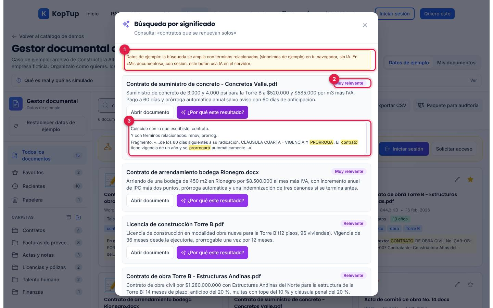

*Búsqueda por significado con los datos de ejemplo: (1) el aviso de que se amplía con sinónimos en el navegador, sin IA, (2) la relevancia en palabras y (3) «¿Por qué este resultado?» con los términos escritos, los relacionados y el fragmento.*

### Tarjetas de documento

Icono por tipo, nombre, tipo, tamaño, fecha, carpeta, política de retención, retención legal (si aplica), hasta tres etiquetas y, al buscar, el fragmento que coincide. El **lápiz** abre «Renombrar documento» y la **estrella** marca o quita el favorito. En la **Papelera**, cada tarjeta trae **Restaurar** y **Eliminar definitivamente**, y arriba aparece **Vaciar papelera**; las dos acciones definitivas piden confirmación.

### Panel del documento

Se abre al hacer clic en una tarjeta, debajo del menú del sitio; se cierra con la **X**, con **Escape** o haciendo clic fuera. Las ventanas que abre (cláusulas, versiones, OCR, retención, confirmaciones) quedan por encima del panel y del menú del sitio, y **Escape** cierra solo la de arriba.

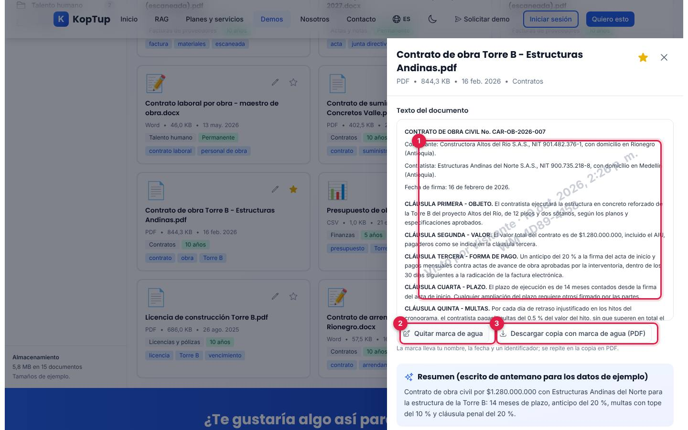

*(1) La marca de agua sobre la vista previa, (2) el botón para quitarla y (3) la descarga de la copia en PDF.*

- **Texto del documento** o **Imagen escaneada (representación de ejemplo)** en las facturas; el presupuesto en CSV se ve como tabla.
- **Ver con marca de agua** pone sobre la vista previa «Visto por <tu nombre o Visitante> · <fecha y hora>» y un identificador; **Descargar copia con marca de agua (PDF)** genera en el navegador un PDF con el texto del documento y la marca en cada página.
- **Herramientas:** **Ver lectura OCR** (facturas escaneadas), **Detectar cláusulas** (documentos con cláusulas) y **Comparar versiones** (el contrato de obra). Debajo, **¿Necesitas firmarlo?** enlaza a la demo de [Firma electrónica](Guia-Demo-firma-electronica.md).
- **Mover a la papelera** pide confirmación: el documento pasa a la Papelera, desde donde se restaura o se elimina definitivamente.

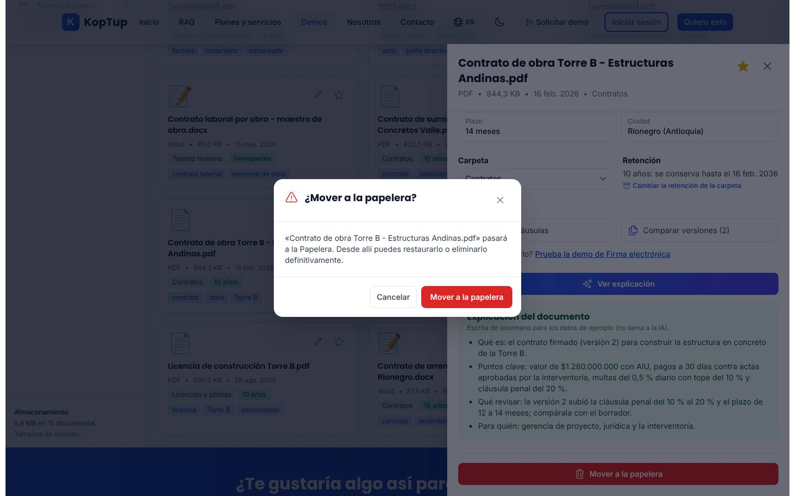

*La confirmación aparece por encima del panel; «Cancelar» queda enfocado y Escape la cierra.*

### Mis documentos (con sesión)

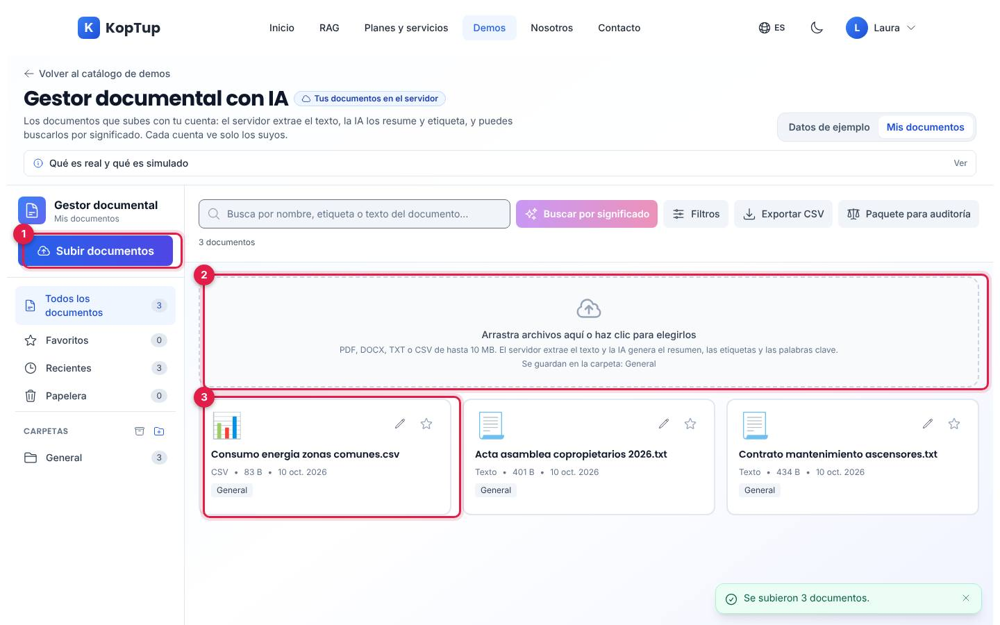

*(1) Subir documentos, (2) la zona para arrastrar archivos y (3) un documento subido.*

1. **Subir documentos** o arrastrar archivos a la zona punteada. Antes de enviar, la demo revisa el tipo (PDF, DOCX, TXT o CSV) y el tamaño (hasta 10 MB) y avisa por cada archivo que no cumple. Se ve «Subiendo 1 de 3…» y luego «Analizando … en el servidor».
2. Al terminar, la lista se actualiza y un aviso dice cuántos se subieron; si el servidor guardó alguno sin análisis de IA (cupo agotado o IA no disponible), otro aviso lo dice.
3. Favoritos, renombrar, mover, nueva carpeta, papelera, restaurar y eliminar definitivamente se guardan en el servidor.

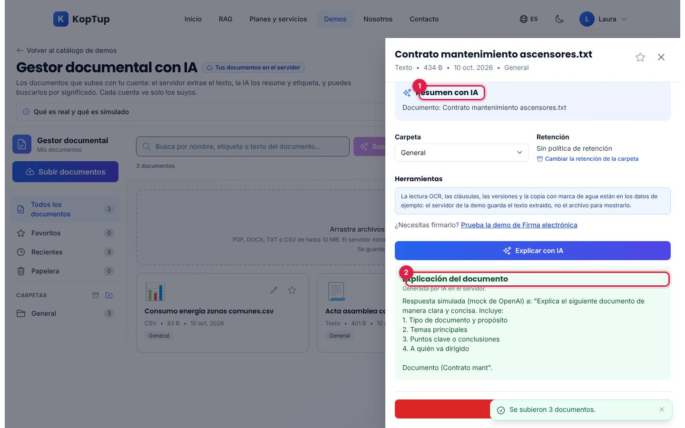

*Panel de un documento subido: (1) el resumen que generó la IA al subirlo y (2) la respuesta de «Explicar con IA». La captura se tomó en un entorno con un modelo de IA simulado: por eso el resumen dice «Documento: nombre del archivo» y la explicación empieza con «Respuesta simulada…».*

- **Explicar con IA** pide al servidor el tipo de documento y su propósito, los temas principales, los puntos clave y a quién va dirigido.
- **Buscar por significado** compara el significado de la consulta con el de cada documento y muestra los que pasan del 50 % de similitud, cada uno con **¿Por qué este resultado?** (también con IA).
- La vista previa del archivo, la lectura OCR, las cláusulas, las versiones y la copia con marca de agua no están en «Mis documentos»: el panel lo explica (el servidor guarda el texto extraído, no un archivo para mostrar).
- Los errores salen como avisos con texto propio: sesión vencida, demasiadas solicitudes, tipo o tamaño no admitido, documento sin texto legible, IA no configurada o sin cupo, sin conexión.

### En el celular

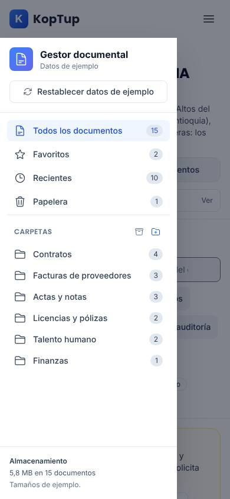

*En el teléfono, el botón **Vistas y carpetas** abre la barra lateral como panel.*

A 390 px la página no se desborda: la barra de búsqueda y los botones pasan a varias líneas, las tarjetas quedan en una columna, el panel del documento ocupa todo el ancho y las ventanas se abren desde abajo.

---

## Qué es real y qué es simulado

| Parte | Real o simulado | Detalle |
|---|---|---|
| Organización de los datos de ejemplo | **Real (navegador)** | Favoritos, renombrar, mover, carpetas, papelera, restaurar, eliminar y restablecer; se guarda en el almacenamiento local de ese navegador. |
| Búsqueda en el texto, filtros y orden | **Real (navegador)** | Ranking BM25 con coincidencia por prefijo y fragmento resaltado. |
| Búsqueda por significado con los datos de ejemplo | **Simulado (sin IA)** | Amplía la consulta con un diccionario de sinónimos de ejemplo; el aviso lo dice. |
| Resúmenes, palabras clave, datos encontrados y explicaciones de los datos de ejemplo | **Datos de ejemplo** | Escritos de antemano; no los genera una IA en vivo. |
| Detección de cláusulas y riesgo | **Real (navegador, por reglas)** | Sobre el texto del documento abierto. En un proyecto se hace con IA. |
| Comparar versiones | **Real (navegador)** | Diferencia palabra por palabra entre las versiones del contrato de ejemplo. |
| Lectura OCR de las facturas escaneadas | **Datos de ejemplo** | No se procesa ninguna imagen. Las verificaciones (NIT, sumas) sí se calculan. |
| Retención por carpeta y retención legal | **Real en la demo (navegador)** | Calcula la fecha de conservación y bloquea la papelera; las reglas se guardan en el navegador y el servidor no las aplica. Tiempos ilustrativos. |
| Exportar CSV, paquete para auditoría, copia en PDF con marca de agua | **Real (navegador)** | Archivos generados y descargados en el navegador. |
| Empresa, personas, NIT, valores y CUFE | **Datos de ejemplo** | Ficticios; los NIT tienen dígito de verificación válido. |
| Subida y almacenamiento (Mis documentos) | **Real (servidor)** | PDF, DOCX, TXT y CSV de hasta 10 MB; máximo 10 subidas por minuto. Cada cuenta ve solo sus documentos. |
| Resumen, etiquetas y palabras clave al subir | **IA real** | Con tope de gasto y cupo diario por cuenta; sin cupo, el documento se guarda sin análisis y la demo lo avisa. |
| Búsqueda por significado, «¿Por qué este resultado?» y «Explicar con IA» (Mis documentos) | **IA real** | En el servidor, con los mismos límites. |
| Firma electrónica | **Enlace** | Lleva a la demo de Firma electrónica; esta demo no firma. |

Para un desarrollador, «Mis documentos» usa estas rutas de la API (todas exigen sesión y filtran por el usuario; detalle en [API](Doc-08-API.md)):

| Ruta | Para qué |
|---|---|
| `GET /api/documents` y `GET /api/documents?trash=true` | La lista activa y la papelera (dos llamadas; las carpetas y los contadores se calculan en la página). |
| `POST /api/documents/upload` | Subir y analizar un archivo (campo `file` y `folder`). |
| `PATCH /api/documents/:id` | Renombrar, mover de carpeta o marcar favorito. |
| `DELETE /api/documents/:id` · `DELETE /api/documents/:id?permanent=true` | Mover a la papelera · eliminar definitivamente (solo el dueño). |
| `POST /api/documents/:id/restore` | Restaurar de la papelera. |
| `POST /api/documents/search/semantic` | Búsqueda por significado. |
| `GET /api/documents/:id/explain` · `POST /api/documents/:id/explain-similarity` | Explicar el documento · explicar una coincidencia. |

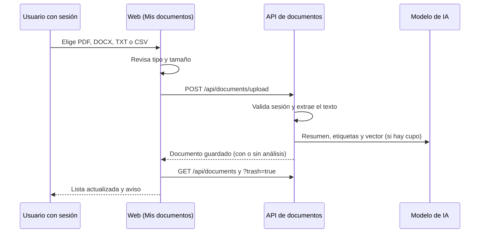

*Qué pasa al subir un documento en «Mis documentos».*

---

## Acceso

**Cómo lo ve un visitante.** La demo está en modo **Abierta** (`publico`): cualquiera entra a `/demo/gestor-documentos` y ve los datos de ejemplo sin iniciar sesión. Sin sesión, la página **no llama a la API** de documentos.

- **Para subir documentos propios:** «Mis documentos» invita a **Iniciar sesión** (`/login`, que vuelve a la demo) o a **Solicitar acceso** (`/solicitar-demo` con la demo preseleccionada). Cualquier cuenta con sesión puede usarlo y ve solo sus documentos.
- **Cómo se solicita una demo guiada:** con **Solicitar acceso**, con el bloque azul al final de la página (**Solicitar demo guiada**) o con **Solicitar demo** del menú.
- **Cómo la controla el admin:** el modo sale del catálogo del servidor y se cambia en **Admin › Catálogo de demos**. Si se pasa a «Con solicitud» o «Solo por invitación», los visitantes verán la pantalla de acceso y los accesos se conceden en **Admin › Solicitudes de demo** y **Admin › Accesos a demos**. La API de documentos revisa la sesión, no el acceso a la demo. Detalle en el [Manual del administrador](Doc-06-Manual-del-Administrador.md) y en [Flujos del visitante](Doc-04-Flujos-del-Visitante.md).

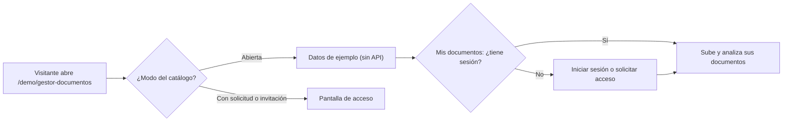

*Camino de un visitante hasta usar la demo.*

---

## Limitaciones conocidas

Lo que queda es por diseño de la demo o depende de otras partes del producto:

1. **Los datos de ejemplo no usan IA en vivo.** Sus resúmenes, explicaciones y la lectura OCR están escritos de antemano, y la búsqueda por significado se amplía con sinónimos en el navegador. La pantalla lo rotula en cada caso; la IA real está en «Mis documentos».
2. **Las herramientas de contenido solo están en los datos de ejemplo.** En «Mis documentos» no hay vista previa del archivo, lectura OCR, cláusulas, versiones ni copia con marca de agua, porque el servidor guarda el texto extraído y no un archivo para mostrar ni sus versiones. La búsqueda de la lista busca en el nombre, las etiquetas, las palabras clave y el resumen.
3. **La retención es una regla de la demo.** Los tiempos son ilustrativos y la retención legal se guarda en el navegador y se aplica en la pantalla; el servidor no la conoce.
4. **Carpetas vacías en «Mis documentos».** Una carpeta nueva queda en el navegador hasta que se le mueve o sube un documento; desde ese momento la guarda el servidor.
5. **Documentos en español.** Los textos de los datos de ejemplo están en español también con la página en inglés; las sugerencias de búsqueda lo indican.
6. **Entorno local con IA simulada.** Con el modelo simulado de los entornos de prueba, el resumen queda «Documento: nombre del archivo», la explicación empieza con «Respuesta simulada…» y la búsqueda por significado no encuentra nada. Con la clave real de IA los redacta el modelo.
7. **Borrado y cupos de IA en «Mis documentos».** La interfaz confirma el borrado con una ventana y muestra los avisos de cupo de IA; ambos cuentan con la versión del servidor de la pista de plataforma (borrado limitado al dueño y topes de IA en las rutas de documentos), que se integra al unir las ramas.
