# Guía de la demo: Generador de contenido para LinkedIn con IA

> Ruta `/demo/linkedin-ads` · Modo de acceso: **Con solicitud** · Tipo: **IA real** (OpenAI desde el servidor de KopTup, con respaldo de plantillas locales) · Plan del producto: [Motor de contenido para LinkedIn (herramienta interna)](Demo-linkedin-ads.md)

**Resumen.** Es la herramienta con la que KopTup prepara su contenido de LinkedIn sobre sus propias demos, mostrada como vitrina. El encabezado dice qué es («Generador de contenido para LinkedIn con IA»), para quién («equipos de marketing B2B y agencias que publican con constancia») y por dónde empezar («Empezar: publicación del día 1»). Tiene cuatro pestañas: **Resumen** (primeros pasos que se marcan solos), **Calendario 30 días**, **Generador de publicaciones** (publicación, texto de anuncio y carrusel, con IA o con plantillas) y **Capturas y video** (imagen 1200×627, foto o video de una demo). **No publica en LinkedIn**: copias el texto y lo publicas tú. Sirve para mostrarle a una agencia o a un equipo de marketing B2B cómo sería un motor de contenido con IA, y al equipo de KopTup para su propio plan editorial.

**Contenido:** [Recorrido sugerido](#recorrido-sugerido-demo-comercial-de-5-minutos) · [Pantallas y funciones](#pantallas-y-funciones) · [Qué es real y qué es simulado](#qué-es-real-y-qué-es-simulado) · [Acceso](#acceso) · [Limitaciones conocidas](#limitaciones-conocidas)

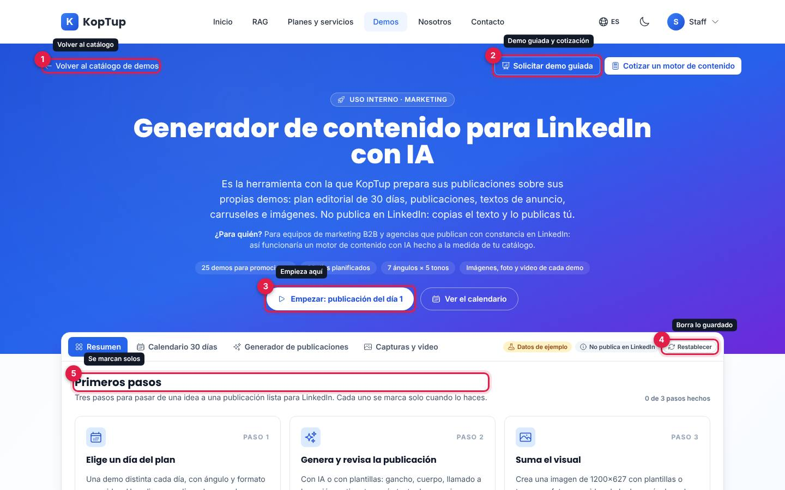

*Lo primero que ve una cuenta con acceso: encabezado con el nombre de la demo, para quién es y las salidas, y debajo los primeros pasos.*

1. **Volver al catálogo de demos** (`/demo`).
2. **Solicitar demo guiada** (`/solicitar-demo` con esta demo ya marcada) y **Cotizar un motor de contenido** (`/contact` con «Automatización de workflows» prellenado).
3. **Empezar: publicación del día 1**: carga el plan del día 1 en el generador y baja hasta él. «Ver el calendario» abre el plan completo.
4. **Restablecer**: pide confirmación en la misma barra («¿Borrar borradores y preferencias de este navegador?») y deja la demo como nueva. Escape cancela.
5. **Primeros pasos**: tres tarjetas (elige un día, genera y revisa la publicación, suma el visual) que se marcan «Hecho» solas y llevan la cuenta «n de 3 pasos hechos».

Los rótulos **Datos de ejemplo** (al pasar el mouse explica que el calendario, las plantillas y las vistas previas son de ejemplo y que la IA sí es real) y **No publica en LinkedIn** quedan fijos junto a las pestañas. Al final de la página está el cierre común de las demos (demo guiada, cotización y planes).

---

## Recorrido sugerido (demo comercial de 5 minutos)

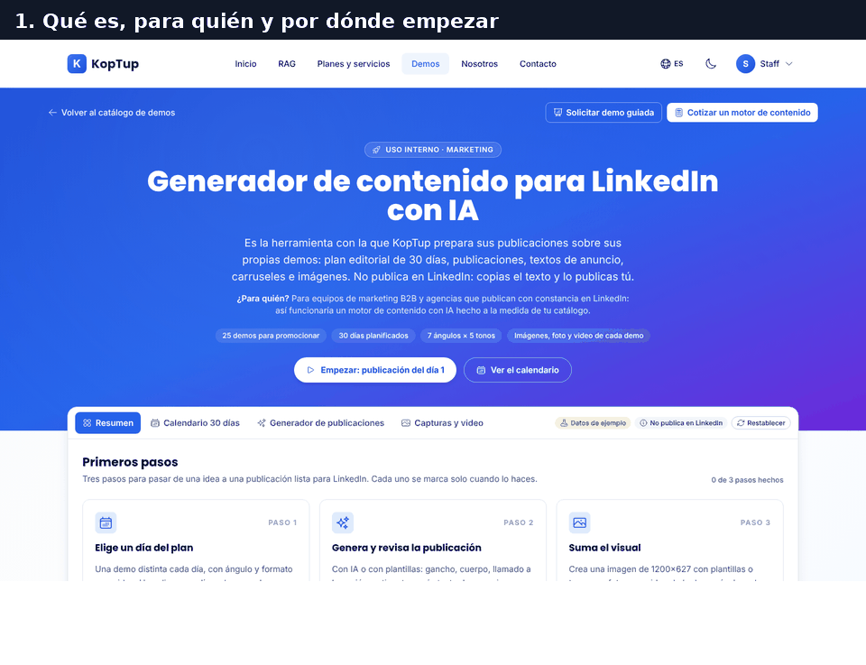

*Del resumen a la publicación con imagen, en ocho cuadros.*

### Paso 1 · Presenta la herramienta (≈ 30 s)

Empieza en **Resumen** (captura de arriba): lee el encabezado y el «¿Para quién?». Debajo de los primeros pasos están «Cómo se usa (flujo sugerido)» en cinco puntos y el cuadro **«Qué hace y qué no hace esta demo»**.

**Qué decir:** «Es la herramienta que usamos nosotros; no publica por ti y no inventa resultados».

### Paso 2 · Elige un día del calendario (≈ 45 s)

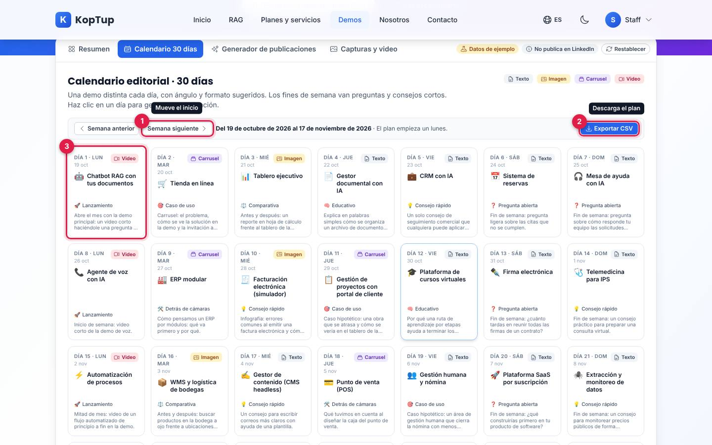

*Calendario editorial: una demo distinta cada día, con formato, ángulo y nota.*

1. **Semana anterior / Semana siguiente**: mueve el lunes de inicio de a una semana (se recuerda en este navegador). El plan empieza el próximo lunes; entre semana va contenido más elaborado (video, carrusel, imagen) y los fines de semana, preguntas y consejos cortos en texto.
2. **Exportar CSV**: descarga el plan con día, fecha, demo, ángulo, formato, nota y enlace.
3. **Clic en un día** (aquí, el Día 1): abre el generador con la demo y el ángulo de ese día, y marca el primer paso como hecho.

### Paso 3 · Genera la publicación (≈ 1 min)

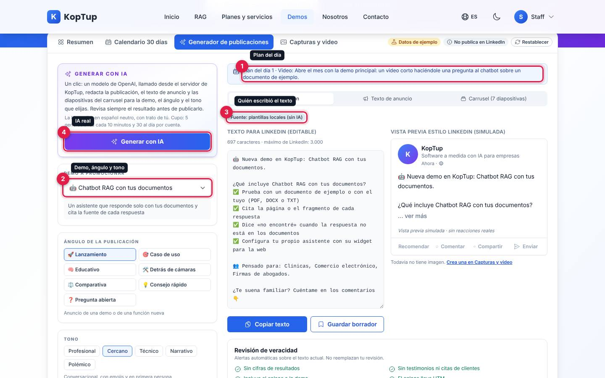

*Generador cargado con el plan del Día 1 (Chatbot RAG con tus documentos, Lanzamiento, video).*

1. **Plan del día**: recuerda el formato y la nota estratégica que trae el calendario.
2. **Demo, ángulo y tono**: 25 demos de KopTup, cada una con su descripción debajo; 7 ángulos (Lanzamiento, Caso de uso, Educativo, Detrás de cámaras, Comparativa, Consejo rápido, Pregunta abierta); 5 tonos (Profesional, Cercano, Técnico, Narrativo, Polémico). Más abajo: «Generar otra versión» (cambia el gancho y el cierre de las plantillas) y «Medición de visitas (UTM)».
3. **Fuente del texto**: «Fuente: plantillas locales (sin IA)», «Fuente: IA (modelo)» o «Editado por ti».
4. **Generar con IA**: un clic pide al servidor la publicación, el texto de anuncio y el carrusel juntos (ver [Generar con IA](#generar-con-ia)). El cuadro dice el cupo: 5 generaciones cada 10 minutos y 30 al día por cuenta.

### Paso 4 · Revisa y guarda (≈ 1 min)

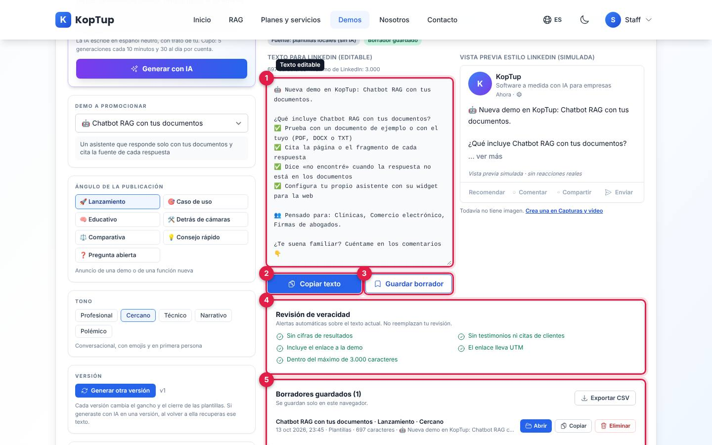

*Publicación con su revisión automática y el borrador guardado.*

1. **Texto para LinkedIn (editable)**: con el conteo de caracteres frente al máximo de 3.000. Si lo editas, la fuente pasa a «Editado por ti» y aparece «Restablecer texto».
2. **Copiar texto**: lo copia al portapapeles para pegarlo en LinkedIn.
3. **Guardar borrador**: lo guarda en este navegador (aparece en «Borradores guardados»).
4. **Revisión de veracidad**: alertas automáticas sobre el texto actual: cifras de resultados, testimonios o citas de clientes, enlace a la demo, UTM y largo. Si el texto no trae el enlace a la demo, aparece el botón **«Agregar el enlace a la demo»** (lo agrega al final, con la UTM si está activa). No reemplaza la revisión humana.
5. **Borradores guardados**: lista con «Abrir», «Copiar», «Eliminar» y «Exportar CSV».

A la derecha está la **Vista previa estilo LinkedIn (simulada)**: así se vería la publicación; «… ver más» la despliega. No hay reacciones reales y, si todavía no tiene imagen, el enlace «Crea una en Capturas y video» lleva a esa pestaña.

### Paso 5 · Suma el visual (≈ 1 min 30 s)

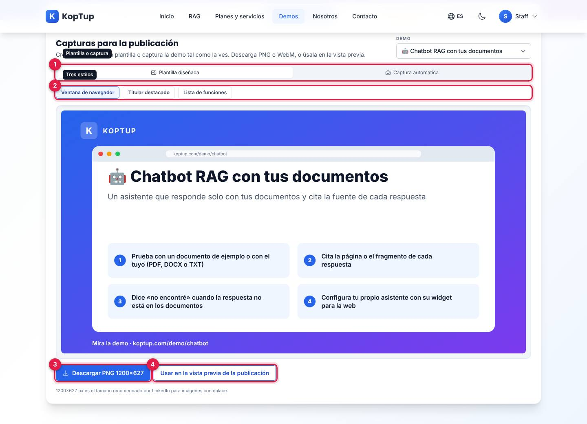

*Pestaña «Capturas y video» en modo «Plantilla diseñada».*

1. **Plantilla diseñada / Captura automática**: dos formas de crear el visual.
2. **Tres estilos**: «Ventana de navegador», «Titular destacado» y «Lista de funciones», con el título, la descripción y las funciones de la demo elegida.
3. **Descargar PNG 1200×627**: el tamaño que recomienda LinkedIn para imágenes con enlace.
4. **Usar en la vista previa de la publicación**: pasa la imagen al generador; aparece «Imagen agregada a la vista previa de la publicación» con el botón «Ir al generador».

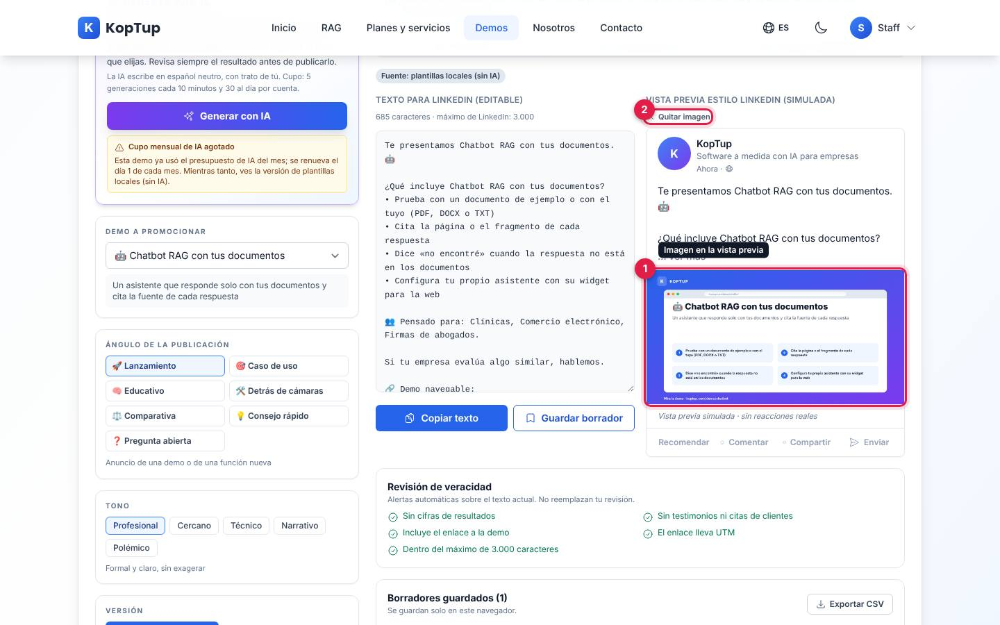

*De vuelta en el generador: la publicación simulada ya lleva la imagen.*

1. **Imagen en la vista previa**.
2. **Quitar imagen**.

Con esto los tres primeros pasos quedan «Hecho» en el Resumen. Para cerrar: «Cotizar un motor de contenido» o «Solicitar demo guiada» (arriba) o el cierre común al final de la página.

---

## Pantallas y funciones

### Resumen

Ver la [vista general](#guía-de-la-demo-generador-de-contenido-para-linkedin-con-ia). Las tarjetas de primeros pasos son botones que abren Calendario, Generador y Capturas. El cuadro «Qué hace y qué no hace» lista que genera con IA (con un cupo de uso) o con plantillas y dice cuál usó, que guarda borradores y exporta CSV, que crea imágenes, PDF del carrusel y capturas de las demos que puedes abrir, y que agrega UTM; y que **no** se conecta a tu cuenta de LinkedIn, **no** mide alcance ni clics y **no** inventa resultados.

Las pestañas se manejan también con el teclado: flechas izquierda y derecha, Inicio y Fin.

### Calendario 30 días

Cada tarjeta muestra el día, la fecha (calculada en el navegador a partir del lunes elegido, con zona horaria fija), el formato (Texto, Imagen, Carrusel o Video, con su color), la demo, el ángulo y una nota estratégica. Clic en una tarjeta abre el generador con ese plan (ver [paso 2](#paso-2--elige-un-día-del-calendario--45-s)).

### Generador de publicaciones

Tiene tres vistas: **Publicación** (pasos 3 y 4), **Texto de anuncio** y **Carrusel**.

#### Generar con IA

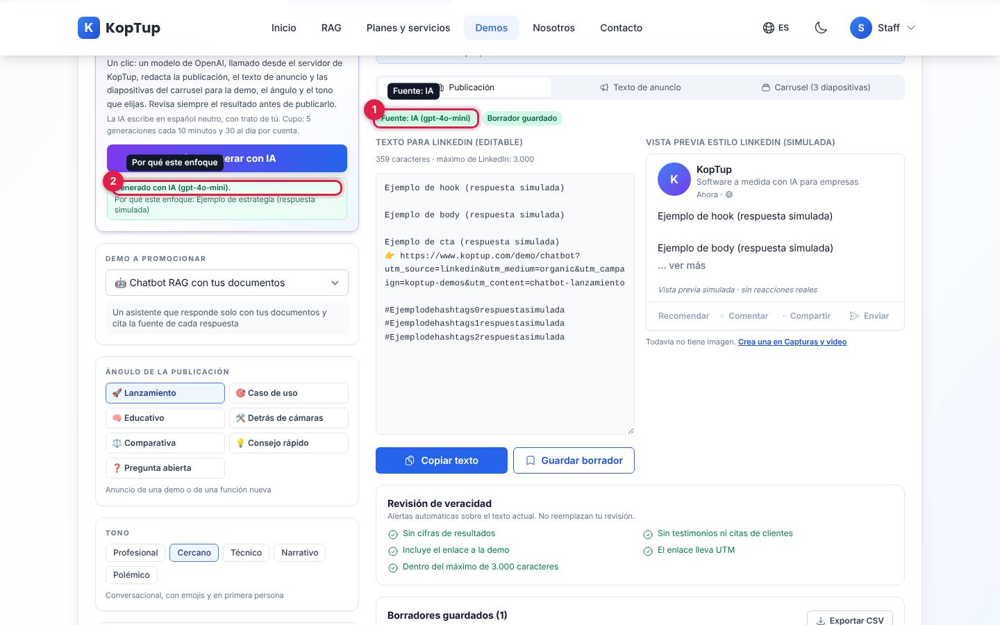

*Después de «Generar con IA»: la fuente cambia a «Fuente: IA (gpt-4o-mini)» y aparece «Por qué este enfoque». En esta captura el texto viene del modelo simulado del entorno de pruebas («Ejemplo de… (respuesta simulada)»); con la clave real lo redacta GPT-4o mini.*

1. **Quién generó el texto**: «Fuente: IA (gpt-4o-mini)».
2. **Estrategia de la IA**: «Generado con IA (modelo). Por qué este enfoque: …». El botón cambia a «Regenerar con IA».

Detalles:

- El enlace que escribe la IA se lleva a la dirección canónica de la demo (`https://www.koptup.com/demo/...`) y, si la IA no lo escribió, se agrega al cierre. Así la UTM y la revisión funcionan igual que con plantillas. Las etiquetas (#) se limpian de espacios y signos.
- El resultado de la IA se guarda por combinación (demo, ángulo, tono y versión): si cambias una opción ves las plantillas de esa combinación y, al volver, recuperas el texto de la IA.
- Si la sesión venció, la demo la renueva sola y reintenta una vez.

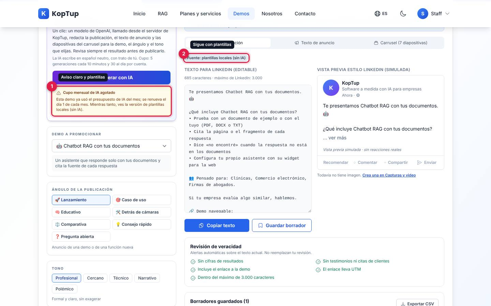

*Aviso de cupo mensual agotado (respuesta `budget_exhausted` simulada para la captura): la demo sigue con plantillas.*

Si la IA no responde, el aviso dice qué pasó según el código de error del servidor y qué ves mientras tanto (plantillas locales, tu texto editado o el texto de IA anterior de esa combinación):

| Código del servidor | Aviso |
|---|---|
| `budget_exhausted` | «Cupo mensual de IA agotado»: se renueva el día 1 de cada mes. |
| `rate_limited` (429) | «Llegaste al límite de generaciones»: 5 cada 10 minutos y 30 al día, e «Intenta de nuevo en N min» si el servidor dice cuánto falta. |
| `ai_not_configured` | «IA no disponible en este servidor» (falta la clave del modelo). |
| `limits_unavailable` | «No pudimos verificar el cupo de IA», por eso no se llamó al modelo. |
| `login_required`, `TOKEN_EXPIRED` (si no se pudo renovar) | «Tu sesión terminó», con el enlace «Iniciar sesión» que vuelve a la demo. |
| `demo_access_required` | «Tu cuenta no tiene acceso a esta demo», con el enlace «Solicitar acceso». |
| `demo_disabled` | «Demo desactivada». |
| `service_unavailable`, `unexpected_response` | «La IA no responde ahora mismo». |
| `llm_error` / `invalid_output` | «El modelo no pudo responder» / «La respuesta de la IA llegó incompleta». |
| Sin conexión | «Sin conexión con el servidor». |

Si la respuesta no trae `code` (formato anterior), el aviso se decide por el estado HTTP.

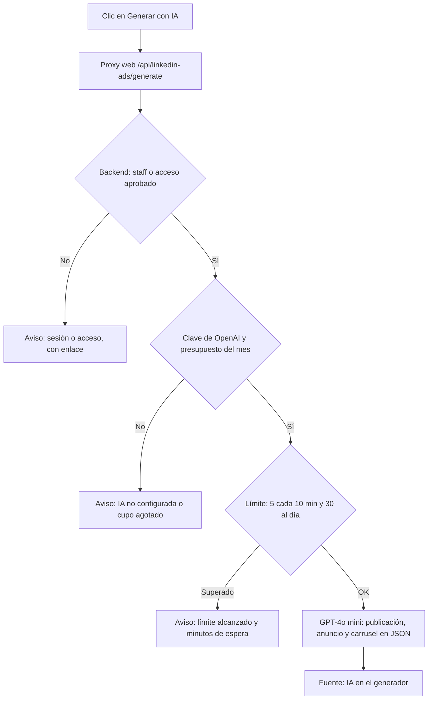

*Qué pasa al pulsar «Generar con IA». En todos los casos de aviso, el generador sigue funcionando con plantillas locales.*

#### Texto de anuncio

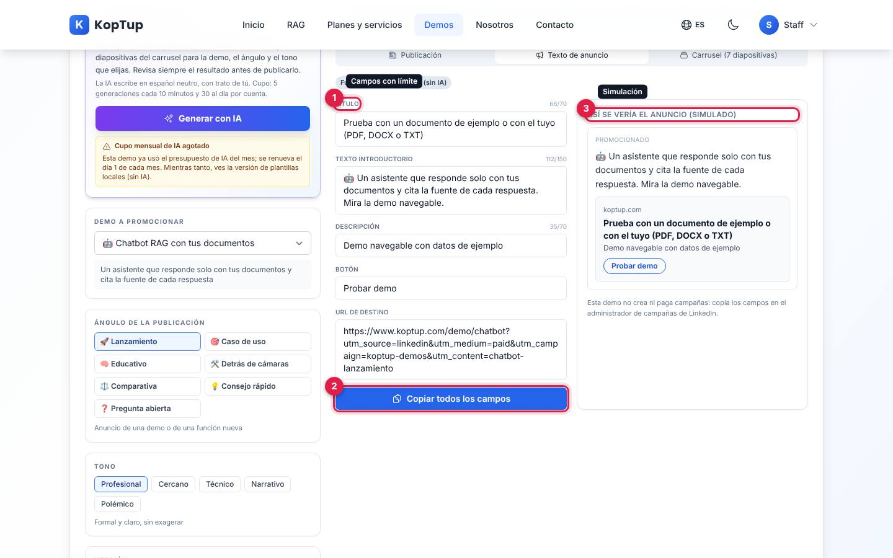

*Campos para el administrador de campañas de LinkedIn y su simulación.*

1. **Título** (máx. 70), **Texto introductorio** (máx. 150), **Descripción** (máx. 70), **Botón** y **URL de destino**, con contador y aviso «Supera el límite». La UTM de pauta va en la URL de destino, no en el texto introductorio.
2. **Copiar todos los campos**: los copia juntos.
3. **Así se vería el anuncio (simulado)**. La demo aclara que no crea ni paga campañas.

#### Carrusel

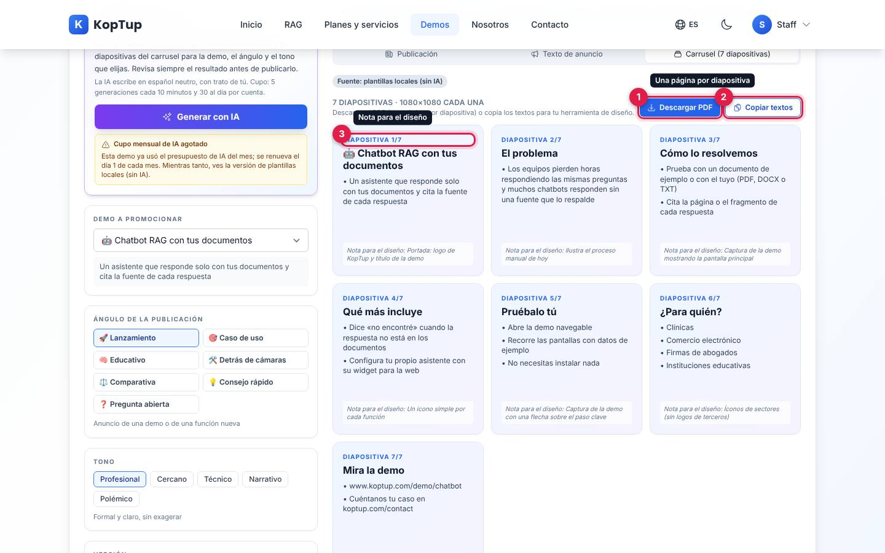

*Siete diapositivas de 1080×1080 con su nota para el diseño.*

1. **Descargar PDF**: genera en el navegador un PDF con una página por diapositiva (LinkedIn publica carruseles como documento PDF).
2. **Copiar textos**: copia todas las diapositivas en texto.
3. Cada diapositiva trae título, viñetas y una «Nota para el diseño».

#### Borradores guardados

Se guardan **solo en este navegador** (máximo 50). Cada uno muestra fecha, fuente (IA, Plantillas o Editado) y caracteres, con «Abrir» (lo carga en el editor), «Copiar» y «Eliminar». «Exportar CSV» descarga todos. «Restablecer» (junto a las pestañas) los borra junto con las preferencias.

### Capturas y video

**Plantilla diseñada:** ver [paso 5](#paso-5--suma-el-visual--1-min-30-s).

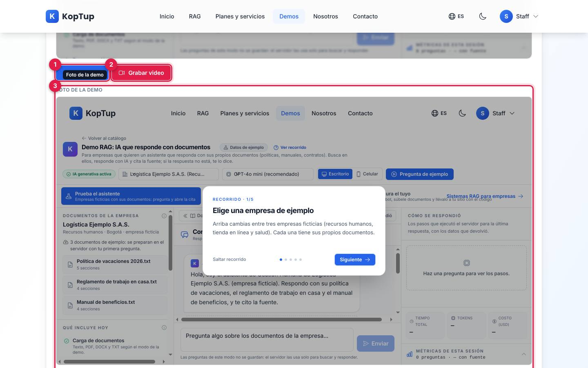

*Modo «Captura automática»: la demo real cargada en un recuadro y la foto tomada debajo (sale tal cual, incluso con el recorrido guiado de la demo abierto si no lo cierras antes dentro del recuadro).*

1. **Tomar foto**: toma exactamente lo que se ve en el recuadro y lo muestra como «Foto de la demo», con «Descargar PNG» y «Usar en la vista previa de la publicación».
2. **Grabar video**: graba mientras navegas por la demo dentro del recuadro (botón «Detener (n s)»); se descarga en **WebM**. La demo avisa que LinkedIn no acepta WebM y sugiere convertirlo a MP4.
3. **Foto de la demo**: el resultado.

El selector «Demo» (arriba a la derecha) cambia la demo del recuadro; «Abrir en otra pestaña» la abre aparte. No pide permisos porque la demo está en el mismo sitio. Si tu cuenta no tiene acceso a una demo con solicitud, el recuadro muestra su pantalla de acceso (la demo lo advierte).

### En el celular

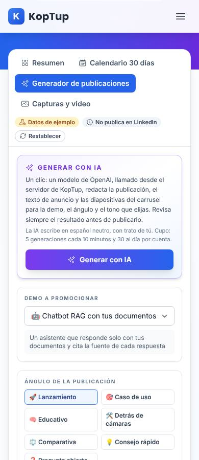

*Después de «Empezar: publicación del día 1» en un teléfono de 390 px: las pestañas y los rótulos se acomodan en varias líneas y los bloques se apilan.*

---

## Qué es real y qué es simulado

| Elemento | Real o simulado | Detalle |
|---|---|---|
| Catálogo de 25 demos | **Real** | Nombre, descripción, cuatro funciones, sector, público y problema de cada demo están en los textos de esta demo, escritos según lo que cada demo hace de verdad (sus guías en el [catálogo de demos](Doc-07-Guia-de-Demos.md)). No se toman de las tarjetas del hub porque lo que sale de aquí se publica. |
| Calendario de 30 días | **Datos de ejemplo** | Plan fijo en el código; las fechas se calculan en el navegador a partir del próximo lunes. |
| Texto con plantillas locales | **Real, sin IA** | Se arma en el navegador a partir del catálogo; sin cifras ni testimonios. |
| Generar con IA | **IA real** | El navegador llama a la web (`/api/linkedin-ads/generate`), que reenvía al backend; el backend llama a OpenAI (GPT-4o mini) con salida JSON. Tiene límites por cuenta y tope de gasto mensual. |
| Avisos de error de la IA | **Real** | Se deciden por el `code` del formato único de errores de la API. |
| Revisión de veracidad | **Real** | Reglas en el navegador (no usa IA). |
| Vista previa de la publicación y del anuncio | **Simulado** | Imitan LinkedIn; no hay reacciones ni métricas reales. |
| Publicar o pautar en LinkedIn | **No existe** | No se conecta a LinkedIn. |
| Borradores, preferencia de UTM e inicio del calendario | **Real, solo local** | `localStorage` de este navegador; «Restablecer» los borra. |
| Primeros pasos | **Real, solo en la pestaña** | Se marcan con lo que haces; al recargar vuelven a cero. |
| PDF del carrusel e imagen 1200×627 | **Real** | Se generan en el navegador. |
| Foto y video de una demo | **Real** | Captura del recuadro con la demo real (foto PNG, video WebM). |

---

## Acceso

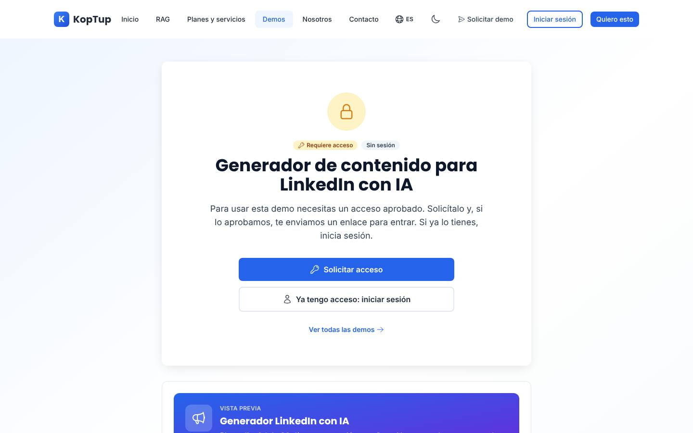

*Lo que ve un visitante sin sesión en `/demo/linkedin-ads` (la URL no cambia).*

- **Cómo la ve un visitante:** la demo está en modo **Con solicitud** (`solicitud`). Sin sesión o sin acceso aprobado, la dirección `/demo/linkedin-ads` muestra la pantalla de acceso: rótulos «Requiere acceso» y «Sin sesión», el texto «Para usar esta demo necesitas un acceso aprobado…», y debajo una **vista previa** con la descripción de la tarjeta del catálogo.
  1. **Solicitar acceso**: abre el formulario `/solicitar-demo` con esta demo ya marcada.
  2. **Ya tengo acceso: iniciar sesión**: va a `/login` y, al entrar, vuelve a la demo.
- **Cómo se concede:** el equipo revisa la solicitud en **Admin › Solicitudes de demo** y, al aprobarla, el visitante recibe un enlace para activar su cuenta; luego ve la demo en **Mis demos** del portal. Los accesos vigentes se gestionan en **Admin › Accesos a demos** y el modo de la demo en **Admin › Catálogo de demos**. El personal de KopTup (staff) la ve siempre, sin solicitud. Si el acceso vence o se revoca, la pantalla lo dice. Detalle en el [Manual del administrador](Doc-06-Manual-del-Administrador.md) y en [Flujos del visitante](Doc-04-Flujos-del-Visitante.md).
- **Doble control:** además de la pantalla de acceso, el servidor vuelve a verificar el acceso en cada «Generar con IA» (staff o acceso aprobado a `linkedin-ads`); si falla, la demo lo dice con un enlace para iniciar sesión o solicitar acceso. Si el admin dejara la demo abierta, el límite de IA se contaría por IP en lugar de por cuenta.

---

## Limitaciones conocidas

- **La tarjeta del catálogo todavía no coincide con la demo.** La vista previa de la pantalla de acceso (y la tarjeta en `/demo`) dice «Vista previa real de LinkedIn + 8 ángulos × 5 tonos» y «ad copy», pero la demo tiene **7** ángulos y su vista previa es **simulada** (así lo rotula ella misma). Los textos nuevos están propuestos para la pista de plataforma, igual que el de la página Nosotros («a partir de tu producto»: la demo genera a partir de las demos de KopTup, no de un producto que escribas).
- **Los textos de las 25 demos viven en esta demo.** Si una demo cambia lo que hace, hay que actualizar su entrada en `demoLinkedinAds.catalog` (ES y EN); no se sincroniza sola con la tarjeta del hub.
- **No publica ni mide.** No hay conexión con LinkedIn, ni alcance, ni clics, ni seguidores.
- **Todo lo guardado vive en este navegador.** Borradores (máx. 50), preferencia de UTM e inicio del calendario se pierden si borras los datos del navegador o cambias de equipo. El texto generado con IA que no guardes como borrador se pierde al recargar.
- **Límites de la IA:** 5 generaciones cada 10 minutos y 30 al día por cuenta, y un tope de gasto mensual (20 USD por defecto, configurable). Al pasarlos, la demo avisa y sigue con plantillas.
- **La IA escribe en español** también cuando la página está en inglés (el aviso del generador lo dice); las plantillas locales sí salen en el idioma de la página.
- **Captura automática de demos con solicitud:** con una cuenta que solo tiene acceso a esta demo, el recuadro de las demos con solicitud (ERP, HRMS, LMS, etc.) muestra su pantalla de acceso. Elige una demo abierta o usa la plantilla.
- **Video en WebM y a pocos cuadros por segundo.** LinkedIn no acepta WebM; hay que convertirlo a MP4. La cantidad de cuadros depende del equipo.
- **La foto automática redibuja la página.** Puede verse un poco distinta de la pantalla real: por ejemplo, salen barras de desplazamiento y no salen efectos como el desenfoque de fondo.
- **Portapapeles:** si el navegador bloquea la copia, la demo dice «No se pudo copiar automáticamente; selecciona el texto y cópialo».
- **Botones:** la sonda automática probó todos los elementos del Resumen, del Calendario, del Generador y de Capturas (escritorio, 390 px e inglés) y ninguno quedó sin efecto; solo aparecen «sin cambio» la pestaña, la vista, el modo o el estilo que ya están activos y la lista desplegable de demos al abrirla sin elegir otra, como es de esperar. Los flujos principales (empezar, generar con IA, avisos de error por código, renovación de la sesión, copiar, guardar, agregar enlace, anuncio, PDF del carrusel, plantilla, vista previa con imagen, calendario y CSV, restablecer y teclado) se probaron con Playwright.
