# Guía de la demo: Plataforma de cursos virtuales (LMS)

> Ruta `/demo/lms` (y su página pública de verificación `/demo/lms/verificar`) · Modo de acceso: **Con solicitud** · Tipo: **datos de ejemplo** en el navegador, con **IA real** solo en el tutor del curso (llama al servidor) · Plan del producto: [LMS / E-learning](Producto-lms-elearning.md)

**Resumen.** Es la plataforma de cursos de una academia ficticia de educación continua, Academia Quindé (Pereira), con seis cursos en pesos colombianos. Muestra el recorrido completo de un alumno (catálogo, compra simulada con PSE, tarjeta o Nequi y cupones, lecciones con video simulado y subtítulos, notas, un tutor con IA que cita la lección y el minuto, evaluación final, ruta adaptativa, logros y certificados con QR) y las vistas del instructor (analítica y riesgo de abandono, creación de cursos) y del administrador (ventas, cupones y certificados emitidos). Está pensada para academias, centros de formación y empresas que capacitan a su equipo; se abre con un acceso aprobado, y su página de verificación de certificados es pública. Al entrar, el encabezado dice qué es y para quién, qué es real y qué es simulado, y la tarjeta **Primeros pasos** propone un recorrido de cuatro pasos con su botón.

**En esta página:** [Recorrido sugerido](#recorrido-sugerido-demo-comercial-de-5-minutos) · [Pantallas y funciones](#pantallas-y-funciones) · [Qué es real y qué es simulado](#qué-es-real-y-qué-es-simulado) · [Acceso](#acceso) · [Limitaciones conocidas](#limitaciones-conocidas)

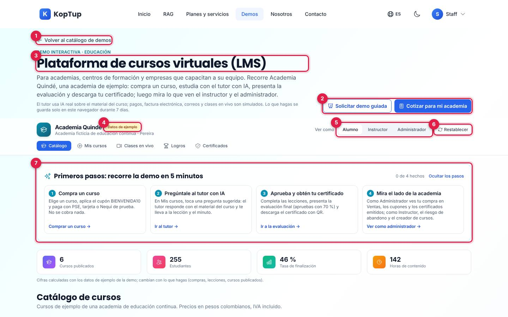

*Lo primero que se ve: volver al catálogo, las salidas comerciales, qué es la demo y para quién, la academia de ejemplo con su rótulo, el selector de vista, Restablecer y los primeros pasos.*

1. **Volver al catálogo de demos** (`/demo`).
2. **Solicitar demo guiada** (`/solicitar-demo?demos=lms`, con esta demo ya elegida) y **Cotizar para mi academia** (`/contact?service=lms-elearning`, con la solución ya elegida en el formulario).
3. **Qué es y para quién**: «Plataforma de cursos virtuales (LMS)», para academias, centros de formación y empresas que capacitan a su equipo. Debajo, una línea dice que el tutor usa IA real, que pagos, factura electrónica, correos y clases en vivo son simulados y que lo que hagas se guarda solo en ese navegador durante 7 días.
4. **Academia Quindé · Datos de ejemplo**: la academia ficticia sobre la que corre la demo (al pasar el mouse por el rótulo se repite qué es simulado).
5. **Ver como**: Alumno, Instructor o Administrador (también con las flechas del teclado). Cambia las secciones y la vista; en la demo no pide iniciar sesión, y el aviso del selector aclara que en un proyecto cada rol entra con su propia cuenta y permisos.
6. **Restablecer**: pide confirmación y vuelve a los datos de ejemplo.
7. **Primeros pasos**: cuatro pasos con su botón (**Comprar un curso**, **Ir al tutor**, **Ir a la evaluación** y **Ver como administrador**); cada uno se marca solo cuando lo completas («0 de 4 hechos»). Se pliega con **Ocultar los pasos** y el navegador lo recuerda.

---

## Recorrido sugerido (demo comercial de 5 minutos)

El guion recorre lo que vive un alumno de punta a punta y termina mostrando lo que ve la academia; es el mismo orden de **Primeros pasos**. Empieza con los datos limpios: si alguien ya usó la demo en ese navegador, pulsa **Restablecer** y confirma con **Sí, restablecer**. El alumno de ejemplo (Valentina Ríos) ya está inscrito en «Excel para análisis de datos» (40 %) y terminó «Protección de datos personales (Ley 1581)», con su certificado.

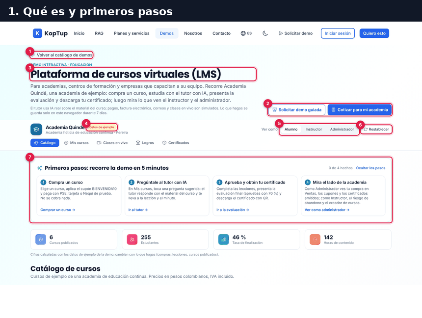

*Recorrido en 12 cuadros: primeros pasos, catálogo, compra con cupón, pago aprobado, lección, tutor, evaluación no aprobada con refuerzo, evaluación aprobada, certificados, verificación en el mismo navegador y en el de un tercero, y la venta en el panel del administrador.*

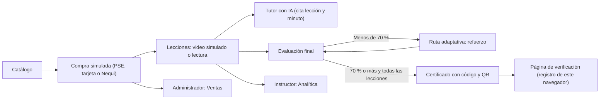

*El camino del alumno y dónde se refleja en las vistas del instructor y del administrador.*

### Paso 1. Catálogo: elige un curso

Pulsa **Comprar un curso** en Primeros pasos (abre directamente la compra de «Marketing digital para pymes») o baja al catálogo.

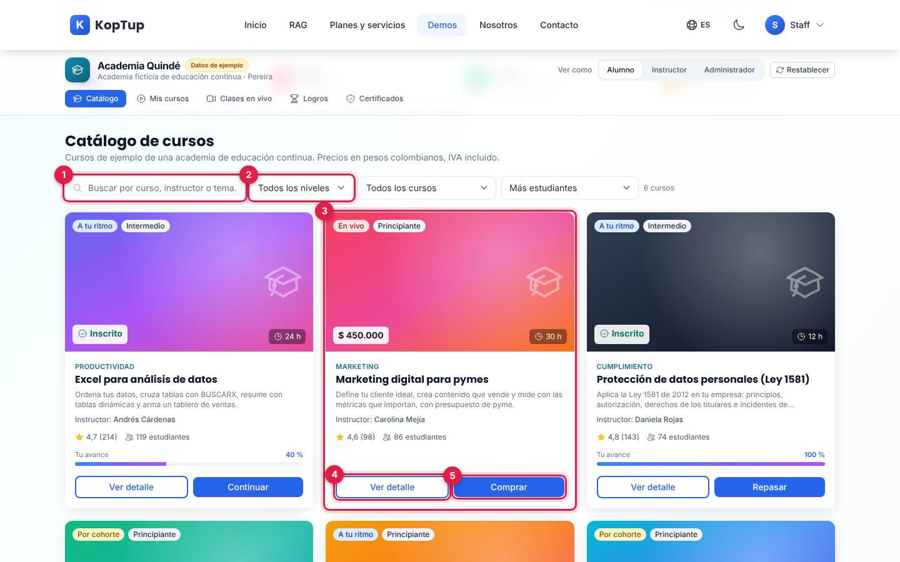

*Catálogo con los cursos inscritos (avance) y los disponibles (precio con IVA).*

1. **Buscar** por curso, instructor o tema. Al lado dice cuántos cursos coinciden.
2. **Filtros**: nivel; todos, mis cursos o disponibles para comprar; orden por estudiantes, precio o calificación.
3. **Tarjeta del curso**: modalidad (en vivo, a tu ritmo o por cohorte), nivel, horas, precio con IVA (o «Inscrito»), categoría, instructor, calificación y estudiantes (datos de ejemplo). En los inscritos muestra **Tu avance**.
4. **Ver detalle** abre la ficha del curso (temario, requisitos, instructor y política del certificado).
5. **Comprar** (o **Continuar** / **Repasar** si ya estás inscrito).

### Paso 2. Compra simulada con cupón

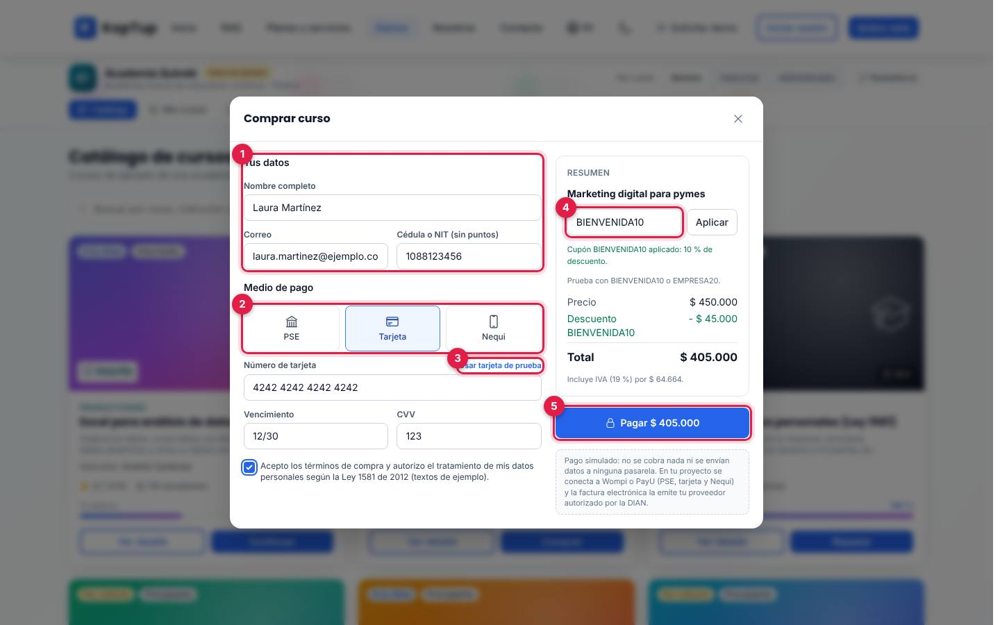

*Ventana «Comprar curso» con la tarjeta de prueba y el cupón BIENVENIDA10 aplicado.*

1. **Tus datos**: nombre, correo y cédula o NIT. Vienen los del alumno de ejemplo; en la prueba se cambiaron a «Laura Martínez», `laura.martinez@ejemplo.co`. Ese nombre se usará en los certificados que emitas desde ahora.
2. **Medio de pago**: PSE (con tipo de persona natural o jurídica), Tarjeta o Nequi (celular de 10 dígitos que empiece por 3).
3. **Usar tarjeta de prueba**: llena número, vencimiento y CVV de prueba. La demo valida el número de tarjeta, la fecha (MM/AA, no vencida) y el CVV.
4. **Cupón**: «Prueba con BIENVENIDA10 o EMPRESA20». Con el primero: «Cupón BIENVENIDA10 aplicado: 10 % de descuento». El resumen muestra precio, descuento, total y el IVA incluido (19 %, $ 64.664 en la prueba).
5. **Pagar $ 405.000**: exige aceptar los términos y la autorización de datos (Ley 1581, textos de ejemplo). Muestra «Validando la tarjeta (simulado)…» y, a los pocos segundos, **Pago aprobado (simulado)** con la referencia (`AQ-261014-1437`), la factura electrónica simulada (`FEQ-1437`), el medio («Tarjeta •••• 4242») y el total.

En la confirmación, **Descargar comprobante (PDF)** descarga `comprobante-AQ-261014-1437.pdf` (marcado «DOCUMENTO DE EJEMPLO… no es una factura electrónica») e **Ir al curso** abre la primera lección. La pantalla aclara que no se cobra nada ni se envía ningún correo. Escape o la X cierran la ventana (salvo mientras «procesa» el pago).

Qué decir: «La venta es autoservicio: el alumno paga con el medio que usa en Colombia y entra al curso de inmediato».

### Paso 3. La lección: video simulado, subtítulos y notas

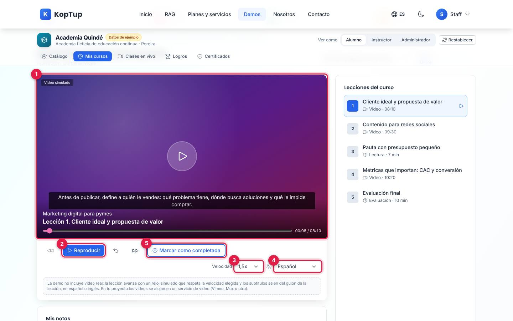

*Lección 1 del curso comprado, con subtítulos en español a velocidad 1,5x.*

1. **Video simulado**: no hay video real; un reloj avanza la lección y los subtítulos salen del guion. Abajo, el título de la lección y la barra de posición (`00:08 / 08:10` en la captura).
2. **Reproducir / Pausar** (también lección anterior, retroceder 10 segundos y lección siguiente).
3. **Velocidad**: 0,75x, 1x, 1,25x, 1,5x o 2x; el reloj la respeta.
4. **Subtítulos**: sin subtítulos, español o inglés.
5. **Marcar como completada** (en las lecturas, **Marcar como leída**): avisa «Lección completada: …», suma al avance y a los logros. Si el video llega al final, la lección también queda completada.

Debajo están **Mis notas** («Guardar nota en 00:08» guarda la nota con el minuto; cada nota lleva de vuelta a ese punto, se puede borrar y **Descargar notas (.txt)**) y, a la derecha, la lista de lecciones con su estado. El selector junto al título cambia de curso.

### Paso 4. Pregúntale al tutor con IA

Pulsa **Ir al tutor** en Primeros pasos (o baja hasta **Tutor con IA**) y toca una pregunta sugerida (en la prueba, «¿Cómo calculo el CAC?»).

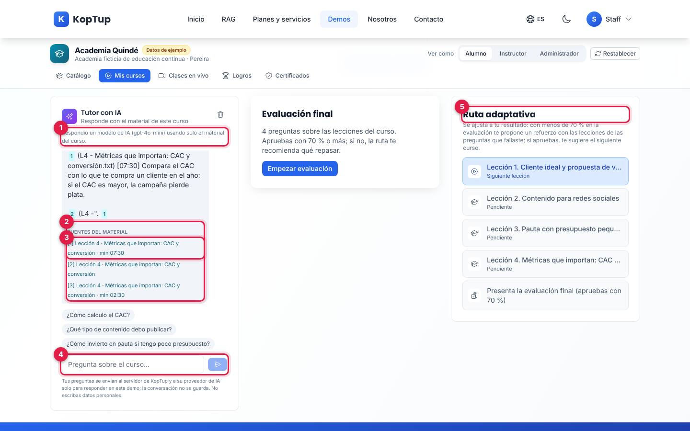

*Respuesta del tutor con sus fuentes y, a la derecha, la ruta adaptativa del curso.*

1. **Modo de la respuesta**: «Respondió un modelo de IA (…) usando solo el material del curso». Si el servidor no tiene IA configurada, si se agotó el cupo de IA de la demo o si el proveedor falla, lo dice y muestra los fragmentos; si no hay conexión con el servidor, busca en el material dentro del navegador y lo marca «Búsqueda local (sin IA)».
2. **Fuentes del material**: lección y minuto de cada fragmento (por ejemplo, «Lección 4 · Métricas que importan: CAC y conversión · min 07:30»).
3. **Ir a esa parte de la lección**: cada fuente (y cada número entre corchetes de la respuesta) abre la lección en ese minuto.
4. **Pregunta sobre el curso…**: preguntas libres. Debajo: «Tus preguntas se envían al servidor de KopTup solo para responder en esta demo y no se guardan. No escribas datos personales». El ícono de papelera limpia la conversación.
5. **Ruta adaptativa**: lecciones completadas, la siguiente y la evaluación final.

Qué decir: «El tutor no inventa: responde con el material del curso y te lleva al minuto exacto donde se explica».

### Paso 5. Evaluación final y ruta de refuerzo

Pulsa **Ir a la evaluación** en Primeros pasos: abre «Excel para análisis de datos» y baja a la evaluación. Marca como hechas las lecciones 3 y 4 (desde la lista de lecciones) y pulsa **Empezar evaluación**. Son 4 preguntas; cada una se valida con **Validar respuesta** («¡Correcto!» o «Incorrecto. La respuesta correcta es: …») y se sigue con **Siguiente** hasta **Ver resultado**. En la prueba se contestaron mal dos a propósito.

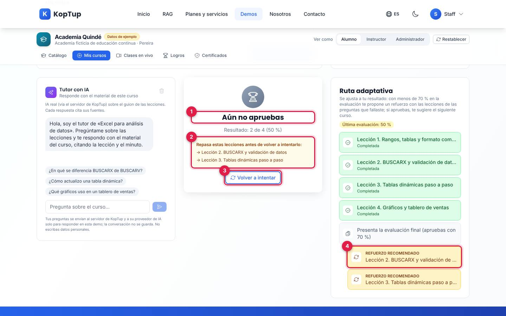

*Resultado de 2 de 4 (50 %) y la ruta adaptativa con el refuerzo recomendado.*

1. **Aún no apruebas**: «Resultado: 2 de 4 (50 %)». Se aprueba con 70 % o más.
2. **Repasa estas lecciones**: las lecciones de las preguntas falladas (BUSCARX y tablas dinámicas); cada una abre la lección.
3. **Volver a intentar**: repite la evaluación; queda el mejor intento.
4. **Ruta adaptativa**: «Última evaluación: 50 %» y dos tarjetas **Refuerzo recomendado** con esas lecciones.

Al repetir con todas buenas: «¡Aprobaste! Resultado: 4 de 4 (100 %)», «Insignia desbloqueada: Evaluación perfecta», «Certificado AQ-2026-0200 emitido.» y **Ver certificado**. La ruta cambia a **Siguiente curso recomendado** («Finanzas para no financieros»). Si faltan lecciones, en lugar del certificado dice «Te faltan N lecciones para obtener el certificado».

### Paso 6. El certificado y su verificación

Pulsa **Ver certificado** (la vista sube al inicio de Certificados) o abre **Certificados**.

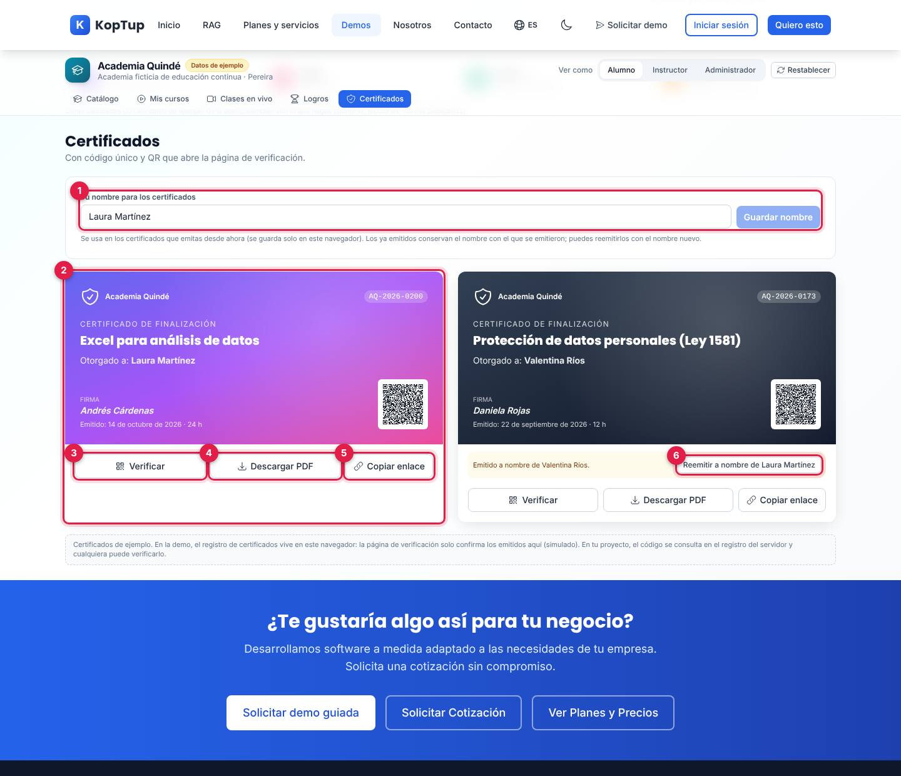

*El certificado recién emitido a nombre de Laura Martínez y el que ya traía el alumno de ejemplo, que conserva su nombre.*

1. **Tu nombre para los certificados**: se usa en los certificados que emitas desde ahora. Los ya emitidos conservan el nombre con el que se emitieron.
2. **Certificado**: academia, código único (`AQ-2026-0200`), curso, «Otorgado a», firma del instructor, fecha de emisión, horas y QR.
3. **Verificar**: abre en una pestaña nueva la página de verificación del QR.
4. **Descargar PDF**: `certificado-AQ-2026-0200.pdf`, con el QR y la marca «DOCUMENTO DE EJEMPLO».
5. **Copiar enlace**: copia el enlace de verificación («Enlace de verificación copiado»).
6. **Reemitir a nombre de Laura Martínez**: aparece en los certificados emitidos con otro nombre. Crea un certificado nuevo con otro código («Certificado reemitido como AQ-2026-0201. El código AQ-2026-0173 queda anulado.») y el anterior queda anulado; el nuevo dice «Reemplaza al certificado AQ-2026-0173, que quedó anulado».

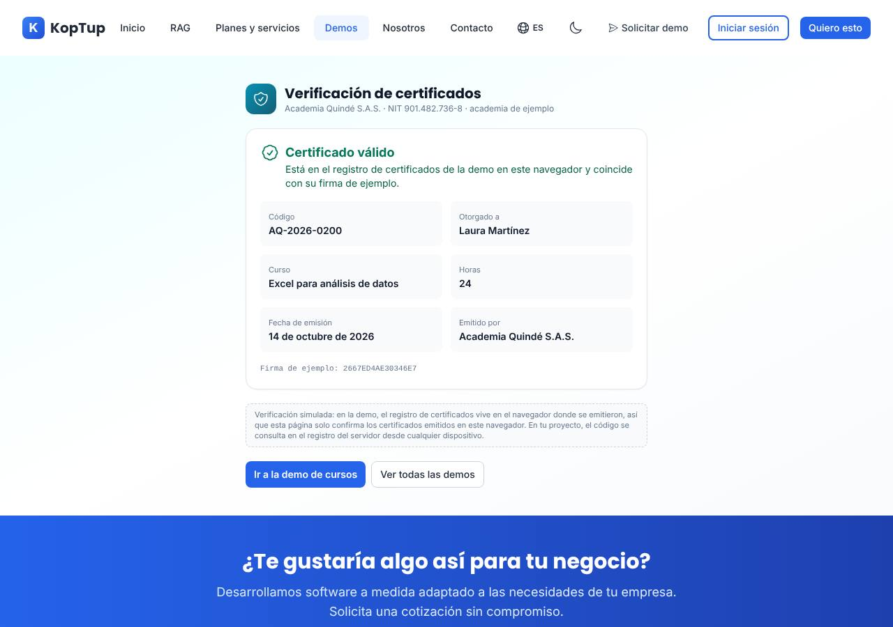

*`/demo/lms/verificar` abierta en el navegador donde se emitió: «Certificado válido», con código, nombre, curso, horas, fecha, emisor y la firma de ejemplo.*

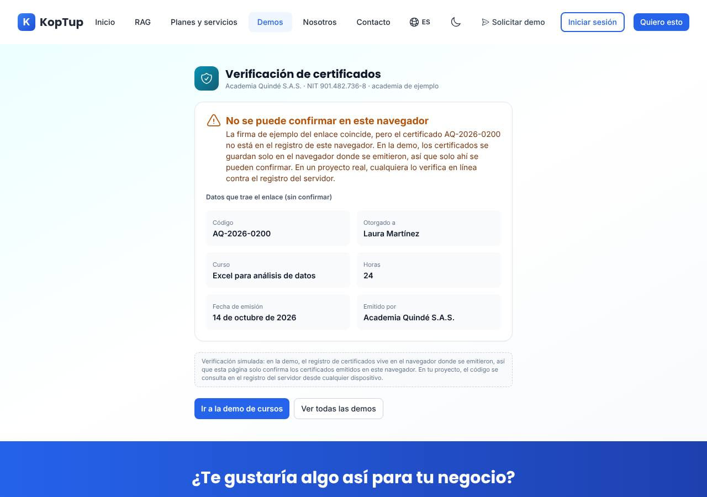

*El mismo enlace abierto por otra persona, sin sesión y en otro navegador: «No se puede confirmar en este navegador», con los datos del enlace marcados «sin confirmar».*

La página de verificación es pública (no pide sesión ni acceso a la demo) y cruza dos cosas: la firma de ejemplo que viaja en el enlace y el **registro de certificados de la demo, que vive en el navegador donde se emitieron**. Por eso:

| Resultado | Cuándo |
|---|---|
| **Certificado válido** | El enlace es íntegro y el código está en el registro de este navegador con los mismos datos. |
| **No se puede confirmar en este navegador** | El enlace es íntegro, pero el certificado no está en el registro de este navegador (por ejemplo, lo abre un tercero). La página lo explica y dice que en un proyecto real cualquiera lo verifica en línea contra el registro del servidor. |
| **Certificado anulado** | El certificado se reemitió con otro código. |
| **Los datos no coinciden** | El enlace fue modificado o no corresponde al certificado del registro. |
| **Enlace incompleto o inválido** | Falta información en el enlace. |

Debajo, «Verificación simulada…» repite que en la demo solo se confirman los certificados emitidos en ese navegador, y hay botones **Ir a la demo de cursos** y **Ver todas las demos**.

Para cerrar, pulsa **Ver como administrador** en Primeros pasos: en **Ventas** aparece tu compra al inicio de la tabla con la marca «tu compra» (ver [Administrador](#administrador)).

Qué decir: «Cada certificado tiene código y QR; en tu plataforma, quien lo reciba lo verifica en línea contra tu registro».

---

## Pantallas y funciones

### Encabezado, primeros pasos y cifras

| Elemento | Qué hace |
|---|---|
| **Volver al catálogo de demos** · **Solicitar demo guiada** · **Cotizar para mi academia** | Salida al catálogo y salidas comerciales (ver la [vista general](#guía-de-la-demo-plataforma-de-cursos-virtuales-lms)). Al final de la página está además el cierre común de las demos. |
| **Academia Quindé · Datos de ejemplo** | Al pasar el mouse por el rótulo: academia ficticia; pagos, factura electrónica, correos y clases en vivo simulados; el tutor usa IA real sobre el material. |
| **Ver como** | Alumno, Instructor o Administrador (clic o flechas, Inicio y Fin). Al cambiar, abre la primera sección de ese rol y la vista empieza arriba. |
| **Restablecer** | Pide confirmación y borra compras, avances, notas, certificados nuevos, cupones, cursos creados y los primeros pasos hechos en este navegador. |
| **Secciones** | Cambian según el rol (ver abajo). En escritorio el encabezado de la academia queda fijo al bajar, debajo del menú del sitio. |
| **Primeros pasos** | Cuatro pasos que se marcan solos: compra de un curso nuevo, una pregunta al tutor, un certificado nuevo y abrir la vista de Administrador. |
| **Cifras** | Cursos publicados (6), estudiantes (255), tasa de finalización (46 %) y horas de contenido (142), calculadas con los datos de ejemplo; cambian con lo que hagas (por ejemplo, al publicar un curso). |

### Alumno: Catálogo y ficha del curso

Ver el [paso 1](#paso-1-catálogo-elige-un-curso). Los seis cursos son: Excel para análisis de datos ($ 290.000), Marketing digital para pymes ($ 450.000), Protección de datos personales Ley 1581 ($ 320.000), Finanzas para no financieros ($ 890.000), Contabilidad básica para emprendedores ($ 350.000) y Servicio al cliente y ventas por WhatsApp ($ 240.000), todos con IVA incluido.

**Ver detalle** abre la ficha: precio («IVA incluido · pago único (simulado)»), qué aprenderás, requisitos, instructor con su perfil, calificación, temario por módulos con la duración y el tipo de cada lección, la política del certificado («se emite al completar todas las lecciones y aprobar la evaluación final con 70 % o más») y la nota «En la demo verás una versión resumida de 5 lecciones; el programa completo es de 40 horas». Termina con **Comprar por $ …**, **Empezar curso** o **Continuar curso**. Un curso creado con precio $ 0 muestra **Inscribirme gratis**.

### Alumno: Mis cursos

Ver los pasos [3](#paso-3-la-lección-video-simulado-subtítulos-y-notas), [4](#paso-4-pregúntale-al-tutor-con-ia) y [5](#paso-5-evaluación-final-y-ruta-de-refuerzo). Reúne el reproductor, las notas, la lista de lecciones, el tutor, la evaluación final y la ruta adaptativa del curso elegido. Si no tienes cursos: «Aún no tienes cursos. Compra o inscríbete en uno del catálogo».

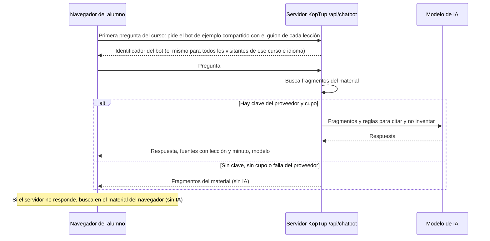

*Cómo responde el tutor: usa las mismas rutas del chatbot RAG del sitio. Los cursos de ejemplo usan un bot de ejemplo compartido (`POST /api/chatbot/sample-bots`): no se crea un bot por visitante ni se gasta el límite de bots nuevos por hora, y sus conversaciones no se guardan. Los cursos creados en la vista Instructor (o un servidor que no tenga esa ruta) usan un bot de ejemplo propio de ese navegador.*

### Alumno: Clases en vivo

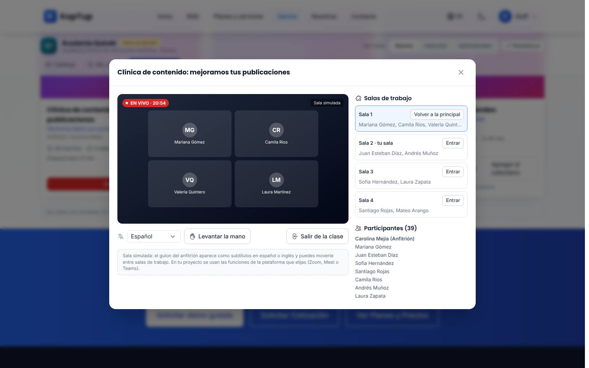

*Sala simulada de la clase en vivo, dentro de la sala de trabajo 1: tú apareces en la sala a la que entras.*

- **Tres sesiones**: una «EN VIVO» (Clínica de contenido, del curso de marketing) y dos próximas (taller de flujo de caja y respuestas rápidas por WhatsApp), con anfitrión, inscritos, salas de trabajo, duración y «Empieza en …». Las fechas se calculan desde hoy.
- **Unirme ahora** abre la sala simulada: el anfitrión «Está hablando», los subtítulos salen de su guion (español o inglés), **Levantar la mano**, cuatro **salas de trabajo** con **Entrar** y **Volver a la principal**, y la lista de participantes. **Salir de la clase** (o Escape) registra la asistencia («Asistencia registrada en tu historial») y el botón pasa a **Volver a entrar**.
- **Recordarme** activa un recordatorio simulado («En tu proyecto llega por correo o WhatsApp 15 minutos antes»). **Agregar al calendario** descarga un archivo `.ics` (por ejemplo, `clase-live-finanzas.ics`).

### Alumno: Logros

- **Nivel y XP**: 50 XP por lección, 100 por evaluación aprobada (más 50 si es perfecta) y 200 por certificado vigente; se sube de nivel cada 500 XP. El alumno de ejemplo empieza en nivel 2 con 700 XP. **¿Cómo se calculan tus puntos?** detalla la cuenta con el singular o plural correcto («1 certificado vigente», «2 evaluaciones aprobadas»).
- **Racha de estudio** y **reto semanal** (completar 3 lecciones en 7 días, +150 XP).
- **Insignias** (6): Primer paso, Constancia, Evaluación perfecta, Curioso (3 preguntas al tutor), Buenos apuntes (3 notas) y Certificado.
- **Tabla de tu cohorte**: compañeros de ejemplo y tu puntaje real, marcado «(Tú)».

### Alumno: Certificados

Ver el [paso 6](#paso-6-el-certificado-y-su-verificación). Los certificados anulados al reemitir no se muestran ni cuentan en los logros.

### Instructor: Analítica

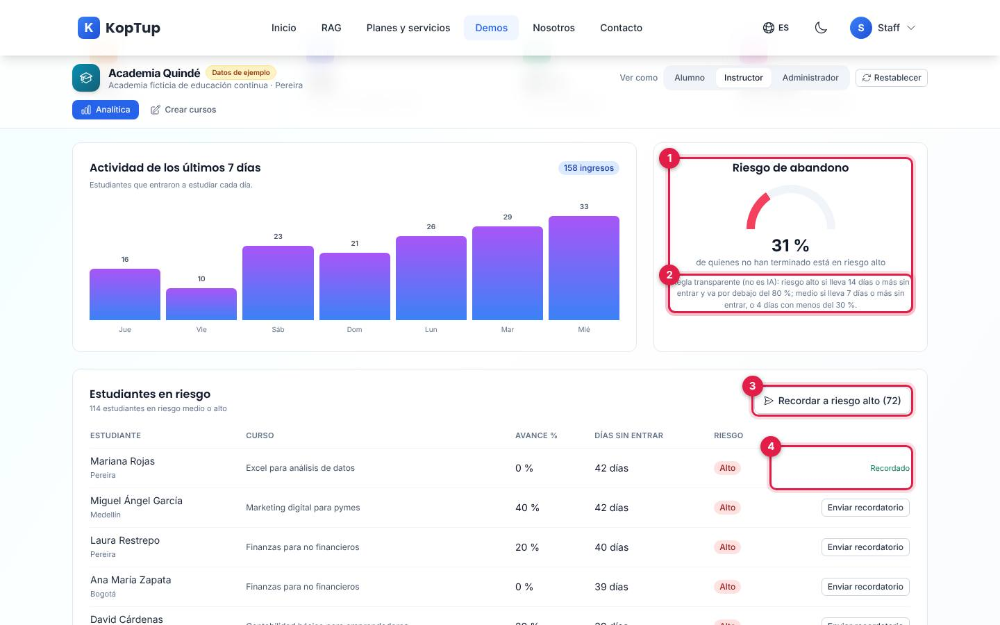

*Actividad de la semana, riesgo de abandono y estudiantes en riesgo, después de enviar un recordatorio.*

1. **Riesgo de abandono**: porcentaje de quienes no han terminado que está en riesgo alto (31 % en la prueba).
2. **Regla**: «Regla transparente (no es IA): riesgo alto si lleva 14 días o más sin entrar y va por debajo del 80 %; medio si lleva 7 días o más sin entrar, o 4 días con menos del 30 %».
3. **Recordar a riesgo alto (N)**: envío simulado a todos los de riesgo alto (72 en la prueba).
4. **Enviar recordatorio** por estudiante: «Recordatorio enviado a Mariana Rojas (simulado)» y la fila queda **Recordado**.

Arriba de la captura están el selector de curso (todos o uno), **Exportar estudiantes (CSV)** y las cifras (437 inscripciones, 158 activos en 7 días, 46 % de finalización, nota media 84/100). La tabla muestra 8 de los estudiantes en riesgo («114 estudiantes en riesgo medio o alto») y **Ver 8 más** carga los siguientes. Más abajo, **Lecciones con más avance** y **Lecciones a reforzar** (porcentaje de inscritos que llegó a cada lección).

### Instructor: Crear cursos

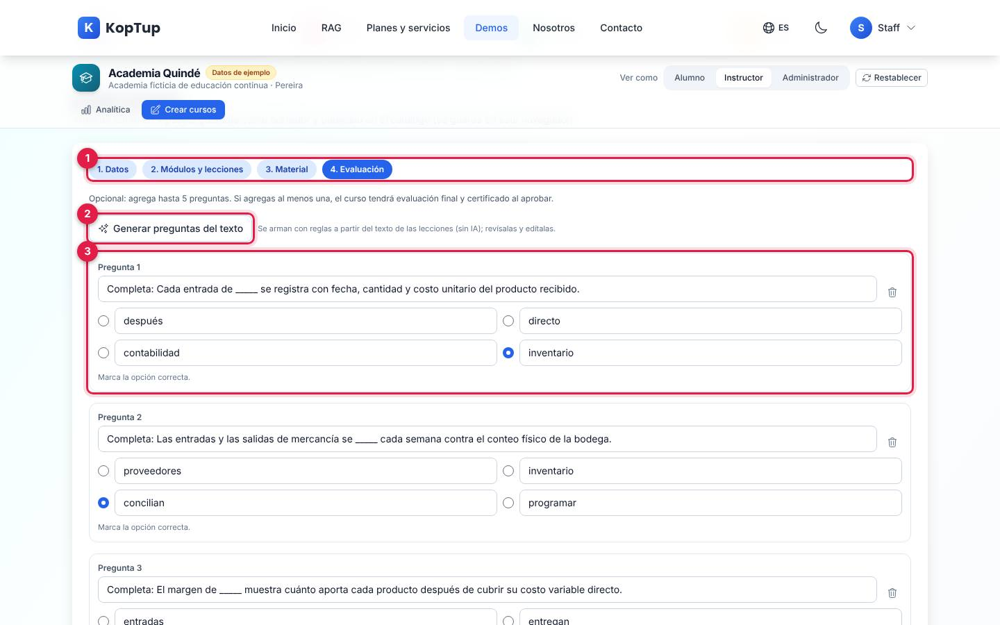

*Paso 4 del asistente con las preguntas generadas a partir del texto de la lección.*

1. **Cuatro pasos**: Datos (título, descripción, categoría, nivel, modalidad, horas y precio con IVA), Módulos y lecciones (título, tipo video o lectura, minutos y texto de la lección, que el tutor usa como material y el video simulado como subtítulos), Material (PDF, video, presentaciones o SCORM; en la demo solo se guardan el nombre y el tamaño) y Evaluación.
2. **Generar preguntas del texto**: arma hasta 5 preguntas de completar con las frases de las lecciones. «Se arman con reglas… (sin IA); revísalas y edítalas». Necesita al menos 4 frases. Las opciones de una misma pregunta no se repiten en singular y plural, y cada pregunta recuerda de qué lección salió (esa lección es la que recomienda la ruta de refuerzo si se falla).
3. **Preguntas**: cada una con 4 opciones y la correcta marcada; se pueden editar, quitar o agregar.
4. **Guardar y publicar** (o **Guardar borrador**): «Curso publicado: ya aparece en el catálogo». El catálogo pasa a 7 cursos.

En **Tus cursos creados** cada curso muestra estado (Borrador o Publicado), lecciones, precio, archivos y preguntas, con **Ver ficha**, **Editar**, **Publicar** / **Despublicar** y **Eliminar** (pide confirmación y borra también tu avance en ese curso). La demo valida título (5 o más caracteres), descripción (10 o más), horas (1 a 300), precio ($ 0 a $ 20.000.000) y que cada módulo tenga título y lecciones.

### Administrador

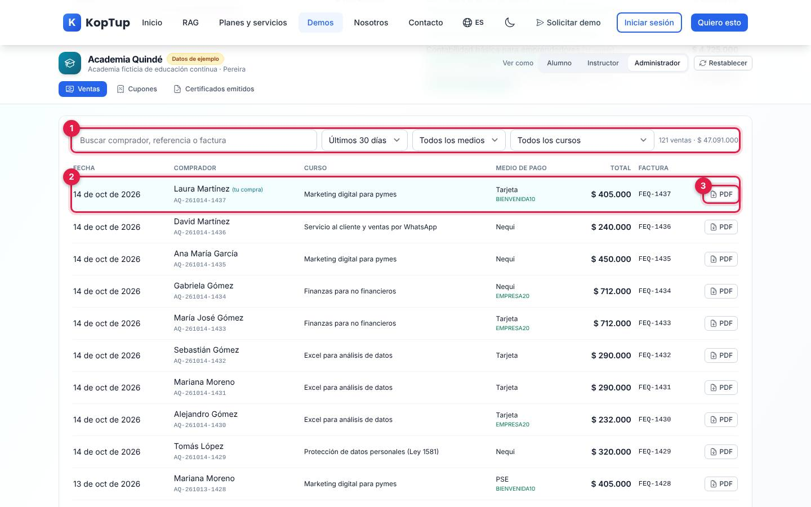

*Tabla de ventas: la compra hecha en el recorrido aparece primera con la marca «tu compra».*

1. **Buscar** por comprador, referencia o factura (el buscador ocupa el espacio libre); filtros de período (30 días, 90 días o todo), medio de pago y curso, con el conteo y el total («121 ventas · $ 47.091.000» después de la compra).
2. **Tu compra**: fecha, comprador y referencia, curso, medio de pago y cupón, total y número de factura simulada.
3. **PDF**: descarga el comprobante de esa venta.

Además:

- **Ventas**: cifras de los últimos 30 días (ventas, inscripciones pagadas, ticket promedio y descuentos con cupón), ventas por medio de pago y por curso, **Ver N más** y **Exportar ventas (CSV)**. «Pagos y facturas electrónicas simulados».
- **Cupones**: BIENVENIDA10 (10 %), EMPRESA20 (20 %) y VERANO15 (15 %, inactivo), con sus usos (BIENVENIDA10 suma uno con la compra). **Crear cupón** pide un código de 4 a 16 letras o números y un descuento de 5 % a 50 %; **Activar** / **Desactivar** cambia si funciona en el pago.
- **Certificados emitidos**: por curso, inscritos, certificados y tasa de finalización, y la lista de los certificados emitidos en tu recorrido, con **Verificar**; los reemitidos muestran «reemplazado por AQ-…».

### En el celular

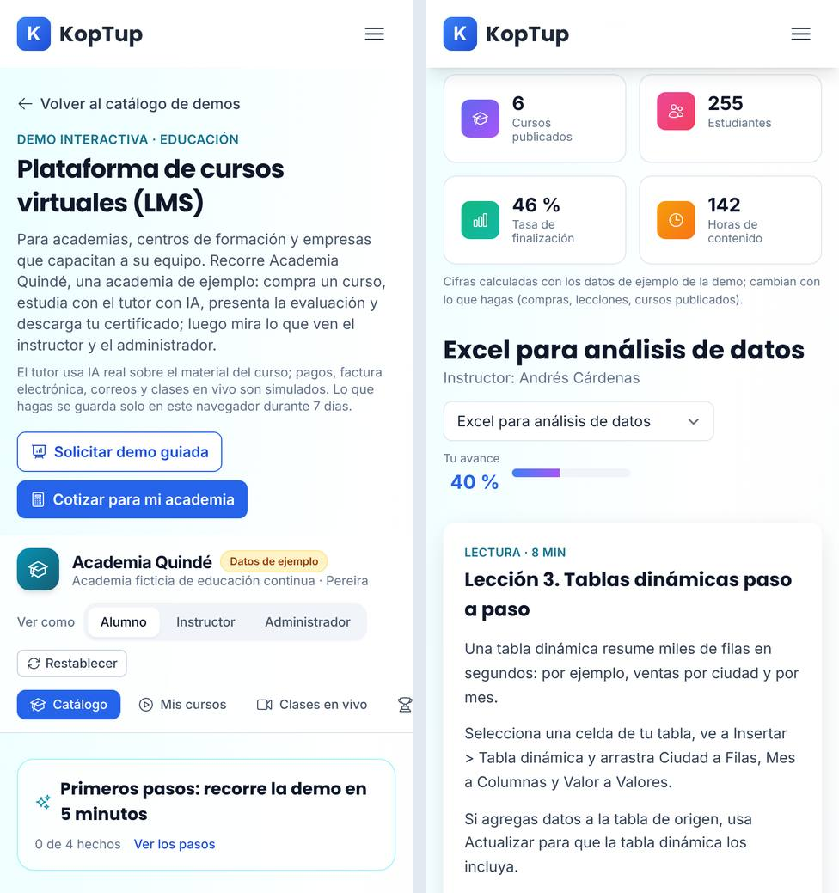

*La demo en un teléfono de 390 px: qué es, salidas comerciales, encabezado de la academia y primeros pasos plegados; a la derecha, una lección de lectura.*

En el teléfono el encabezado deja de ser fijo, los botones comerciales se apilan, el selector de rol y **Restablecer** pasan debajo del nombre, las secciones se desplazan de lado, los primeros pasos van en una columna, las cifras de dos en dos y los cursos en una columna. La página no se desborda a lo ancho.

---

## Qué es real y qué es simulado

| Parte | Real o simulado | Detalle |
|---|---|---|
| Academia, cursos, instructores, estudiantes, reseñas y ventas de ejemplo | **Datos de ejemplo** | Academia Quindé es ficticia (NIT de ejemplo con dígito de verificación válido); las fechas se calculan con el día. |
| Tutor con IA | **IA real** | Llama al servidor de KopTup (`/api/chatbot`) con el guion de las lecciones, usando un bot de ejemplo compartido por curso e idioma; si no hay IA disponible lo dice, y sin conexión busca en el navegador. |
| Pago con PSE, tarjeta o Nequi, factura electrónica y correo de confirmación | **Simulados** | No se cobra nada ni se envían datos a una pasarela. El comprobante PDF no es una factura. |
| Validaciones del pago y cupones | **Reales (en el navegador)** | Tarjeta, vencimiento, CVV, celular, documento y cupones activos. |
| Video de las lecciones | **Simulado** | Reloj que respeta la velocidad; subtítulos desde el guion en español o inglés. |
| Avance, evaluación, ruta adaptativa, XP e insignias | **Reales (en el navegador)** | Se calculan con lo que haces. |
| Riesgo de abandono y preguntas generadas | **Reglas, no IA** | Lo dicen las propias pantallas. |
| Clases en vivo, recordatorios y asistencia | **Simulados** | No hay Zoom, Meet ni Teams; el archivo `.ics` sí se descarga. |
| Certificados, reemisión y verificación | **Simulados (registro en el navegador)** | El PDF y el QR se generan en el navegador. La página de verificación es pública y comprueba la firma de ejemplo del enlace contra el registro de certificados de ese navegador: solo confirma los emitidos ahí. |
| Roles | **Vistas, sin permisos** | Cualquiera con acceso a la demo cambia de vista; el selector lo aclara. |
| Dónde se guardan tus cambios | **Solo en este navegador** | `localStorage` (clave `koptup.lms.state`) durante 7 días; los primeros pasos plegados, en `koptup.lms.guideHidden`; el bot propio de un curso creado, en `koptup.lms.tutorBots`. |

---

## Acceso

**Cómo lo ve un visitante.** La demo aparece en `/demo` con la insignia «Requiere acceso» y los botones **Solicitar acceso** y **Ya tengo acceso: iniciar sesión**. Si alguien abre `/demo/lms` sin sesión, la web muestra en la misma dirección la pantalla de acceso:

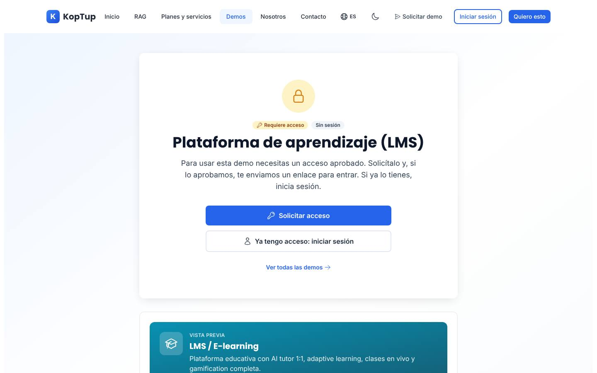

*Lo que ve un visitante sin sesión: «Requiere acceso», «Sin sesión», los botones para pedir la demo o iniciar sesión y, debajo, la vista previa del catálogo.*

- **Solicitar acceso** abre `/solicitar-demo?demos=lms` con la demo ya elegida.
- **Ya tengo acceso: iniciar sesión** lleva a `/login?redirect=%2Fdemo%2Flms` y, al entrar, vuelve a la demo.
- **Ver todas las demos** vuelve a `/demo`.
- Con sesión pero sin acceso, la misma pantalla dice «Sin acceso»; si el acceso venció o fue retirado, ofrece pedir más tiempo o solicitarlo de nuevo.
- La página de verificación `/demo/lms/verificar` es **pública**: la abre cualquiera (por ejemplo, quien escanea el QR) sin sesión ni acceso, no se indexa en buscadores y no recarga la página para revisar el acceso.

**Cómo se concede.** La solicitud llega a **Admin › Solicitudes de demo** y la aprueban los roles **admin** o **sales**. Al aprobar se crea o se reutiliza la cuenta del prospecto, el acceso dura 14 días por defecto (se extiende o se revoca en **Admin › Accesos a demos**) y la persona recibe un correo con la decisión (con el enlace de activación si su cuenta es nueva). El equipo de KopTup (admin, manager, sales y developer) abre la demo sin solicitud. El modo de acceso se cambia en **Admin › Catálogo de demos**. Detalle en el [Manual del administrador](Doc-06-Manual-del-Administrador.md) y en [Flujos del visitante](Doc-04-Flujos-del-Visitante.md).

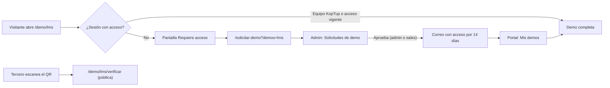

*Camino de un visitante hasta la demo, y del QR del certificado a la página pública de verificación.*

---

## Limitaciones conocidas

En el recorrido no aparecieron errores en la consola, ni en español ni en inglés, en claro ni en oscuro, a 1440 px ni a 390 px, y ninguna vista se desborda a lo ancho. Una prueba automática hizo clic en los controles visibles de la vista inicial y no encontró botones muertos: los únicos que «no cambiaron nada» fueron la pestaña ya activa (Alumno y Catálogo). Una revisión automática de accesibilidad (axe) de todas las secciones, de las ventanas (compra, ficha del curso, Restablecer, clase en vivo) y de la página de verificación no encontró controles sin etiqueta ni textos con contraste insuficiente; las ventanas se cierran con Escape, el foco no se sale de ellas y vuelve al botón que las abrió. Lo que sí conviene saber:

1. **La verificación solo confirma certificados emitidos en el mismo navegador.** El registro de certificados de la demo vive en el navegador de quien los emite; un tercero que escanea el QR ve «No se puede confirmar en este navegador» y la explicación. En un proyecto real el registro está en el servidor.
2. **La tarjeta del catálogo y la pantalla de acceso todavía usan el texto anterior.** Dicen «LMS / E-learning», «AI tutor 1:1», «quizzes auto-generados» y «subtítulos multi-idioma», con términos en inglés; la demo genera preguntas con reglas («sin IA»), los subtítulos son en español e inglés y las clases en vivo son una sala simulada. Además, la misma demo tiene tres nombres: «LMS / E-learning» en la tarjeta, «Plataforma de aprendizaje (LMS)» en la pantalla de acceso y «Plataforma de cursos virtuales (LMS)» dentro de la demo. El cambio de esos textos está propuesto al catálogo.
3. **Los cambios viven solo en el navegador**, por 7 días. Compras, avances, notas, certificados, cupones y cursos creados no llegan a un servidor ni los ven otras personas; en otro equipo o navegador la demo vuelve a los datos de ejemplo.
4. **Los roles no tienen permisos**: cualquiera con acceso a la demo cambia a Instructor o Administrador con un clic (el selector lo dice).
5. **Preguntas generadas con distractores poco naturales**: el generador por reglas toma como distractores otras palabras largas del texto (por ejemplo, «después» o «directo»). Ya no propone variantes de la misma palabra; la pantalla pide revisarlas antes de publicar.
6. **El tutor con IA necesita el servidor.** En el entorno local las respuestas las produce un modelo simulado («Respuesta simulada (mock de OpenAI)…»); con la clave real del proveedor las redacta el modelo. En un servidor anterior a la ruta de bots de ejemplo compartidos, el tutor crea un bot de ejemplo propio por curso e idioma, que sí cuenta en el límite de bots nuevos por hora.

> **Sobre las capturas.** Se tomaron el 14 de octubre de 2026 (hora de Colombia) en un entorno local con IA simulada: el texto de la respuesta del tutor lo produjo el modelo simulado; la búsqueda en el material, las citas con lección y minuto y los avisos de modo sí son el comportamiento real. Las fechas de las clases en vivo y de las ventas se calculan con el día en que abres la demo.
