# Guía de la demo: Programa de fidelización

> Ruta `/demo/loyalty` · Modo de acceso: **Abierta** · Tipo: **datos de ejemplo** (todo corre en el navegador; no llama al servidor ni a un modelo de IA) · Plan del producto: [Loyalty y fidelización](Producto-loyalty-fidelizacion.md)

**Resumen.** Es el club de puntos de una droguería ficticia colombiana (Club Ceiba Verde, de Droguerías Ceiba Verde, con sedes en Bogotá, Medellín y Cali). Muestra las cuatro caras del programa: la **Caja** donde se inscribe al cliente y se suman puntos, la **App del miembro** donde canjea, la **Configuración** que ajusta el comercio (reglas, niveles, misiones, campañas, antifraude…) y los **Resultados** con el pasivo por puntos. Está pensada para gerentes de mercadeo y dueños de cadenas de droguerías, supermercados, tiendas y restaurantes con varias sedes; abre sin cuenta, trabaja con la **fecha de hoy en Colombia** y lo que haces se guarda solo en tu navegador.

**En esta página:** [Recorrido sugerido](#recorrido-sugerido-demo-comercial-de-5-minutos) · [Pantallas y funciones](#pantallas-y-funciones) · [Qué es real y qué es simulado](#qué-es-real-y-qué-es-simulado) · [Acceso](#acceso) · [Limitaciones conocidas](#limitaciones-conocidas)

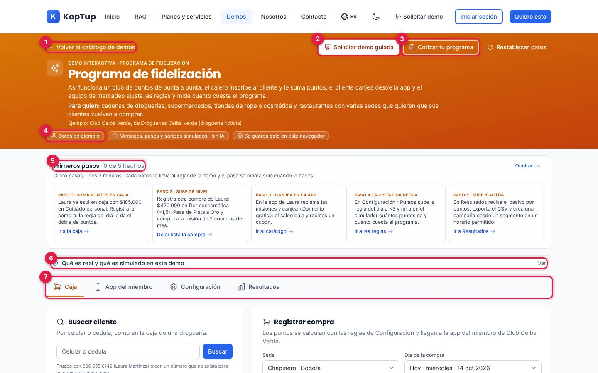

*Vista inicial (capturas tomadas el miércoles 14 de octubre de 2026).*

1. **Volver al catálogo de demos** (`/demo`).
2. **Solicitar demo guiada**: abre `/solicitar-demo?demos=loyalty`, con esta demo ya elegida.
3. **Cotizar tu programa**: abre `/contact?service=loyalty-fidelizacion`, con el producto preseleccionado.
4. Rótulos **Datos de ejemplo** (al pasar el mouse dice que la marca, el NIT, las sedes, los miembros y las cifras son inventados), **Mensajes, pases y sorteos simulados · sin IA** y **Se guarda solo en este navegador**. Al lado de los botones está **Restablecer datos**.
5. **Primeros pasos**: cinco pasos con botón que llevan al lugar de la demo y se marcan solos cuando los haces («0 de 5 hechos»).
6. **Qué es real y qué es simulado en esta demo**: panel plegable.
7. Pestañas **Caja**, **App del miembro**, **Configuración** y **Resultados** (se recorren con las flechas, Inicio y Fin).

---

## Recorrido sugerido (demo comercial de 5 minutos)

El guion sigue los **Primeros pasos** de la propia demo. Empieza con los datos limpios: si alguien ya usó la demo en ese navegador, pulsa **Restablecer datos** y confirma con **Sí, restablecer** (Escape cancela).

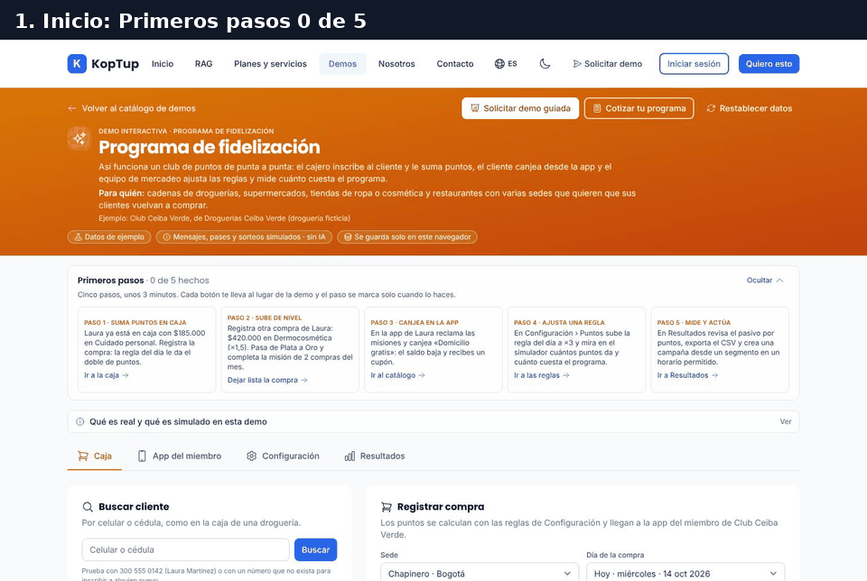

*Recorrido completo: dos compras de Laura en caja, subida a Oro, misiones y canje en la app, regla del día ×3, resultados con CSV y una campaña desde un segmento.*

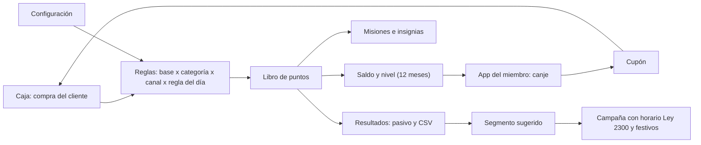

*Cómo se conectan las pestañas: todo sale del mismo libro de puntos, así que un cambio en una pestaña se ve al instante en las otras.*

### Paso 1. Caja: suma puntos con la regla del día

Pulsa **Ir a la caja** en el paso 1. Laura Martínez Ríos ya está en caja y la compra viene lista: $185.000 en Cuidado personal, hoy, en Tienda.

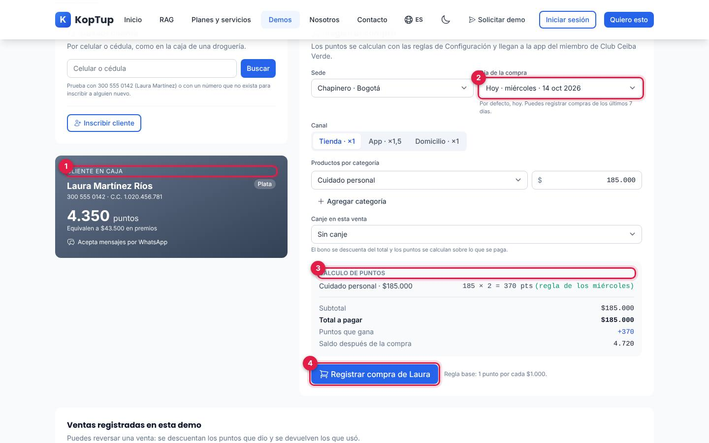

*Laura en caja (Plata, 4.350 puntos) y el cálculo en vivo de la compra.*

1. **Cliente en caja**: nombre, celular, cédula, nivel, saldo y su valor en premios ($10 por punto), y si autorizó mensajes por WhatsApp.
2. **Día de la compra**: por defecto, hoy («Hoy · miércoles · 14 oct 2026»); se pueden registrar compras de los últimos 7 días.
3. **Cálculo de puntos**: `185 × 2 = 370 pts (regla de los miércoles)`, el total a pagar, los puntos que gana y el saldo después de la compra (4.720). La regla del día de ejemplo arranca en el día de la semana de hoy para que se pueda probar sin cambiar la fecha.
4. **Registrar compra de Laura**: aparece «Venta V-0001 registrada · +370 puntos» con la fecha y la hora de Colombia.

Para buscar a otro cliente usa **Buscar cliente** (celular o cédula, al menos 3 dígitos; prueba `300 555 0142`). Si el número no existe, ofrece **Inscribir cliente nuevo**.

Qué decir: «El cajero no calcula nada: el sistema aplica la regla base y las promociones del día».

### Paso 2. Segunda compra: Laura sube a Oro

Pulsa **Dejar lista la compra** en el paso 2: la línea cambia a Dermocosmética por $420.000. Pulsa **Registrar compra de Laura**.

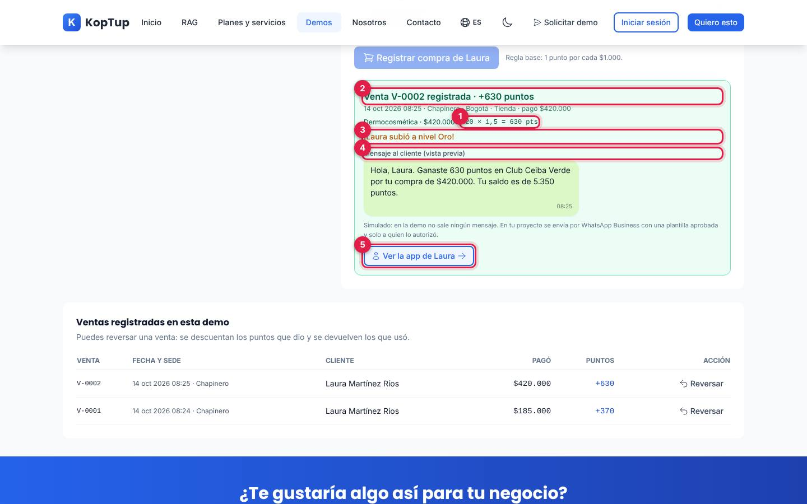

*Resultado de la venta V-0002: 630 puntos, subida a Oro y la vista previa del mensaje al cliente.*

1. **Cálculo**: Dermocosmética tiene multiplicador ×1,5, así que `420 × 1,5 = 630 pts`.
2. **Venta registrada** con fecha, hora, sede, canal y lo que pagó.
3. **¡Laura subió a nivel Oro!**: sus puntos de compras de los últimos 12 meses pasan de 3.480 a 4.110 y el umbral de Oro es 4.000.
4. **Mensaje al cliente (vista previa)**: el WhatsApp que recibiría («Hola, Laura. Ganaste 630 puntos…»). Es simulado: no sale ningún mensaje. Si el cliente no autorizó WhatsApp, la demo lo dice y no muestra mensaje.
5. **Ver la app de Laura**: salta a la pestaña App del miembro con ella seleccionada.

Debajo queda la tabla **Ventas registradas en esta demo**, con **Reversar** por venta (pide confirmar; descuenta los puntos que dio y devuelve los que usó).

### Paso 3. App del miembro: misiones y canje

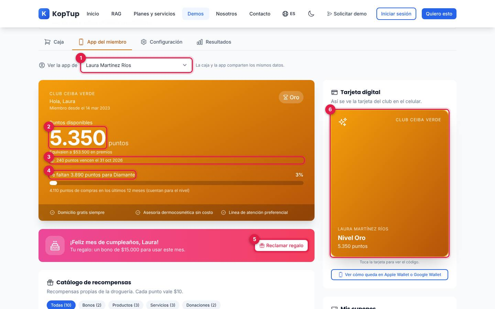

*La app de Laura después de las dos compras: 5.350 puntos y nivel Oro.*

1. **Ver la app de**: elige cualquiera de los miembros de ejemplo (o los que inscribas). «La caja y la app comparten los mismos datos».
2. **Puntos disponibles** y su valor en premios.
3. **Vencimiento**: «240 puntos vencen el 31 oct 2026» (siempre el último día del mes en curso).
4. **Progreso al siguiente nivel**: «Te faltan 3.890 puntos para Diamante», con los puntos de compras de los últimos 12 meses.
5. **Regalo de cumpleaños**: Laura cumple años este mes; **Reclamar regalo** genera un cupón de $15.000 (el valor sale de Configuración › Puntos).
6. **Tarjeta digital**: se gira al tocarla para mostrar el código de miembro; **Ver cómo queda en Apple Wallet o Google Wallet** abre una vista previa simulada del pase.

Baja a **Misiones del mes**: «Compra 2 veces este mes» (se completa con las dos compras de la demo: Laura no había comprado en el mes) y «Completa tu perfil» quedan listas; pulsa **Reclamar** en cada una (+300 y +50 puntos, saldo 5.700). Después pulsa **Ir al catálogo** en el paso 3:

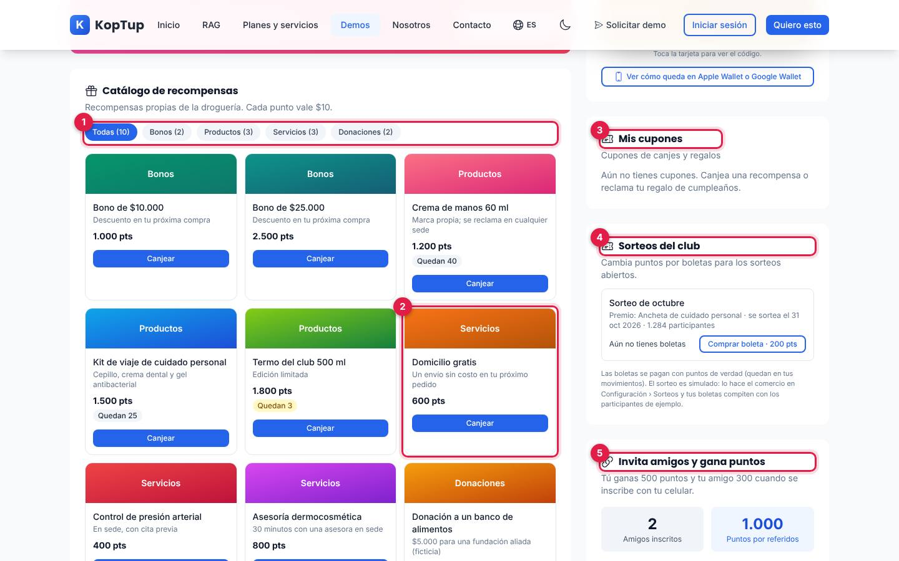

*Catálogo de recompensas propias de la droguería, cupones y programa de referidos.*

1. **Filtros**: Todas (10), Bonos, Productos, Servicios y Donaciones.
2. **Domicilio gratis** (600 puntos). Los productos muestran las unidades que quedan; si no te alcanza, el botón dice «Te faltan N pts».
3. **Mis cupones**: los cupones de canjes y regalos, con su estado (Vigente, Usado o Donado).
4. **Invita amigos y gana puntos**: amigos inscritos, puntos ganados, enlace de ejemplo con **Copiar** y botones **WhatsApp** y **Correo**, que sí abren tu aplicación con el mensaje listo.

Pulsa **Canjear** en Domicilio gratis y confirma con **Sí, canjear**:

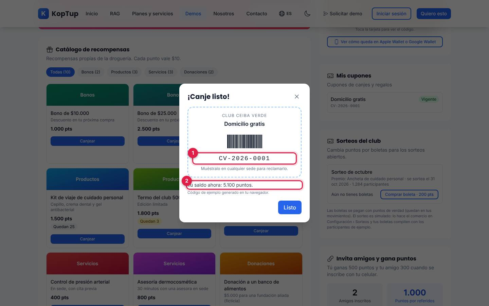

*Ventana «¡Canje listo!» con el cupón y el saldo nuevo (Escape la cierra y el foco vuelve al botón).*

1. **Código del cupón** (`CV-2026-0001`: año de hoy y consecutivo), generado en el navegador.
2. **Tu saldo ahora**: 5.100 puntos (5.700 − 600).

Qué decir: «El cliente canjea desde el celular y el cupón se usa en cualquier sede». Los bonos en pesos (y el regalo de cumpleaños) también se pueden usar en la Caja, en **Canje en esta venta**.

### Paso 4. Configuración: cambia la regla del día

Pulsa **Ir a las reglas** en el paso 4 (abre **Configuración › Puntos** con el foco en el multiplicador) y cambia la regla del día a ×3.

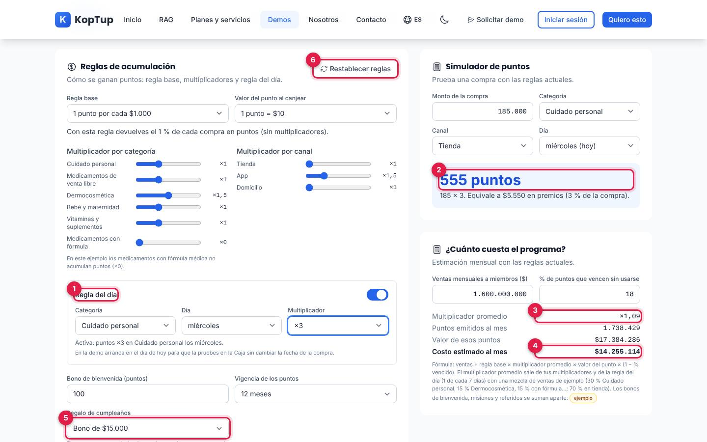

*Reglas de acumulación con la regla del día en ×3 y su efecto en el simulador.*

1. **Regla del día**: categoría, día y multiplicador, con un interruptor para apagarla. Queda activa al instante: «Activa: puntos ×3 en Cuidado personal los miércoles».
2. **Simulador de puntos**: la misma compra de $185.000 da ahora **555 puntos** (185 × 3), equivalentes a $5.550 en premios (3 % de la compra). El día del simulador se elige entre los últimos 7 días («miércoles (hoy)»).
3. **¿Cuánto cuesta el programa?**: con ventas a miembros de $1.600.000.000 al mes y 18 % de puntos vencidos, el costo estimado es $13.120.000 al mes. La fórmula está escrita debajo.
4. **Regalo de cumpleaños**: sin regalo, $10.000, $15.000 o $20.000; con «Sin regalo» la app deja de mostrar el banner.
5. **Restablecer reglas**: vuelve a las reglas de ejemplo.

Qué decir: «Antes de lanzar una promoción ves cuánto da y cuánto te cuesta».

### Paso 5. Resultados y una campaña desde un segmento

Pulsa **Ir a Resultados** en el paso 5.

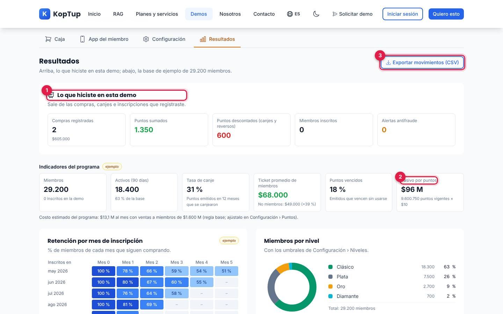

*Resultados: arriba lo que hiciste en la demo; abajo, los indicadores de la base de ejemplo.*

1. **Lo que hiciste en esta demo**: 2 compras ($605.000), 1.350 puntos sumados, 600 descontados, miembros inscritos y alertas antifraude.
2. **Pasivo por puntos**: $96 M, es decir 9.600.750 puntos vigentes × $10. Incluye los puntos que sumaste.
3. **Exportar movimientos (CSV)**: descarga `club-ceiba-verde-movimientos-AAAA-MM-DD.csv` (con la fecha de hoy) con fecha, hora, miembro, cédula, tipo, detalle, puntos, saldo y origen (Ejemplo o Demo).

Más abajo, en **Segmentos sugeridos**, pulsa **Crear campaña** en «En riesgo de irse». La demo abre **Configuración › Campañas** con el formulario listo:

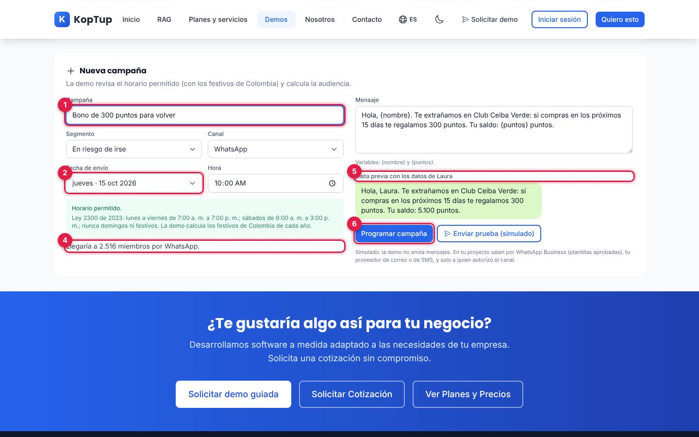

*Formulario «Nueva campaña» armado desde el segmento «En riesgo de irse».*

1. **Campaña**: el nombre y el mensaje salen de la acción sugerida del segmento («Bono de 300 puntos para volver»; «…si compras en los próximos 15 días te regalamos 300 puntos»). Se pueden cambiar.
2. **Fecha de envío**: los próximos 14 días; por defecto, el primero permitido. Los festivos aparecen marcados «(festivo)».
3. **Horario permitido**: la regla de la Ley 2300 de 2023 (lunes a viernes de 7:00 a. m. a 7:00 p. m.; sábados de 8:00 a. m. a 3:00 p. m.; nunca domingos ni festivos). Si eliges un domingo, un festivo («El 2 nov 2026 es festivo (Todos los Santos)…») o una hora fuera del horario, el aviso se pone en rojo y **Programar campaña** se desactiva. Los festivos de Colombia se calculan para cada año (fijos, Ley 51 de 1983 y los que dependen de la Pascua).
4. **Audiencia**: «Llegaría a 2.516 miembros por WhatsApp» (miembros del segmento que autorizaron ese canal).
5. **Vista previa con los datos de Laura**: el mensaje con `{nombre}` y `{puntos}` reemplazados por los del miembro que tengas abierto en la app.
6. **Programar campaña**: la agrega a la lista con la marca «tuya» y el aviso «Campaña programada para el 15 oct 2026 a las 10:00: 2.516 miembros». **Enviar prueba (simulado)** no envía nada.

Con eso los Primeros pasos quedan en «5 de 5 hechos» y la demo invita a **Solicitar demo guiada**. Cierra con: «Todo lo que viste —reglas, niveles, canjes, campañas— lo configura tu equipo sin programar».

---

## Pantallas y funciones

### Encabezado y controles

Ver la [vista general](#guía-de-la-demo-programa-de-fidelización).

| Elemento | Qué hace |
|---|---|
| **Volver al catálogo de demos** | Vuelve a `/demo`. |
| **Solicitar demo guiada** / **Cotizar tu programa** | Salidas comerciales: `/solicitar-demo?demos=loyalty` y `/contact?service=loyalty-fidelizacion`. El bloque azul al final de la página ofrece también **Solicitar Cotización** y **Ver Planes y Precios**. |
| **Restablecer datos** | Pide confirmación en línea («¿Borrar tus compras, canjes y cambios de esta demo?»; Escape cancela), vuelve a los datos de ejemplo de hoy, a la Caja y a «0 de 5 hechos». |
| **Primeros pasos** | Cinco pasos con botón; cada uno abre su pestaña, deja lista la acción (por ejemplo, la compra de $420.000) y lleva el foco a su lugar. Se marcan solos con lo que hiciste. **Ocultar** los pliega y este navegador lo recuerda. En el celular se desplazan de lado. |
| **Qué es real y qué es simulado en esta demo** | Panel plegable con lo que se calcula de verdad, lo simulado, cómo se manejan las fechas y cómo sería en un proyecto real. |
| **Aviso al volver** | Si guardaste la demo en otro mes, vuelve a los datos de ejemplo de hoy y lo avisa (las misiones, la racha y los vencimientos dependen del mes). |

### Caja

Ver los [pasos 1 y 2](#paso-1-caja-suma-puntos-con-la-regla-del-día). Además:

- **Inscribir cliente** abre el formulario de inscripción:

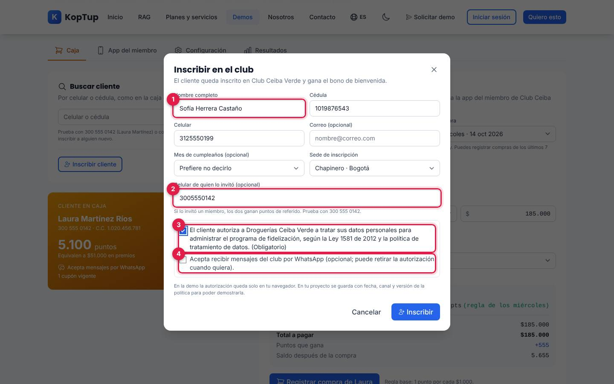

*Formulario de inscripción con un cliente nuevo invitado por Laura (300 555 0142).*

1. **Nombre completo**, **cédula** (6 a 10 dígitos), **celular** (10 dígitos que empiecen por 3), correo y mes de cumpleaños opcionales y **sede**. Si llegaste desde una búsqueda sin resultados, el número buscado ya viene escrito.
2. **Celular de quien lo invitó** (opcional). Rechaza cédulas o celulares repetidos y referidos que no existan.
3. **Autorización de tratamiento de datos (Ley 1581 de 2012)**: obligatoria; sin ella sale «Sin la autorización de tratamiento de datos no se puede inscribir».
4. **Mensajes por WhatsApp**: opcional y **sin marcar** de entrada (el cliente la acepta de forma expresa).

- Al inscribir: «Inscripción lista: Sofía Herrera Castaño ganó 100 puntos de bienvenida» y la persona queda en caja. Si hubo referido, quien invita gana 500 puntos y el nuevo 300 (valores de Configuración › Referidos).
- **Varias categorías** en una compra (hasta 5 líneas, con **Agregar categoría** y la papelera para quitar). Los medicamentos con fórmula no acumulan (×0).
- **Canal**: Tienda ×1, App ×1,5 o Domicilio ×1 (los multiplicadores salen de Configuración).
- **Canje en esta venta**: bonos de $10.000 o $25.000 (si el saldo alcanza) o cupones vigentes del cliente. El bono se descuenta del total y los puntos se calculan sobre lo que se paga.
- Si los puntos del cliente están congelados por antifraude, no puede canjear y la tarjeta lo avisa.
- La hora de cada venta, canje o reverso es la hora actual de Colombia.

### App del miembro

Ver el [paso 3](#paso-3-app-del-miembro-misiones-y-canje). Además del saldo, el catálogo y los cupones:

- **Misiones del mes**: cuatro retos con su avance (compras del mes, compras por app o a domicilio, amigos referidos y perfil completo) y la pista de cómo completarlos en la demo.
- **Racha**: meses seguidos comprando (Laura empieza con 8 y pasa a 9 con la primera compra del mes) y la barra de los últimos 12 meses.
- **Insignias**: Primera compra, Cliente constante, Embajador, Corazón solidario y Nivel Oro, obtenidas o pendientes.
- **Ranking del mes**: apagado por privacidad; se activa en Configuración › Misiones y muestra un top 10 con nombre corto.
- **Tus movimientos**: el libro de puntos; «El saldo es la suma de estos movimientos». Las líneas hechas en la demo llevan la marca «demo» y **Ver los N movimientos** despliega todo (Laura tiene 19 al empezar).
- **Donaciones**: canjear «Donación a un banco de alimentos» o «Donación de útiles escolares» muestra «¡Gracias por tu donación!» (no se transfiere dinero).

### Configuración

Diez subpestañas (se recorren con las flechas, Inicio y Fin). Los cambios se aplican de inmediato en Caja, en la app del miembro y en Resultados.

| Subpestaña | Qué puedes hacer |
|---|---|
| **Puntos** | Regla base (por defecto 1 punto por cada $1.000), valor del punto al canjear ($10), multiplicadores por categoría y por canal, regla del día, bono de bienvenida, vigencia de los puntos, regalo de cumpleaños, simulador y costo del programa. Ver el [paso 4](#paso-4-configuración-cambia-la-regla-del-día). |
| **Niveles** | Umbrales de puntos de los últimos 12 meses para Plata, Oro y Diamante, con el número de miembros en cada nivel; **Guardar niveles** valida que suban (Plata < Oro < Diamante). Regla para bajar de nivel tras N meses sin compras, con cuántos bajarían. |
| **Misiones** | Activar o pausar cada misión y cambiar su premio; crear una misión nueva (tipo, meta y premio) que aparece de inmediato en la app; interruptor del ranking. |
| **Referidos** | Puntos para quien invita y para el nuevo miembro, costo por referido y cifras de ejemplo. |
| **Devolución en saldo** | Simulador de devolución en saldo por nivel (0,5 %, 1 %, 1,5 % y 2 % de ejemplo) para comparar con los puntos; la Caja sigue acumulando puntos. |
| **Sorteos** | Aviso de que en Colombia los sorteos promocionales necesitan autorización de Coljuegos; el sorteo de este mes (con **Sortear (simulado)**, que elige un ganador de una lista de nombres ficticios) y el del mes pasado ya realizado; formulario para crear un sorteo con fecha al cierre de este mes o de los dos siguientes. Los sorteos nuevos quedan «Sin boletas todavía» (en la demo nadie participa en ellos). |
| **Campañas** | Lista de campañas de ejemplo (las que se repiten cada semana dicen «Los sábados · 10:00») con **Pausar** y **Programar**, y el formulario de nueva campaña con fecha, revisión de la Ley 2300 con festivos y vista previa. Ver el [paso 5](#paso-5-resultados-y-una-campaña-desde-un-segmento). |
| **Aliados** | Comercios aliados (coalición) con los puntos que dan por cada $1.000 y los emitidos en el mes; **Agregar aliado** y quitar. Calcula cuánto paga cada aliado por sus puntos. |
| **Antifraude** | Reglas activas en la demo y alertas para revisar (ver abajo). |
| **Pruebas A/B** | Tres pruebas con resultados de ejemplo; **Finalizar y aplicar la ganadora** deja la variante ganadora en las reglas: la regla del día en ×2, el bono de bienvenida en 300 puntos o el regalo de cumpleaños en $15.000. |

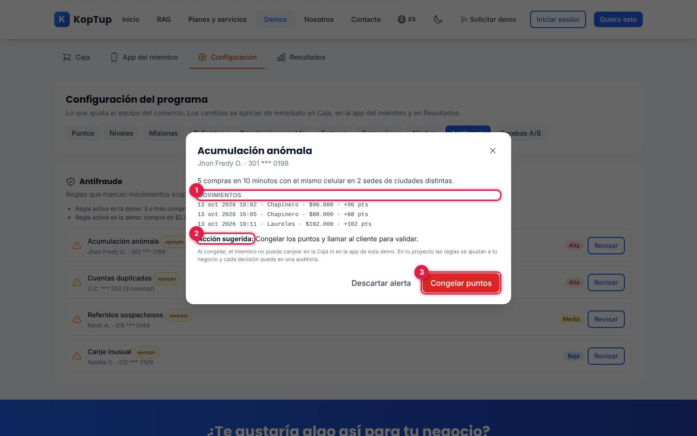

*Revisión de la alerta de ejemplo «Acumulación anómala»: movimientos de ayer, acción sugerida y las dos decisiones.*

1. **Movimientos**: en las alertas de ejemplo, con fechas de los días anteriores a hoy; en las de tu demo, las ventas que activaron la regla.
2. **Acción sugerida**.
3. **Congelar puntos** impide que el miembro canjee en Caja y en la app; **Descartar alerta** la cierra.

- **Reglas activas en la demo**: 3 o más compras del mismo miembro el mismo día, y compras de $2.000.000 o más. Si registras una compra así en Caja, aparece una alerta «de tu demo» y la Caja avisa «Esta compra activó una regla antifraude».

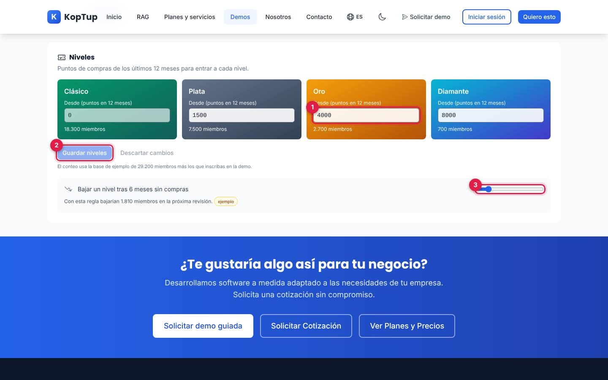

*Umbrales de nivel (0, 1.500, 4.000 y 8.000 puntos en 12 meses), Guardar niveles y la regla para bajar de nivel.*

### Resultados

Ver el [paso 5](#paso-5-resultados-y-una-campaña-desde-un-segmento). Además de lo que hiciste y del pasivo:

- **Indicadores del programa** (marcados «ejemplo»): 29.200 miembros, activos a 90 días, tasa de canje, ticket promedio de miembros frente a no miembros y puntos vencidos.
- **Retención por mes de inscripción**: tabla de cohortes de los últimos 6 meses (de hace 5 meses al mes en curso).
- **Miembros por nivel**: gráfico de anillo que se recalcula con los umbrales de Configuración › Niveles.
- **Recompensas más canjeadas** (últimos 30 días), que suma tus canjes («+N tuyos»).
- **Segmentos sugeridos**: VIP, En riesgo de irse, Cerca de subir de nivel e Inactivos, con la regla que los define, una acción sugerida y **Crear campaña** (que arma el nombre y el mensaje con esa acción). «En esta demo no hay un modelo de IA».

### En el celular

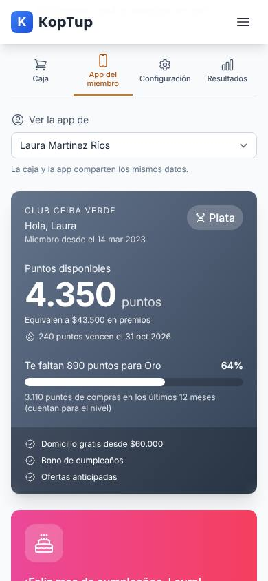

*La app del miembro en un teléfono (390 px).*

En el teléfono las cuatro pestañas caben en una fila (ícono arriba y nombre abajo), los Primeros pasos se desplazan de lado y las tarjetas se apilan. La página no se desborda a lo ancho.

---

## Qué es real y qué es simulado

| Parte | Real o simulado | Detalle |
|---|---|---|
| Marca, sedes, miembros, cédulas, celulares, aliados | **Datos de ejemplo** | Droguerías Ceiba Verde (NIT 901.555.214-1, con dígito de verificación válido) y todo su club son ficticios. |
| Fechas | **Real (fecha de Colombia)** | La demo arma los datos de ejemplo hacia atrás desde hoy (compras de los últimos 12 meses, vencimientos al final del mes, cohortes y sorteos) y registra lo que haces con la fecha y la hora de Colombia. |
| Puntos de cada compra, saldo, niveles, misiones, referidos, canjes y cupones | **Real (en el navegador)** | Se calculan de verdad con las reglas de Configuración; el saldo es la suma del libro de puntos y el nivel usa los puntos de compras de los últimos 12 meses. |
| Reglas antifraude de la demo y congelamiento | **Real (en el navegador)** | Reglas simples (3 compras el mismo día, compras de $2.000.000 o más). Las cuatro alertas iniciales son de ejemplo. |
| Validación del horario de campañas (Ley 2300) | **Real (en el navegador)** | Revisa día, hora y festivos de Colombia (calculados para cada año). |
| Simulador de puntos, costo del programa, pasivo y devolución en saldo | **Real (cálculo)** | Fórmulas a la vista; parten de supuestos de ejemplo. |
| Pruebas A/B | **Resultados de ejemplo; la aplicación es real** | Las cifras de cada variante son de ejemplo; al finalizar, la ganadora sí cambia la regla correspondiente. |
| Exportación CSV | **Real** | Se genera en el navegador con todos los movimientos. |
| Cifras de la base de 29.200 miembros, cohortes, resultados de misiones, aliados y referidos | **Datos de ejemplo** | Marcadas «ejemplo» en pantalla. |
| Segmentos sugeridos | **Reglas, no IA** | Recencia, frecuencia y nivel; tamaños de ejemplo. |
| WhatsApp, correo y SMS de campañas y compras | **Simulado** | Solo vista previa; no sale ningún mensaje. |
| Pase de Apple Wallet y Google Wallet | **Simulado** | Vista previa; no se genera el archivo del pase. |
| Sorteos | **Simulado** | El ganador sale de una lista de nombres ficticios. |
| Botones WhatsApp y Correo de «Invita amigos» | **Real** | Abren tu aplicación con el mensaje listo (el enlace es de un dominio de ejemplo). |
| Dónde se guardan tus cambios | **Solo en este navegador** | `localStorage`; no llegan a un servidor ni los ven otras personas. |

---

## Acceso

- **Cómo la ve un visitante:** la demo está en modo **Abierta** (`publico`): cualquiera entra a `/demo/loyalty` sin cuenta y sin pantalla de acceso. En el hub `/demo` aparece así:

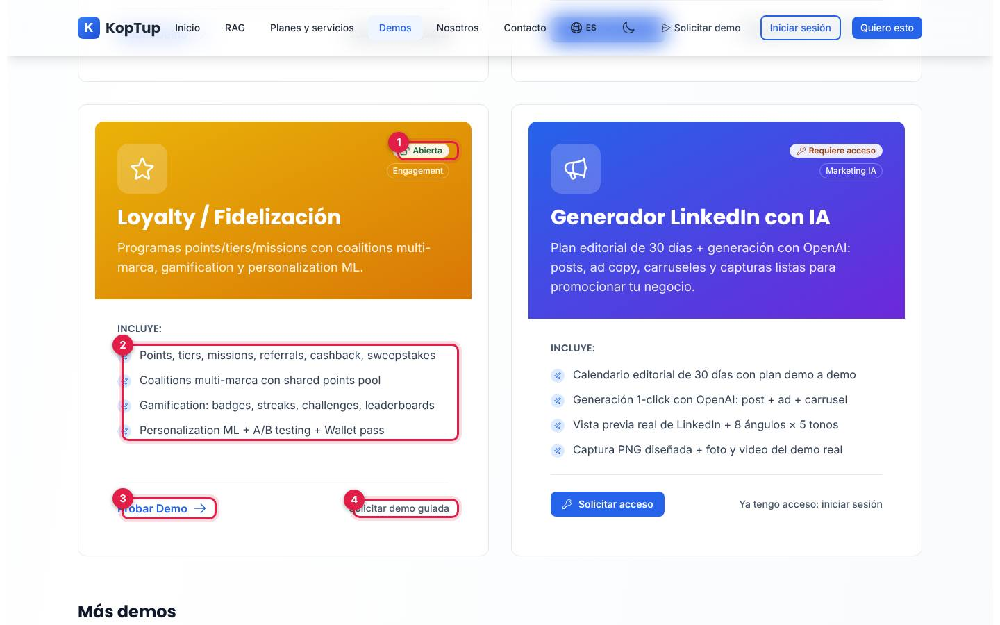

*Tarjeta «Loyalty / Fidelización» en el hub, vista por un visitante sin sesión.*

1. Insignia **Abierta** (junto a «Engagement»).
2. Lo que **Incluye** según la tarjeta (ver la [limitación 1](#limitaciones-conocidas)).
3. **Probar Demo** abre `/demo/loyalty`.
4. **Solicitar demo guiada** abre `/solicitar-demo?demos=loyalty`.

- **Cómo se solicita:** no hace falta solicitarla. Quien quiera una sesión con su propio caso usa **Solicitar demo guiada** (en la tarjeta, en el encabezado de la demo o en el bloque azul al final) o **Cotizar tu programa**.
- **Cómo la controla el admin:** el modo sale del catálogo del servidor y se cambia en **Admin › Catálogo de demos** (`/admin/catalogo-demos`). Si se pasa a «Con solicitud» o «Solo por invitación», los visitantes verán la pantalla de acceso y los accesos se conceden en **Admin › Solicitudes de demo** y **Admin › Accesos a demos**; si se desactiva, el visitante ve que la demo está en mantenimiento y el equipo sigue entrando. Si el backend no responde, la demo sigue abierta porque así está en la tabla de respaldo. Detalle en el [Manual del administrador](Doc-06-Manual-del-Administrador.md) y en [Flujos del visitante](Doc-04-Flujos-del-Visitante.md).

---

## Limitaciones conocidas

1. **La tarjeta del hub todavía promete más de lo que hace la demo.** Habla de «coalitions multi-marca con shared points pool», «personalization ML», «challenges, leaderboards» y «Wallet pass», en inglés. La demo tiene aliados con cifras de ejemplo, segmentos por reglas («en esta demo no hay un modelo de IA»), el ranking apagado por defecto y solo una vista previa del pase. El texto nuevo de la tarjeta está propuesto al catálogo; hasta que se cambie, apóyate en esta guía.
2. **Los cambios viven solo en el navegador.** Si el prospecto cambia de equipo o borra los datos del sitio, vuelve a los datos de ejemplo; no hay espacio compartido con el vendedor. Si vuelve en otro mes, la demo se rearma con la fecha de ese día (lo avisa).
3. **Hora real.** Las compras quedan con la hora actual de Colombia; si la demo se muestra de madrugada, la venta dice, por ejemplo, «02:57».
4. **La regla del día arranca en el día de hoy.** Es un dato de ejemplo para poder probarla en caja cualquier día (por eso las capturas dicen «miércoles»); en un programa real el comercio elige el día.
5. **Campañas de un solo envío.** Las campañas que creas se programan para una fecha de los próximos 14 días; las cuatro de ejemplo se repiten cada semana y no se recalculan contra festivos.
6. **Mensajes, pases y sorteos simulados**; los indicadores de la base de 29.200 miembros son fijos salvo lo que se recalcula con tus acciones y los umbrales de nivel. Los sorteos que creas no reciben participantes.
