# Guía de la demo: Moderación de contenido con IA

> Ruta `/demo/moderacion-contenido` · Modo de acceso: **Abierta** · Tipo: **datos de ejemplo** (la consola corre en el navegador y se guarda en ese navegador) **+ IA real en «Explicar con IA»** (asistente del servidor con tope de gasto) · Plan del producto: [Moderación de contenido con IA](Producto-moderacion-contenido.md)

**Resumen.** Es la consola del equipo de moderación de una plataforma ficticia (marketplace, medio digital, plataforma educativa, fintech o portal de empleo). Trae 17 casos de ejemplo saneados y en español de Colombia —pago por fuera de la plataforma, oferta de empleo con cobro por adelantado, préstamo «gota a gota», reseñas falsas, insultos, odio, contacto de un adulto con un estudiante, suplantación de la mesa de ayuda, spam— que **un clasificador por reglas calcula de verdad en el navegador**: categoría, confianza y los fragmentos del texto que la explican. Las **reglas por umbral** que tú editas deciden la ruta de cada caso (rechazar, ocultar y advertir, limitar, aprobar, escalar o revisión humana), un **simulador** muestra qué harían con un lote de ejemplo de 240 contenidos y «Aplicar reglas a la cola» resuelve los automáticos. Aprobar, rechazar (con política y medida), escalar (a un equipo) y corregir la categoría dejan rastro en la **Auditoría**, que se exporta en CSV; las **apelaciones** tienen un plazo que corre con la hora real; el **informe de transparencia** de ejemplo se descarga en PDF; y el bloque de **bienestar** desenfoca lo sensible, propone pausas, guarda un check-in y saca de la cola los casos sensibles cuando lo pides. La única parte con IA es **Explicar con IA**: un modelo de nuestro servidor lee el contenido y la política de la plataforma y cita el apartado que aplica. Lo que haces se guarda en tu navegador; **Restablecer datos de ejemplo** vuelve al inicio.

**En esta página:** [Recorrido sugerido](#recorrido-sugerido-demo-comercial-de-5-minutos) · [Pantallas y funciones](#pantallas-y-funciones) · [Qué es real y qué es simulado](#qué-es-real-y-qué-es-simulado) · [Acceso](#acceso) · [Limitaciones conocidas](#limitaciones-conocidas)

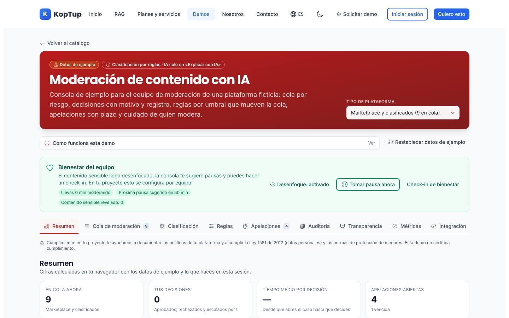

*Vista inicial: «Volver al catálogo», los rótulos «Datos de ejemplo» y «Clasificación por reglas · IA solo en «Explicar con IA»», el selector «Tipo de plataforma» con los casos pendientes de cada una, el desplegable «Cómo funciona esta demo», «Restablecer datos de ejemplo», el bloque de bienestar, las nueve pestañas y la nota de cumplimiento.*

---

## Recorrido sugerido (demo comercial de 5 minutos)

El mismo guion está dentro de la demo, en **Cómo funciona esta demo › Recorrido sugerido**. Si alguien ya usó la demo en ese navegador, pulsa **Restablecer datos de ejemplo** antes de empezar.

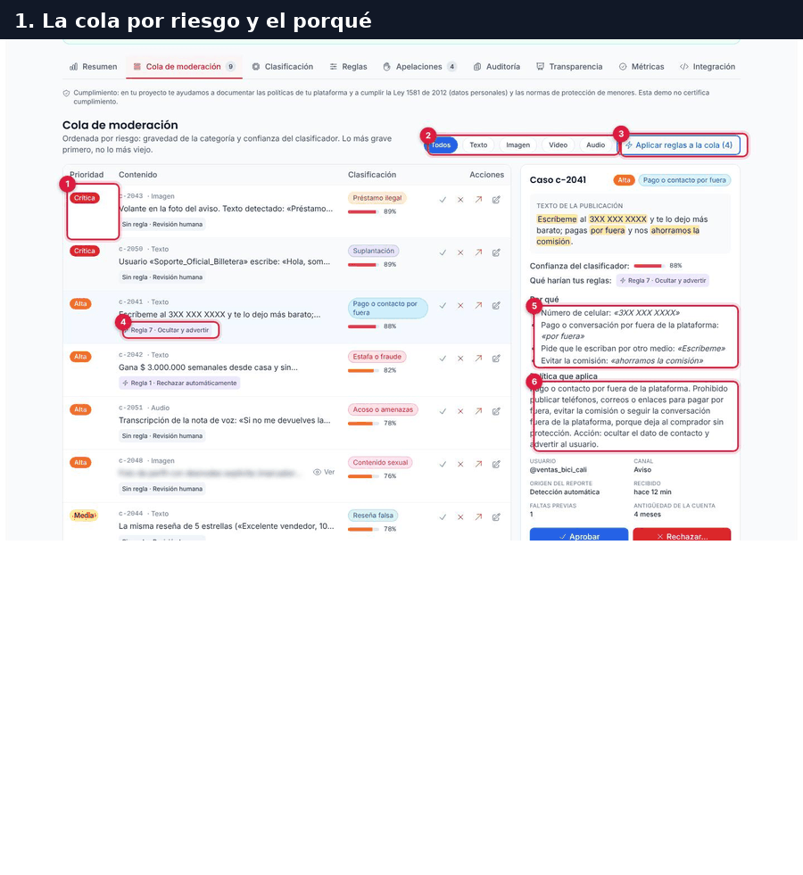

*Recorrido completo en 5 pasos: la cola y el porqué, rechazar con política y medida, una regla nueva en el simulador, aplicar las reglas a la cola y probar tu propio texto con «Explicar con IA».*

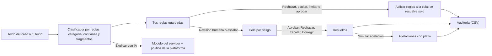

*Qué está conectado con qué. Todo menos «Explicar con IA» corre en el navegador.*

### Paso 1. La cola por riesgo y el porqué

Abre **Cola de moderación** y haz clic en el caso **c-2041** («Escríbeme al 3XX XXX XXXX…»).

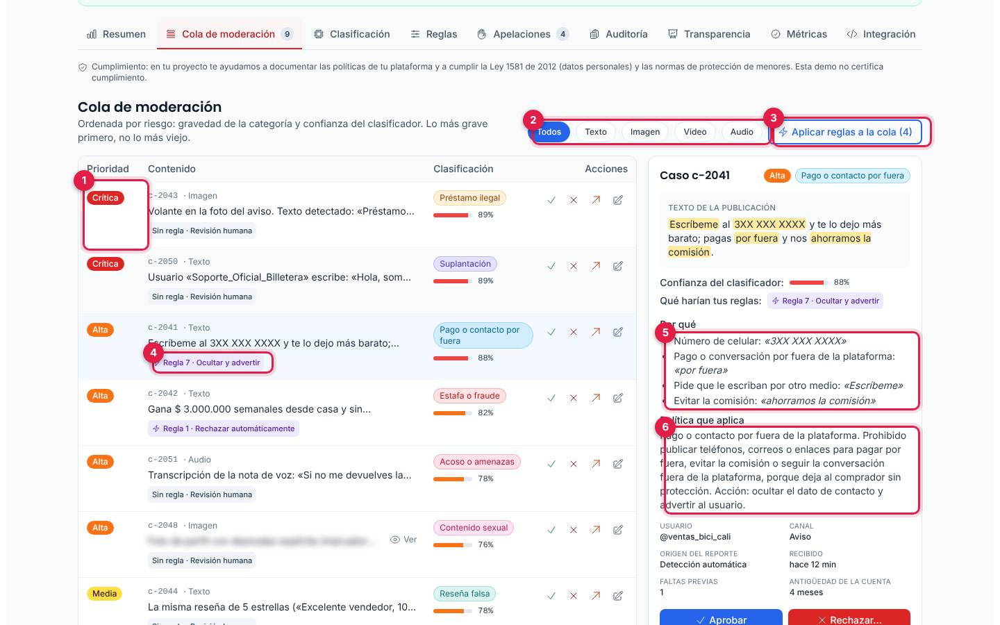

*La cola de «Marketplace y clasificados» con el detalle de c-2041.*

1. **Prioridad**: se calcula con la gravedad de la categoría y la confianza del clasificador. Primero lo más grave (préstamo ilegal y suplantación, críticos), no lo más viejo.
2. **Filtro por tipo** de contenido: Todos, Texto, Imagen, Video o Audio.
3. **Aplicar reglas a la cola (4)**: cuántos casos de esta vista resolverían tus reglas sin que nadie los revise (ver el paso 4).
4. **Ruta según tus reglas**: «Regla 7 · Ocultar y advertir». Los casos sin regla dicen «Sin regla · Revisión humana».
5. **Por qué**: las señales que encontró el clasificador con el fragmento exacto (número de celular, «por fuera», «Escríbeme», «ahorramos la comisión»), resaltadas también en el texto.
6. **Política que aplica**: el apartado de la política de la plataforma de ejemplo, con la acción que indica.

Debajo están el usuario, el canal, el origen del reporte, hace cuánto llegó, las faltas previas y la antigüedad de la cuenta, y los botones **Aprobar**, **Rechazar…**, **Escalar…**, **Corregir categoría…** y **Explicar con IA**. Los casos sensibles (odio, menores, autolesión, contenido sexual) llegan desenfocados hasta que pulses **Ver**.

Qué decir: «El moderador no ve primero lo más viejo sino lo más grave, y ve por qué el sistema lo marcó y qué dice la política».

### Paso 2. Decidir con motivo

Pulsa **Rechazar…** en c-2041.

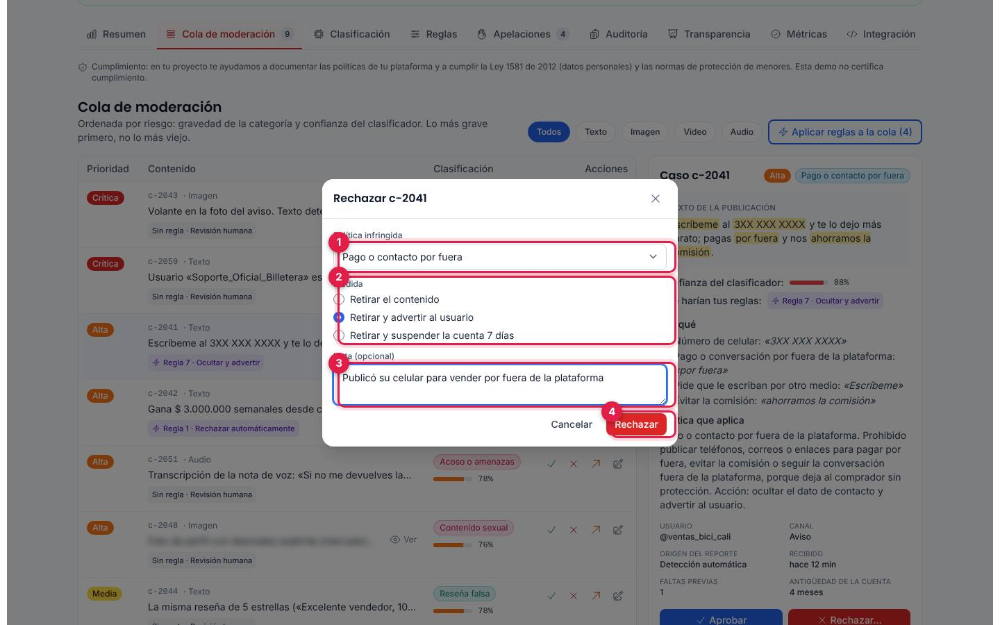

*La ventana de rechazo: política, medida y nota.*

1. **Política infringida**: viene la que propuso el clasificador; puedes cambiarla. Sin política no deja rechazar.
2. **Medida**: retirar el contenido, retirar y advertir al usuario, o retirar y suspender la cuenta 7 días.
3. **Nota** opcional (hasta 200 caracteres).
4. **Rechazar**: el caso sale de la cola, aparece en **Resueltos** y queda en la Auditoría con política, medida y nota.

**Aprobar** es inmediato; **Escalar…** pide el equipo (Protección de menores, Legal y cumplimiento, Fraude y pagos o Líder de turno) y una nota; **Corregir categoría…** cambia la categoría del caso, lo marca «Corregida por ti» y lo saca de las reglas automáticas. Las tres decisiones son distintas en la cola, en los indicadores y en la Auditoría. Escape cierra la ventana.

Qué decir: «Cada decisión lleva política y medida; eso es lo que después pide un usuario que apela o un regulador».

### Paso 3. Cambiar una regla y ver el efecto antes de guardarla

Abre **Reglas** y pulsa **Pausada** en la regla 8 (préstamo ilegal).

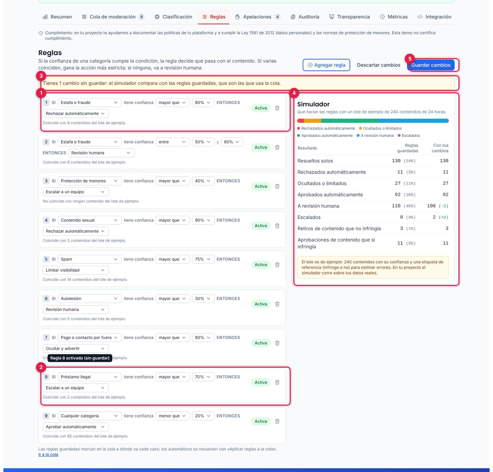

*La regla 8 activada como borrador, con el simulador comparando antes y después.*

1. **Una regla**: «Si [categoría] tiene confianza [mayor que / menor que / entre] [umbral] entonces [acción]». Se elige la categoría (o «Cualquier categoría»), la condición, el umbral (de 5 % a 95 %) y la acción, y se puede pausar o borrar. Debajo dice con cuántos contenidos del lote de ejemplo coincide.
2. **Regla 8** activada: el cambio es un borrador.
3. **Aviso de cambios sin guardar**: mientras no guardes, la cola sigue usando las reglas guardadas.
4. **Simulador** sobre el lote de ejemplo de 240 contenidos: resueltos solos, rechazados, ocultados o limitados, aprobados, a revisión humana, escalados y los errores estimados (retiros de contenido que no infringía y aprobaciones de contenido que sí). Con la regla 8, dos contenidos pasan de revisión humana a escalados.
5. **Guardar cambios**: la cola empieza a usar las reglas nuevas y la Auditoría registra «Editó las reglas · 1 cambio». **Descartar cambios** vuelve a las guardadas.

Si varias reglas coinciden, gana la acción más estricta (escalar, luego rechazar, ocultar y advertir, limitar, revisión humana y aprobar); si ninguna coincide, el caso va a revisión humana.

Qué decir: «El equipo de políticas cambia un umbral y ve cuánto trabajo y cuántos errores cambian, antes de aplicarlo».

### Paso 4. Aplicar las reglas a la cola

Guarda y vuelve a **Cola de moderación**.

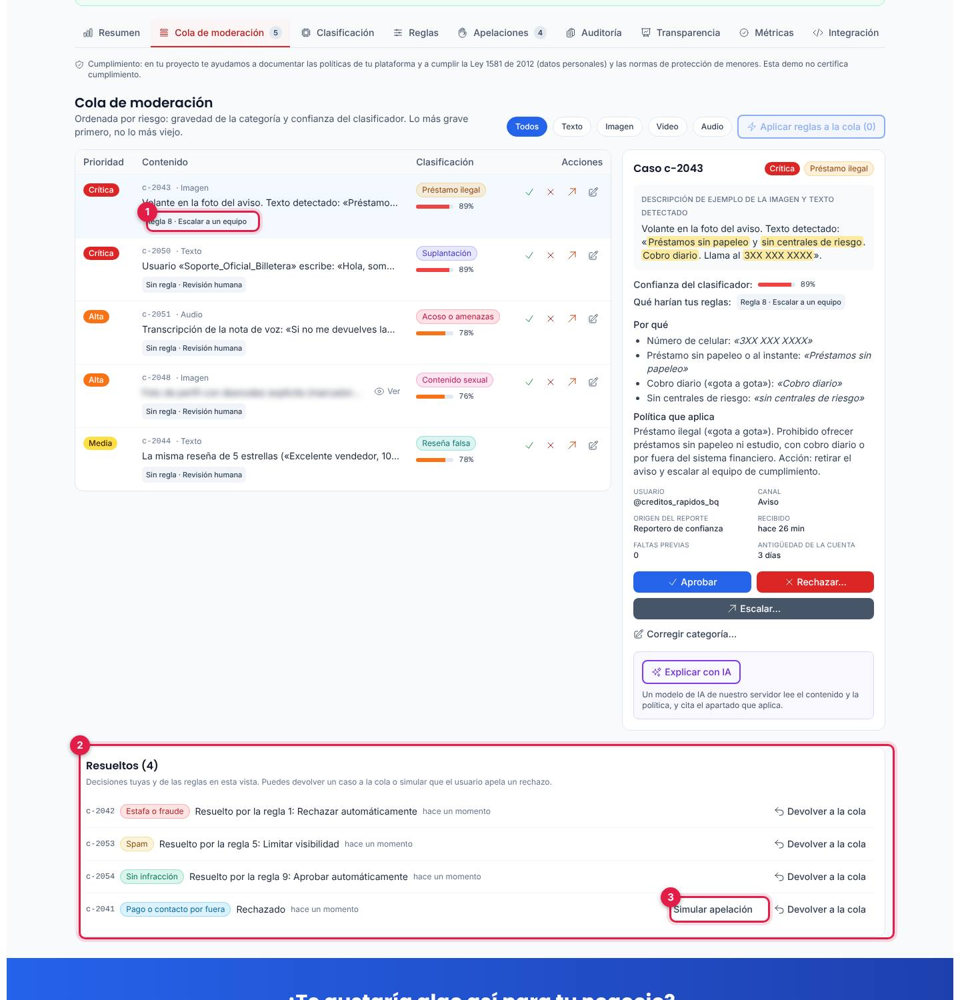

*c-2043 ahora va por la regla 8 y la lista de resueltos tras aplicar las reglas.*

1. **c-2043** (préstamo «gota a gota») ahora dice «Regla 8 · Escalar a un equipo» (ya era crítica).
2. **Resueltos**: al pulsar **Aplicar reglas a la cola (3)** las reglas resuelven solas c-2042 (regla 1, rechazo), c-2053 (regla 5, limitar) y c-2054 (regla 9, aprobar). Cada una deja un registro «Sistema · regla N» en la Auditoría. **Devolver a la cola** deshace cualquier decisión.
3. **Simular apelación** en un caso rechazado por ti: crea una apelación con plazo de 24 horas en **Apelaciones**.

Las reglas solo resuelven los casos de la plataforma elegida y no tocan los que corregiste a mano.

### Paso 5. Probar tu propio texto y pedir la explicación a la IA

Abre **Clasificación**, pulsa el ejemplo **Préstamo gota a gota** (o escribe tu texto) y luego **Explicar con IA**.

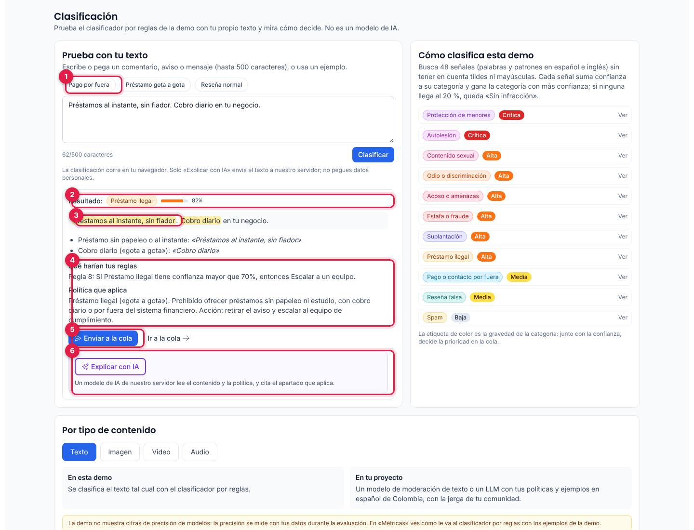

*Resultado del clasificador por reglas para el ejemplo «Préstamo gota a gota» (con la regla 8 ya activada en el paso 3) y el recuadro de «Explicar con IA».*

1. **Ejemplos rápidos** o tu texto (hasta 500 caracteres; Ctrl + Enter clasifica).
2. **Resultado**: categoría, confianza y otras categorías con puntaje.
3. **Fragmentos resaltados** y la lista de señales.
4. **Qué harían tus reglas** y la política que aplica.
5. **Enviar a la cola**: crea un caso nuevo (c-3001, c-3002…) con tu texto. Si una regla lo resuelve sola, llega resuelto y lo dice («las reglas lo resolverán»).
6. **Explicar con IA**: mientras carga dice «Cargando la política en el servidor…» y «Consultando el modelo…»; luego muestra «Respuesta del modelo gpt-4o-mini en N s», la explicación (qué apartado aplica, por qué y qué acción indica, citando [1], [2]…), los **apartados consultados** y la nota «La explicación es orientativa: la decisión la tomas tú». Sin clave de IA en el servidor, sin cupo del mes o si el proveedor falla, muestra los apartados más parecidos y lo dice («modo extractivo»); si se alcanza el límite de consultas o el servidor no responde, lo avisa. El mismo botón está en el detalle de cada caso de la cola.

La demo avisa que solo «Explicar con IA» envía el texto al servidor y que no pegues datos personales.

Qué decir: «Las reglas resuelven lo evidente en milisegundos y sin costo; la IA explica lo dudoso con la política de tu plataforma».

---

## Pantallas y funciones

Todo está en una sola página: encabezado, «Cómo funciona esta demo», bienestar y nueve pestañas. Lo que haces se guarda en `localStorage` del navegador y se conserva al recargar; pasadas 24 horas los datos de ejemplo se regeneran con horas nuevas.

### Encabezado y tipo de plataforma

- **Volver al catálogo** lleva al hub `/demo`.
- **Datos de ejemplo** y **Clasificación por reglas · IA solo en «Explicar con IA»**: rótulos con una explicación al pasar el mouse.
- **Tipo de plataforma**: Todas (17 casos), Marketplace y clasificados (9, por defecto), Medio digital (6), Plataforma educativa (4), Fintech y billeteras (6) y Portal de empleo (4). Filtra la cola, la lista de resueltos y el alcance de «Aplicar reglas».
- **Cómo funciona esta demo**: qué es real, qué es de ejemplo, el recorrido sugerido y qué haríamos en un proyecto.
- **Restablecer datos de ejemplo** pide confirmación y borra decisiones, reglas, apelaciones, registros y check-ins.
- Una línea de **cumplimiento**: «en tu proyecto te ayudamos a documentar las políticas de tu plataforma y a cumplir la Ley 1581 de 2012 (datos personales) y las normas de protección de menores. Esta demo no certifica cumplimiento».

### Bienestar del equipo

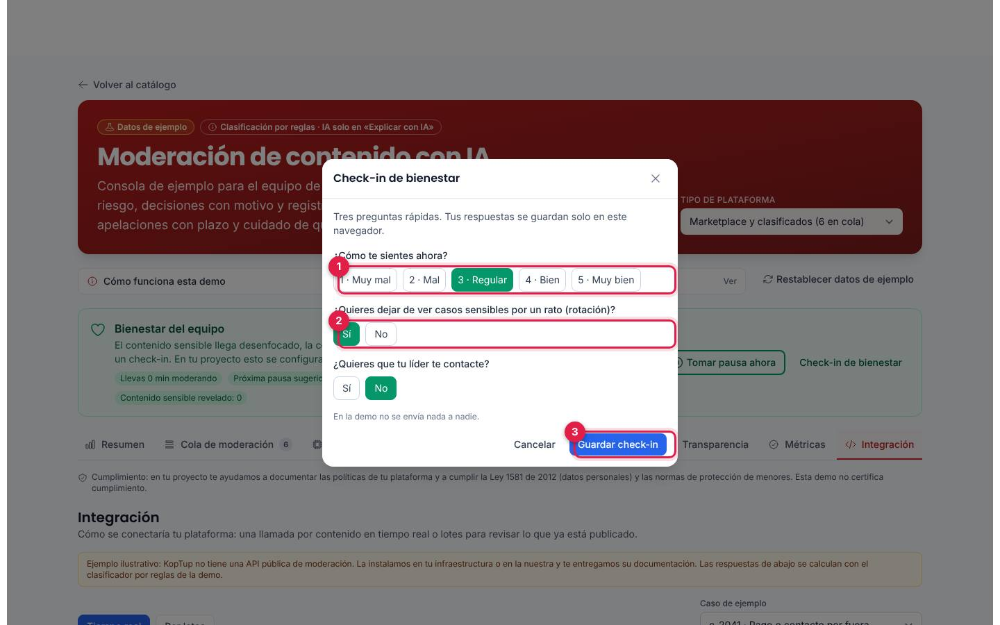

*El check-in de bienestar.*

- Indicadores que se calculan en la sesión: minutos moderando, próxima pausa sugerida (cada 50 minutos), contenido sensible revelado y el último check-in.
- **Desenfoque: activado / desactivado**: con el desenfoque activado, los casos sensibles se ven borrosos hasta pulsar **Ver**.
- **Tomar pausa ahora**: abre una ventana con cuenta regresiva de 5 minutos y desenfoca la cola; **Terminar pausa** (o Escape) la cierra y reinicia la próxima pausa.
- **Check-in de bienestar**: 1) cómo te sientes (1 a 5), 2) si quieres rotar fuera de los casos sensibles y 3) si quieres que tu líder te contacte. Con la rotación, los casos de menores, autolesión, contenido sexual y odio salen de tu cola (lo dice un aviso con **Quitar la rotación**). Si pides que te contacten, la demo aclara que no envía ningún mensaje; con ánimo 1 o 2 recomienda una pausa.

### Resumen

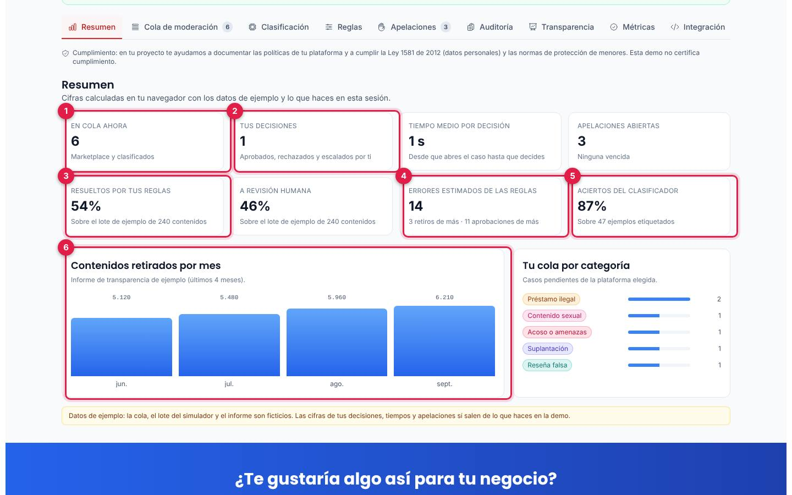

*Indicadores después de algunas decisiones.*

1. **En cola ahora** en la plataforma elegida.
2. **Tus decisiones**, **Tiempo medio por decisión** (desde que abres el caso hasta que decides) y **Apelaciones abiertas** con las vencidas: salen de lo que haces.
3. **Resueltos por tus reglas** y **A revisión humana** sobre el lote de ejemplo (54 % y 46 % con las reglas iniciales).
4. **Errores estimados de las reglas** en el lote (3 retiros de más y 11 aprobaciones de más con las reglas iniciales).
5. **Aciertos del clasificador** sobre los ejemplos etiquetados (87 %).
6. **Contenidos retirados por mes** (informe de ejemplo de los últimos cuatro meses) y **Tu cola por categoría**.

### Cola de moderación

Ver los pasos [1](#paso-1-la-cola-por-riesgo-y-el-porqué), [2](#paso-2-decidir-con-motivo) y [4](#paso-4-aplicar-las-reglas-a-la-cola). Los 17 casos de ejemplo (confianza calculada por el clasificador; igual en español y en inglés):

| Caso | Tipo | Plataformas | Categoría | Confianza | Ruta con las reglas iniciales | Prioridad |
|---|---|---|---|---|---|---|
| c-2041 | Texto | Marketplace, Fintech | Pago o contacto por fuera | 88 % | Regla 7 · Ocultar y advertir | Alta |
| c-2042 | Texto | Empleo, Marketplace | Estafa o fraude | 82 % | Regla 1 · Rechazar automáticamente | Alta |
| c-2043 | Imagen (volante) | Marketplace, Fintech | Préstamo ilegal | 89 % | Sin regla (la 8 está pausada) | Crítica |
| c-2044 | Texto | Marketplace | Reseña falsa | 78 % | Sin regla | Media |
| c-2045 | Texto | Medio digital | Acoso o amenazas | 65 % | Sin regla | Alta |
| c-2046 | Texto (sensible) | Medio digital | Odio o discriminación | 79 % | Sin regla | Alta |
| c-2047 | Texto (sensible) | Educativa | Protección de menores | 86 % | Regla 3 · Escalar a un equipo | Crítica |
| c-2048 | Imagen (sensible) | Todas | Contenido sexual | 76 % | Sin regla (la 4 pide más de 90 %) | Alta |
| c-2049 | Texto (sensible) | Medio, Educativa | Autolesión | 78 % | Regla 6 · Revisión humana | Crítica |
| c-2050 | Texto | Fintech, Marketplace | Suplantación | 89 % | Sin regla | Crítica |
| c-2051 | Audio | Marketplace, Fintech | Acoso o amenazas | 78 % | Sin regla | Alta |
| c-2052 | Video | Medio, Fintech | Estafa o fraude | 78 % | Regla 2 · Revisión humana | Alta |
| c-2053 | Texto | Marketplace, Medio | Spam | 80 % | Regla 5 · Limitar visibilidad | Baja |
| c-2054 | Texto | Marketplace | Sin infracción | 0 % | Regla 9 · Aprobar automáticamente | Baja |
| c-2055 | Texto | Empleo | Odio o discriminación (oferta discriminatoria) | 73 % | Sin regla | Alta |
| c-2056 | Texto | Educativa | Acoso o amenazas | 59 % | Sin regla | Media |
| c-2057 | Texto | Empleo | Pago o contacto por fuera | 77 % | Sin regla | Media |

En el celular la tabla pasa a tarjetas con las acciones a la vista (ver [En el celular](#en-el-celular)).

### Clasificación

Ver el [paso 5](#paso-5-probar-tu-propio-texto-y-pedir-la-explicación-a-la-ia). A la derecha, **Cómo clasifica esta demo** explica el método (48 señales en español e inglés, sin tildes ni mayúsculas; cada señal suma confianza a su categoría; por debajo de 20 % queda «Sin infracción») y lista las 11 categorías con su gravedad, sus señales en palabras y su política. **Por tipo de contenido** (Texto, Imagen, Video, Audio) dice qué hace la demo y qué haríamos en un proyecto; no muestra cifras de precisión de modelos.

### Reglas

Ver el [paso 3](#paso-3-cambiar-una-regla-y-ver-el-efecto-antes-de-guardarla). Reglas iniciales:

| # | Si… | Entonces | Estado | Coincide en el lote |
|---|---|---|---|---|
| 1 | Estafa o fraude > 80 % | Rechazar automáticamente | Activa | 9 |
| 2 | Estafa o fraude entre 50 % y 80 % | Revisión humana | Activa | 8 |
| 3 | Protección de menores > 40 % | Escalar a un equipo | Activa | 0 |
| 4 | Contenido sexual > 90 % | Rechazar automáticamente | Activa | 2 |
| 5 | Spam > 75 % | Limitar visibilidad | Activa | 14 |
| 6 | Autolesión > 30 % | Revisión humana | Activa | 5 |
| 7 | Pago o contacto por fuera > 80 % | Ocultar y advertir | Activa | 13 |
| 8 | Préstamo ilegal > 70 % | Escalar a un equipo | Pausada | 0 |
| 9 | Cualquier categoría < 20 % | Aprobar automáticamente | Activa | 92 |

### Apelaciones

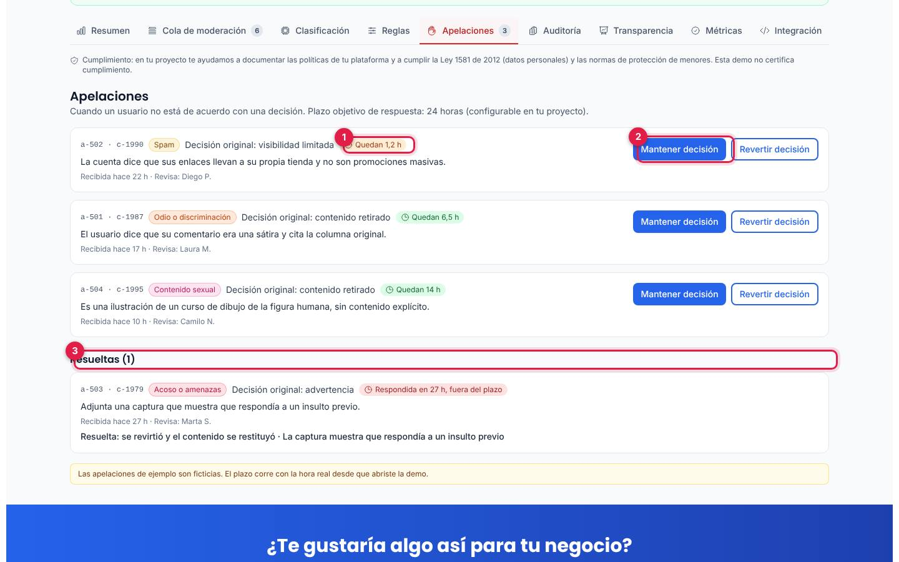

*Apelaciones abiertas con su plazo y una resuelta.*

1. **Plazo**: 24 horas desde que llega (de ejemplo, configurable en un proyecto), en verde, naranja con menos de 3 horas y rojo «Vencida hace N h». Corre con la hora real.
2. **Mantener decisión** o **Revertir decisión**: piden una nota opcional, cambian el estado, registran en la Auditoría y, si la apelación es de un caso que rechazaste, revertir lo restituye (queda aprobado).
3. **Resueltas**: con el resultado y si se respondió dentro o fuera del plazo.

Las cuatro apelaciones de ejemplo: a-503 (acoso, vencida hace 3 h), a-502 (spam, quedan 1,2 h), a-501 (odio, quedan 6,5 h) y a-504 (contenido sexual, quedan 14 h). **Simular apelación** en la cola agrega más.

### Auditoría

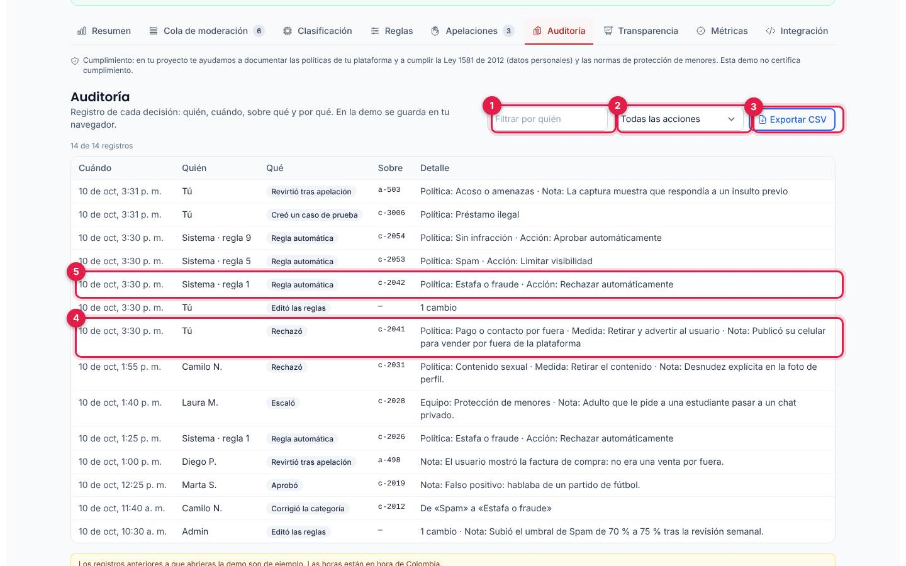

*El registro después del recorrido.*

1. **Filtrar por quién** (por ejemplo «Tú» o «regla»).
2. **Filtrar por acción**: aprobó, rechazó, escaló, corrigió la categoría, devolvió a la cola, regla automática, mantuvo o revirtió tras apelación, editó las reglas o creó un caso de prueba.
3. **Exportar CSV**: descarga lo filtrado (`auditoria-moderacion-AAAA-MM-DD.csv`, separado por punto y coma en español y con tildes legibles en Excel).
4. **Tu decisión** con política, medida y nota.
5. **Una regla automática** con la acción que aplicó.

Los siete registros anteriores a abrir la demo son de ejemplo y sus horas se calculan hacia atrás desde ese momento; todas las horas están en hora de Colombia.

### Transparencia

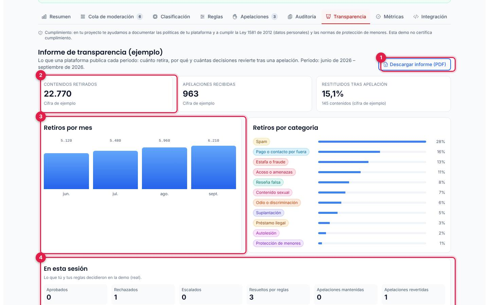

*Informe de transparencia de ejemplo.*

1. **Descargar informe (PDF)**: genera en el navegador un PDF rotulado como ejemplo con el resumen, los retiros por mes y por categoría, lo hecho en la sesión y las reglas vigentes.
2. Indicadores de ejemplo de los últimos cuatro meses completos (con la fecha de hoy: junio a septiembre de 2026): 22.770 contenidos retirados, 963 apelaciones y 145 restituidos (15,1 %).
3. **Retiros por mes** (5.120, 5.480, 5.960 y 6.210) y **por categoría** (de Spam 28 % a Protección de menores 1 %).
4. **En esta sesión**: aprobados, rechazados, escalados, resueltos por reglas y apelaciones mantenidas o revertidas (real).

### Métricas

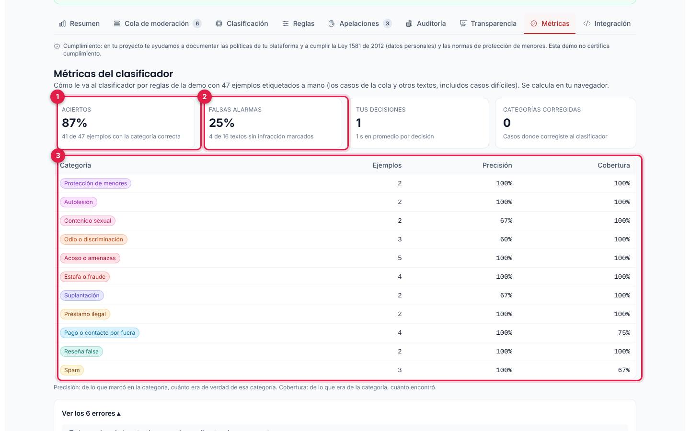

*Evaluación del clasificador por reglas con los errores abiertos.*

1. **Aciertos**: 41 de 47 ejemplos (87 %) con la categoría correcta. Los 47 son los 17 casos de la cola y 30 textos etiquetados a mano, incluidos casos difíciles.
2. **Falsas alarmas**: 4 de 16 textos sin infracción marcados (25 %).
3. **Precisión y cobertura** por categoría, y **Ver los 6 errores**: «sin pasar por la app» (no lo detecta), «el cultivo tiene plaga» (lo marca como odio), «figura humana desnuda» en una clase de arte, «Compra ya, compra ya…» (no lo detecta), «enviar el código del producto» (lo marca como suplantación) y «solo hombres en el equipo de fútbol» (lo marca como discriminación).

También muestra tus decisiones con su tiempo medio y cuántas categorías corregiste. La nota aclara que son pocos ejemplos escritos para la demo y que en un proyecto se mide con los datos del cliente.

### Integración

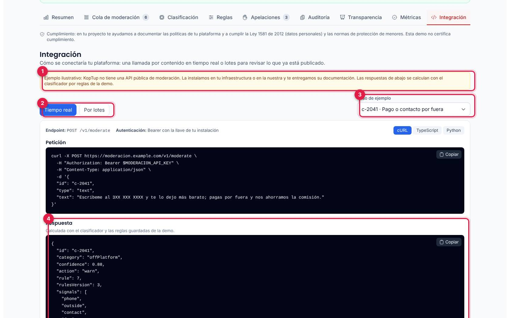

*Ejemplo de integración con la respuesta calculada.*

1. **Ejemplo ilustrativo**: KopTup no tiene una API pública de moderación; se instala en la infraestructura del cliente o en la nuestra.
2. **Tiempo real** (`POST /v1/moderate`) o **Por lotes** (`POST /v1/moderate/batch`), sobre el dominio reservado `moderacion.example.com`, con cURL, TypeScript (`fetch`) o Python (`requests`), sin paquetes inventados.
3. **Caso de ejemplo**: cualquier caso de la cola, incluidos los tuyos.
4. **Respuesta** calculada con el clasificador y las reglas guardadas de la demo (categoría, confianza, acción, regla, versión de las reglas y señales), y el **aviso de decisión (webhook)** con el estado actual del caso. **Copiar** copia cada bloque.

### En el celular

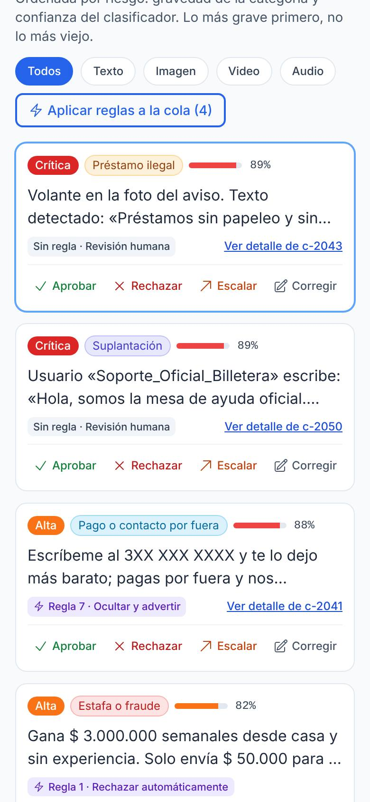

*La cola en un teléfono (390 px).*

Las pestañas se deslizan de lado y la pestaña activa queda a la vista. La cola se muestra como tarjetas con prioridad, categoría, confianza, ruta y las acciones con texto (Aprobar, Rechazar, Escalar, Corregir); **Ver detalle** baja al detalle del caso. Auditoría y Apelaciones también pasan a tarjetas; los bloques de código de Integración se deslizan de lado dentro de su recuadro.

---

## Qué es real y qué es simulado

| Parte | Real o simulado | Detalle |
|---|---|---|
| Clasificación de la cola y de tu texto | **Real, por reglas, en el navegador** | Señales de palabras y patrones; no es un modelo de IA. Los fragmentos resaltados son los que la activaron. |
| Explicar con IA | **Real (IA del servidor)** | Usa el asistente RAG del backend (`/api/chatbot`): la primera vez crea un asistente con la política de la plataforma de ejemplo (11 apartados) y luego le pregunta por el contenido. Con tope de gasto mensual y límites por conexión; sin clave o sin cupo responde en modo extractivo y lo dice. |
| Reglas, rutas y «Aplicar reglas» | **Real en el navegador** | Las reglas guardadas deciden la ruta de cada caso; las automáticas se aplican al pulsar el botón. |
| Simulador | **Calculado sobre datos de ejemplo** | Lote fijo de 240 contenidos con confianza y etiqueta de referencia. |
| Decisiones, apelaciones, auditoría, bienestar | **Real en el navegador** | Cambian el estado, quedan registradas y se guardan en `localStorage`. Nadie recibe avisos ni mensajes. |
| Métricas del clasificador | **Real** | Se calculan al abrir la pestaña con 47 ejemplos etiquetados. |
| Casos, apelaciones y registros iniciales | **Datos de ejemplo** | Ficticios y saneados; horas relativas a cuando abres la demo. |
| Imágenes, video y audio | **Simulado** | Se clasifica una descripción o transcripción de ejemplo; no hay archivos. |
| Informe de transparencia | **Cifras de ejemplo + sesión real** | El PDF se genera en el navegador y dice que es un ejemplo. |
| Integración | **Ilustrativa** | No hay API pública; la respuesta se calcula con la demo. |
| Cumplimiento | **Texto de servicio** | «Te ayudamos a…»; la demo no certifica nada. |

---

## Acceso

- **Cómo la ve un visitante:** la demo está en modo **Abierta** (`publico`): cualquiera entra a `/demo/moderacion-contenido` sin cuenta y sin pantalla de acceso. En el hub `/demo` aparece así:

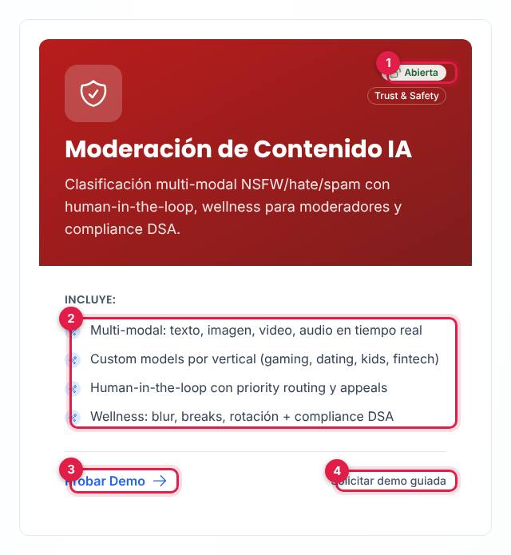

*Tarjeta «Moderación de Contenido IA» en el hub, vista por un visitante sin sesión.*

1. Insignia **Abierta** (junto a «Trust & Safety»).
2. Lo que **Incluye** según la tarjeta (ver la [limitación 6](#limitaciones-conocidas)).
3. **Probar Demo** abre `/demo/moderacion-contenido`.
4. **Solicitar demo guiada** abre `/solicitar-demo?demos=moderacion-contenido`.

- **Cómo se solicita:** no hace falta solicitarla. Quien quiera verla con sus propios datos usa **Solicitar demo guiada** (en la tarjeta o en el bloque azul al final de la demo, que también ofrece **Solicitar Cotización** y **Ver Planes y Precios**).
- **Cómo la controla el admin:** el modo sale del catálogo del servidor (allí se llama «Moderación de contenido con IA», el mismo nombre que ahora tiene la página) y se cambia en **Admin › Catálogo de demos** (`/admin/catalogo-demos`). Si se pasa a «Con solicitud» o «Solo por invitación», los visitantes verán la pantalla de acceso y los accesos se conceden en **Admin › Solicitudes de demo** y **Admin › Accesos a demos**; si se desactiva, el visitante ve que la demo está en mantenimiento y el equipo sigue entrando. Si el backend no responde, la demo sigue abierta porque así está en la tabla de respaldo (y «Explicar con IA» muestra que no pudo conectar). Detalle en el [Manual del administrador](Doc-06-Manual-del-Administrador.md) y en [Flujos del visitante](Doc-04-Flujos-del-Visitante.md).

---

## Limitaciones conocidas

1. **La clasificación es por reglas, no por IA.** Funciona con las señales escritas para la demo (87 % de aciertos en sus propios ejemplos y errores típicos de las reglas: sarcasmo, arte, palabras con doble sentido). La demo lo dice en el encabezado, en «Clasificación» y en «Métricas»; un proyecto usaría un modelo de moderación o un LLM medido con los datos del cliente.
2. **No hay imágenes, audios ni videos reales**: se clasifican descripciones y transcripciones de ejemplo.
3. **Escalar, advertir, suspender o pedir que te contacte tu líder no avisa a nadie**: queda registrado en la demo.
4. **Todo se guarda en el navegador** (`localStorage`): no se comparte entre equipos ni dispositivos y se regenera a las 24 horas. «Restablecer datos de ejemplo» lo borra.
5. **«Explicar con IA» depende del servidor**: envía el texto al backend (y al proveedor de IA si hay clave), deja un asistente con la política en el servidor, y está sujeto al cupo mensual de IA de las demos y a los límites por conexión (por ejemplo, 30 asistentes nuevos por hora); al pasarse muestra un aviso y el navegador registra la respuesta 429 en la consola. Si el servidor no responde, lo dice.
6. **La tarjeta del hub y el catálogo prometen más de lo que hay** («Multi-modal… en tiempo real», «Custom models por vertical», «compliance DSA») y usan otro nombre («Moderación de Contenido IA»). Los textos nuevos están propuestos para el catálogo (fuera de los archivos de esta demo).
7. **«Ver Planes y Precios»** del bloque final lleva a `/services#planes-rag`, que abre en los planes RAG (es común a todas las demos).
8. **El simulador y el informe usan cifras de ejemplo**; solo las de la sesión son tuyas.
