# Guía de la demo: POS para tiendas y restaurantes

> Ruta `/demo/pos` · Modo de acceso: **Abierta** · Tipo: **datos de ejemplo** (todo corre en el navegador; sin backend ni IA) · Plan del producto: [POS retail](Producto-pos-retail.md)

**Resumen.** Es una caja registradora (punto de venta) para dos negocios ficticios colombianos: un minimercado (Mercado La Ceiba, tres sedes en Bogotá y Medellín) y un restaurante (Fogón Andino, tres sedes en Bogotá, Medellín y Cali). Vendes con lector de código de barras y balanza o por mesas con comandas a cocina, cobras con pago mixto, emites el documento equivalente POS de ejemplo, simulas la venta «sin internet» y cierras caja con reporte X y Z; además hay pre-cuenta de mesa, consola de sedes, inventario, traslados y empleados. Está pensada para dueños y administradores de minimercados, tiendas y restaurantes con una o varias sedes. Cualquier visitante la abre sin registrarse.

Al entrar se ve en segundos qué es y por dónde empezar: el encabezado dice para quién es, trae **Volver al catálogo de demos**, **Solicitar demo guiada** y **Cotizar tu POS**, y debajo están los **Primeros pasos**: cinco pasos que llevan a su lugar de la demo y se marcan solos cuando los haces.

**En esta página:** [Recorrido sugerido](#recorrido-sugerido-demo-comercial-de-5-minutos) · [Pantallas y funciones](#pantallas-y-funciones) · [Qué es real y qué es simulado](#qué-es-real-y-qué-es-simulado) · [Acceso](#acceso) · [Limitaciones conocidas](#limitaciones-conocidas)

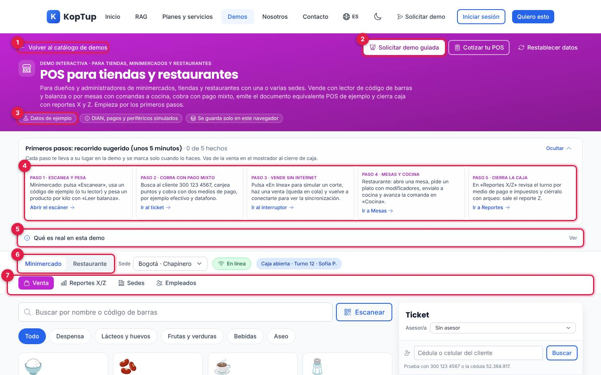

*Vista inicial.* **1** Volver al catálogo de demos. **2** Salidas comerciales: Solicitar demo guiada (con esta demo ya elegida), Cotizar tu POS y Restablecer datos. **3** Rótulos «Datos de ejemplo», «DIAN, pagos y periféricos simulados» y «Se guarda solo en este navegador». **4** Primeros pasos con su avance («0 de 5 hechos»). **5** Desplegable «Qué es real en esta demo». **6** Tipo de negocio, sede, interruptor de conexión y estado de la caja. **7** Pestañas.

---

## Recorrido sugerido (demo comercial de 5 minutos)

Este guion sigue los cinco **Primeros pasos** que trae la propia demo. Cada tarjeta tiene un enlace («Abrir el escáner», «Ir al ticket», «Ir al interruptor», «Ir a Mesas», «Ir a Reportes») que cambia de negocio y de pestaña si hace falta y lleva la vista (y el foco del teclado) al lugar del paso. Cuando haces el paso, la tarjeta se pone verde con «Hecho» y sube el contador. Empieza con los datos limpios: si alguien ya usó la demo en ese navegador, pulsa **Restablecer datos** y confirma con **Sí, restablecer** (también reinicia el avance de los pasos). **Ocultar** pliega los pasos y el navegador lo recuerda.

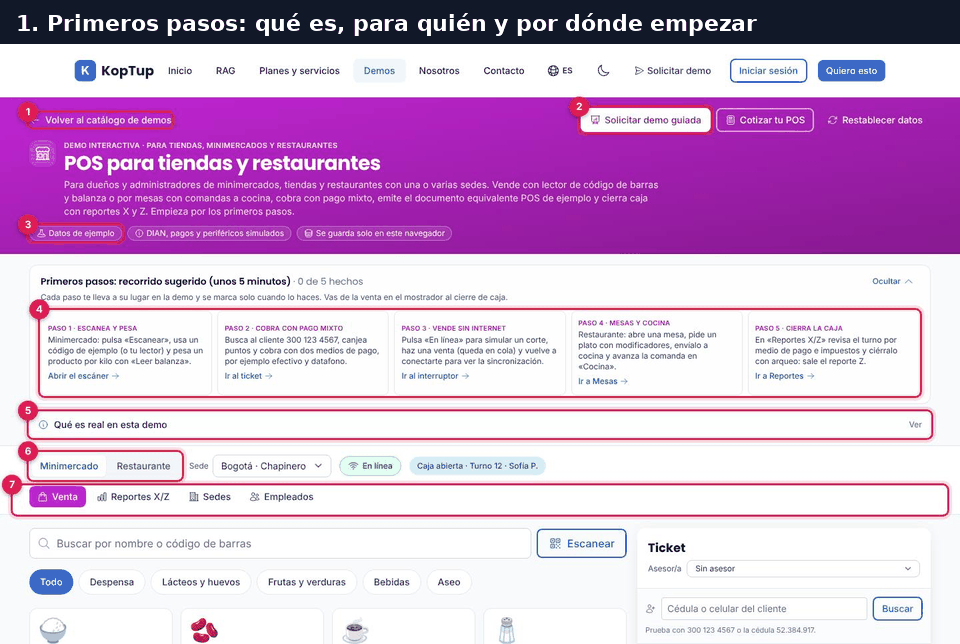

*Recorrido completo: primeros pasos, escanear y pesar, cobro mixto, documento POS, venta sin internet, mesas, pre-cuenta, cocina, reporte X, cierre Z y turno cerrado.*

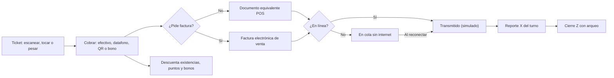

*Ciclo de una venta en la demo: cada flecha la hace la propia página al cobrar.*

### Paso 1. Minimercado: escanea y pesa

En **Minimercado** (el negocio inicial), sede Bogotá · Chapinero, pulsa **Abrir el escáner** en el paso 1 (o **Escanear** junto al buscador) y usa los códigos de ejemplo.

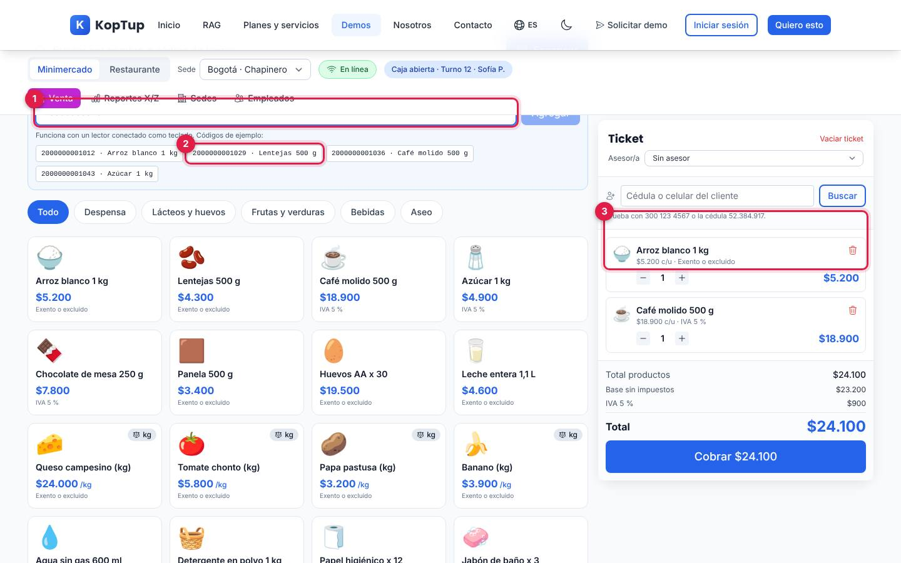

*Campo de escaneo abierto; el arroz y el café ya están en el ticket.*

1. **Campo de código**: acepta un lector de código de barras real conectado como teclado (USB o Bluetooth) o un código escrito más Enter. Un código que no existe muestra «El código … no está en el catálogo». El buscador de arriba también agrega el producto si escribes (o escaneas) un código de 8 a 14 dígitos y pulsas Enter; si el código no existe, avisa «El código … no está en el catálogo» y deja el código escrito para corregirlo.
2. **Códigos de ejemplo**: los cuatro primeros productos con código (arroz, lentejas, café y azúcar). Un clic equivale a escanearlos.
3. **Líneas del ticket**: cada producto con precio unitario, tarifa de impuesto, botones − y +, y la papelera para quitarlo.

Luego toca un producto **por kilo** (los que llevan la insignia «kg», por ejemplo Tomate chonto) y pulsa **Leer balanza (simulado)**:

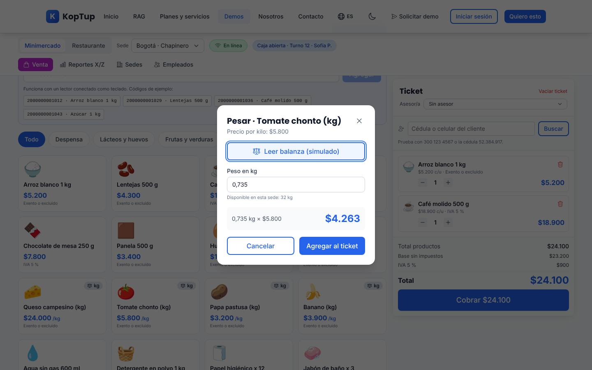

*Ventana «Pesar · Tomate chonto (kg)»: la balanza simulada leyó 0,735 kg y la demo calcula $4.263.*

Cada lectura de la balanza simulada da el siguiente peso de una lista fija (0,735 · 1,25 · 0,48 · 2,105 · 0,92 kg). También puedes escribir el peso a mano (entre 0,01 y 20 kg); la ventana muestra lo disponible en la sede y no deja agregar más de eso. **Agregar al ticket** suma la línea. El paso 1 queda «Hecho» cuando escaneaste un código y pesaste un producto.

Qué decir: «El cajero no digita nada: escanea o pesa, y el precio sale con el impuesto correcto».

### Paso 2. Cliente frecuente, canje de puntos y cobro mixto

**Ir al ticket** pone el cursor en **Cédula o celular del cliente**. Escribe `300 123 4567` y pulsa **Buscar**: aparece Valentina Rojas (5.420 puntos, nivel Oro). Pulsa **Canjear 500 pts (−$5.000)**. Si quieres, elige un **Asesor/a** (en la captura, Camila Ortiz) para que la venta le sume comisión.

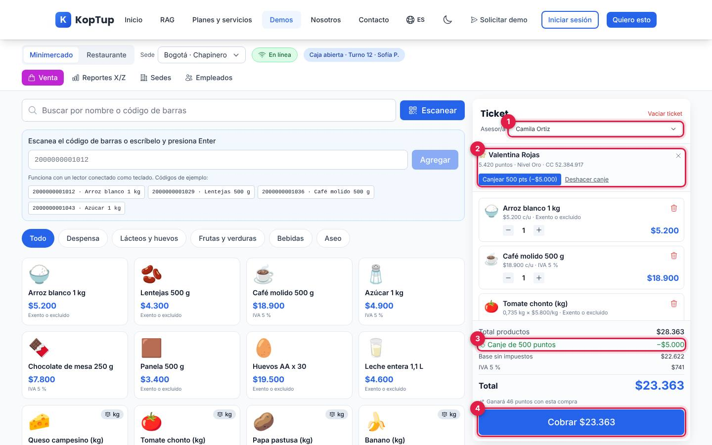

*Ticket con arroz, café y tomate.* **1** Asesor/a. **2** Cliente identificado con su nivel y el canje. **3** Canje de 500 puntos (−$5.000) en los totales; debajo, la base, el IVA 5 % y «Ganará 46 puntos con esta compra». **4** Cobrar $23.363.

Pulsa **Cobrar $23.363**. En la ventana escribe `20000`, pulsa **Recibir efectivo**, cambia a **Tarjeta (datafono)** y pulsa **Cobrar en datafono** (sin monto: cobra lo que falta).

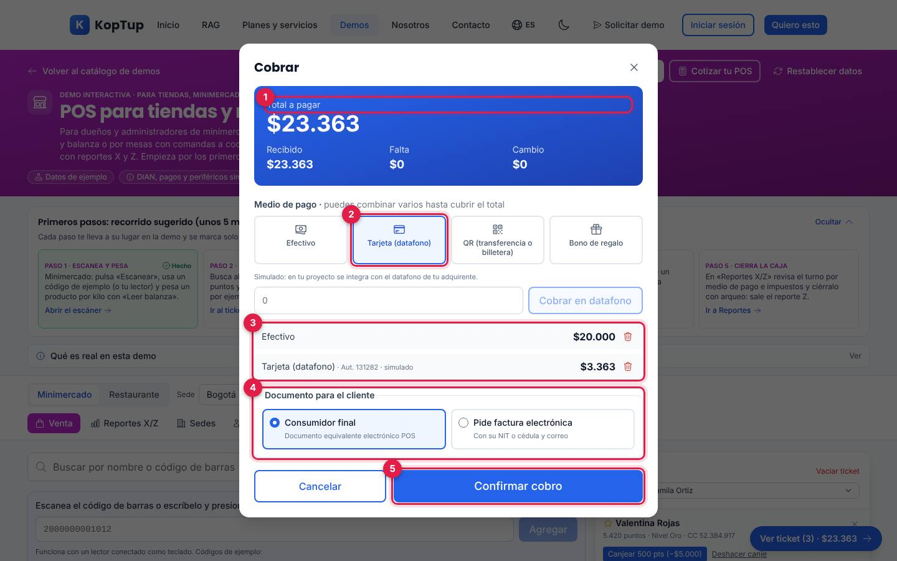

*Ventana «Cobrar» con dos pagos: $20.000 en efectivo y $3.363 con tarjeta (autorización simulada).*

1. **Total a pagar**, con lo **Recibido**, lo que **Falta** y el **Cambio**.
2. **Medio de pago**: Efectivo, Tarjeta (datafono), QR (transferencia o billetera) o Bono de regalo. Se pueden combinar hasta cubrir el total. En efectivo aparecen botones rápidos («Exacto …» y valores redondeados) y la demo calcula el cambio. Datafono y QR esperan menos de un segundo y devuelven un código de autorización simulado. Los bonos de ejemplo son `BONO50` ($50.000) y `BONO20` ($20.000).
3. **Pagos parciales**: cada uno con su papelera para quitarlo.
4. **Documento para el cliente**: «Consumidor final» (documento equivalente electrónico POS) o «Pide factura electrónica» (tipo y número de documento, nombre y correo obligatorios; un NIT se escribe con su dígito de verificación y la demo lo comprueba, ver abajo).
5. **Confirmar cobro**: se activa cuando no falta nada. Registra la venta. El paso 2 queda «Hecho» con cualquier venta cobrada con dos medios de pago distintos.

Si el cliente pide factura con NIT, la demo comprueba el dígito de verificación con el mismo cálculo de la DIAN (módulo 11). Sin dígito pide «Escribe el NIT con su dígito de verificación, separado por un guion»; con uno equivocado dice cuál debería ser y no deja confirmar el cobro:

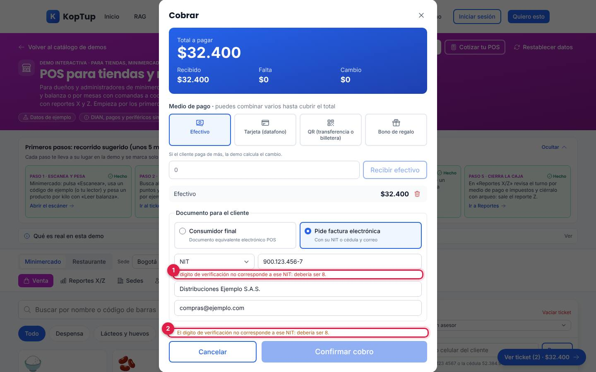

*Factura a un NIT de prueba con el dígito equivocado.* **1** Aviso bajo el número de documento. **2** El mismo aviso en lo que falta para cobrar; «Confirmar cobro» sigue desactivado hasta corregirlo.

### Paso 2 (cont.). El documento equivalente POS

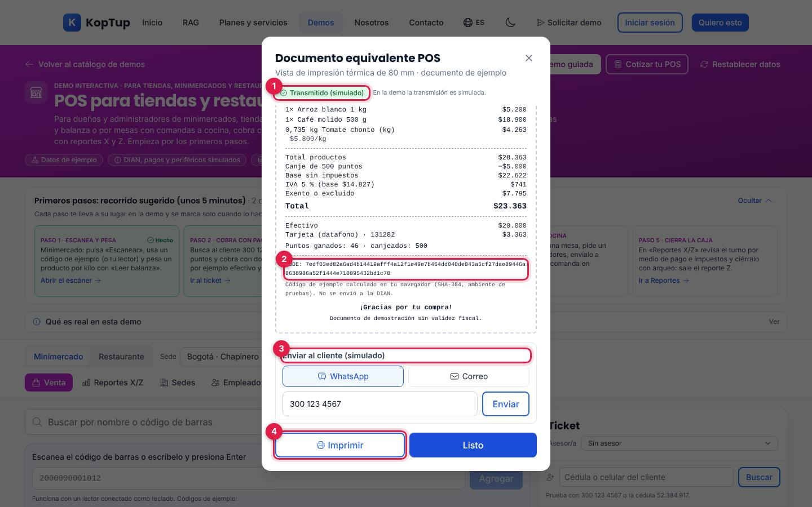

*Documento `LC1-4821` en vista de impresión térmica de 80 mm.*

1. **Estado**: «Transmitiendo…» y, en poco más de un segundo, «Transmitido (simulado)».
2. **CUDE** (o CUFE si es factura): se calcula en tu navegador con SHA-384, con la fecha y hora de Colombia, en ambiente de pruebas, y no se envía a la DIAN. El documento trae negocio, NIT, resolución de ejemplo, cajero, asesor, líneas, base, impuestos por tarifa, pagos, cambio y puntos ganados y canjeados, y termina con «Documento de demostración sin validez fiscal».
3. **Enviar al cliente (simulado)**: por WhatsApp (trae el celular del cliente) o por correo. Responde «Listo: se enviaría a … Simulado: en la demo no sale ningún mensaje».
4. **Imprimir**: abre el diálogo de impresión del navegador solo con el recibo.

Escape o **Listo** cierran la ventana y el foco vuelve al botón que la abrió; si ese botón ya no está disponible (después de cobrar, **Cobrar** queda desactivado con el ticket vacío), el foco vuelve al campo de escaneo o al buscador para seguir vendiendo.

Qué decir: «Cobro mixto en segundos, documento electrónico con su código y recibo por WhatsApp sin papel».

### Paso 3. Sin internet: la caja sigue vendiendo

**Ir al interruptor** lleva a **En línea** en la barra de la caja. Púlsalo: cambia a **Sin internet**. Haz otra venta (en la prueba, agua y detergente con **Exacto $15.200**) y abre **Reportes X/Z**.

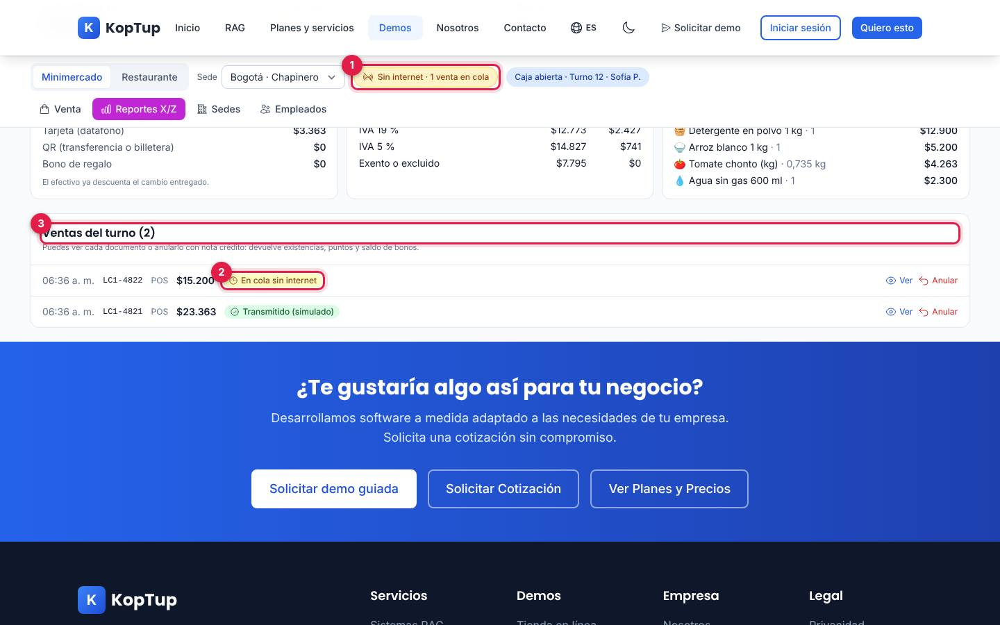

*Con el interruptor en «Sin internet · 1 venta en cola», el documento `LC1-4822` queda «En cola sin internet».*

1. **Interruptor de conexión**: es un botón de la demo; no corta tu internet. Muestra cuántas ventas hay en cola.
2. **En cola sin internet**: el documento se emitió y se guardó, pero no se ha «transmitido».
3. **Ventas del turno**: cada documento con su estado, **Ver** y **Anular**.

Pulsa otra vez el interruptor: dice «Sincronizando 1 venta…» y, en menos de dos segundos, la venta pasa a «Transmitido (simulado)» y el paso 3 queda «Hecho». Sin conexión no se pueden registrar traslados entre sedes.

Qué decir: «Si se cae el internet, no se para la fila: los documentos se envían solos al volver».

### Paso 4. Restaurante: mesas, modificadores, pre-cuenta y cocina

**Ir a Mesas** cambia a **Restaurante** (sede Bogotá · Usaquén) y abre **Mesas**. Aparecen también las pestañas **Mesas** y **Cocina**.

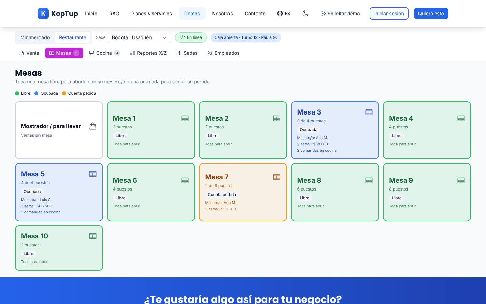

*Plano de 10 mesas más «Mostrador / para llevar»: libres en verde, ocupadas en azul (Mesa 3 y Mesa 5) y con cuenta pedida en naranja (Mesa 7).*

Toca **Mesa 1**, elige mesero/a y número de personas y pulsa **Abrir mesa**: vuelves a **Venta** con el ticket de esa mesa («Mesa 1 · 2 personas · Mesero/a: …»). Toca **Bandeja paisa**: se abre la ventana de modificadores (Media porción −$8.000, Aguacate +$4.000, Huevo frito +$3.000, Chicharrón extra +$7.000, Sin cebolla) y una **Nota para cocina**. Las bebidas preparadas tienen En leche +$1.500, Sin azúcar y Sin hielo. Agrega también una Limonada de coco y pulsa **Enviar a cocina (2)**: la demo crea una comanda para cocina y otra para bar.

Pulsa **Pre-cuenta**: la mesa queda «Cuenta pedida» y se abre la pre-cuenta para revisarla con el cliente antes de cobrar (el botón pasa a **Ver pre-cuenta**).

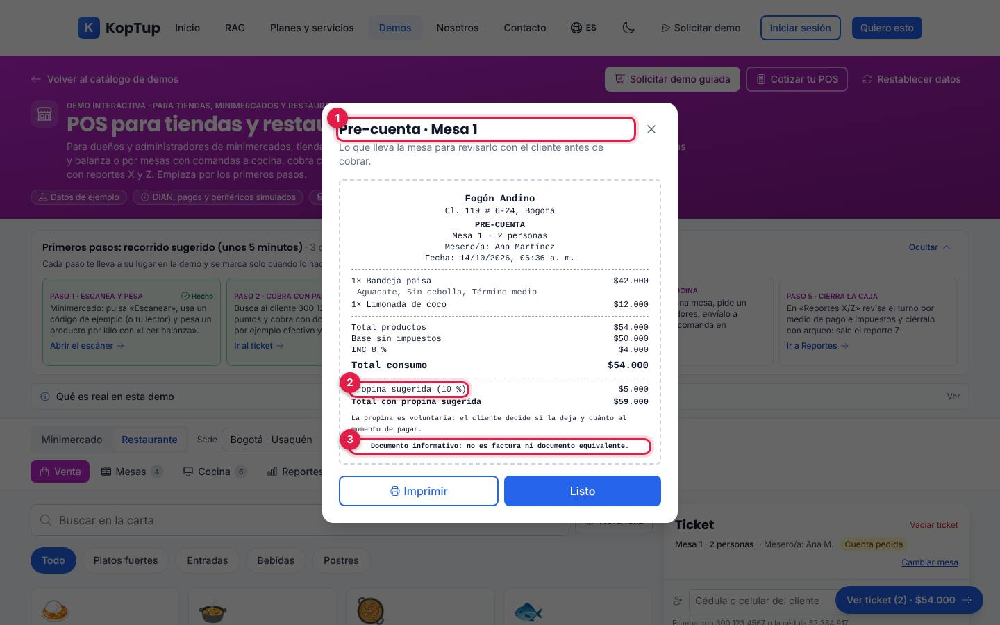

*Pre-cuenta de la Mesa 1 con los modificadores y la nota.* **1** Encabezado con mesa, personas, mesero/a y hora. **2** Propina sugerida del 10 % sobre la base sin impuestos y total con propina. **3** «Documento informativo: no es factura ni documento equivalente». **Imprimir** la manda al diálogo de impresión del navegador.

Luego abre **Cocina**.

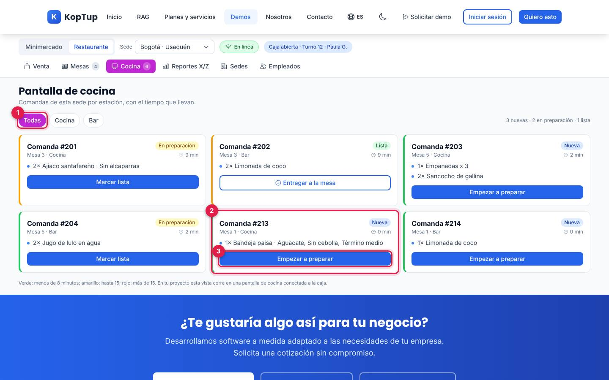

*Pantalla de cocina de la sede: las comandas de ejemplo de las mesas 3 y 5 y las dos nuevas de la Mesa 1 (#213 a cocina y #214 a bar).*

1. **Estación**: Todas, Cocina o Bar, con el conteo «3 nuevas · 2 en preparación · 1 lista».
2. **Comanda nueva** de la Mesa 1, con los modificadores y la nota («Aguacate, Sin cebolla, Término medio»).
3. **Botón de avance**: Empezar a preparar → Marcar lista → Entregar a la mesa (al entregarla desaparece). Al avanzar una comanda que enviaste tú, el paso 4 queda «Hecho».

El borde de cada comanda es verde con menos de 8 minutos, amarillo hasta 15 y rojo después; el tiempo corre con el reloj real.

Qué decir: «El mesero no corre a la cocina: la comanda llega sola, separada por estación, y se ve cuánto lleva esperando».

### Paso 5. Reporte X, cierre Z y sedes

**Ir a Reportes** abre **Reportes X/Z** del negocio que tengas a la vista; para el guion vuelve antes a **Minimercado**.

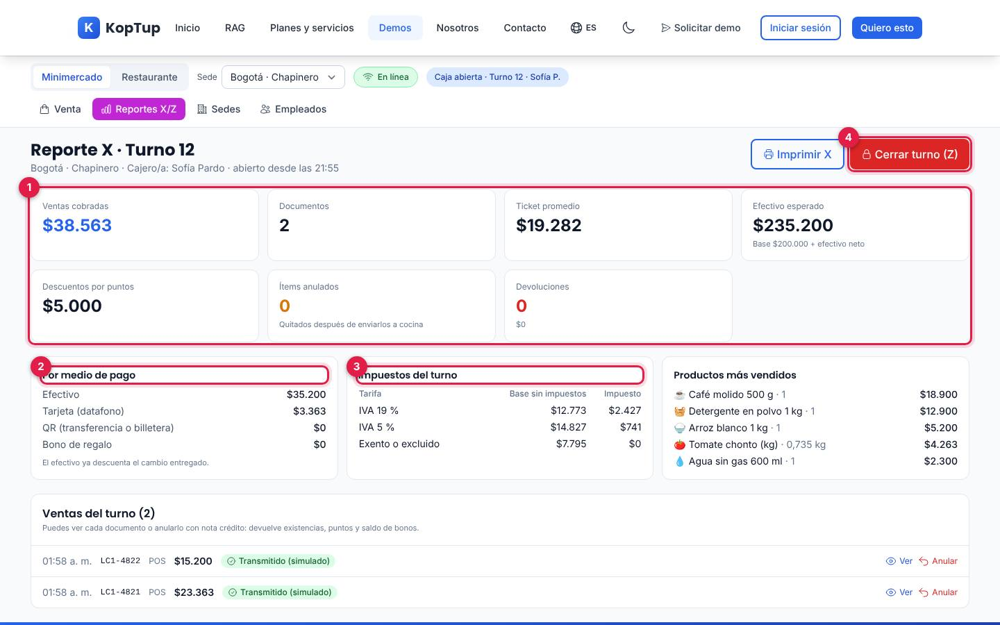

*Reporte X del turno 12 de Chapinero con las dos ventas del recorrido.*

1. **Totales del turno**: ventas cobradas ($38.563), documentos (2), ticket promedio, efectivo esperado (base $200.000 + efectivo neto = $235.200), descuentos por puntos ($5.000), ítems anulados (quitados después de enviarlos a cocina) y devoluciones. En restaurante suma también las propinas.
2. **Por medio de pago**: efectivo (ya descuenta el cambio entregado), tarjeta, QR y bono.
3. **Impuestos del turno**: base e impuesto por tarifa (IVA 19 %, IVA 5 %, exento o excluido; INC 8 % en restaurante).
4. **Cerrar turno (Z)**: abre el arqueo. **Imprimir X** imprime el reporte.

En **Cerrar turno (Z)** escribe el efectivo contado (o pulsa **Usar el valor esperado**). La ventana dice si cuadra exacto, si sobra o si falta. En la prueba se contaron $233.200 frente a $235.200 esperados. **Cerrar y generar Z** muestra el reporte Z y el paso 5 queda «Hecho»:

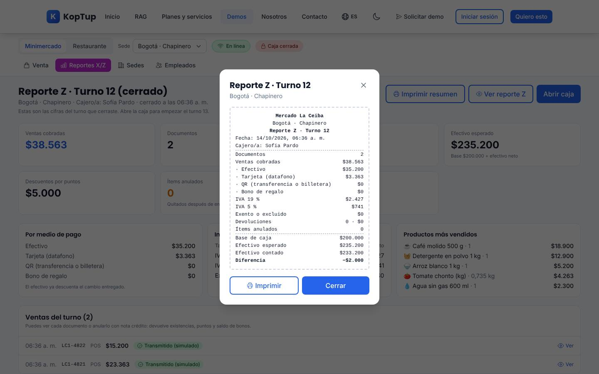

*Reporte Z del turno 12: documentos, ventas por medio de pago, impuestos, devoluciones, ítems anulados, base, efectivo esperado, contado y diferencia (−$2.000).*

Al cerrar la ventana, la pestaña muestra el turno cerrado:

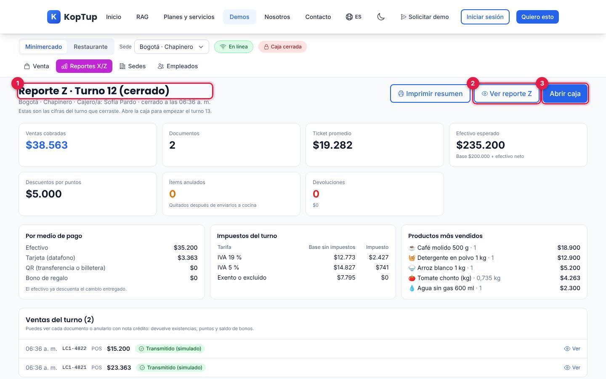

*Reportes con la caja cerrada.* **1** Título «Reporte Z · Turno 12 (cerrado)», con la hora del cierre y «Abre la caja para empezar el turno 13». **2** **Ver reporte Z** vuelve a abrir el Z de ese turno. **3** **Abrir caja** (base sugerida $200.000 y cajero/a o supervisor/a de la sede); el turno nuevo toma el número siguiente. **Imprimir resumen** imprime las cifras del turno cerrado.

Mientras la caja está cerrada, la pestaña Venta muestra «La caja de esta sede está cerrada» con el mismo botón **Abrir caja**. Termina en **Sedes** con un traslado (ver [Sedes](#sedes)).

Qué decir: «El cierre de caja deja de ser una hoja de cálculo: el sistema dice cuánto debería haber y cuánto falta».

---

## Pantallas y funciones

### Encabezado y barra de la caja

Ver la [vista general](#guía-de-la-demo-pos-para-tiendas-y-restaurantes).

| Elemento | Qué hace |
|---|---|
| **Volver al catálogo de demos** | Vuelve a `/demo`. |
| **Solicitar demo guiada** | Abre `/solicitar-demo?demos=pos` con esta demo ya elegida. |
| **Cotizar tu POS** | Abre `/contact?service=pos-retail` con el producto POS retail elegido. |
| **Restablecer datos** | Pide confirmación y vuelve a los datos de ejemplo (borra ventas, cierres, clientes registrados, precios, traslados y el avance de los primeros pasos de los dos negocios). |
| **Datos de ejemplo** y demás rótulos | Al pasar el mouse por «Datos de ejemplo» explica que negocios, NIT, sedes, personas, códigos de barras, existencias y cifras son inventados. |
| **Primeros pasos** | Cinco tarjetas con su enlace; se marcan solas («Hecho») y muestran «N de 5 hechos». **Ocultar** / **Ver pasos** los pliega (el navegador lo recuerda). En el celular se desplazan de lado. |
| **Qué es real en esta demo** | Desplegable con lo que se calcula de verdad en el navegador, lo que es simulado (DIAN, datafono, QR, balanza, impresora, cajón, WhatsApp y correo) y lo que se haría en el proyecto real. |
| **Minimercado / Restaurante** | Cambia de negocio. Cada uno guarda su propia información; la categoría y el formulario de traslados vuelven a empezar al cambiar. |
| **Sede** | Cambia la sede donde vendes («Ahora vendes en …»). El ticket vuelve al mostrador de esa sede. |
| **En línea / Sin internet** | Interruptor simulado; muestra las ventas en cola y la sincronización. Afecta a los dos negocios. |
| **Caja abierta · Turno N · nombre** | Estado del turno de la sede; en rojo «Caja cerrada». |
| **Pestañas** | Minimercado: Venta, Reportes X/Z, Sedes y Empleados. Restaurante: además Mesas (con el número de mesas abiertas) y Cocina (con las comandas pendientes; el lector de pantalla oye «Cocina (4 comandas pendientes)»). Si cambias de pestaña con la página ya abajo, la nueva se muestra desde su inicio, justo debajo de la barra de la caja. |

### Venta

Ver los [pasos 1 y 2](#paso-1-minimercado-escanea-y-pesa).

- **Catálogo**: 16 productos por negocio, con buscador por nombre o código, categorías (Despensa, Lácteos y huevos, Frutas y verduras, Bebidas y Aseo; en restaurante Platos fuertes, Entradas, Bebidas y Postres), precio con impuestos incluidos y tarifa. Muestra «Quedan N» cuando las existencias de la sede llegan al mínimo y «Agotado» cuando no hay.
- **Hora feliz** (solo restaurante): botón que aplica −20 % a la cerveza nacional.
- **Combo** (restaurante): «Combo almuerzo: sancocho + jugo» se cobra como un ítem y se envía a cocina y a bar por separado.
- **Periféricos**: impresora térmica, lector, datafono, balanza (solo minimercado) y cajón monedero con **Probar** o **Abrir**. Solo muestran un aviso simulado, salvo **Abrir campo** del lector, que abre el campo de escaneo (el lector real sí funciona).
- **Caja**: turno, hora de apertura y cajero/a, base, efectivo neto de ventas, efectivo esperado y **Cerrar turno (Z)** o **Abrir caja**. En **Abrir caja** se elige la base y el cajero/a o supervisor/a; quien no ha marcado entrada aparece como «Fuera de turno».
- **Ticket**: en minimercado, selector **Asesor/a** (solo asesores en turno); en restaurante, mesa, personas, mesero/a y **Cambiar mesa**. **Vaciar ticket** borra las líneas.
- **Cliente frecuente**: búsqueda por cédula o celular (prueba con 300 123 4567 o la cédula 52.384.917). Si no existe, **Registrarlo** pide nombre, cédula (5 a 10 dígitos), celular (10 dígitos que empiezan por 3) y la autorización de datos (Ley 1581 de 2012). Niveles: Bronce, Plata desde 1.500 puntos y Oro desde 5.000; se gana 1, 1,5 o 2 puntos por cada $1.000 y se canjean bloques de 500 puntos por $5.000.
- **Restaurante**: **Enviar a cocina (N)** (solo lo que falta enviar; la línea muestra «Enviado: N»), **Pre-cuenta** / **Ver pre-cuenta** (marca la mesa como «Cuenta pedida» y abre la pre-cuenta informativa) y **Liberar mesa sin consumo**. Al cobrar pide elegir la propina (Sin propina, 5 % o 10 % sugerida, sobre la base sin impuestos).
- **Ver ticket (N) · $…**: botón flotante que aparece cuando el botón **Cobrar** no se ve (en el celular, o en escritorio con la página arriba); lleva al ticket con **Cobrar** a la vista.

### Mesas

Ver el [paso 4](#paso-4-restaurante-mesas-modificadores-pre-cuenta-y-cocina). Las mesas 3, 5 y 7 llegan con pedidos de ejemplo en las tres sedes. Una mesa libre se abre con su mesero/a (solo meseros en turno) y el número de personas; una ocupada lleva a su ticket. **Mostrador / para llevar** es la venta sin mesa.

### Cocina

Ver el [paso 4](#paso-4-restaurante-mesas-modificadores-pre-cuenta-y-cocina).

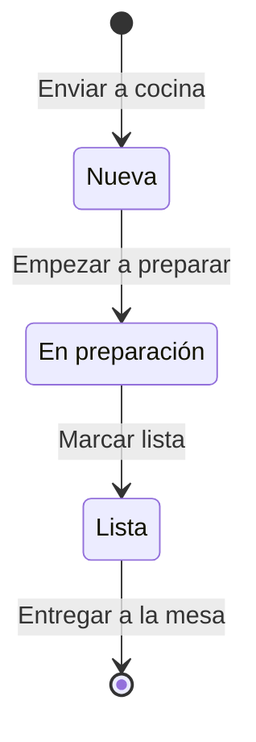

*Estados de una comanda en la pantalla de cocina.*

### Reportes X/Z

Ver el [paso 5](#paso-5-reporte-x-cierre-z-y-sedes). Además de los totales:

- **Productos más vendidos** del turno.
- **Ventas del turno**: hora, número, POS o Factura, total y estado. **Ver** abre el documento; **Anular** pide confirmación y crea una nota crédito de ejemplo (`NC1-101`…): devuelve existencias, puntos y saldo de bonos, y la venta queda «Anulada · NC…». Con el turno cerrado solo queda **Ver**.
- **Cierres Z de hoy en esta sede**: lista de cierres con su diferencia y **Ver**.
- Con la caja cerrada, el título cambia a «Reporte Z · Turno N (cerrado)» y aparecen **Ver reporte Z** y **Abrir caja**.

### Sedes

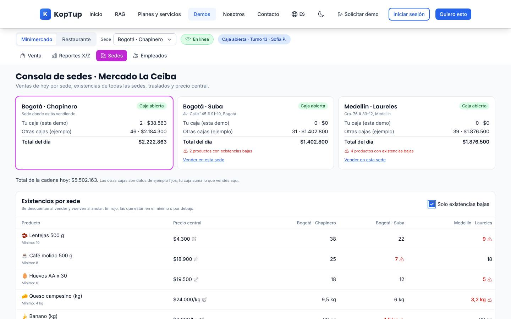

*Consola de Mercado La Ceiba después del traslado de 5 unidades de arroz de Medellín · Laureles a Bogotá · Chapinero, con el filtro «Solo existencias bajas» activo.*

- **Tarjetas por sede**: caja abierta o cerrada, «Tu caja (esta demo)» (ventas y valor de lo que vendes aquí, por ejemplo «2 ventas · $38.563»), «Otras cajas (ejemplo)» (cifras fijas), total del día, productos con existencias bajas y **Vender en esta sede**. Debajo, el total de la cadena.
- **Existencias por sede**: una columna por sede, en rojo con alerta las que están en el mínimo o por debajo, y **Solo existencias bajas**.
- **Precio central**: el lápiz permite cambiar el precio (entre $100 y $10.000.000) para todas las sedes; aplica a los productos que agregues después y queda marcado «Cambiado».
- **Trasladar existencias entre sedes**: producto, origen, destino y cantidad (enteros o kg). No deja trasladar sin conexión, entre la misma sede ni más de lo disponible; lo que está en un ticket abierto de la sede de origen no cuenta y el aviso dice cuánto hay disponible. Debajo queda el historial de traslados.

### Empleados

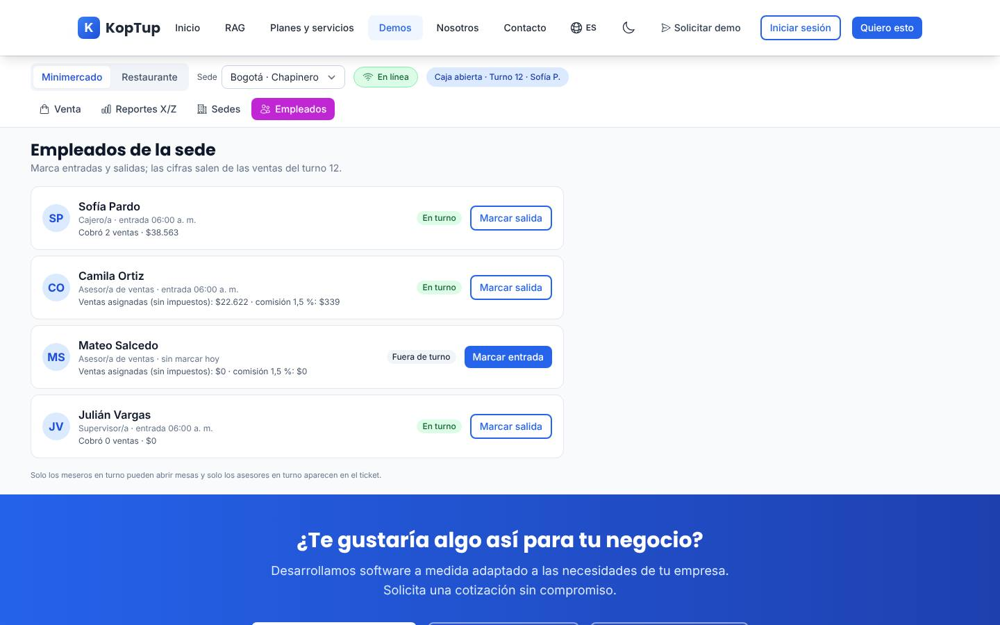

*Empleados de Chapinero en el turno 12: la cajera con sus 2 ventas ($38.563), la asesora con su comisión y el supervisor.*

Lista del personal de la sede con **Marcar entrada** y **Marcar salida** (hora real de Colombia) y cifras del turno: ventas cobradas por cajero/a, ventas asignadas y comisión del 1,5 % por asesor/a, mesas abiertas, cuentas cobradas y propinas por mesero/a y comandas pendientes de cocina o bar. Solo los meseros en turno pueden abrir mesas y solo los asesores en turno aparecen en el ticket. Las horas de entrada de ejemplo se calculan al abrir la demo, unas horas antes de la hora actual de Colombia, pero nunca antes de las 6:00 a. m., la hora de apertura de las sedes de ejemplo: si abres la demo a las 6:30 a. m., la cajera entró a las 6:00 a. m., no a las 2:00 a. m. Todas las horas (apertura, entradas, salidas, traslados y documentos) se muestran con el mismo formato («06:00 a. m.»).

### En el celular

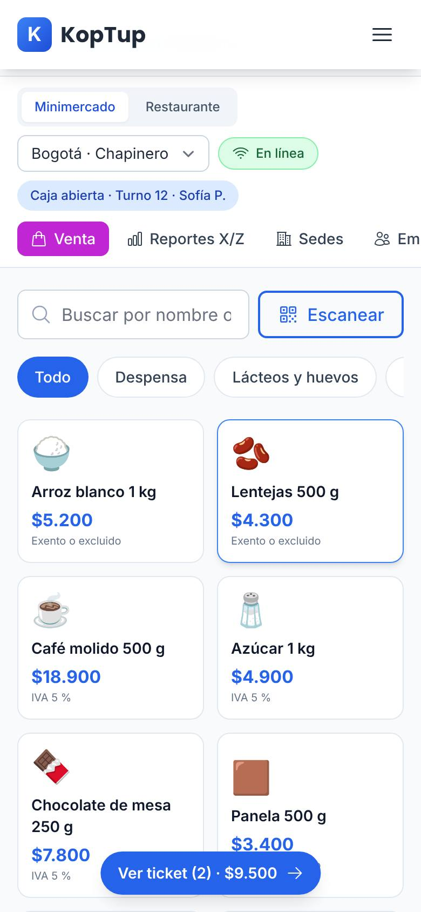

*La demo en un teléfono (390 px): la barra de la caja se apila, las pestañas se desplazan de lado y aparece el botón flotante «Ver ticket (2) · $9.500».*

En el teléfono el catálogo va en dos columnas y el ticket queda debajo; el botón flotante lleva hasta él. Los primeros pasos se desplazan de lado y la barra de la caja deja de ser fija. La página no se desborda a lo ancho, en claro ni en oscuro.

---

## Qué es real y qué es simulado

| Parte | Real o simulado | Detalle |
|---|---|---|
| Negocios, NIT, sedes, empleados, clientes, códigos de barras, existencias y cifras | **Datos de ejemplo** | Mercado La Ceiba y Fogón Andino son ficticios; sus NIT tienen dígito de verificación válido y los códigos de barras son EAN-13 válidos de uso interno. |
| Cálculos de la venta | **Real (en el navegador)** | Impuestos incluidos en el precio (IVA 19 %, IVA 5 %, exento, INC 8 %), puntos, cambio, propina, existencias por sede, pre-cuenta, reportes X y Z, arqueo, comisiones y consola de sedes. |
| Primeros pasos | **Real (en el navegador)** | Se marcan según lo que de verdad hiciste en la demo. |
| Lector de código de barras | **Real** | Funciona cualquier lector que escriba como teclado. |
| Balanza, datafono, QR, impresora térmica y cajón | **Simulados** | Avisos y lecturas fijas; el datafono y el QR devuelven un código inventado. |
| Impresión | **Real (navegador)** | **Imprimir** abre el diálogo de impresión del navegador con el recibo, la pre-cuenta o el reporte. |
| Documento equivalente POS, factura electrónica y nota crédito | **Simulados** | CUDE o CUFE calculado con SHA-384 en el navegador, en ambiente de pruebas; nada se envía a la DIAN y el documento dice «sin validez fiscal». La pre-cuenta dice que no es factura ni documento equivalente. |
| Sin internet y sincronización | **Simulados** | Es un interruptor de la demo; no corta tu conexión. |
| Envío del recibo por WhatsApp o correo | **Simulado** | Solo muestra a dónde se enviaría. |
| Otras cajas de cada sede | **Datos de ejemplo fijos** | Solo «Tu caja» suma lo que vendes. |
| Horas de turnos, entradas y comandas de ejemplo | **Relativas a la hora real** | Se calculan al abrir la demo con la hora de Colombia, sin quedar antes de la apertura de las 6:00 a. m.; documentos, cierres y marcaciones usan la hora real. |
| Dónde se guardan tus cambios | **Solo en este navegador** | `localStorage` del equipo; no llegan a un servidor ni los ven otras personas. La demo no llama al backend. Lo guardado otro día se descarta al abrirla (con el aviso «Empezó un día nuevo…»). |

---

## Acceso

**Cómo lo ve un visitante.** La demo es **Abierta**: en `/demo` su tarjeta tiene **Probar Demo** (abre `/demo/pos` directamente) y **Solicitar demo guiada** (`/solicitar-demo?demos=pos`). No hay pantalla de acceso ni hace falta cuenta. Dentro de la demo, el encabezado trae **Volver al catálogo de demos**, **Solicitar demo guiada** y **Cotizar tu POS** (`/contact?service=pos-retail`). Al final de la página está el bloque común «¿Te gustaría algo así para tu negocio?» con **Solicitar demo guiada**, **Solicitar Cotización** (`/contact`) y **Ver Planes y Precios** (`/services#planes-rag`).

**Cómo se solicita una demo guiada y cómo la gestiona el admin.** La solicitud del formulario llega a **Admin › Solicitudes de demo** como cualquier otra. Como la demo es abierta, no hace falta conceder acceso para usarla; la solicitud sirve para agendar la demo guiada. Un admin puede cambiar el modo de acceso en **Admin › Catálogo de demos** (por ejemplo, a «Con solicitud»); entonces empezaría a mostrarse la pantalla de acceso. Detalle en el [Manual del administrador](Doc-06-Manual-del-Administrador.md) y en [Flujos del visitante](Doc-04-Flujos-del-Visitante.md).

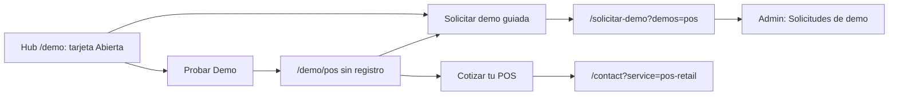

*Tres caminos: probarla de una vez, pedir una demo guiada o cotizar.*

---

## Limitaciones conocidas

1. **La tarjeta del catálogo todavía promete más que la demo** mientras no se cambien sus textos (son de otra pista): dice «Offline-first con CRDT sync y conflict resolution», «Multi-payment: efectivo, tarjeta, QR, wallets, BNPL, split», «facturación electrónica» y «hardware integrado». En la demo el modo sin internet es un interruptor simulado (no hay sincronización real ni manejo de conflictos), no hay pago a cuotas, los documentos son de ejemplo sin transmisión y solo el lector de código de barras funciona de verdad. Ya se propusieron textos nuevos para la tarjeta y para el producto POS retail.
2. **Los cambios viven solo en el navegador.** Otro equipo o navegador ve los datos de ejemplo; el vendedor no ve lo que hizo el prospecto. Las «otras cajas» de cada sede son cifras fijas, también a primera hora del día.
3. **Lo de otro día se borra.** Si vuelves a abrir la demo otro día (hora de Colombia), arranca con los datos de ejemplo de hoy y avisa «Empezó un día nuevo…».
4. **Entre la medianoche y las 6:00 a. m., los turnos de ejemplo empezaron la noche anterior.** Antes de la hora de apertura de las sedes de ejemplo, las horas de apertura y de entrada se calculan unas horas antes de la hora actual: si haces la demo a la 1 a. m., el turno aparece abierto desde las 9 p. m. Desde las 6:00 a. m. nadie aparece entrando antes de que abra la sede.
5. **En inglés, los nombres de productos, sedes y personas siguen en español**: son los datos de un negocio colombiano de ejemplo.
6. **«Ver Planes y Precios»** del bloque común al final de la página lleva a los planes RAG, no a los del POS (es un componente compartido de todas las demos).

Verificación: la sonda automática, con los datos de ejemplo limpios en cada carga, probó cada botón visible a 1440 px y a 390 px, en claro y oscuro y con el navegador en español (es-CO) y en inglés (en-US), sin errores de consola ni de hidratación. Solo marca como «sin efecto» lo que ya estaba elegido al abrir (Minimercado, Venta, la categoría Todo y los selectores de sede y asesor), que es lo esperado. Además se recorrieron a mano los cinco pasos, la factura con NIT, la anulación, el cierre Z, los traslados, el precio central, las marcaciones, el guardado al recargar, el aviso de día nuevo y Restablecer datos, en español y en inglés.
