# Guía de la demo: Plataforma SaaS multi-tenant

> Ruta `/demo/saas-boilerplate` · Modo de acceso: **Abierta** · Tipo: **datos de ejemplo** (todo corre en el navegador y se guarda en él; no llama al servidor) · Plan del producto: [Plataforma SaaS multi-tenant](Producto-saas-multi-tenant.md)

**Resumen.** Muestra cómo se vería un software convertido en un SaaS que cobra cada mes. El caso es ficticio: **ConjuntoDemo**, un software para administrar conjuntos residenciales que se vende por suscripción; cada conjunto es un cliente («tenant») con sus datos aislados. Tiene 6 pantallas que comparten el mismo estado: lo que haces en una (dar de alta un conjunto, cobrarle, invitar a su equipo, entrar como soporte) aparece en las demás, en la bitácora, en los webhooks y en la API de prueba. Está pensada para fundadores, casas de software y equipos de TI que quieren vender su producto por suscripción. Los cobros, correos, WhatsApp y el inicio de sesión con Google o Microsoft son simulados y lo dice en pantalla; el segundo factor (TOTP), las firmas HMAC de los webhooks y el CUFE de ejemplo sí se calculan de verdad en el navegador.

**En esta página:** [Recorrido sugerido](#recorrido-sugerido-demo-comercial-de-5-minutos) · [Pantallas y funciones](#pantallas-y-funciones) · [Datos de ejemplo](#datos-de-ejemplo) · [Qué es real y qué es simulado](#qué-es-real-y-qué-es-simulado) · [Acceso](#acceso) · [Limitaciones conocidas](#limitaciones-conocidas)

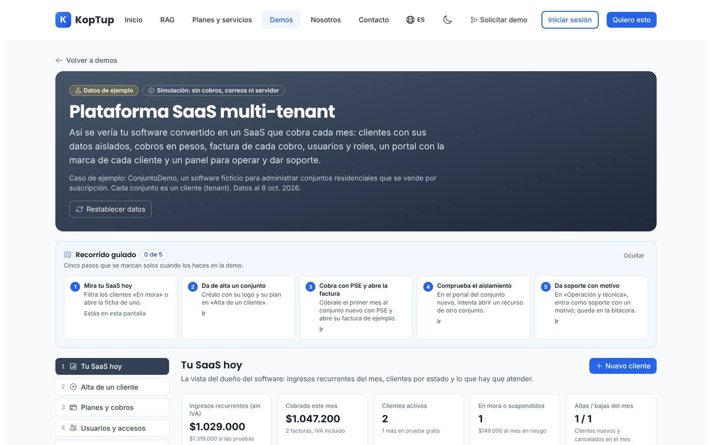

*Vista inicial: «Volver a demos», las insignias «Datos de ejemplo» y «Simulación: sin cobros, correos ni servidor», el caso de ejemplo con su fecha de corte (8 oct. 2026), «Restablecer datos», el recorrido guiado de 5 pasos y el menú de 6 pantallas.*

---

## Recorrido sugerido (demo comercial de 5 minutos)

La idea que vende: «tu software cobra solo: cada cliente con sus datos aislados, cobro en pesos con factura, soporte con trazabilidad». El **recorrido guiado** de arriba tiene 5 pasos que se marcan solos cuando el visitante los hace de verdad; al completarlos aparece el botón **Solicitar demo guiada** (abre `/solicitar-demo?demos=saas-boilerplate`). Los cambios se guardan en el navegador: al recargar siguen ahí, y **Restablecer datos** (con confirmación) vuelve a los datos de ejemplo.

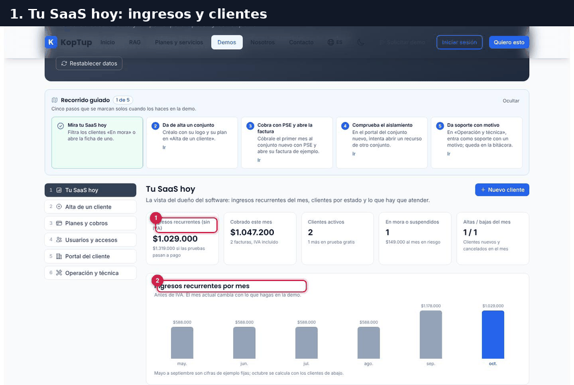

*Recorrido en 6 cuadros: panel del dueño, alta de un conjunto, cobro con PSE, factura de ejemplo, prueba de aislamiento y soporte con motivo.*

### Paso 1. Tu SaaS hoy

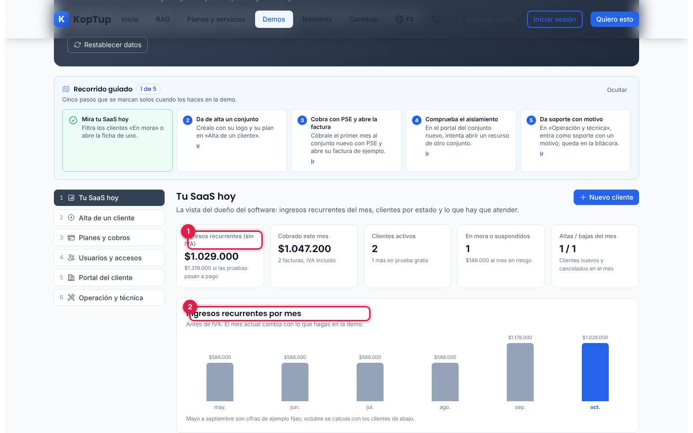

*Pantalla «Tu SaaS hoy» con el filtro «En mora» y la ficha de Edificio Mirador de Laureles abierta.*

1. **Indicadores del mes**: ingresos recurrentes sin IVA ($1.029.000, y $1.319.000 si la prueba gratis pasa a pago), cobrado este mes con IVA ($1.047.200 en 2 facturas), clientes activos (2, más 1 en prueba), en mora o suspendidos (1, $149.000 al mes en riesgo) y altas / bajas del mes (1 / 1). Todos se recalculan con lo que hagas.
2. **Ingresos recurrentes por mes**: mayo a septiembre son cifras fijas de ejemplo (coherentes con los clientes: $588.000 hasta agosto y $1.178.000 en septiembre, cuando entra Administraciones del Oriente); octubre se calcula en vivo.
3. **Filtros por estado** (Todos, Activo, En prueba, En mora, Suspendido, Cancelado) y un **buscador** por nombre, ciudad o subdominio.
4. **Exportar CSV**: descarga `clientes-2026-10.csv` con los clientes filtrados (NIT con dígito de verificación, subdominio, plan, unidades, usuarios del equipo, estado y valor mensual).
5. **Ficha de cada cliente** (clic en la fila): NIT, plan, cliente desde, contacto, uso del plan y botones **Ver su portal**, **Cobros**, **Usuarios** y **Cancelar suscripción** (pide confirmación; el conjunto pierde el acceso y sale de los ingresos recurrentes).

Qué decir: «Esto es lo que ve el dueño del software cada mañana: cuánto factura, quién está en prueba y quién no ha pagado».

### Paso 2. Alta de un conjunto

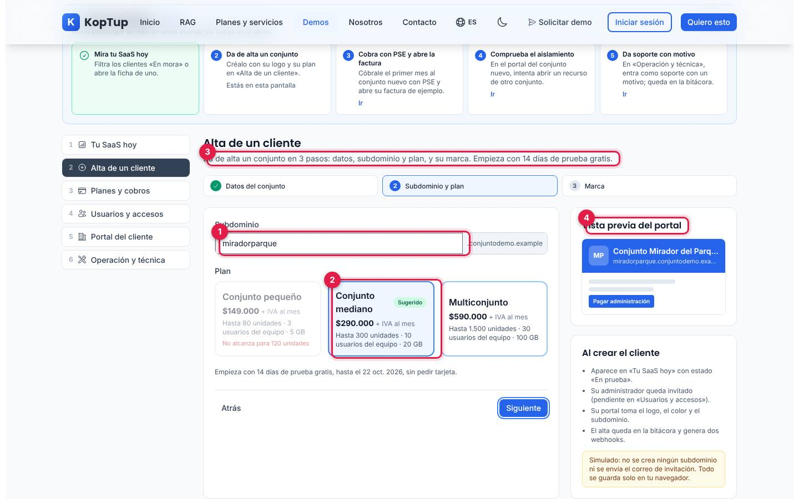

*Asistente «Alta de un cliente», paso 2, con el subdominio sugerido y el plan recomendado para 120 unidades.*

El asistente tiene 3 pasos con validaciones en cada uno:

- **Datos del conjunto**: nombre, ciudad (16 ciudades colombianas), NIT de 9 dígitos (calcula el dígito de verificación al vuelo con el método de la DIAN y rechaza un NIT que ya tenga otro cliente), correo del administrador y número de unidades (1 a 5.000).
1. **Subdominio**: se sugiere a partir del nombre (sin tildes ni palabras como «conjunto» o «torres») y se valida: formato, subdominios reservados (`www`, `api`, `admin`…) y ocupados.
2. **Plan**: el que no alcanza para las unidades queda deshabilitado y se marca el **Sugerido**.
3. **Prueba gratis** de 14 días, hasta el 22 oct. 2026, sin tarjeta.
4. **Vista previa del portal**, que cambia con el nombre, el color y el logo.
- **Marca**: 6 colores o uno propio y un logo (PNG, JPG, WebP o SVG de máximo 200 KB, que se queda en el navegador).

**Crear cliente** lo agrega «En prueba» al panel, deja invitado a su administrador, le crea 6 unidades de ejemplo y un comunicado de bienvenida, y registra la alta en la bitácora y dos webhooks (`tenant.created` y `member.invited`). No se crea ningún subdominio ni se envía el correo.

### Paso 3. Cobrar el primer mes con PSE y abrir la factura

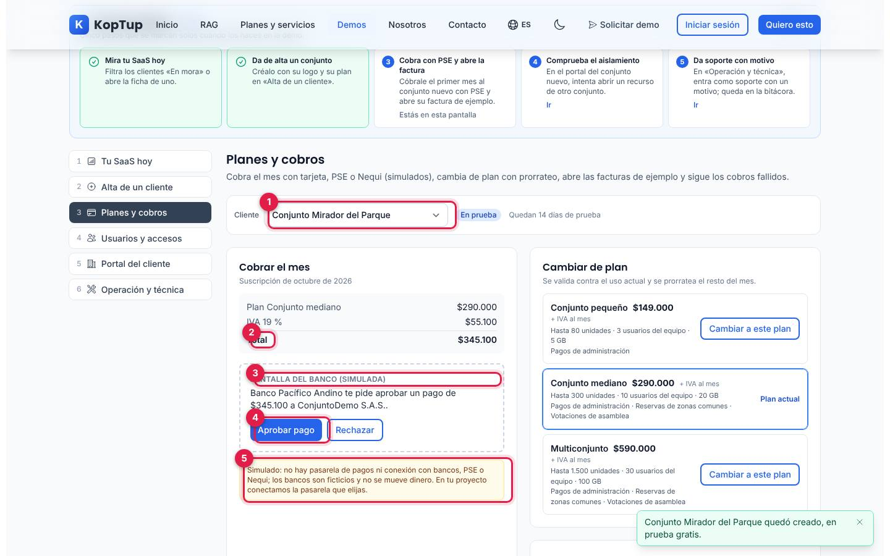

*«Planes y cobros» para el conjunto nuevo, en la pantalla del banco simulada de PSE.*

1. **Cliente** al que se le cobra (con su estado y los días de prueba que le quedan).
2. **Resumen del cobro**: plan, IVA del 19 % y total ($345.100 para el plan Conjunto mediano).
3. **Medio de pago** (Tarjeta, PSE o Nequi), cada uno con sus validaciones: tarjeta con Luhn, vencimiento y CVC (la 4242 4242 4242 4242 se aprueba y la 4000 0000 0000 0002 se rechaza); PSE con tipo de persona, banco (ficticio) y correo; Nequi con celular colombiano de 10 dígitos. PSE y Nequi muestran la **pantalla del banco** o la **notificación del celular** simuladas, con **Aprobar** o **Rechazar**.
4. **Aprobar pago** emite la factura de ejemplo y deja al cliente «Activo». Un rechazo no emite factura y queda en la bitácora.
5. La nota «Simulado» explica que no hay pasarela ni conexión con bancos, PSE o Nequi.

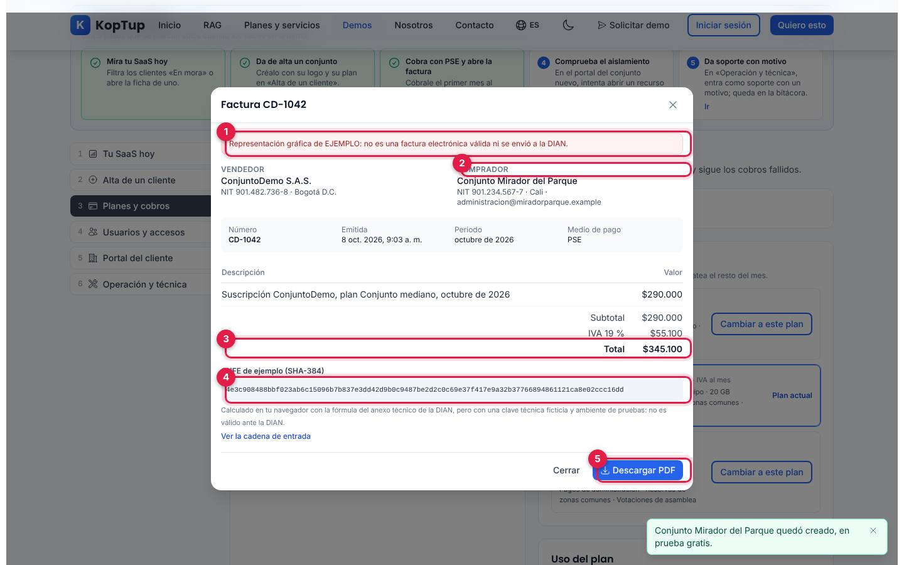

*Factura CD-1042 del conjunto nuevo (se abre con «Ver factura»; Escape o la X la cierran).*

1. **Aviso de ejemplo**: no es una factura electrónica válida ni se envió a la DIAN.
2. Vendedor (ConjuntoDemo S.A.S.) y comprador con NIT y dígito de verificación.
3. Subtotal, IVA y total.
4. **CUFE de ejemplo**: SHA-384 calculado en el navegador con la fórmula del anexo técnico, pero con una clave técnica ficticia y ambiente de pruebas; «Ver la cadena de entrada» muestra exactamente qué se firmó.
5. **Descargar PDF** genera `factura-ejemplo-CD-1042.pdf` en el navegador, con el mismo aviso.

Qué decir: «Cada cobro genera su factura; en tu proyecto la emite tu proveedor tecnológico autorizado».

### Paso 4. El portal del conjunto y el aislamiento

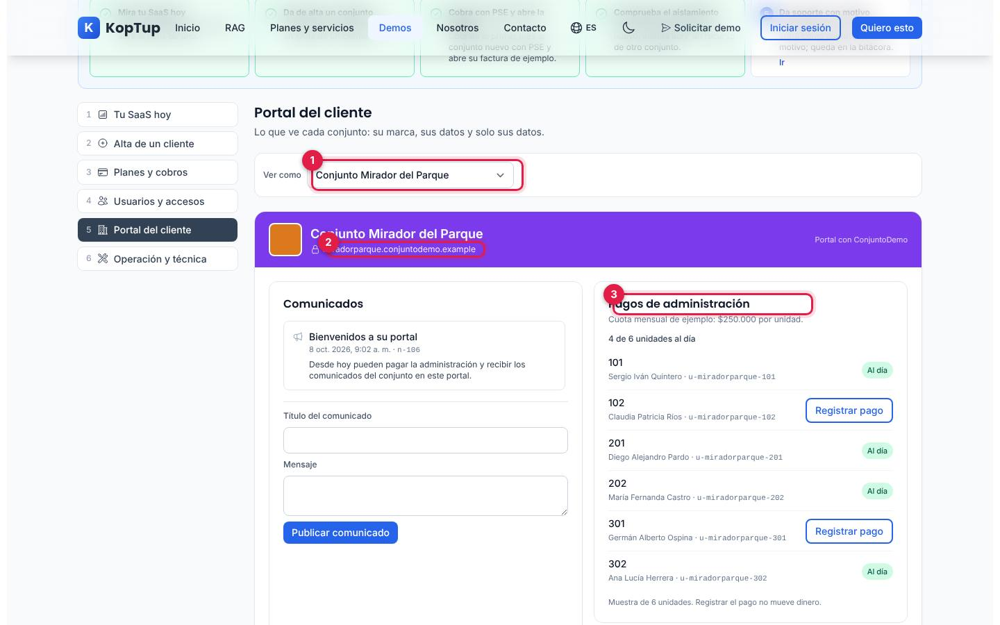

*Portal del conjunto nuevo con su color, su logo y su subdominio.*

1. **Ver como**: el portal de cualquier cliente activo.
2. **Marca** del conjunto (color, logo y subdominio); el texto se vuelve oscuro si el color es claro.
3. **Módulos** según el plan y lo que active el dueño: comunicados (con formulario para publicar), pagos de administración (6 unidades de ejemplo; **Registrar pago** las deja al día), reservas de zonas comunes (rechaza fechas pasadas y una zona ya reservada ese día) y votación de asamblea (un voto por conjunto y navegador). Si un módulo no está en el plan o está apagado, lo dice. Un conjunto suspendido ve «Portal suspendido» con **Ir a cobrar**.

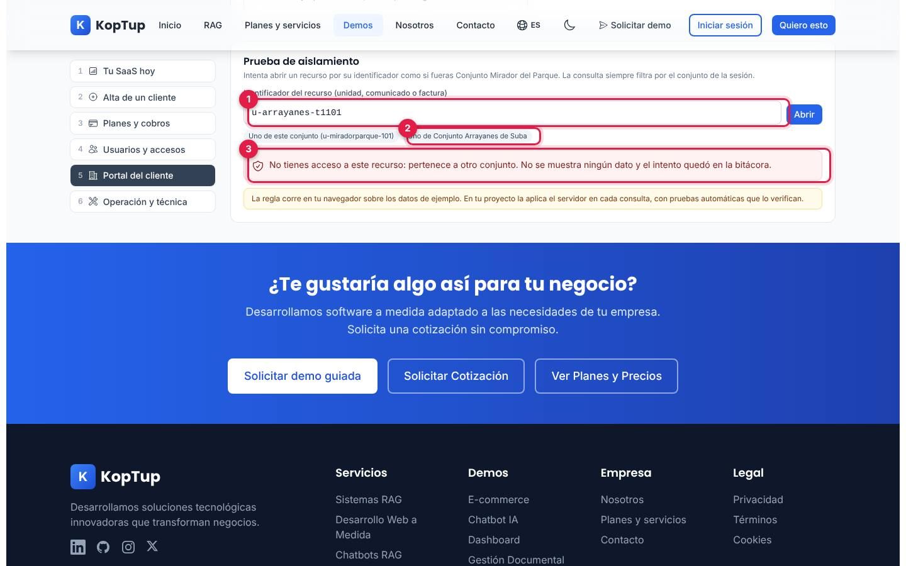

*Prueba de aislamiento: un recurso de otro conjunto se rechaza.*

1. **Identificador del recurso**: una unidad, un comunicado o una factura.
2. Atajos con un recurso **de este conjunto** y uno **de otro conjunto**.
3. Resultado: «Encontrado en este conjunto», «No tienes acceso a este recurso» (sin mostrar ningún dato y con registro en la bitácora) o «No existe». La regla corre en el navegador; en el proyecto la aplica el servidor en cada consulta.

### Paso 5. Soporte con motivo y bitácora

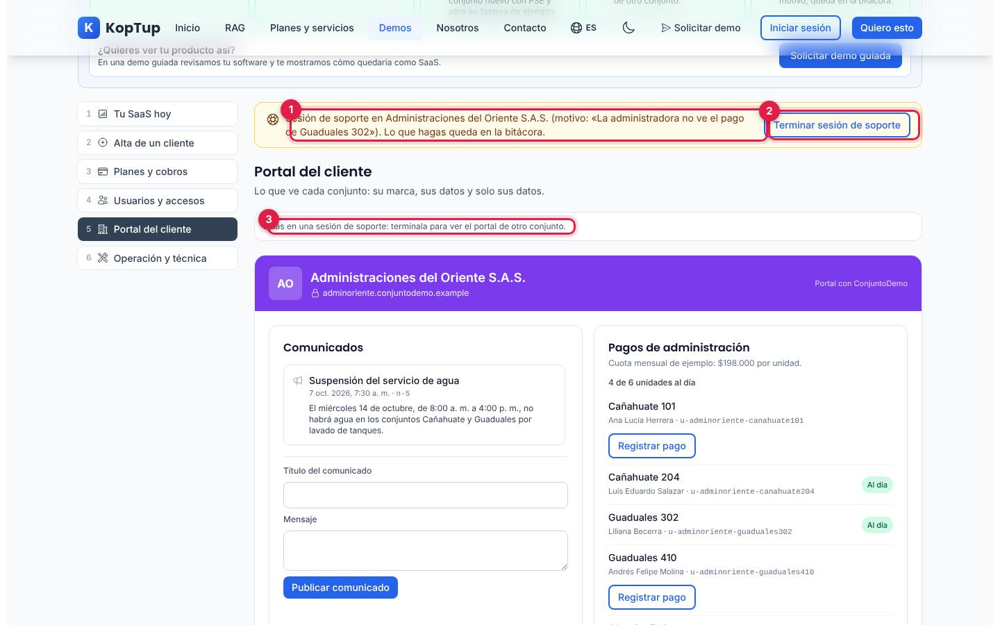

*Sesión de soporte en Administraciones del Oriente, abierta desde «Operación y técnica».*

En **Operación y técnica › Soporte con suplantación** se elige el cliente y se escribe el **motivo** (obligatorio, mínimo 10 caracteres). **Entrar como soporte** abre su portal con:

1. Un **aviso** fijo con el cliente y el motivo.
2. **Terminar sesión de soporte**, que también queda en la bitácora.
3. El selector «Ver como» bloqueado mientras dure la sesión.

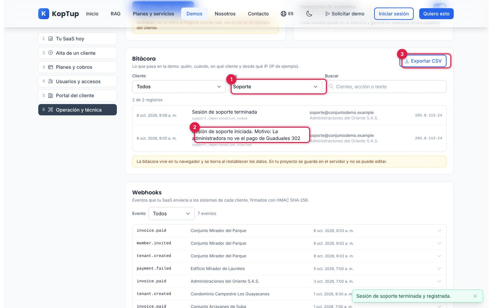

*Bitácora filtrada por el tipo «Soporte».*

1. **Filtros** por cliente (o «Plataforma»), por tipo (clientes y planes, cobros, usuarios, inicio de sesión, soporte, portal y API) y **buscador**.
2. Cada registro dice qué pasó, quién, en qué cliente, cuándo y desde qué IP (de ejemplo).
3. **Exportar CSV** descarga `bitacora-2026-10.csv` con lo filtrado.

Qué decir: «Tu equipo ve lo que ve el cliente, pero siempre con motivo y con rastro».

---

## Pantallas y funciones

Las 6 pantallas comparten un solo estado guardado en el navegador (`localStorage`). En escritorio el menú va a la izquierda y se queda visible al bajar; en el celular va en una cuadrícula arriba del contenido.

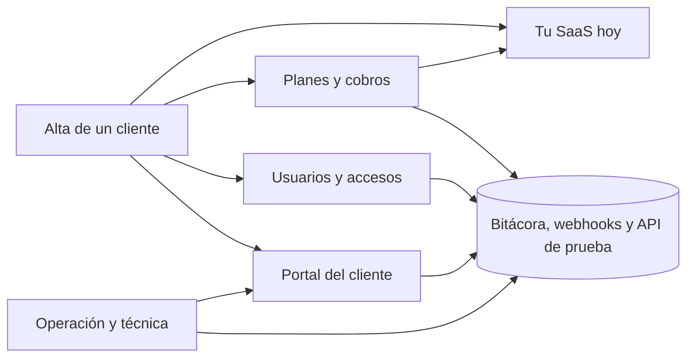

*Lo que se hace en una pantalla aparece en las demás y queda en la bitácora, los webhooks y la API de prueba. Nada sale del navegador.*

### 1. Tu SaaS hoy

Ver el [paso 1](#paso-1-tu-saas-hoy). El botón **Nuevo cliente** lleva al asistente.

### 2. Alta de un cliente

Ver el [paso 2](#paso-2-alta-de-un-conjunto). Al terminar ofrece **Cobrarle el primer mes**, **Ver su portal**, **Ir a «Tu SaaS hoy»** y **Dar de alta otro**.

### 3. Planes y cobros

Además del cobro y la factura del [paso 3](#paso-3-cobrar-el-primer-mes-con-pse-y-abrir-la-factura):

- **Cambiar de plan**: valida el uso actual (unidades, usuarios del equipo y almacenamiento) y el estado (no se cambia en mora, suspendido ni cancelado). Subir de plan cobra la diferencia prorrateada del resto del mes en una **factura de ajuste** (por ejemplo, Arrayanes de Conjunto mediano a Multiconjunto: 24 días, $232.258 + IVA = $276.387); bajar deja **saldo a favor** que se descuenta del próximo cobro; durante la prueba el cambio no cuesta nada.
- **Uso del plan** con barras que avisan cerca del límite.
- **Facturas del cliente** con **Ver factura** en cada una.

| Plan | Precio de ejemplo | Límites | Módulos del portal |
|---|---|---|---|
| Conjunto pequeño | $149.000 + IVA al mes | 80 unidades, 3 usuarios del equipo, 5 GB | Pagos de administración |
| Conjunto mediano | $290.000 + IVA al mes | 300 unidades, 10 usuarios del equipo, 20 GB | Pagos, reservas y votaciones |
| Multiconjunto | $590.000 + IVA al mes | 1.500 unidades, 30 usuarios del equipo, 100 GB | Pagos, reservas y votaciones |

*Precios del SaaS ficticio ConjuntoDemo, no de KopTup.*

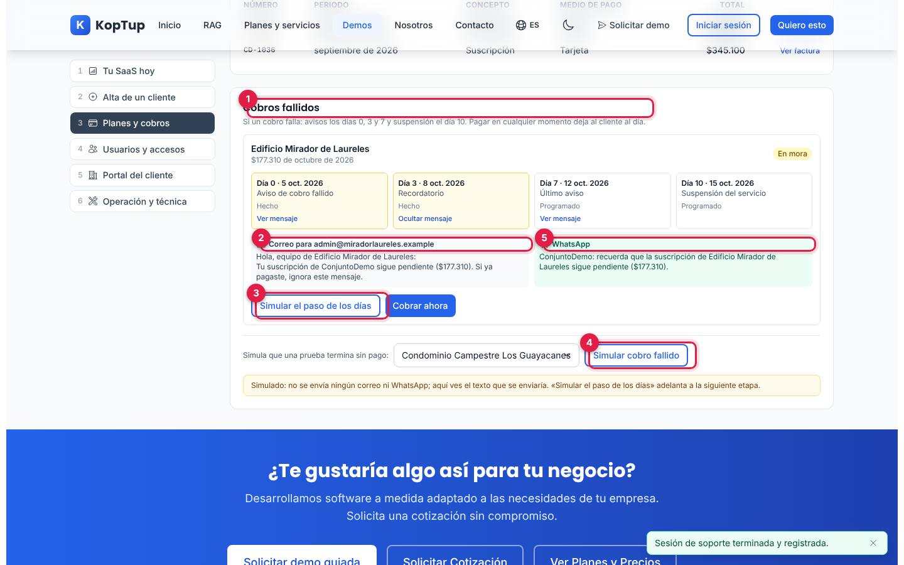

*Cobros fallidos de Edificio Mirador de Laureles con el recordatorio del día 3 abierto.*

1. **Cobros fallidos**: avisos los días 0, 3 y 7 y suspensión el día 10, con su fecha y si ya se hizo o está programado.
2. **Ver mensaje** muestra el correo que se enviaría…
3. …**Simular el paso de los días** adelanta a la siguiente etapa (en el día 10 el cliente pasa a «Suspendido» y su portal y su API se bloquean); **Cobrar ahora** lleva al cobro de ese cliente, y pagar lo deja al día.
4. **Simular cobro fallido**: hace que una prueba gratis termine sin pago y arranque el proceso.
5. …y el WhatsApp. No se envía nada.

### 4. Usuarios y accesos

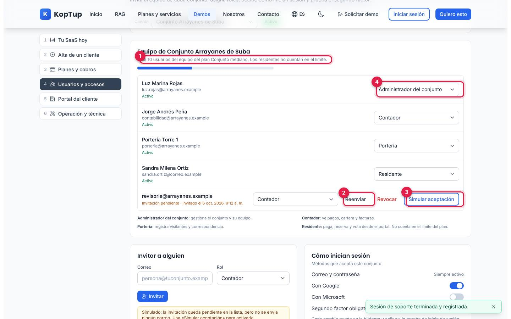

*Equipo de Conjunto Arrayanes de Suba.*

1. **Usuarios del equipo** frente al límite del plan (los residentes no cuentan).
2. **Reenviar** una invitación pendiente (cuenta los reenvíos) y **Revocar** (pide confirmación).
3. **Simular aceptación**: pide el nombre y deja al usuario «Activo».
4. **Rol** de cada persona: Administrador del conjunto, Contador, Portería o Residente. Se valida que quede al menos un administrador activo y el límite del plan.

Debajo, **Invitar a alguien** (correo válido, sin duplicados, respeta el límite del plan y rechaza conjuntos suspendidos).

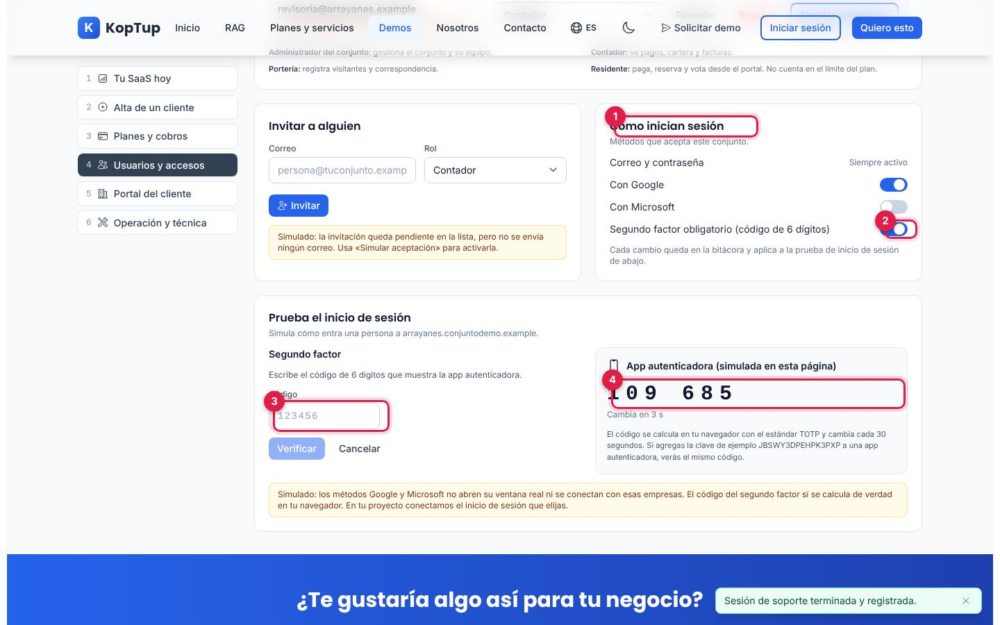

*Prueba de inicio de sesión con el segundo factor activo.*

1. **Cómo inician sesión**: correo y contraseña (siempre), Google, Microsoft y **segundo factor obligatorio**; cada cambio queda en la bitácora.
2. Interruptor del segundo factor.
3. **Prueba el inicio de sesión**: correo (con atajos a un usuario del conjunto y a uno de otro conjunto), método y contraseña (la demo acepta cualquiera de 8 o más caracteres). Rechaza a quien no pertenece al conjunto, una invitación sin aceptar, un método apagado y un conjunto suspendido; si el segundo factor está activo, pide el código de 6 dígitos.
4. **App autenticadora** simulada en la página: el código TOTP se calcula de verdad (estándar RFC 6238, cambia cada 30 s). Con la clave de ejemplo `JBSWY3DPEHPK3PXP` en una app autenticadora real se ve el mismo código. Un código errado o vencido se rechaza.

Google y Microsoft no abren su ventana real: la demo simula su respuesta, y lo dice.

### 5. Portal del cliente

Ver el [paso 4](#paso-4-el-portal-del-conjunto-y-el-aislamiento).

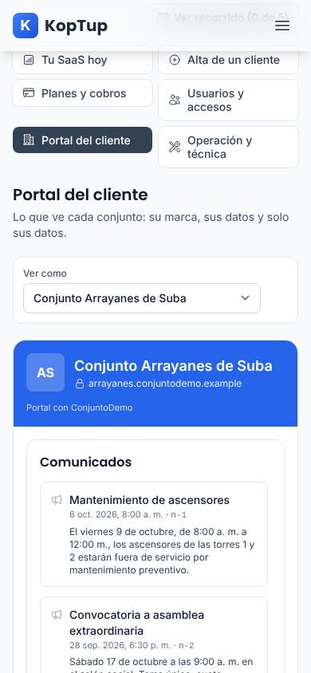

*Portal de Conjunto Arrayanes de Suba en un teléfono (390 px).*

### 6. Operación y técnica

Además del soporte y la bitácora del [paso 5](#paso-5-soporte-con-motivo-y-bitácora):

- **Módulos por cliente**: interruptores de pagos, reservas y votaciones; los que el plan no incluye quedan deshabilitados con el plan desde el que están. El portal cambia al instante y cada cambio genera un webhook `tenant.updated`.

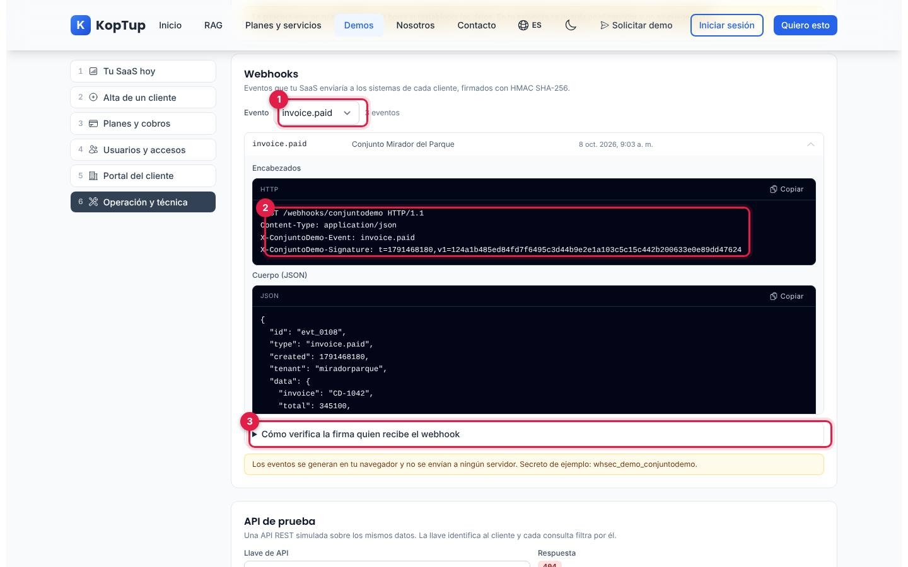

*Webhook `invoice.paid` del conjunto nuevo con su firma.*

1. **Webhooks** generados por lo que pasa en la demo, con filtro por evento.
2. Encabezados y cuerpo JSON de cada evento, con la firma `X-ConjuntoDemo-Signature: t=…,v1=…` (HMAC SHA-256 de «timestamp.cuerpo» con el secreto de ejemplo, calculada en el navegador). Los bloques de código tienen **Copiar**.
3. **Cómo verifica la firma quien recibe el webhook**: ejemplo en Node.js.

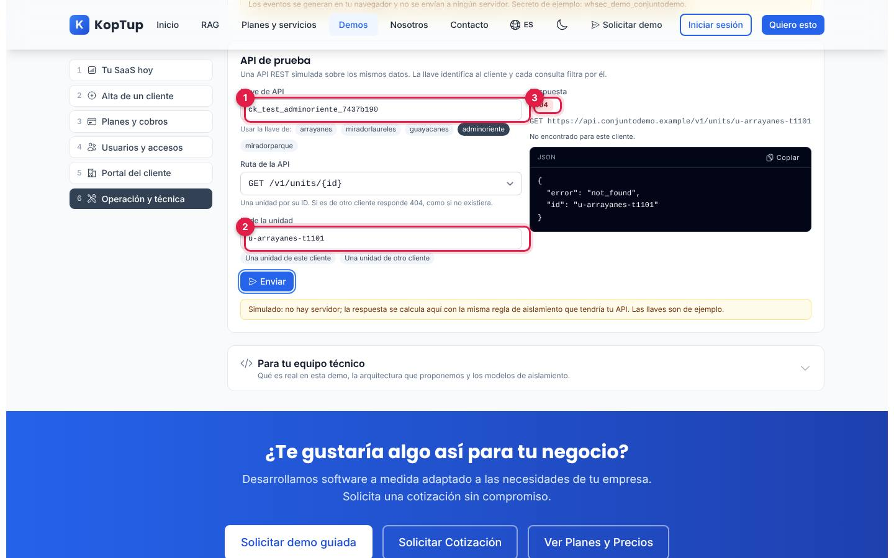

*API de prueba: la llave de Administraciones del Oriente pide una unidad de Arrayanes y recibe 404.*

1. **Llave de API** de ejemplo (con atajos para la de cada cliente).
2. Ruta (`GET /v1/tenant`, `/v1/units`, `/v1/units/{id}`, `/v1/invoices`, `/v1/notices` y `POST /v1/notices`) y sus datos.
3. **Respuesta** con su código: 200, 201 (el comunicado aparece en el portal), 400 (JSON inválido), 401 (llave inválida), 402 (cliente suspendido), 404 (no existe para ese cliente, aunque exista en otro) y 422 (falta el título). Cada llamada queda en la bitácora.

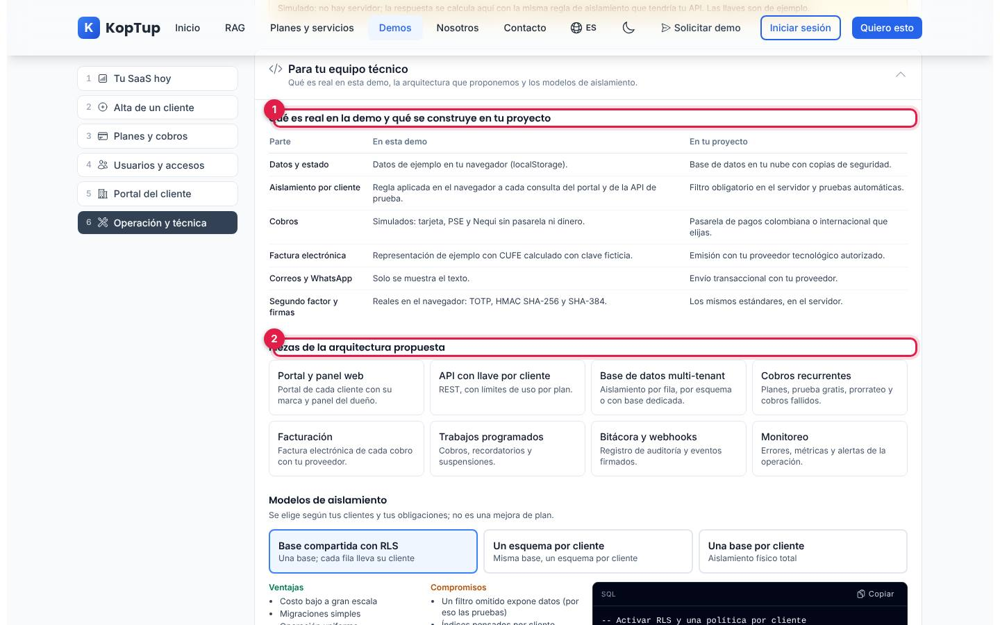

*Sección plegable «Para tu equipo técnico».*

1. **Qué es real en la demo y qué se construye en tu proyecto** (tabla).
2. **Piezas de la arquitectura propuesta**. Debajo, los **modelos de aislamiento** (base compartida con RLS, un esquema por cliente o una base por cliente) con ventajas, compromisos y un fragmento de código de cada uno, y la **localización para Colombia** (pesos sin decimales e IVA, fecha y zona horaria America/Bogota, NIT con dígito de verificación y medios de pago).

### En inglés y en modo oscuro

Todos los textos existen en español (con «tú») y en inglés, y la demo se ve bien en modo claro y oscuro, en 1440 px y en 390 px.

---

## Datos de ejemplo

Fecha de corte: **8 oct. 2026**. Todo es ficticio: empresas, personas, NIT, correos (dominio reservado `.example`) e IP (rangos de documentación).

| Cliente | Ciudad | NIT | Plan | Estado inicial | Unidades |
|---|---|---|---|---|---|
| Conjunto Arrayanes de Suba | Bogotá D.C. | 900.731.245-9 | Conjunto mediano | Activo | 240 |
| Edificio Mirador de Laureles | Medellín | 901.118.342-0 | Conjunto pequeño | En mora (aviso del día 3 enviado) | 64 |
| Condominio Campestre Los Guayacanes | El Retiro | 901.602.587-3 | Conjunto mediano | En prueba hasta el 15 oct. | 96 |
| Administraciones del Oriente S.A.S. | Floridablanca | 900.984.421-4 | Multiconjunto | Activo | 1.120 |
| Edificio Palmas del Norte | Barranquilla | 901.276.650-0 | Conjunto pequeño | Cancelado el 2 oct. | 48 |

El vendedor es ConjuntoDemo S.A.S. (NIT 901.482.736-8, Bogotá). Hay 6 facturas de septiembre y octubre (CD-1036 a CD-1041), 9 registros de bitácora y 4 webhooks iniciales, 6 unidades por conjunto (2 pendientes de pago) y comunicados, reservas y votaciones coherentes con esas fechas.

---

## Qué es real y qué es simulado

| Parte | Real o simulado | Detalle |
|---|---|---|
| Estado compartido entre pantallas | **Real, en el navegador** | Altas, cobros, facturas, usuarios, módulos, comunicados, reservas, votos y bitácora se guardan en `localStorage` (`demo:saas-boilerplate:v1`) y sobreviven a la recarga. |
| Reglas de negocio | **Reales** | Prorrateo, límites del plan, etapas de cobro fallido, validaciones de NIT (DV), tarjeta (Luhn), celular y subdominio, y aislamiento por cliente en el portal y en la API de prueba. |
| Segundo factor (TOTP), firmas de webhooks (HMAC SHA-256) y CUFE (SHA-384) | **Reales, en el navegador** | Con Web Crypto. El CUFE usa una clave técnica ficticia: no es válido ante la DIAN. |
| Exportaciones | **Reales** | CSV de clientes y de bitácora y PDF de cada factura, generados en el navegador. |
| Cobros (tarjeta, PSE, Nequi) | **Simulados** | Sin pasarela, sin bancos (los de la lista son ficticios) y sin dinero. |
| Factura electrónica | **Simulada** | Representación gráfica de ejemplo; no se envía a la DIAN. |
| Correos y WhatsApp | **Simulados** | Solo se muestra el texto que se enviaría. |
| Inicio con Google o Microsoft | **Simulado** | No se abre su ventana ni se conecta con esas empresas. |
| Soporte con suplantación | **Simulado** | Muestra el portal de ejemplo del cliente; no entra a ninguna cuenta. |
| API y webhooks | **Simulados** | La API responde en el navegador; los webhooks no se envían a ningún servidor. |
| Servidor | **No se usa** | En el repositorio hay un módulo de backend `modules/saas-platform` que no está montado ni lo usa esta demo. |

---

## Acceso

- **Cómo la ve un visitante:** la demo está en modo **Abierta** (`publico`): cualquiera entra a `/demo/saas-boilerplate` sin cuenta y sin pantalla de acceso. En el hub `/demo` aparece así:

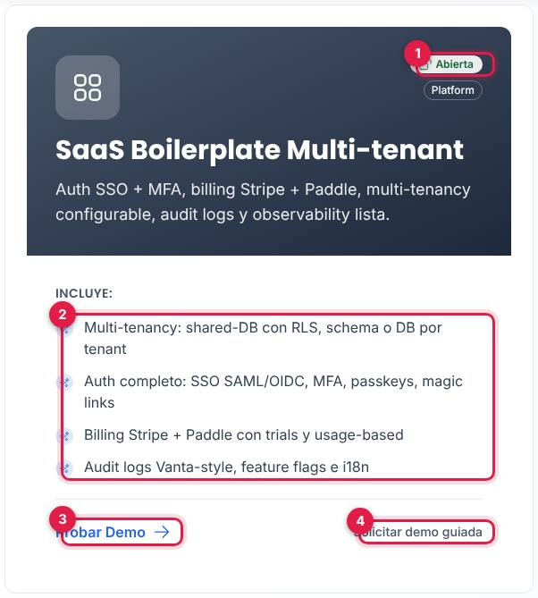

*Tarjeta del hub, vista por un visitante sin sesión. Sus textos todavía describen la versión anterior (ver la [limitación 4](#limitaciones-conocidas)).*

1. Insignia **Abierta** (junto a «Platform»).
2. Lo que **Incluye** según la tarjeta.
3. **Probar Demo** abre `/demo/saas-boilerplate`.
4. **Solicitar demo guiada** abre `/solicitar-demo?demos=saas-boilerplate`.

- **Cómo se solicita:** no hace falta solicitarla. Quien quiera ver su propio producto así usa **Solicitar demo guiada** (en la tarjeta, al completar el recorrido guiado o en el bloque azul al final de la demo, que también ofrece **Solicitar Cotización** y **Ver Planes y Precios**).
- **Cómo la controla el admin:** el modo sale del catálogo del servidor (allí se llama «Plataforma SaaS multiempresa») y se cambia en **Admin › Catálogo de demos** (`/admin/catalogo-demos`). Si se pasa a «Con solicitud» o «Solo por invitación», los visitantes verán la pantalla de acceso y los accesos se conceden en **Admin › Solicitudes de demo** y **Admin › Accesos a demos**; si se desactiva, el visitante ve que la demo está en mantenimiento y el equipo sigue entrando. Si el backend no responde, la demo sigue abierta porque así está en la tabla de respaldo. Detalle en el [Manual del administrador](Doc-06-Manual-del-Administrador.md) y en [Flujos del visitante](Doc-04-Flujos-del-Visitante.md).

---

## Limitaciones conocidas

Quedan solo las que son por diseño o están fuera de la demo:

1. **Todo vive en el navegador.** Es una demo sin servidor: los datos se guardan en `localStorage` de ese navegador (otro navegador o una ventana privada empiezan desde cero) y no hay pasarela, correo, WhatsApp, inicio de sesión real ni envío a la DIAN. Cada simulación lo dice en pantalla.
2. **Fecha de corte fija.** Los datos están al 8 oct. 2026 y no avanzan con el calendario; la bitácora usa un reloj de la demo que avanza un minuto por acción, y «Simular el paso de los días» solo adelanta los cobros fallidos.
3. **Simplificaciones de ejemplo.** El portal muestra 6 unidades por conjunto; la votación admite un voto por conjunto y navegador; la contraseña de la prueba de inicio de sesión no se compara con nada (cualquiera de 8 o más caracteres); el formato del campo de fecha de las reservas lo pone el navegador.
4. **La tarjeta del hub, el catálogo y la metadata aún describen la versión anterior** («SaaS Boilerplate Multi-tenant», «Auth completo», «Billing Stripe + Paddle», «Audit logs Vanta-style», «lista para producción»). El cambio de esos textos está pedido fuera de la demo; mientras tanto la demo tiene tres nombres: el del hub, «Plataforma SaaS multi-tenant» en la página y en el plan, y «Plataforma SaaS multiempresa» en el catálogo del admin.
5. **«Ver Planes y Precios»** del bloque final (común a todas las demos) lleva a `/services#planes-rag`, los planes RAG.
6. **Sin personalización por prospecto.** La versión con el nombre, el logo y el sector del prospecto que propone el [plan del producto](Producto-saas-multi-tenant.md) no existe todavía.
