# Guía de la demo: Sistema experto de auditoría médica

> Ruta `/demo/sistema-experto` · Modo de acceso: **Solo por invitación** · Tipo: **backend real + datos de ejemplo** (el simulador corre en el navegador) · Plan del producto: [Motor de reglas del auditor](Demo-sistema-experto.md)

**Resumen.** Es el motor de reglas que propone glosas en la auditoría de cuentas médicas. Muestra el estado real del servidor, deja activar o desactivar las 8 reglas y ajustar la tolerancia de tarifa, simula el efecto de esos cambios sobre un lote de 12 facturas de ejemplo antes de guardarlos y busca códigos CUPS. Está pensada para coordinadores de auditoría de cuentas médicas en EPS, firmas auditoras e IPS. Se llama igual en el hub, en la pantalla de acceso y dentro de la demo: **«Sistema experto de auditoría médica»**. Solo la abren las personas que invita un administrador y el equipo de KopTup.

**En esta página:** [Recorrido sugerido](#recorrido-sugerido-demo-comercial-de-5-minutos) · [Pantallas y funciones](#pantallas-y-funciones) · [Qué es real y qué es simulado](#qué-es-real-y-qué-es-simulado) · [Acceso](#acceso) · [Limitaciones conocidas](#limitaciones-conocidas)

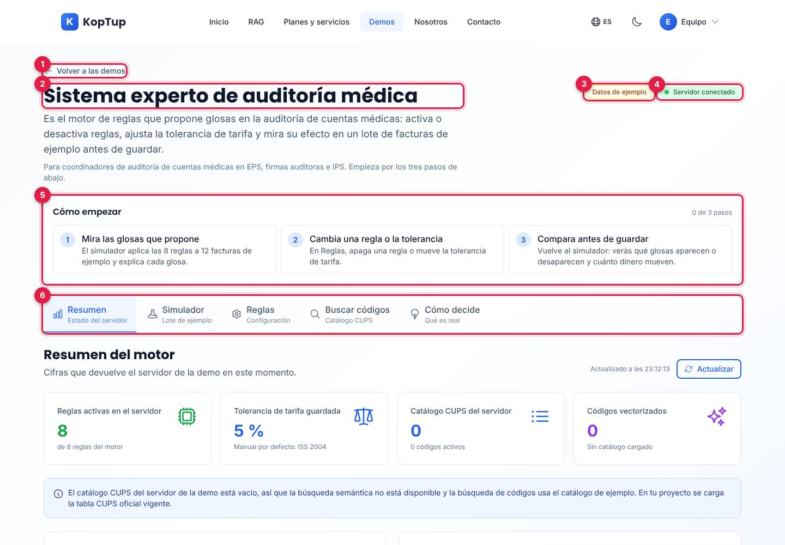

*Encabezado de la demo: (1) volver al catálogo de demos, (2) nombre, (3) insignia «Datos de ejemplo», (4) estado real del servidor, (5) «Cómo empezar» con los tres primeros pasos y (6) las cinco pestañas.*

---

## Recorrido sugerido (demo comercial de 5 minutos)

La idea que vende: «tus reglas de auditoría, explicadas y probadas antes de activarlas». Los pasos 1 a 4 los puede hacer cualquier persona con acceso; el paso 5 (guardar en el servidor) solo lo hace el equipo de KopTup, porque la configuración del servidor es **una sola y compartida**: al terminar, pulsa **Valores por defecto** y **Guardar en el servidor** para dejarla como estaba.

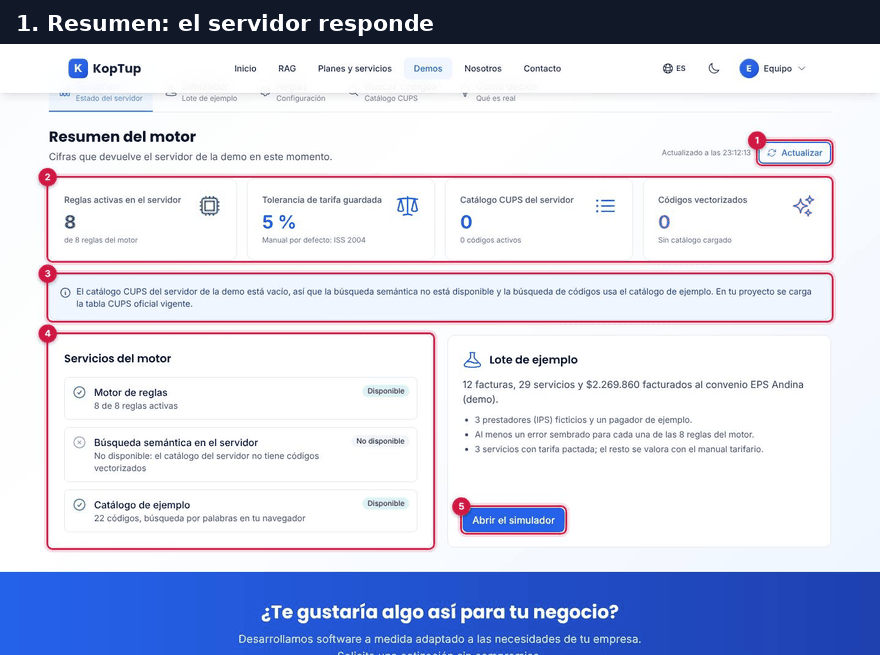

*Recorrido completo en 6 pasos: resumen, simulador, reglas, efecto de los cambios, guardado y búsqueda de códigos.*

### Paso 1. Resumen: el servidor responde

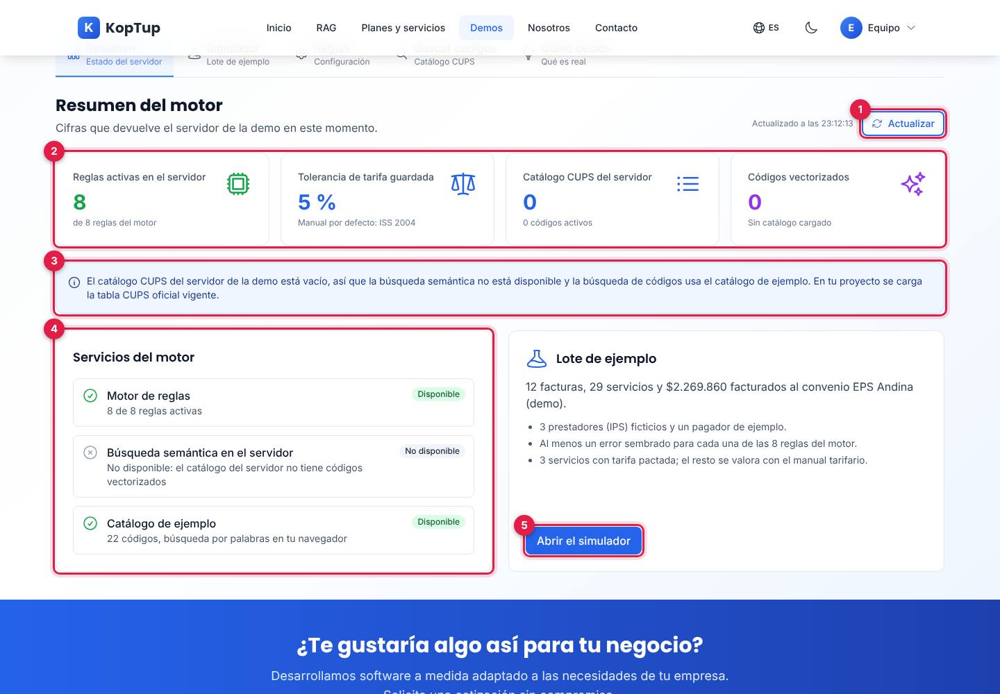

*Pestaña Resumen con las cifras que devuelve el servidor y el lote de ejemplo.*

1. **Actualizar** vuelve a consultar el servidor y muestra la hora de la última lectura.
2. **Cifras del servidor**: reglas activas (8 de 8), tolerancia de tarifa guardada (5 %, con el manual por defecto), catálogo CUPS del servidor y códigos vectorizados.
3. **Aviso de catálogo vacío**: si el catálogo CUPS del servidor no tiene códigos, lo dice y explica que la búsqueda usa el catálogo de ejemplo.
4. **Servicios del motor**: qué está disponible (motor de reglas, búsqueda semántica en el servidor, catálogo de ejemplo).
5. **Abrir el simulador**: el lote de ejemplo tiene 12 facturas, 29 servicios y $2.269.860 facturados al convenio ficticio «EPS Andina (demo)».

Qué decir: «Esto es lo que hay hoy en el servidor; nada de este tablero es una cifra inventada».

### Paso 2. Simulador con la configuración guardada

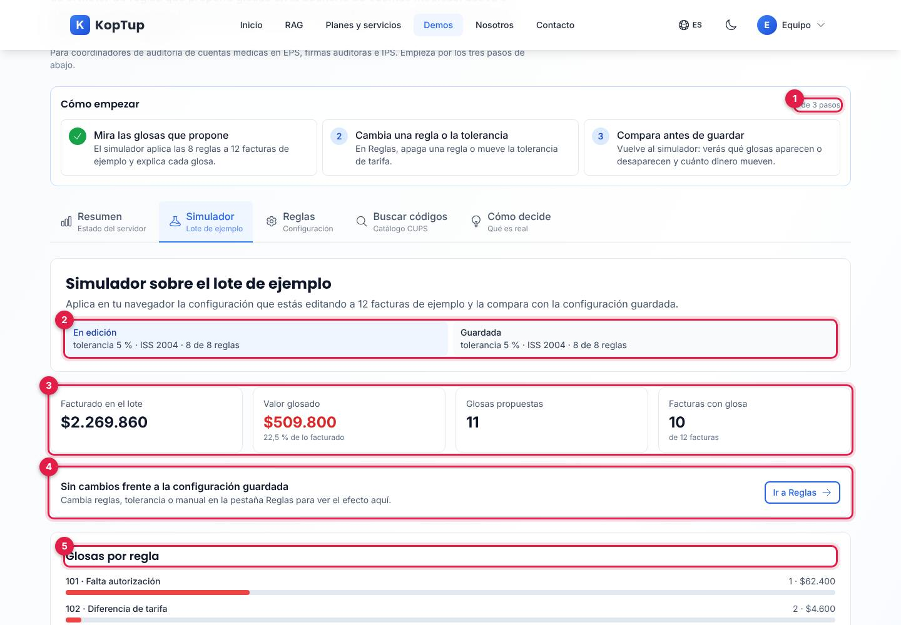

*El simulador aplica la configuración guardada al lote de ejemplo.*

1. **Cómo empezar** marca el primer paso como hecho (1 de 3 pasos).
2. **En edición / Guardada**: la configuración que estás editando y la que tiene el servidor (tolerancia, manual tarifario y reglas activas).
3. **Resultado**: facturado en el lote, valor glosado ($509.800, 22,5 %), glosas propuestas (11) y facturas con glosa (10 de 12).
4. **Sin cambios**: mientras no edites nada, lo dice y ofrece **Ir a Reglas**.
5. **Glosas por regla**: cuántas glosas y cuánto valor aporta cada una de las 8 reglas.

Qué decir: «Cada glosa sale de una regla explícita; la IA no decide glosas».

### Paso 3. Cambia reglas y tolerancia

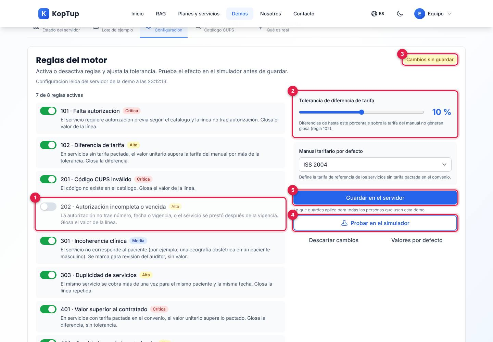

*Pestaña Reglas: se apagó la regla 202 y se subió la tolerancia al 10 %.*

1. **Interruptor de la regla 202** (Autorización incompleta o vencida), apagado. Cada regla muestra su severidad (Crítica, Alta, Media) y qué condición evalúa.
2. **Tolerancia de diferencia de tarifa**: deslizador de 0 a 20 %; en el ejemplo, 10 %.
3. **Cambios sin guardar**: la insignia avisa que hay diferencias con lo guardado.
4. **Probar en el simulador**: lleva al simulador con estos cambios, sin guardarlos.
5. **Guardar en el servidor**: guarda la configuración (solo se activa si hay cambios y la cuenta es del equipo). Debajo, la nota «Lo que guardes aplica para todas las personas que usan esta demo»; un prospecto ve en su lugar el aviso de la [captura del paso 5](#paso-5-guarda-en-el-servidor-solo-el-equipo).

El borrador (lo que editas aquí) se conserva en el navegador: si recargas la página, sigue ahí hasta que lo guardes o pulses **Descartar cambios**.

### Paso 4. Mira el efecto antes de guardar

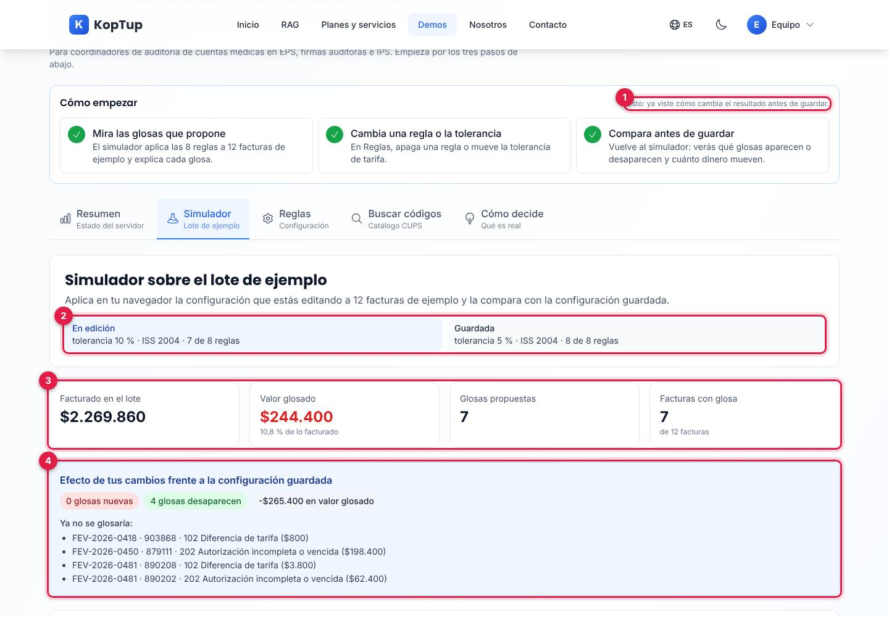

*El simulador compara la configuración en edición con la guardada.*

1. **Cómo empezar** queda completo: «Listo: ya viste cómo cambia el resultado antes de guardar».
2. **En edición**: tolerancia 10 %, 7 de 8 reglas; **Guardada**: tolerancia 5 %, 8 de 8.
3. **Nuevo resultado**: valor glosado $244.400 (10,8 %), 7 glosas, 7 facturas con glosa.
4. **Efecto de tus cambios**: 0 glosas nuevas, 4 glosas desaparecen, −$265.400 en valor glosado, y la lista «Ya no se glosaría» con factura, código, regla y valor.

Qué decir: «Antes de activar una regla ves cuánto dinero mueve y en qué facturas».

### Paso 5. Guarda en el servidor (solo el equipo)

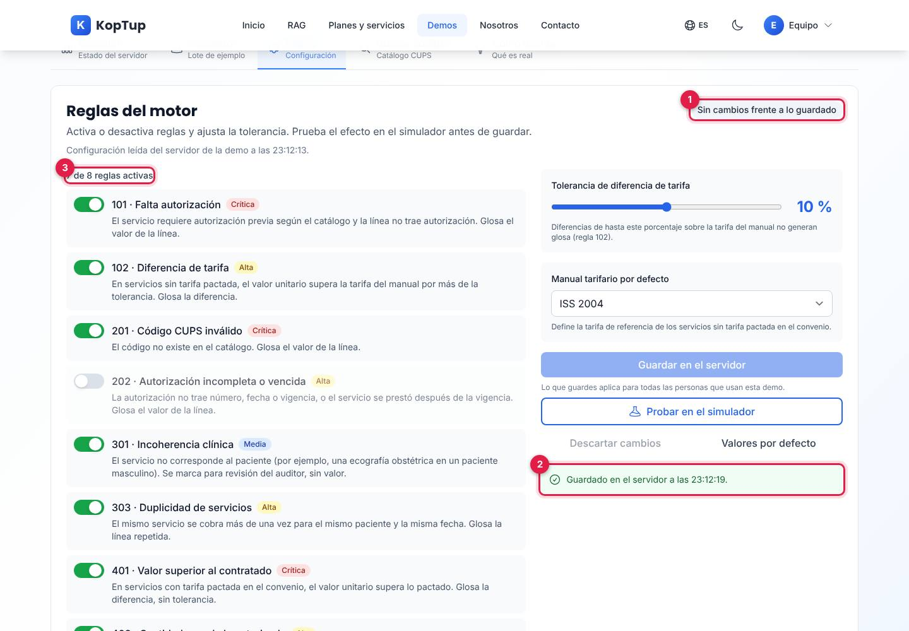

*Cuenta del equipo: después de guardar, la configuración en edición y la guardada coinciden.*

1. La insignia vuelve a **Sin cambios frente a lo guardado**.
2. **Guardado en el servidor a las …** confirma el guardado.
3. **7 de 8 reglas activas**: ahora es la configuración del servidor para todas las personas que usan la demo.

Después de mostrarlo, pulsa **Valores por defecto** y otra vez **Guardar en el servidor** (tolerancia 5 %, ISS 2004, 8 de 8 reglas).

Un prospecto invitado ve el botón deshabilitado y el aviso de que solo el equipo guarda:

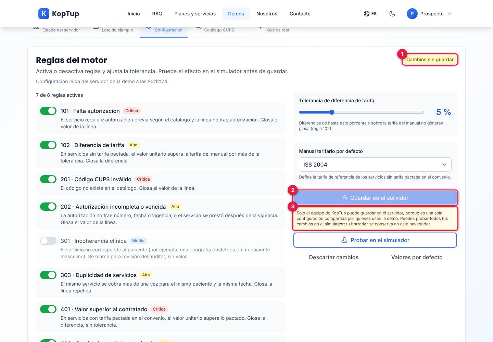

*Cuenta de prospecto: puede editar y simular, pero no guardar en el servidor.*

1. **Cambios sin guardar**: el prospecto sí edita su borrador.
2. **Guardar en el servidor**, deshabilitado y con candado.
3. «Solo el equipo de KopTup puede guardar en el servidor, porque es una sola configuración compartida por quienes usan la demo. Puedes probar todos tus cambios en el simulador; tu borrador se conserva en este navegador.»

### Paso 6. Busca un código CUPS

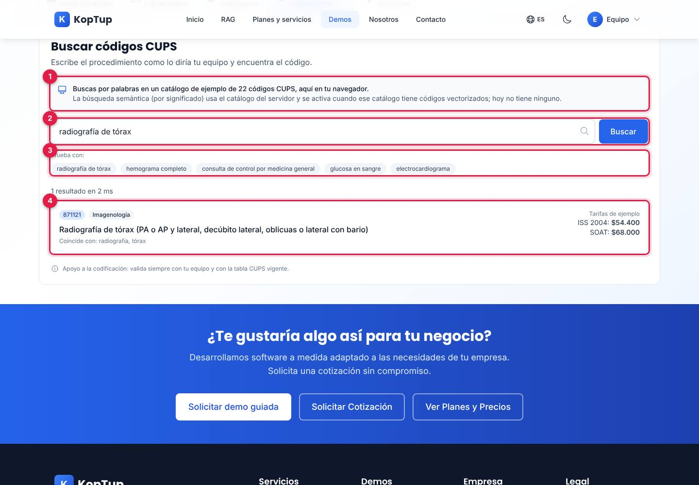

*Búsqueda de «radiografía de tórax» en el catálogo de ejemplo.*

1. **Dónde se busca**: con el catálogo del servidor vacío, la demo dice que buscas por palabras en un catálogo de ejemplo de 22 códigos CUPS, en tu navegador, y por qué la búsqueda semántica no está disponible. Si el catálogo del servidor tiene códigos vectorizados, aquí aparecen dos opciones: «Catálogo de ejemplo» y «Catálogo del servidor» (búsqueda semántica, por significado).
2. **Procedimiento a buscar** y **Buscar**.
3. **Prueba con**: cinco ejemplos que buscan con un clic.
4. **Resultado**: código, categoría, descripción, palabras con las que coincidió, «Requiere autorización» si aplica, y tarifas de ejemplo ISS 2004 y SOAT.

---

## Pantallas y funciones

La demo tiene un encabezado, el bloque **Cómo empezar** y cinco pestañas: Resumen, Simulador, Reglas, Buscar códigos y Cómo decide. Al final, como en todas las demos, está la franja con **Solicitar demo guiada**, **Solicitar cotización** y **Ver planes y precios**.

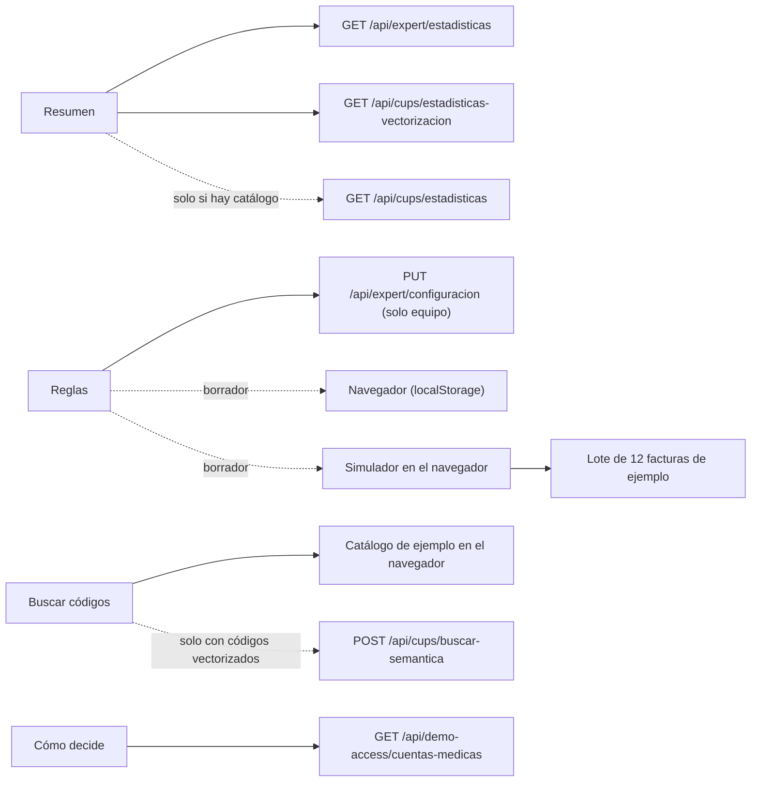

*Qué pestaña habla con el servidor y qué corre en el navegador.*

### Encabezado y primeros pasos

**Volver a las demos** (lleva a `/demo`), título «Sistema experto de auditoría médica», una línea de para quién es, insignia **Datos de ejemplo** (al pasar el cursor explica que facturas, pacientes, prestadores, convenio y tarifas son ficticios) e insignia de **estado del servidor**: «Conectando con el servidor…», «Servidor conectado», «Sin sesión», «Sin acceso», «Límite de consultas», «Servidor no disponible» o «Error del servidor».

**Cómo empezar** muestra tres pasos que llevan a la pestaña correspondiente y se marcan solos a medida que se hacen: (1) mirar las glosas en el simulador, (2) cambiar una regla o la tolerancia, (3) volver al simulador y comparar el efecto. Arriba a la derecha dice cuántos pasos llevas.

### Resumen

Ver el [paso 1](#paso-1-resumen-el-servidor-responde).

| Tarjeta | Qué cuenta |
|---|---|
| Reglas activas en el servidor | Reglas activas de las 8 del motor, según la configuración guardada |
| Tolerancia de tarifa guardada | Tolerancia de la regla 102 y manual tarifario por defecto guardados en el servidor |
| Catálogo CUPS del servidor | Códigos cargados y activos en el catálogo del servidor |
| Códigos vectorizados | Porcentaje del catálogo del servidor preparado para la búsqueda semántica |

Si el catálogo está vacío, un aviso azul lo explica. Si tiene códigos, aparece además «Catálogo del servidor por categoría».

### Simulador

Ver los [pasos 2 y 4](#paso-2-simulador-con-la-configuración-guardada). Más abajo está la lista de glosas:

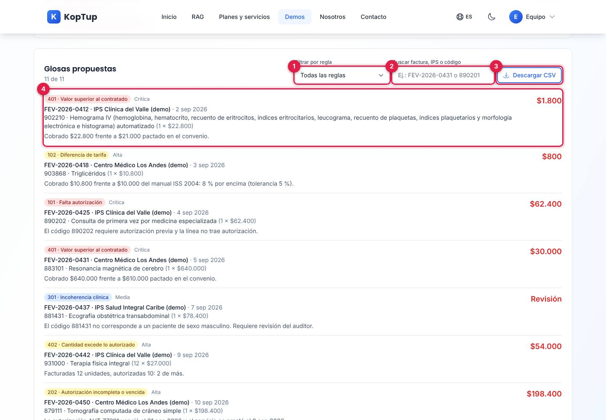

*Lista de glosas propuestas por el simulador, con filtros y descarga en CSV.*

1. **Filtrar por regla**: todas o una de las 8.
2. **Buscar factura, IPS o código**: por ejemplo «FEV-2026-0431» o «890201».
3. **Descargar CSV**: guarda `simulacion-motor-de-reglas.csv` con las glosas visibles (factura, IPS, línea, código, descripción, regla, severidad, valor y explicación).
4. **Cada glosa** trae la regla y su severidad, la factura, la IPS y la fecha, el servicio con cantidad y valor, la explicación con los valores comparados y el valor glosado («Revisión» cuando la regla no glosa valor). Las glosas que aparecen por tus cambios llevan la marca **Nueva**.

### Reglas

Ver los [pasos 3 y 5](#paso-3-cambia-reglas-y-tolerancia).

| Regla | Nombre | Severidad | Qué glosa |
|---|---|---|---|
| 101 | Falta autorización | Crítica | La línea completa |
| 102 | Diferencia de tarifa | Alta | La diferencia sobre la tarifa del manual, si supera la tolerancia |
| 201 | Código CUPS inválido | Crítica | La línea completa |
| 202 | Autorización incompleta o vencida | Alta | La línea completa |
| 301 | Incoherencia clínica | Media | Nada: la marca para revisión del auditor |
| 303 | Duplicidad de servicios | Alta | La línea repetida |
| 401 | Valor superior al contratado | Crítica | La diferencia con la tarifa pactada, sin tolerancia |
| 402 | Cantidad excede lo autorizado | Alta | Las unidades de más |

Además: **Manual tarifario por defecto** (ISS 2001, ISS 2004 o SOAT; define la tarifa de referencia de los servicios sin tarifa pactada), **Descartar cambios** (vuelve a lo guardado y borra el borrador del navegador), **Valores por defecto** (tolerancia 5 %, ISS 2004, todas las reglas) y dos notas: «Dónde se guarda» (el borrador en tu navegador; lo guardado, en una sola configuración en memoria del servidor, compartida, que vuelve a los valores por defecto cuando el servidor se reinicia) y que los códigos 101, 102… son la numeración interna de este motor (no coinciden con los de [Sistema experto para salud](Guia-Demo-cuentas-medicas.md)).

**Quién guarda.** El botón **Guardar en el servidor** solo se activa para cuentas del equipo con rol admin, manager o sales (las mismas que acepta el servidor). Cualquier otra cuenta con acceso ve el botón deshabilitado y el aviso «Solo el equipo de KopTup puede guardar…».

### Buscar códigos

Ver el [paso 6](#paso-6-busca-un-código-cups). La búsqueda en el catálogo de ejemplo es por palabras (sin tildes ni mayúsculas, también por el inicio del código) y funciona aunque el servidor no responda. La búsqueda semántica del servidor (calcula el vector de la consulta con el modelo de embeddings y lo compara con los códigos vectorizados, con el tope de gasto de IA de salud) solo aparece como opción cuando el catálogo del servidor tiene códigos vectorizados; entonces muestra la similitud de cada resultado y, si falla, un mensaje según la causa (sesión, acceso, límite de consultas, conexión).

### Cómo decide

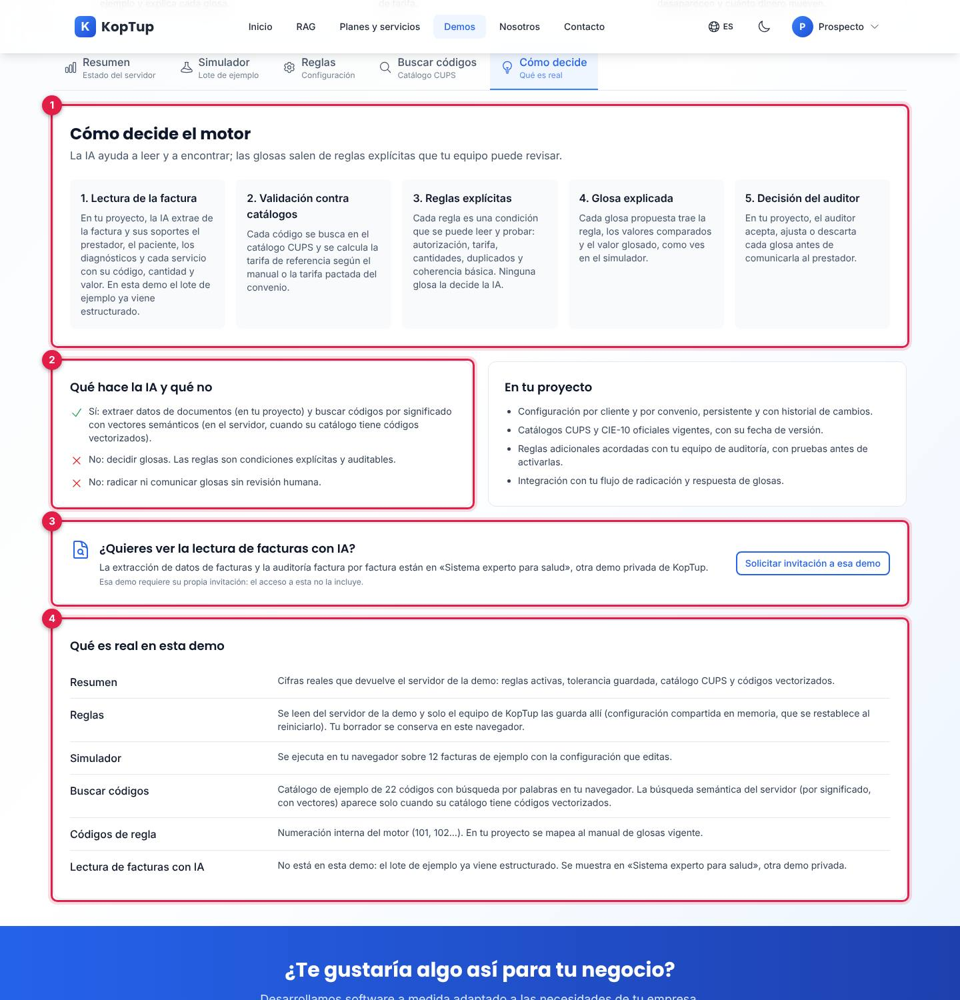

*Pestaña «Cómo decide», vista por un prospecto que solo tiene invitación a esta demo.*

1. Los cinco pasos del motor (lectura, validación contra catálogos, reglas explícitas, glosa explicada, decisión del auditor).
2. Qué hace la IA y qué no («No: decidir glosas») y lo que se construye en el proyecto del cliente.
3. **¿Quieres ver la lectura de facturas con IA?**: explica que está en [Sistema experto para salud](Guia-Demo-cuentas-medicas.md), otra demo privada que **requiere su propia invitación**. Si la cuenta no tiene acceso a esa demo, el botón es **Solicitar invitación a esa demo** (`/solicitar-demo?demos=cuentas-medicas`); si lo tiene (o es del equipo), **Abrir Sistema experto para salud**.
4. La tabla «Qué es real en esta demo».

### Sin conexión con el servidor

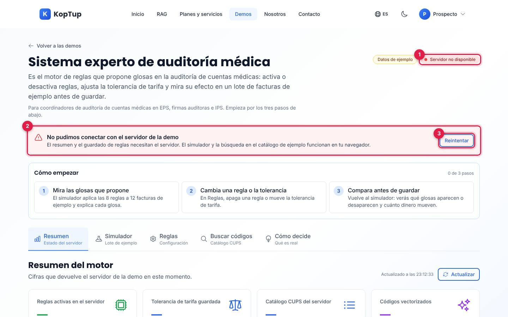

*Si el navegador no alcanza el servidor, la demo lo dice y sigue funcionando en lo que no depende de él.*

1. La insignia cambia a **Servidor no disponible**.
2. Un aviso explica qué necesita el servidor.
3. **Reintentar** vuelve a consultar.

En Reglas aparece «No se pudo leer la configuración del servidor: estás editando los valores por defecto y no podrás guardar hasta que vuelva la conexión». El simulador y la búsqueda en el catálogo de ejemplo siguen funcionando. Con demasiadas consultas (el servidor limita a cada cuenta a 100 consultas cada 15 minutos) la insignia dice **Límite de consultas** y el aviso pide esperar unos minutos.

### En el celular

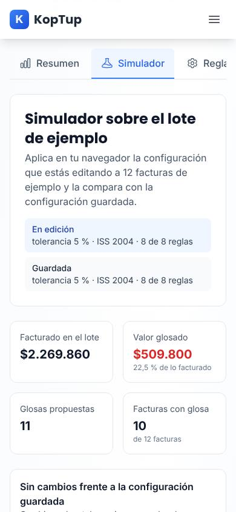

*La demo en un teléfono (390 px), pestaña Simulador.*

Los pasos de «Cómo empezar» se apilan, las pestañas se desplazan de lado (sin la descripción pequeña), las tarjetas pasan a dos columnas o una y los filtros del simulador se apilan. Las pestañas también se recorren con el teclado (flechas, Inicio y Fin).

---

## Qué es real y qué es simulado

| Parte | Real o simulado | Detalle |
|---|---|---|
| Estado del servidor y cifras del Resumen | **Backend real** | Consultas en vivo a `/api/expert` y `/api/cups` (2 por carga; 3 si el catálogo tiene códigos). |
| Configuración de reglas | **Backend real, en memoria** | Se lee del servidor y solo el equipo la guarda; es una sola configuración compartida que se pierde al reiniciarlo. |
| Borrador de reglas | **Navegador** | Se conserva en el navegador (localStorage) hasta guardarlo o descartarlo; no llega al servidor ni a otras personas. |
| Simulador | **Datos de ejemplo, en el navegador** | Aplica las 8 reglas a 12 facturas ficticias; no envía datos al servidor. Usa los mismos códigos, nombres y severidades que el motor del servidor. |
| Lote, convenio y tarifas | **Datos ficticios** | 3 IPS ficticias con NIT de ejemplo, convenio «EPS Andina (demo)», 3 servicios con tarifa pactada; las tarifas no son las oficiales de ningún manual. |
| Catálogo de ejemplo | **Datos de ejemplo** | 22 códigos CUPS reales con tarifas de ejemplo; búsqueda por palabras en el navegador. |
| Búsqueda semántica | **IA real (embeddings), si hay catálogo** | Solo aparece si el catálogo del servidor tiene códigos vectorizados; en el entorno de capturas está vacío y la demo lo dice. |
| Lectura de facturas con IA | **No está en esta demo** | Se muestra en [Sistema experto para salud](Guia-Demo-cuentas-medicas.md), que requiere su propia invitación. |

---

## Acceso

**Cómo lo ve un visitante.** En `/demo`, sección **Más demos**, están las dos demos de salud con la insignia «Solo por invitación»:

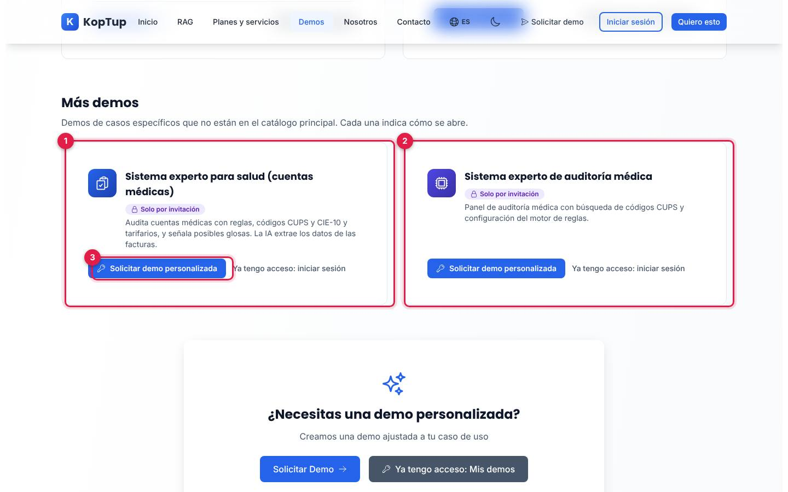

*Sección «Más demos» del hub, vista por un visitante sin sesión.*

1. Tarjeta de [Sistema experto para salud](Guia-Demo-cuentas-medicas.md) (`/demo/cuentas-medicas`).
2. Tarjeta de esta demo, «Sistema experto de auditoría médica».
3. **Solicitar demo personalizada** (y, sin sesión, **Ya tengo acceso: iniciar sesión**).

Si abre `/demo/sistema-experto` sin sesión o sin invitación, ve en la misma dirección la pantalla de acceso:

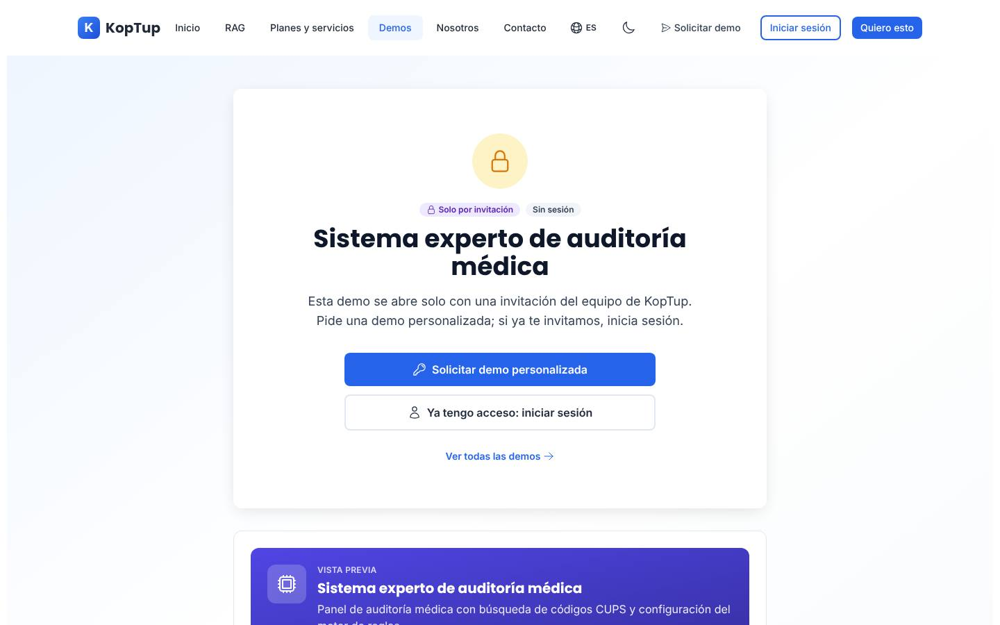

*Pantalla «Solo por invitación» para esta demo, con la vista previa de lo que incluye.*

- **Solicitar demo personalizada** abre `/solicitar-demo?demos=sistema-experto` con la demo elegida.
- **Ya tengo acceso: iniciar sesión** lleva a `/login` y vuelve a la demo.

Si el acceso vence o se revoca con la demo abierta, la página se recarga y muestra esa pantalla; si el servidor de la demo responde «sin acceso» antes de eso, el aviso de la demo ofrece **Solicitar acceso a esta demo** (`/solicitar-demo?demos=sistema-experto`).

**Cómo se concede.** Igual que en [Sistema experto para salud](Guia-Demo-cuentas-medicas.md#acceso): la solicitud llega a **Admin › Solicitudes de demo**, solo el rol **admin** puede aprobar demos «Solo por invitación», el acceso dura 14 días por defecto y se extiende o revoca en **Admin › Accesos a demos**. El equipo de KopTup (admin, manager, sales y developer) abre la demo sin invitación. **Guardar reglas** exige además rol admin, manager o sales: un prospecto invitado (o el rol developer) puede usar todo lo demás, y la demo le muestra el botón deshabilitado con el aviso «Solo el equipo de KopTup puede guardar…». La invitación a esta demo no abre [Sistema experto para salud](Guia-Demo-cuentas-medicas.md): cada una se pide aparte. Más detalle en el [Manual del administrador](Doc-06-Manual-del-Administrador.md) y en [Flujos del visitante](Doc-04-Flujos-del-Visitante.md).

---

## Limitaciones conocidas

1. **Catálogo del servidor vacío.** En el entorno de capturas (y hoy en producción) no hay códigos CUPS cargados ni vectorizados, así que la búsqueda semántica no aparece y se usa el catálogo de ejemplo; la demo lo explica. Cargar y vectorizar el catálogo solo se puede hacer por la API (rutas de administrador); la demo no tiene pantalla para eso.
2. **Una sola configuración, compartida y temporal.** Lo que guarda el equipo lo ven todas las personas; se pierde al reiniciar el servidor; no hay historial ni configuración por cliente o convenio. El borrador de cada persona sí queda en su navegador.
3. **El simulador no llama al motor del servidor.** Las reglas se evalúan en el navegador con la misma numeración y severidades; el servidor no procesa el lote.
4. **No afecta a la otra demo.** Las reglas guardadas aquí no cambian la auditoría de [Sistema experto para salud](Guia-Demo-cuentas-medicas.md), que usa su propio tarifario y otra numeración (aquí 202 es «Autorización incompleta o vencida» y allá «Diferencia de tarifa»); la nota de la pestaña Reglas lo dice.
5. **Límite de consultas.** Cada cuenta tiene 100 consultas a la API cada 15 minutos (compartidas con el resto del sitio); cada carga de la demo usa 2. Quien recarga muchas veces seguidas ve «Límite de consultas» hasta que se libera el cupo.
6. **La vista previa del hub y de la pantalla de acceso** todavía describe la demo como «Panel de auditoría médica con búsqueda de códigos CUPS y configuración del motor de reglas» y promete un «Panel con estadísticas de auditoría»; el texto nuevo está propuesto para el catálogo (ver [Correcciones pendientes](16-Correcciones-Pendientes.md)).
7. **Sondeo de botones.** La sonda automática marca como «sin efecto» la pestaña que ya está activa; es el comportamiento normal de unas pestañas (falso positivo).
