# Guía de la demo: Sistema de Reservas

> Ruta `/demo/sistema-reservas` · Modo de acceso: **Abierta** · Tipo: **datos de ejemplo** (todo corre en el navegador y se guarda en ese navegador; no llama al servidor ni usa IA) · Plan del producto: [Sistema de reservas y agendamiento](Producto-sistema-reservas.md)

**Resumen.** Muestra las dos caras de un sistema de reservas con tres negocios ficticios de Colombia: una clínica odontológica en Bogotá, un spa en Medellín y unas canchas sintéticas en Cali. En la **Vista cliente** el visitante elige sede, servicio, profesional (o cancha), fecha y hora entre las franjas que de verdad están libres, llena sus datos con la autorización de la Ley 1581, paga un abono **simulado** y recibe la confirmación con la vista previa del WhatsApp y del correo. En la **Vista negocio** esa misma cita aparece resaltada en la agenda por profesional, y el negocio la confirma, la reprograma, marca si el cliente llegó o no, guarda notas, exporta la agenda a `.ics` o la lista a CSV y ve indicadores que se recalculan con cada cambio. Todo se guarda en el navegador del visitante durante 7 días. Está pensada para clínicas, spas, canchas y negocios con varias sedes o profesionales que hoy agendan por WhatsApp.

**En esta página:** [Recorrido sugerido](#recorrido-sugerido-demo-comercial-de-5-minutos) · [Pantallas y funciones](#pantallas-y-funciones) · [Qué es real y qué es simulado](#qué-es-real-y-qué-es-simulado) · [Acceso](#acceso) · [Limitaciones conocidas](#limitaciones-conocidas)

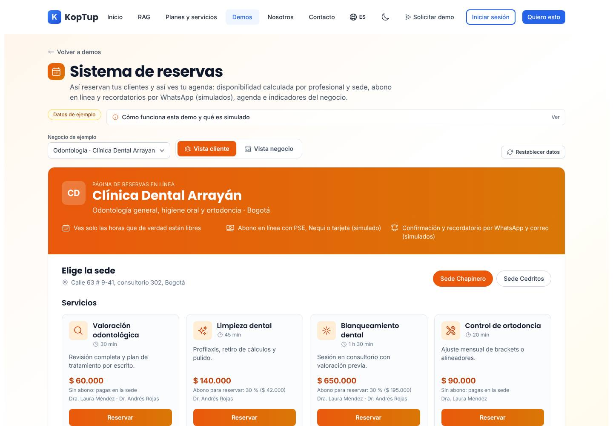

*Vista cliente de la Clínica Dental Arrayán (ficticia): encabezado de la demo con «Volver a demos», el rótulo «Datos de ejemplo», el selector de negocio, el cambio entre Vista cliente y Vista negocio y, debajo, la página de reservas con las sedes y los cuatro servicios.*

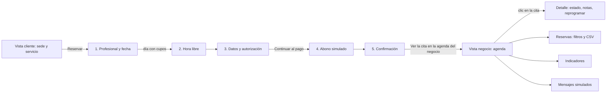

*La reserva que hace el visitante llega a la agenda del negocio. Todo ocurre en la misma página `/demo/sistema-reservas`.*

---

## Recorrido sugerido (demo comercial de 5 minutos)

La demo trae su propio recorrido en **«Cómo funciona esta demo y qué es simulado»** (se despliega con **Ver**). Para empezar desde cero, pulsa **Restablecer datos** y confirma: vuelve al ejemplo inicial con fechas alrededor de hoy.

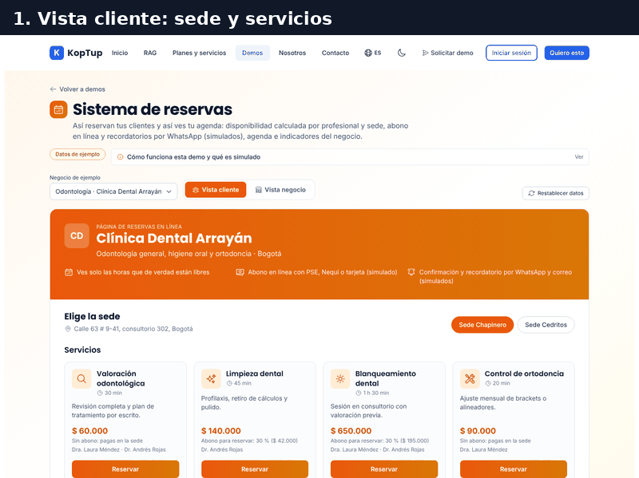

*Recorrido completo: sede y servicio, profesional y fecha, hora, datos, abono simulado, confirmación, recordatorio, agenda, detalle e indicadores.*

### Paso 1. El cliente elige sede y servicio

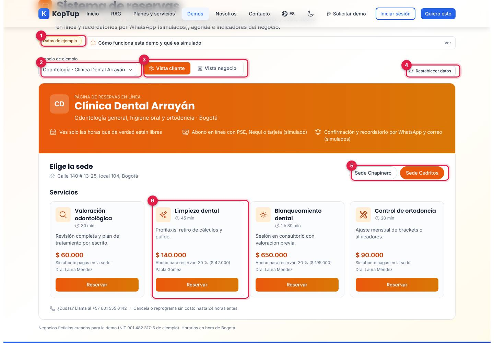

*Vista cliente de la clínica con la Sede Cedritos elegida.*

1. **Datos de ejemplo**: rótulo fijo; al pasar el puntero explica que negocios, personas y reservas son ficticios y que lo que haces se guarda solo en ese navegador.
2. **Negocio de ejemplo**: Odontología (Clínica Dental Arrayán, Bogotá), Estética y spa (Casa Ámbar Spa, Medellín) o Canchas sintéticas (Complejo Deportivo La Pradera, Cali). Cada uno guarda sus propias reservas.
3. **Vista cliente / Vista negocio**: cambia entre la página que ve el cliente y el panel del negocio. Una reserva a medio hacer no se pierde al ir y volver.
4. **Restablecer datos**: pide confirmación y vuelve al ejemplo inicial.
5. **Sede**: cambia la dirección y los servicios que se prestan allí. Si un servicio no se presta en la sede, la tarjeta lo dice y ofrece «Ver en» la otra sede.
6. **Tarjeta del servicio**: duración, precio en pesos, abono que pide para reservar (por ejemplo, 30 % de la limpieza dental: $ 42.000) y quién lo atiende en esa sede. **Reservar** abre el asistente.

Qué decir: «Tu cliente ve tus servicios por sede, con precio, abono y profesional, y agenda solo».

### Paso 2. Elige profesional y fecha

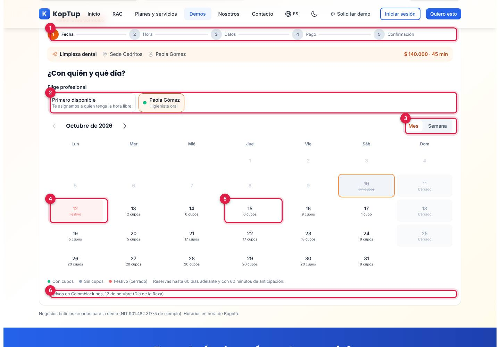

*Paso Fecha de la limpieza dental con Paola Gómez en octubre de 2026.*

1. **Pasos**: Fecha, Hora, Datos, Pago y Confirmación. Debajo, un resumen con servicio, sede, profesional, fecha y precio.
2. **Profesional**: «Primero disponible» o una persona concreta. En las canchas se elige la cancha.
3. **Mes / Semana**: dos vistas reales del calendario (ver la vista semanal abajo). El calendario abre en el mes y la semana del primer día con cupo.
4. **Festivo**: los festivos de Colombia (calculados con la Ley Emiliani) salen en rojo y cerrados; las canchas abren con horario de domingo.
5. **Día con cupos**: cada día dice cuántas horas libres quedan. Los días pasados, los días sin turnos y los días llenos no se pueden elegir; «hoy» se resalta solo en su mes.
6. **Festivos del mes**: lista de los festivos del mes que estás viendo.

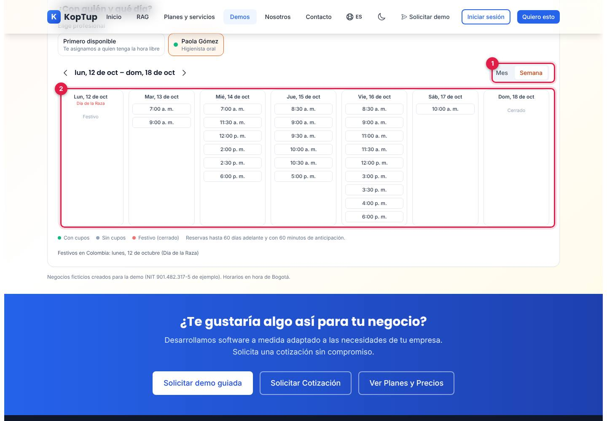

*1 Vista Semana: 2 cada día con sus horas libres; un clic en una hora pasa directo a los datos.*

### Paso 3. Elige la hora

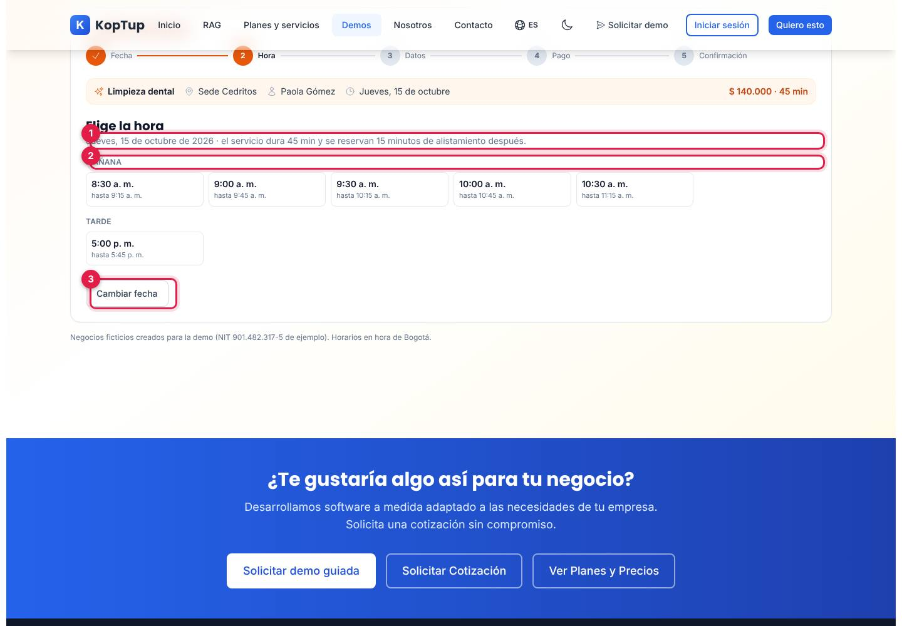

*Horas libres de Paola el jueves 15 de octubre, agrupadas en mañana y tarde.*

1. **Fecha legible y regla**: muestra la fecha completa y que el servicio dura 45 minutos más 15 de alistamiento.
2. **Horas libres**: se calculan con el turno de la persona, la duración del servicio, el alistamiento y las citas que ya tiene. No hay cruces. El mismo día solo se ofrecen horas con al menos 60 minutos de anticipación (30 en las canchas).
3. **Cambiar fecha**: vuelve al calendario.

Qué decir: «El cliente solo ve horas que de verdad están libres; no hay dobles reservas».

### Paso 4. Escribe sus datos y autoriza el tratamiento

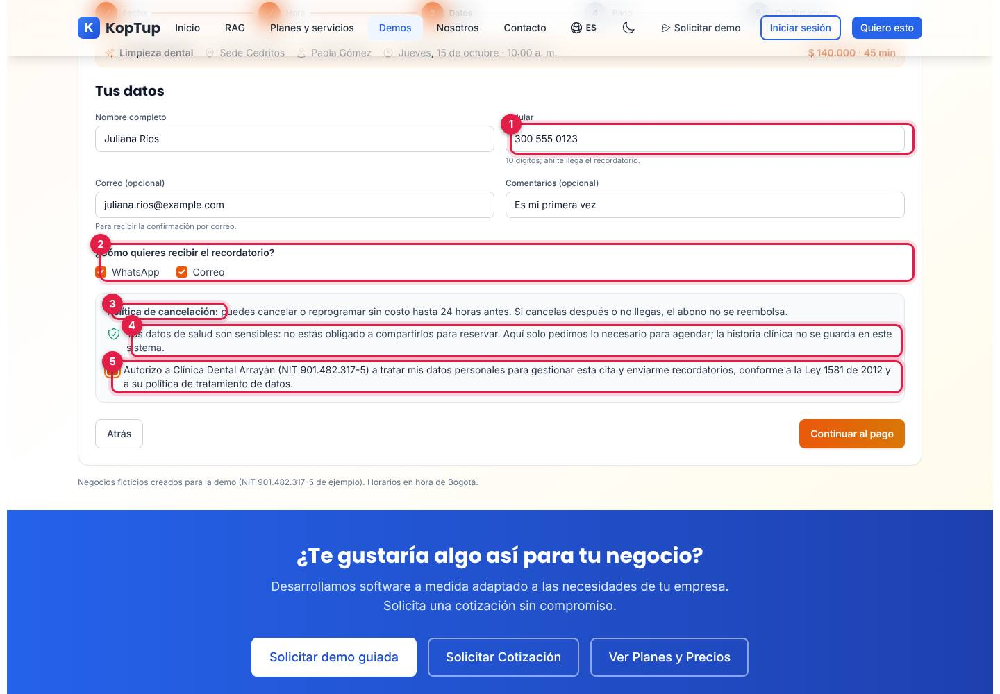

*Formulario con datos ficticios: Juliana Ríos, 300 555 0123 y un correo de example.com.*

1. **Celular**: obligatorio, colombiano de 10 dígitos que empieza por 3. El nombre también es obligatorio; el correo es opcional.
2. **Recordatorio**: WhatsApp y correo; la casilla de correo se activa cuando escribes un correo.
3. **Política de cancelación**: sin costo hasta 24 horas antes (12 en las canchas).
4. **Datos sensibles**: en la clínica aparece el aviso de que los datos de salud no son obligatorios.
5. **Autorización (Ley 1581 de 2012)**: obligatoria para continuar. Sin ella, o con datos incompletos, el formulario muestra el error junto a cada campo.

### Paso 5. Paga el abono (simulado)

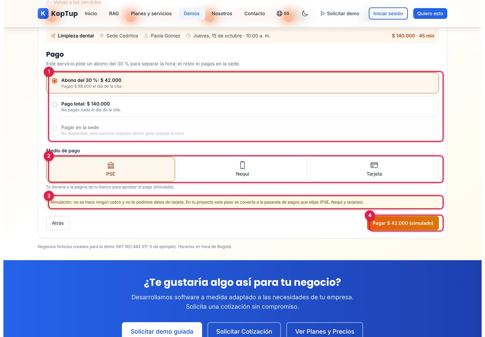

*Pago del abono del 30 % con PSE.*

1. **Opciones de pago**: abono, pago total o pago en la sede. Si el servicio pide abono, «Pagar en la sede» queda deshabilitado; si no lo pide, la reserva puede quedar pendiente y pagarse en la sede.
2. **Medio de pago**: PSE, Nequi o tarjeta, cada uno con una explicación de lo que pasaría en un proyecto real.
3. **Aviso de simulación**: no se cobra nada ni se piden datos de tarjeta.
4. **Pagar … (simulado)**: muestra un instante «Conectando con tu banco (simulado)…» y crea la reserva.

### Paso 6. Ve la confirmación y el recordatorio

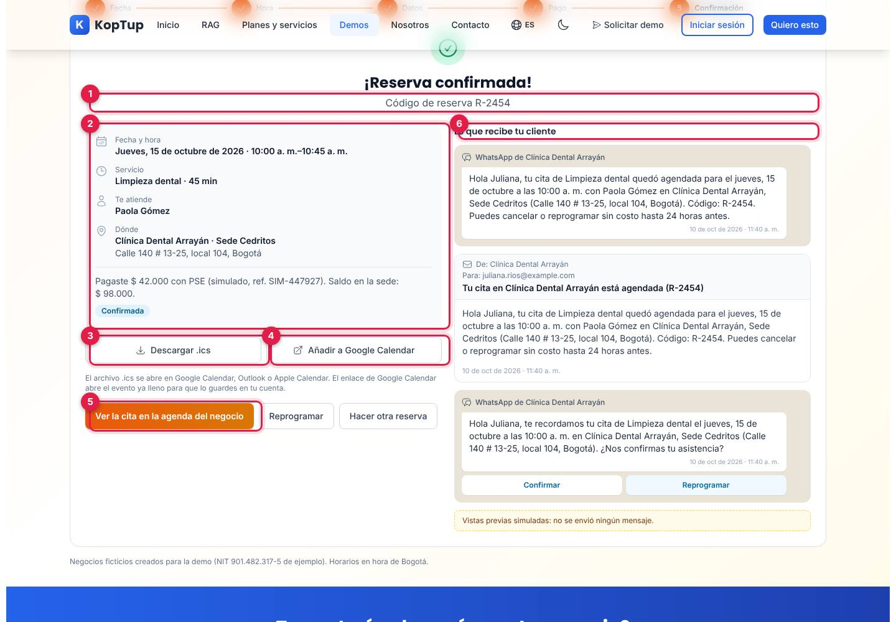

*Reserva confirmada con su código y las vistas previas de los mensajes.*

1. **Código de reserva** (por ejemplo, R-2454).
2. **Resumen**: fecha y hora legibles, servicio, profesional, sede con dirección, pago simulado con su referencia `SIM-…`, saldo a pagar en la sede y estado.
3. **Descargar .ics**: descarga de verdad un evento de calendario con aviso 24 horas antes; se abre en Google Calendar, Outlook o Apple Calendar.
4. **Añadir a Google Calendar**: abre en otra pestaña el formulario de Google Calendar con el evento lleno, para guardarlo en la cuenta del visitante.
5. **Ver la cita en la agenda del negocio**: pasa a la Vista negocio en el día de la cita.
6. **Lo que recibe tu cliente**: vistas previas del WhatsApp y del correo de confirmación. **Simular el recordatorio que se envía 24 horas antes** agrega el recordatorio con los botones **Confirmar** y **Reprogramar**: Confirmar deja «Confirmada» una cita pendiente; Reprogramar abre la ventana para moverla.

También están **Reprogramar** y **Hacer otra reserva**.

### Paso 7. El negocio ve la cita en su agenda

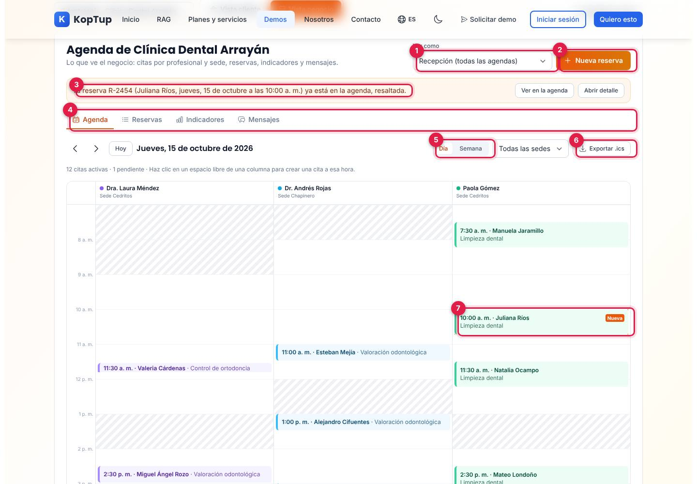

*Agenda del jueves 15 de octubre, una columna por profesional, con la cita nueva resaltada.*

1. **Ver como**: Recepción (todas las agendas) o un profesional (solo su agenda). Es un filtro de la demo, no un inicio de sesión.
2. **Nueva reserva**: para citas que llegan por teléfono, WhatsApp o en persona; solo ofrece horas libres y abre en el día que estás viendo en la agenda (o en el primer día con cupo).
3. **Aviso de la reserva nueva**, con «Ver en la agenda» y «Abrir detalle».
4. **Pestañas**: Agenda, Reservas, Indicadores y Mensajes.
5. **Día / Semana**, con flechas, **Hoy** y filtro de sede.
6. **Exportar .ics**: descarga las citas activas que estás viendo.
7. **Cita nueva** con la marca «Nueva». Un clic en cualquier cita abre su detalle; un clic en un espacio libre dentro del turno abre «Nueva reserva» con esa hora. Las canceladas no ocupan la cuadrícula: se listan debajo.

### Paso 8. Abre la cita y gestiónala

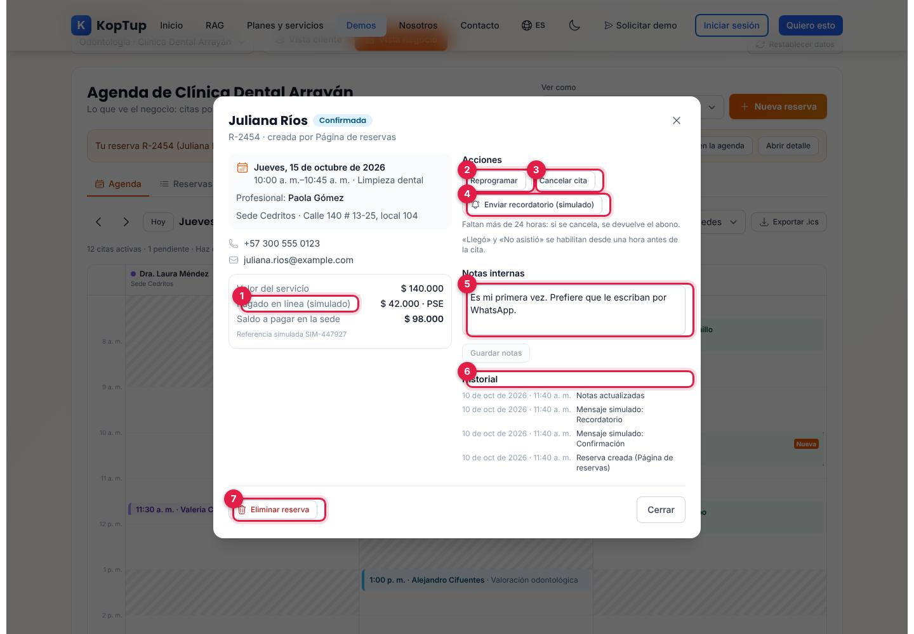

*Detalle de la reserva de Juliana Ríos con una nota guardada.*

1. **Valor, pagado en línea (simulado) y saldo**, con la referencia simulada.
2. **Reprogramar**: abre una ventana con fecha, profesional y solo horas libres; al guardar se registra el aviso de reprogramación simulado.
3. **Cancelar cita**. En las citas que ya empezaron (desde una hora antes) aparecen también **Llegó** y **No asistió**. La demo dice si la cancelación devuelve el abono según la política.
4. **Enviar recordatorio (simulado)**.
5. **Notas internas** con **Guardar notas**: se guardan y siguen ahí al reabrir o recargar.
6. **Historial**: creación, cambios de estado, notas, mensajes y respuestas, con fecha y hora.
7. **Eliminar reserva**, con confirmación.

La ventana se cierra con la **X**, con **Cerrar**, con la tecla **Escape** o con un clic fuera; mientras está abierta, la tecla Tab no sale de ella, y al cerrarla el foco vuelve al botón que la abrió.

Qué decir: «Tu equipo ve todas las citas por profesional y sede, confirma, reprograma y marca ausencias en un solo lugar». Para cerrar, en **Reservas** filtra «Anteriores», abre una cita «Llegó», cámbiala a «No asistió» y muestra cómo cambian los **Indicadores**.

---

## Pantallas y funciones

### Vista cliente

Ver la [vista general](#guía-de-la-demo-sistema-de-reservas) y los [pasos 1 a 6](#paso-1-el-cliente-elige-sede-y-servicio).

| Elemento | Qué hace |
|---|---|
| **Volver a demos** | Regresa al catálogo `/demo`. |
| **Cómo funciona esta demo y qué es simulado** | Lista lo que funciona de verdad, lo simulado y un recorrido de 5 pasos. |
| Encabezado del negocio | Nombre, especialidad, ciudad y tres beneficios; los de pago y mensajes dicen «(simulado)». |
| Sedes y servicios | Cada negocio tiene 2 sedes. Odontología: valoración ($ 60.000), limpieza ($ 140.000, abono 30 %), blanqueamiento ($ 650.000, abono 30 %) y control de ortodoncia ($ 90.000). Spa: limpieza facial y masajes relajante y descontracturante (abono 20 %) y manicure y pedicure (sin abono). Canchas: fútbol 5 de 1 hora y de 1 h 30 min y fútbol 8 de 1 hora (abono 50 %). |
| Pie de la página | Teléfono del negocio (ficticio, bloque 555) y política de cancelación. Debajo: «Negocios ficticios creados para la demo (NIT … de ejemplo)», con dígito de verificación válido. |

### Asistente de reserva

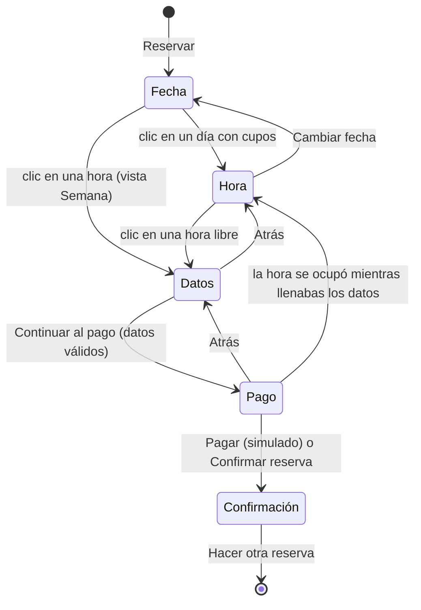

*«Volver a los servicios» sale del asistente desde cualquier paso antes de la confirmación.*

- **Reglas de disponibilidad**: turnos partidos por profesional y sede, duración más alistamiento, festivos, reservas existentes, anticipación mínima (60 minutos; 30 en canchas) y horizonte de 60 días (45 en canchas).
- **Estado inicial**: con abono o pago total la cita queda «Confirmada»; con pago en la sede queda «Pendiente» hasta que el cliente confirme con el recordatorio o la confirme recepción.

### Panel del negocio

| Pestaña | Qué hace |
|---|---|
| **Agenda** | Día (columnas por profesional, franjas fuera de turno rayadas y línea roja de la hora actual en el día de hoy) o Semana (lista por día). Filtro de sede, Hoy, flechas, Exportar .ics y clic en un espacio libre para crear una cita. |
| **Reservas** | Buscador por cliente, celular o código; filtros de fechas (hoy, esta semana, este mes, próximas, anteriores o todas), servicio, profesional, estado y sede; orden; Limpiar filtros; **Exportar CSV** con lo filtrado; «Ver» abre el detalle; carga de 25 en 25. |
| **Indicadores** | Ocupación de la semana, ausencias de 30 días, ingresos del mes (citas atendidas), abonos simulados del mes, citas de los próximos 7 días, ocupación por profesional, servicios más reservados y reservas por canal. Filtro por sede y nota con cómo se calcula cada uno. |
| **Mensajes** | Recordatorios pendientes para el próximo día con citas y botón para enviarlos (simulado); historial de confirmaciones, recordatorios, reprogramaciones y cancelaciones con filtro por canal, vista previa de cada mensaje y respuesta del cliente. |

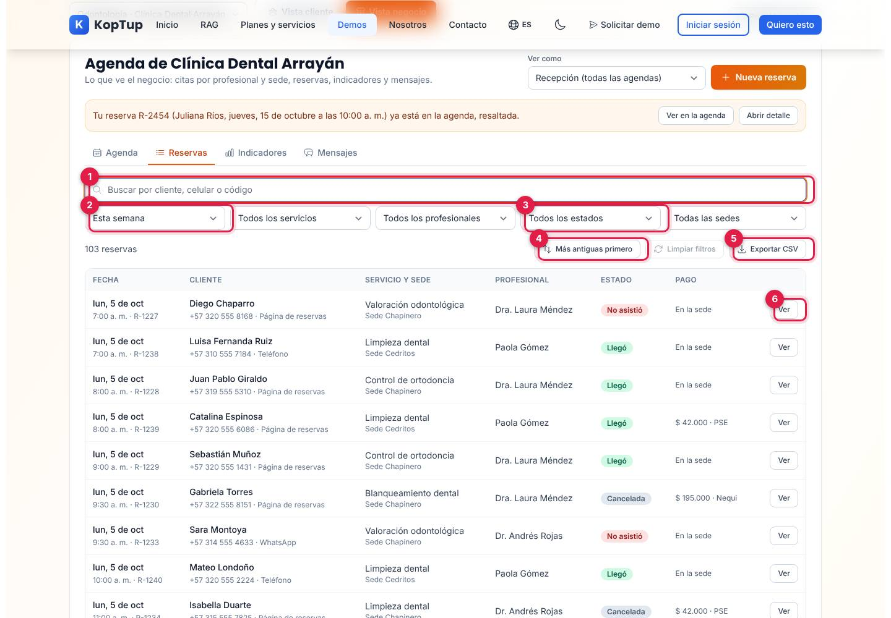

*Reservas: 1 buscador, 2 rango de fechas (abre en «Esta semana», con fechas reales), 3 estado, 4 orden, 5 exportar CSV, 6 abrir el detalle.*

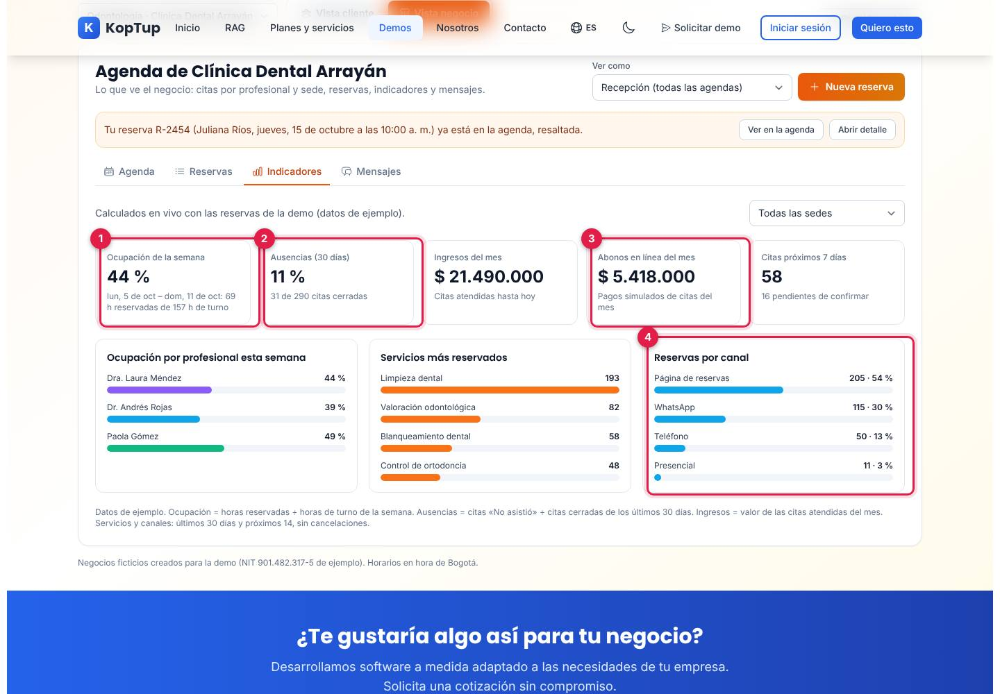

*Indicadores calculados con las reservas: 1 ocupación de la semana, 2 ausencias, 3 abonos simulados, 4 reservas por canal.*

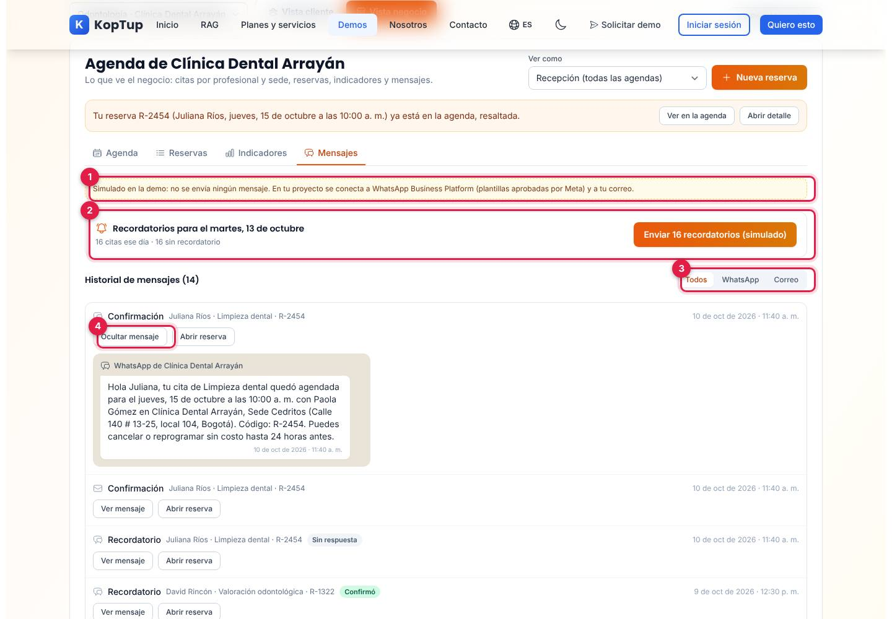

*Mensajes: 1 aviso de simulación, 2 recordatorios del próximo día con citas, 3 filtro por canal, 4 vista previa.*

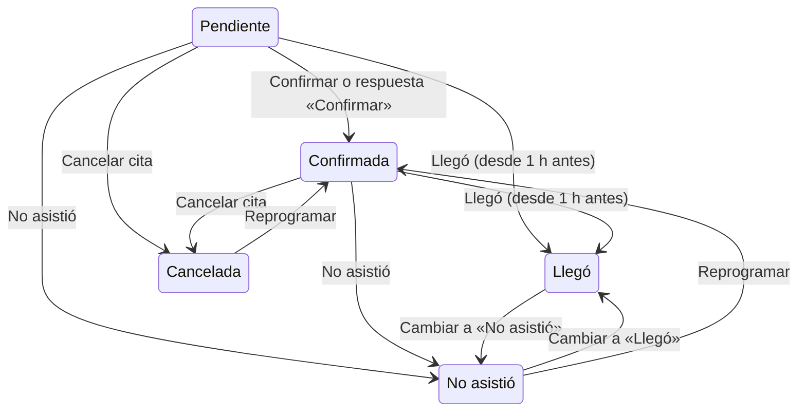

*Estados de una cita. Reprogramar una cita cancelada o con ausencia la deja «Confirmada» en la nueva hora.*

### En el celular

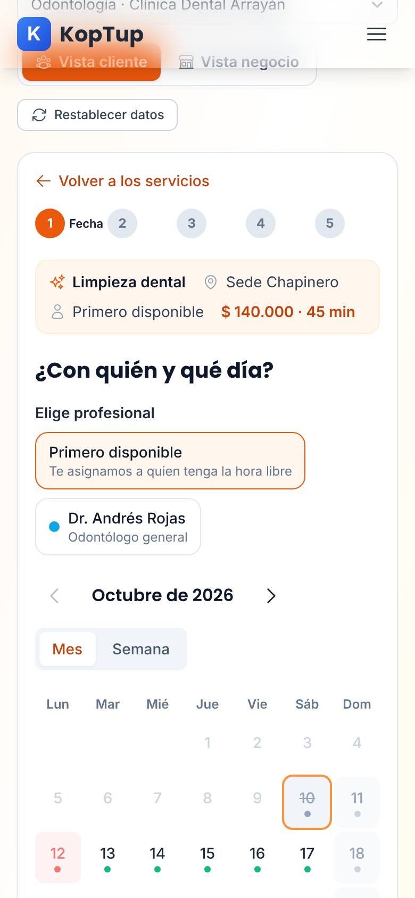

*El asistente en un teléfono (390 px), en el paso Fecha.*

Las tarjetas se apilan, el calendario ocupa todo el ancho (cada día muestra un punto de color en vez del número de cupos), los pasos muestran solo el nombre del paso actual, y la agenda del día y la tabla de reservas se desplazan de lado dentro de su recuadro. La página no se desborda a lo ancho.

---

## Qué es real y qué es simulado

| Parte | Real o simulado | Detalle |
|---|---|---|
| Negocios, sedes, profesionales, servicios, precios, clientes y reservas iniciales | **Datos de ejemplo** | Ficticios. Las reservas se generan alrededor del día en que abres la demo (tres semanas atrás y dos adelante) y son siempre iguales para la misma fecha. Teléfonos del bloque 555 y correos de `example.com`. |
| Calendario, festivos y horas libres | **Real (en el navegador)** | Calculados con los turnos, la duración, el alistamiento, los festivos de Colombia y las reservas existentes. Fechas y horas en hora de Bogotá. |
| Validación del formulario y autorización de datos | **Real (en el navegador)** | Nombre, celular colombiano y autorización obligatorios; el correo se valida si se escribe. |
| La reserva en la agenda, estados, reprogramación, notas y eliminación | **Real (en el navegador)** | Lo que haces en la Vista cliente aparece en la Vista negocio y al revés. |
| Filtros, buscador, orden e indicadores | **Real (en el navegador)** | Calculados con las reservas que hay en ese momento. Los indicadores son de **datos de ejemplo**. |
| Archivos `.ics` y CSV | **Real** | Se descargan de verdad; el CSV abre en Excel (separador `;` en español). |
| «Añadir a Google Calendar» | **Real** | Enlace público de Google Calendar con el evento lleno; no hay integración ni sincronización. |
| Pagos (abono o total con PSE, Nequi o tarjeta) | **Simulado** | No se cobra nada ni se piden datos de tarjeta; la referencia `SIM-…` es inventada. Cada pantalla lo dice. |
| Confirmaciones, recordatorios y avisos de reprogramación y cancelación por WhatsApp y correo | **Simulado** | Son vistas previas y un historial; no se envía ningún mensaje. Las respuestas «Confirmar» y «Reprogramar» las da el visitante con los botones. |
| «Ver como» (recepción o profesional) | **Simulado** | Filtro de la agenda; no hay usuarios ni roles. |
| Dónde se guarda | **Navegador del visitante** | `localStorage` durante 7 días; después, o con «Restablecer datos», se regenera el ejemplo. La demo no llama al backend ni usa IA. |

---

## Acceso

**Cómo la ve un visitante.** La demo es **Abierta** (`publico`): cualquiera entra a `/demo/sistema-reservas` sin cuenta y sin pantalla de acceso. En el hub `/demo` aparece así:

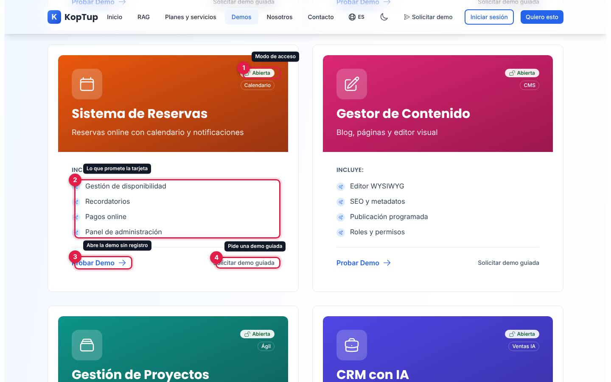

*Tarjeta «Sistema de Reservas» en el hub, vista por un visitante sin sesión.*

1. Insignia **Abierta** (junto a «Calendario»).
2. Lo que **Incluye** según la tarjeta: «Gestión de disponibilidad», «Recordatorios», «Pagos online» y «Panel de administración». En la demo los recordatorios y los pagos son **simulados** (ver la limitación 1).
3. **Probar Demo** abre `/demo/sistema-reservas`.
4. **Solicitar demo guiada** abre `/solicitar-demo?demos=sistema-reservas`.

**Cómo se solicita.** No hace falta solicitarla. Quien quiera verla con sus propios servicios usa **Solicitar demo guiada** (en la tarjeta o en el bloque azul del final de la demo, que también ofrece **Solicitar Cotización** y **Ver Planes y Precios**). La solicitud llega a **Admin › Solicitudes de demo** como cualquier otra.

**Cómo la controla el admin.** El modo sale del catálogo del servidor y se cambia en **Admin › Catálogo de demos**. Si se pasa a «Con solicitud» o «Solo por invitación», los visitantes verán la pantalla de acceso y los accesos se conceden en **Admin › Solicitudes de demo** y **Admin › Accesos a demos**; si se desactiva, el visitante ve que la demo está en mantenimiento y el equipo sigue entrando. Si el backend no responde, la demo sigue abierta porque así está en la tabla de respaldo de la web. Detalle en el [Manual del administrador](Doc-06-Manual-del-Administrador.md) y en [Flujos del visitante](Doc-04-Flujos-del-Visitante.md).

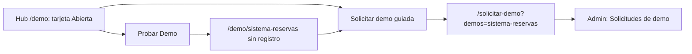

*Dos caminos: probarla de una vez o pedir una demo guiada.*

---

## Limitaciones conocidas

Son de diseño (es una demo con datos de ejemplo) o dependen de textos compartidos del sitio que no están en la demo:

1. **La tarjeta del hub todavía dice «Recordatorios» y «Pagos online» sin aclarar que en la demo son simulados**, y la descripción del inicio habla de «notificaciones». La página de la demo y sus metadatos ya dicen solo lo que hace; el cambio de esos textos compartidos está pendiente en el catálogo.
2. **Pagos y mensajes son simulados.** No hay pasarela de pagos, WhatsApp Business ni correo conectados; en un proyecto real se conectan a los que elija el cliente.
3. **No hay sincronización con calendarios.** Se exporta e importa el archivo `.ics` o se usa el enlace de Google Calendar; la sincronización automática con el calendario de cada profesional es parte de la implementación.
4. **Lo que haces vive solo en tu navegador** (`localStorage`): no se comparte con el equipo comercial ni entre dispositivos, y a los 7 días (o con «Restablecer datos») vuelve el ejemplo con fechas nuevas.
5. **«Ver como» no es un inicio de sesión.** El panel no pide usuario a propósito; en un proyecto real cada persona entra con su rol.
6. **Tres negocios fijos.** No hay personalización por prospecto (logo, servicios o profesionales propios), lista de espera, paquetes ni reprogramación arrastrando la cita.
7. **La fecha y la hora salen del reloj del equipo** convertido a hora de Bogotá; si el reloj del equipo está mal, el calendario lo refleja. El selector de fecha de «Nueva reserva» y «Reprogramar» es el del navegador y muestra la fecha en su formato.
8. **«Ver Planes y Precios»** del bloque azul del final lleva a los planes RAG, como en las demás demos (ver [Limitaciones comunes](Doc-07-Guia-de-Demos.md#limitaciones-comunes)).
