# Guía de la demo: Telemedicina para IPS

> Ruta `/demo/telemedicina` · Modo de acceso: **Con solicitud** · Tipo: **datos de ejemplo** (todo corre en el navegador; no llama al servidor ni a un modelo de IA) · Plan del producto: [Plataforma de telemedicina para IPS](Producto-telemedicina.md)

**Resumen.** Recorre la jornada de **hoy** (fecha de Colombia) en una IPS ficticia (IPS Altavista Salud, Bogotá) vista desde tres lados: el **paciente** describe sus síntomas, agenda su cita y llena la pre-consulta con los consentimientos; el **profesional** de cada especialidad atiende desde un consultorio virtual con sala de espera por prioridad, videoconsulta simulada, ficha, receta firmada y notas SOAP; y **facturación** cobra lo que paga el paciente con una pasarela simulada y genera la factura y el RIPS (simulados), con la tarifa de la especialidad que atendió. Está pensada para gerentes y directores médicos de IPS y consultorios; se abre solo con un acceso aprobado y lo que haces se guarda solo en tu navegador.

**En esta página:** [Recorrido sugerido](#recorrido-sugerido-demo-comercial-de-5-minutos) · [Pantallas y funciones](#pantallas-y-funciones) · [Qué es real y qué es simulado](#qué-es-real-y-qué-es-simulado) · [Acceso](#acceso) · [Limitaciones conocidas](#limitaciones-conocidas)

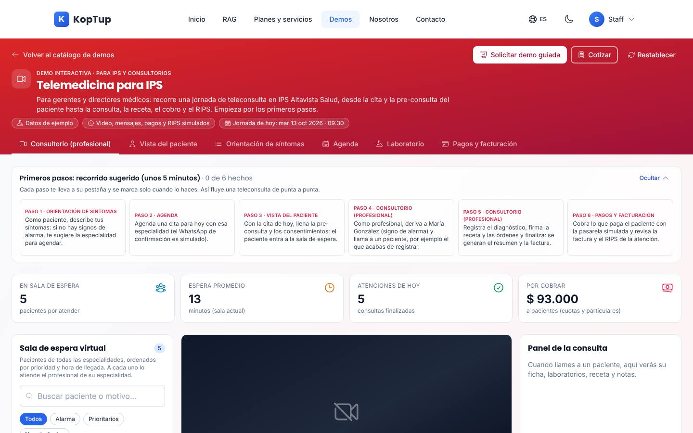

*Vista inicial: arriba, **Volver al catálogo de demos**, **Solicitar demo guiada**, **Cotizar** y **Restablecer**; el encabezado dice qué es y para quién, con las insignias «Datos de ejemplo», «Video, mensajes, pagos y RIPS simulados» y «Jornada de hoy» con el reloj de la demo. Debajo, las seis pestañas, los **Primeros pasos** (abiertos), los cuatro indicadores y el consultorio con la sala de espera.*

---

## Recorrido sugerido (demo comercial de 5 minutos)

La idea que vende: «del síntoma del paciente a la factura con RIPS, sin papel y sin saltarse los controles». El guion sigue los **Primeros pasos** que trae la propia demo (seis pasos, unos 5 minutos): cada paso es un botón que te lleva a su pestaña y se marca **Hecho** solo cuando lo haces (el contador dice «3 de 6 hechos»). Se pueden ocultar con **Ocultar** y el navegador lo recuerda. Si alguien ya usó la demo en ese navegador, empieza con **Restablecer** (arriba a la derecha; pide confirmación).

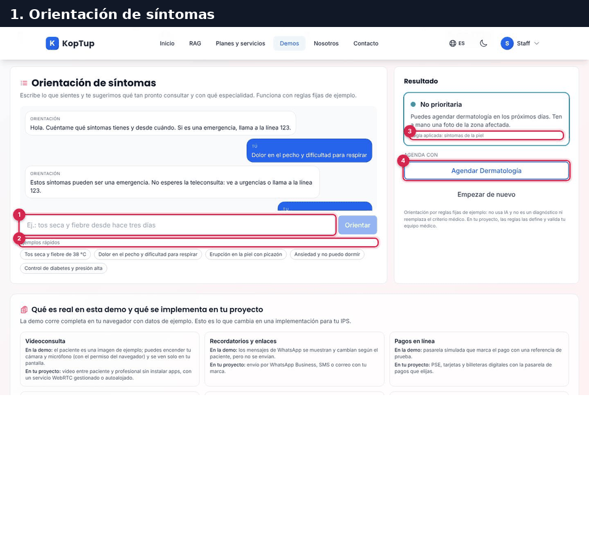

*Recorrido completo en 9 cuadros: orientación de síntomas, cita de hoy, pre-consulta, derivación a urgencias, videoconsulta, receta, resumen, cobro y detalle con el RIPS.*

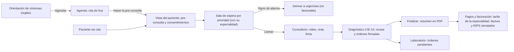

*Cómo se conectan las pestañas: la cita de hoy entra a la sala de espera cuando el paciente hace su pre-consulta, y la atención se factura con la tarifa de la especialidad de la cita.*

### Paso 1. El paciente describe sus síntomas

Abre **Orientación de síntomas** y pulsa dos ejemplos: primero «Dolor en el pecho y dificultad para respirar» y luego «Erupción en la piel con picazón».

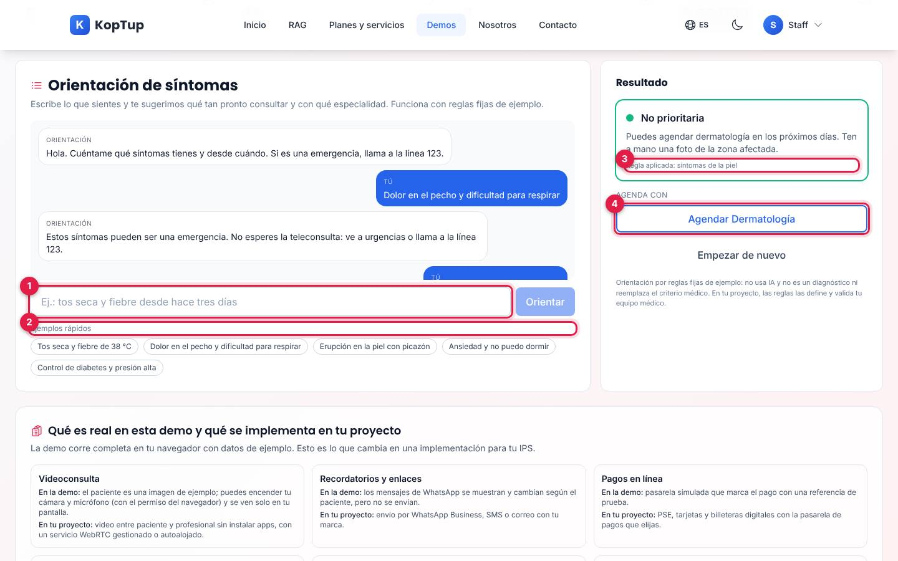

*Después de los dos ejemplos: el primero derivó a urgencias; el segundo sugiere agendar dermatología.*

1. **Caja de texto y Orientar**: escribe los síntomas con tus palabras (Enter también envía).
2. **Ejemplos rápidos**: cinco casos listos (tos y fiebre, dolor en el pecho, erupción en la piel, ansiedad e insomnio, control de diabetes y presión).
3. **Resultado**: prioridad sugerida (Signo de alarma, Prioritaria o No prioritaria), la recomendación y la **regla aplicada**.
4. **Agendar …**: un botón por especialidad sugerida; abre la pestaña **Agenda** con esa especialidad elegida.

Con un signo de alarma, el resultado no ofrece agendar: muestra «Signos de alarma: no esperes una teleconsulta», «Línea de emergencias: 123» como texto (no es un botón) y la nota «En la demo no se marca ningún número. En tu proyecto, este aviso puede incluir un botón para llamar al 123 desde el celular del paciente». Las reglas se evalúan en orden y gana la primera que coincide:

| Regla | Ejemplo de palabras | Prioridad | Sugiere |
|---|---|---|---|
| Dolor en el pecho o dificultad para respirar | dolor en el pecho, falta de aire | Signo de alarma | Urgencias o línea 123 |
| Desmayo, convulsión o pérdida de fuerza | desmayo, convulsión, cara caída | Signo de alarma | Urgencias o línea 123 |
| Sangrado abundante | sangrado abundante, vómito con sangre | Signo de alarma | Urgencias o línea 123 |
| Riesgo de hacerse daño | hacerme daño, quitarme la vida | Signo de alarma | Ayuda inmediata, línea 123 |
| Síntomas respiratorios o fiebre | fiebre, tos, garganta, gripa | Prioritaria | Medicina general o interna |
| Dolor de cabeza | cefalea, migraña | Prioritaria | Medicina general o interna |
| Dolor de oído | oído, otalgia | No prioritaria | Medicina general o pediatría |
| Síntomas de la piel | erupción, picazón, ronchas | No prioritaria | Dermatología |
| Salud mental | ansiedad, estrés, no puedo dormir | No prioritaria | Psicología |
| Control de enfermedad crónica | diabetes, glucosa, presión alta | No prioritaria | Medicina interna o general |
| Ninguna de las anteriores | — | No prioritaria | Medicina general |

Qué decir: «No es un diagnóstico ni usa IA: son reglas que define y valida tu equipo médico, y los signos de alarma nunca se quedan esperando una teleconsulta». La demo lo aclara debajo del resultado.

### Paso 2. Agenda una cita para hoy

**Agendar Dermatología** abre la **Agenda** con dermatología elegida. Elige un horario de hoy, escribe el nombre (por ejemplo, Valeria Gómez), el celular y el pagador (Horizonte Medicina Prepagada) y pulsa **Confirmar cita**.

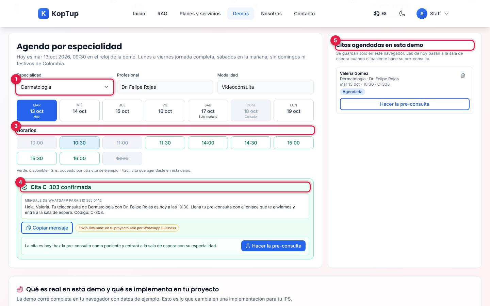

*Cita de dermatología confirmada para hoy, con el mensaje de WhatsApp de ejemplo y el botón para hacer la pre-consulta.*

1. **Especialidad, profesional y modalidad**: cinco especialidades con su profesional (Medicina general, Dra. Patricia Vargas; Pediatría, Dr. Andrés Mejía; Dermatología, Dr. Felipe Rojas; Medicina interna, Dra. Camila Ríos; Psicología, Ps. Iván Cárdenas). La modalidad es **Videoconsulta**.
2. **Siete días desde hoy**: el sábado dice «Solo mañana» y el domingo «Cerrado»; los **festivos de Colombia** (calculados para cualquier año con la Ley 51 de 1983) aparecen como **Festivo** y no se pueden elegir. Si hoy es domingo o festivo, la agenda abre en el siguiente día hábil.
3. **Horarios**: de lunes a viernes de 08:00 a 11:30 y de 14:00 a 16:30, cada 30 minutos; sábados de 08:00 a 11:30; hoy, solo después de la hora del reloj de la demo. Verde: disponible; gris tachado: ocupado por otra cita de ejemplo; azul: tu cita.
4. **Confirmación**: al elegir un horario se piden nombre, celular (WhatsApp) y pagador, con el valor según el pagador (por ejemplo, «Bono de la prepagada de ejemplo: $ 28.000 (valor total $ 98.000)»). **Confirmar cita** muestra «Cita C-… confirmada», el mensaje de WhatsApp que recibiría el paciente y **Copiar mensaje** (el envío es simulado). Si la cita es hoy, aparece **Hacer la pre-consulta**; si es otro día, la demo explica que ese día el paciente recibe el enlace.
5. **Citas agendadas en esta demo**: la lista con el estado de cada cita (**Agendada**, **En sala de espera**, **Atendida** o **Derivada a urgencias**), el botón para cancelar las que siguen agendadas (el horario vuelve a quedar libre) y **Hacer la pre-consulta** en las de hoy.

Qué decir: «La cita no se queda en un calendario aparte: cuando el paciente hace su pre-consulta, entra a la sala de espera con su especialidad y su profesional».

### Paso 3. El paciente hace su pre-consulta

**Hacer la pre-consulta** abre la **Vista del paciente** con la cita ya elegida.

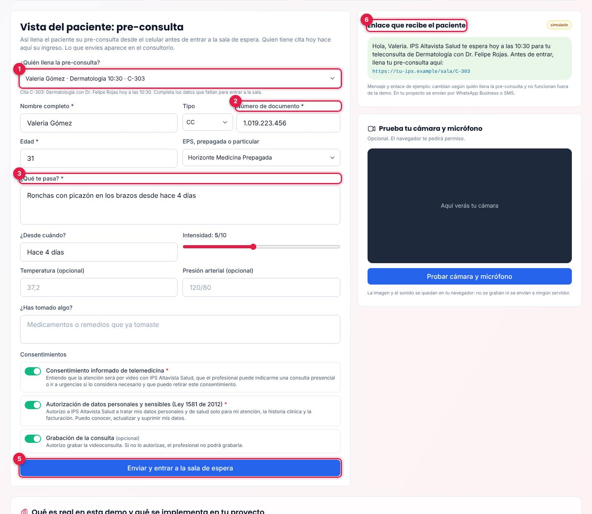

*Pre-consulta de Valeria Gómez (cita de dermatología de hoy) lista para enviar.*

1. **¿Quién llena la pre-consulta?**: «Paciente nuevo (sin cita)», una de las citas de hoy («Con cita hoy») o un paciente que ya está en la sala de espera (para actualizar su pre-consulta). Debajo, una línea explica qué pasa con cada opción (por ejemplo, «Cita C-…: Dermatología con Dr. Felipe Rojas hoy a las 10:30»).
2. **Datos del paciente**: nombre (mínimo 3 letras), tipo de documento (CC, TI o CE), número (5 a 15 dígitos o puntos), edad y pagador. Con cita, el nombre y el pagador vienen de la cita.
3. **¿Qué te pasa?** (obligatorio). Debajo: desde cuándo, intensidad de 1 a 10, temperatura y presión (opcionales) y qué ha tomado.
4. **Consentimientos**: el de telemedicina y la autorización de datos personales y sensibles (Ley 1581 de 2012) son obligatorios; el de **grabación** es opcional, y si el paciente no lo da, el profesional no podrá grabar la consulta.
5. **Enviar y entrar a la sala de espera**: se activa con el motivo, los datos y los dos consentimientos obligatorios.
6. **Enlace que recibe el paciente**: el mensaje de WhatsApp de ejemplo cambia según quién llena la pre-consulta (con su nombre, la especialidad y la hora de la cita) y lleva un enlace de ejemplo (`tu-ips.example`). No se envía.

Al enviar aparece «Listo, Valeria Gómez: ya estás en la sala de espera. Turno aproximado: 5. Prioridad asignada: No prioritaria», «Te atiende: Dermatología · Dr. Felipe Rojas.» y el botón **Ver en el consultorio**. El turno cuenta a quienes esperan con igual o mayor prioridad, sin los signos de alarma (esos se derivan). La prioridad sale de las reglas de la orientación de síntomas; si el motivo tiene un signo de alarma, en lugar del turno se le dice que no espere la teleconsulta y vaya a urgencias o llame a la línea 123. Quien llega **sin cita** queda con la especialidad que sugieren las reglas (los menores de 14 años pasan a pediatría cuando la sugerencia es medicina general).

Qué decir: «El paciente llega a la consulta con sus datos, sus síntomas y sus consentimientos firmados; nadie le pregunta lo mismo dos veces».

### Paso 4. El profesional deriva la alarma y llama al paciente

Abre **Consultorio (profesional)**. María González (dolor en el pecho opresivo) está de primera, en rojo, sin botón **Llamar**: solo **Derivar a urgencias**.

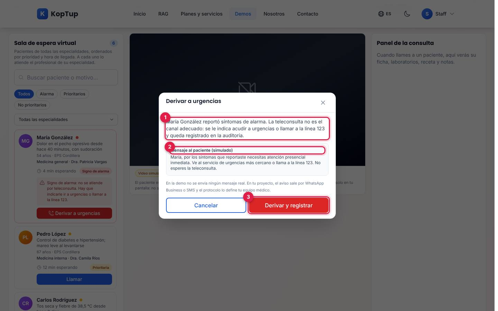

*Ventana «Derivar a urgencias» para María González.*

1. **Qué pasa**: la teleconsulta no es el canal adecuado; se le indica ir a urgencias o llamar a la línea 123 y queda en la auditoría.
2. **Mensaje al paciente (simulado)**: el texto que recibiría por WhatsApp o SMS (no se envía).
3. **Derivar y registrar**: la saca de la sala y crea la atención como «Derivación a urgencias», no facturable.

Luego pulsa **Llamar** en Valeria Gómez. Escríbele un par de mensajes en el chat y pulsa el botón rojo de grabar.

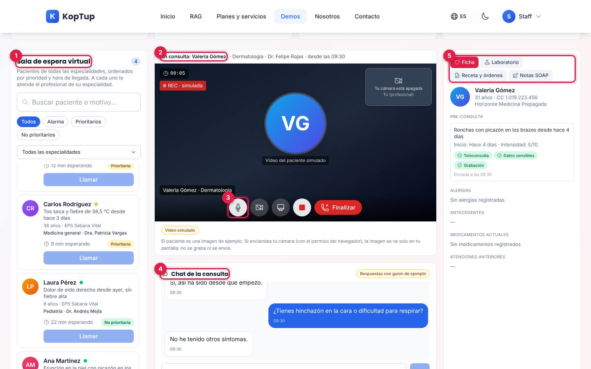

*Consulta en curso con Valeria Gómez: grabación simulada activa, chat con respuestas de guion y su ficha.*

1. **Sala de espera virtual**: pacientes de todas las especialidades, ordenados por prioridad y luego por hora de llegada. Cada tarjeta dice la especialidad y el profesional que lo atiende (y la cita, si vino agendado) y los minutos de espera según el reloj de la demo. Buscador, filtros por prioridad (Todos, Alarma, Prioritarios, No prioritarios) y por especialidad. Mientras hay una consulta abierta, los demás **Llamar** se desactivan («Finaliza la consulta actual para llamar a otro paciente»).
2. **Franja de la consulta**: «En consulta: Valeria Gómez · Dermatología · Dr. Felipe Rojas · desde las …». Debajo, el video simulado: el paciente es un círculo con sus iniciales; arriba, el cronómetro y las insignias «REC · simulada», «Compartiendo pantalla (simulado)» o «Micrófono silenciado»; a la derecha, tu imagen.
3. **Controles**: micrófono, **tu cámara** (el navegador pide permiso; la imagen se ve solo en tu pantalla, no se graba ni se envía), compartir pantalla (simulado), grabar y **Finalizar**. Grabar solo funciona si el paciente lo autorizó en la pre-consulta; si no, avisa «El paciente no autorizó la grabación en la pre-consulta: no se puede grabar» y lo deja en la auditoría.
4. **Chat de la consulta**: el paciente saluda al profesional de su especialidad («Hola, doctor. Gracias por atenderme.») y cada mensaje que envías recibe, en un segundo, la siguiente respuesta de su guion. Cuando se acaba el guion responde «De acuerdo, gracias.».
5. **Panel de la consulta**: pestañas **Ficha**, **Laboratorio**, **Receta y órdenes** y **Notas SOAP**. La ficha muestra documento, edad, grupo sanguíneo, pagador, signos vitales (y de dónde salen), la pre-consulta con sus consentimientos, alergias, antecedentes, medicamentos actuales y atenciones anteriores.

Si **recargas la página** con la consulta abierta, la demo la retoma («Retomamos la consulta en curso con Valeria Gómez»): el cronómetro sigue desde la hora real de inicio y se conservan el chat, el diagnóstico, la receta y las notas. La grabación, compartir pantalla y tu cámara se apagan al recargar.

Qué decir: «El profesional ve todo en una pantalla: quién sigue, por qué, qué autorizó el paciente y su historia».

### Paso 5. Diagnóstico, receta firmada, notas y cierre

En **Receta y órdenes**: busca «L50» y elige L50.9, pulsa **+ Loratadina** y **+ Hidrocortisona**, marca Hemograma completo y pulsa **Firmar receta y órdenes**.

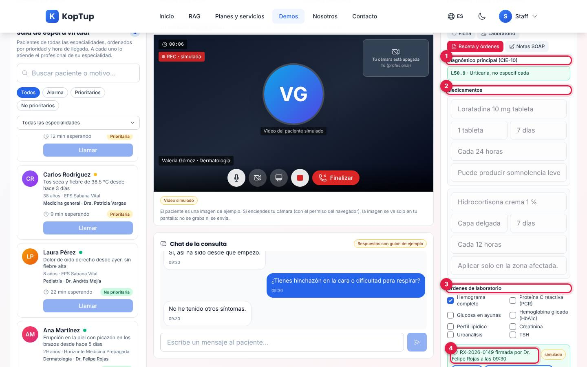

*Receta RX-…-0149 firmada por Dr. Felipe Rojas para Valeria Gómez, con una orden de laboratorio.*

1. **Diagnóstico principal (CIE-10)**: buscador por código o nombre sobre un catálogo reducido de 22 diagnósticos; **Cambiar** lo borra para elegir otro.
2. **Medicamentos**: siete frecuentes con un clic (Acetaminofén, Ibuprofeno, Loratadina, Hidrocortisona, Salbutamol, Amoxicilina y Trimetoprim/sulfametoxazol) u **Otro** en blanco; nombre, dosis, frecuencia, duración e indicaciones se pueden editar. Si el paciente es alérgico (por ejemplo, Ana Martínez a las sulfas o Pedro López al ácido acetilsalicílico y los AINE), aparece «Alerta de alergia: el paciente es alérgico a… Cambia o quita el medicamento para poder firmar» y la firma se bloquea.
3. **Órdenes de laboratorio**: ocho exámenes (hemograma, PCR, glucosa, HbA1c, perfil lipídico, creatinina, uroanálisis y TSH).
4. **Firma**: «RX-…-0149 firmada por Dr. Felipe Rojas a las…» (el profesional de la especialidad del paciente) con tres botones: **PDF** (descarga `RX-<año>-0149.pdf` con la marca de documento de ejemplo y el registro profesional de ejemplo), **Enviar al paciente** («Enviada (simulado)») y **Editar (anula la firma)**. Para firmar hacen falta el diagnóstico y al menos un medicamento u orden, sin alertas de alergia.

Después, en **Notas SOAP**, pulsa **Traer datos de la pre-consulta** (llena S y O con el motivo, el inicio, la intensidad, el tratamiento previo y los signos vitales reportados) y escribe el análisis (A) y el plan (P). Pulsa **Finalizar**: una ventana revisa que haya diagnóstico (obligatorio), que la receta esté firmada o no tenga medicamentos (obligatorio) y que las notas tengan análisis o plan (recomendado), y anticipa el cobro con la tarifa de la especialidad: «Se registrará la atención de Dermatología por $ 98.000 (Horizonte Medicina Prepagada). Paga el paciente: $ 28.000». **Finalizar y generar resumen**:

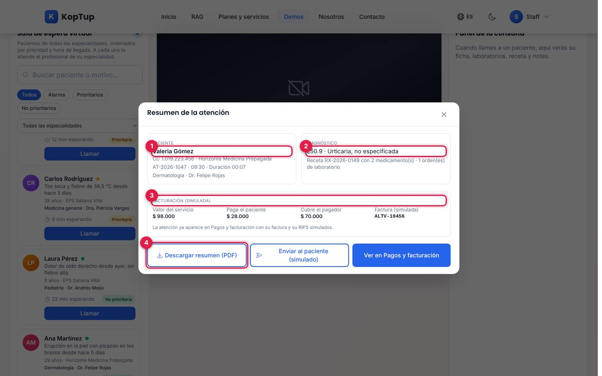

*Resumen de la atención AT-…-1047.*

1. **Paciente**, número de atención, hora, duración exacta (minutos y segundos), especialidad y profesional.
2. **Diagnóstico**, receta y número de órdenes.
3. **Facturación (simulada)**: valor del servicio, lo que paga el paciente, lo que cubre el pagador y el número de factura (ALTV-10456).
4. **Descargar resumen (PDF)** (`resumen-atencion-AT-<año>-1047.pdf`, con datos del paciente, profesional, registro SOAP, receta, órdenes y facturación), **Enviar al paciente (simulado)** y **Ver en Pagos y facturación**.

Si el paciente vino con cita, la cita pasa a **Atendida** en la agenda.

Qué decir: «El sistema no deja cerrar sin diagnóstico ni con una receta sin firmar, porque sin eso no hay factura ni RIPS; y cada consulta se cobra con la tarifa de la especialidad que atendió».

### Paso 6. Cobro, factura y RIPS

**Ver en Pagos y facturación** abre la pestaña con la atención nueva de primera. Pulsa **Cobrar** en Valeria Gómez.

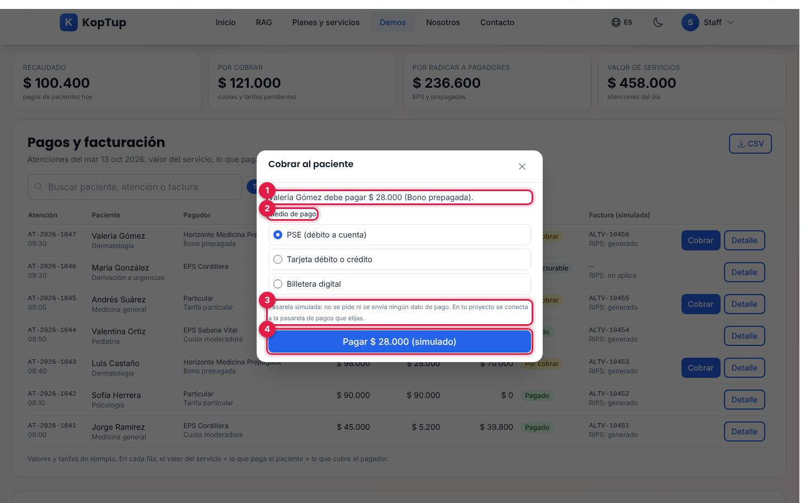

*Ventana «Cobrar al paciente» con el bono de la prepagada de $ 28.000.*

1. **Qué paga y por qué**: «Valeria Gómez debe pagar $ 28.000 (Bono prepagada)».
2. **Medio de pago**: PSE, tarjeta débito o crédito, o billetera digital.
3. **Pasarela simulada**: no se pide ni se envía ningún dato de pago.
4. **Pagar $ 28.000 (simulado)**: tras un segundo dice «Pago aprobado (simulado). Referencia SIM-…» y la fila pasa a **Pagado**.

Luego pulsa **Detalle** en la misma fila:

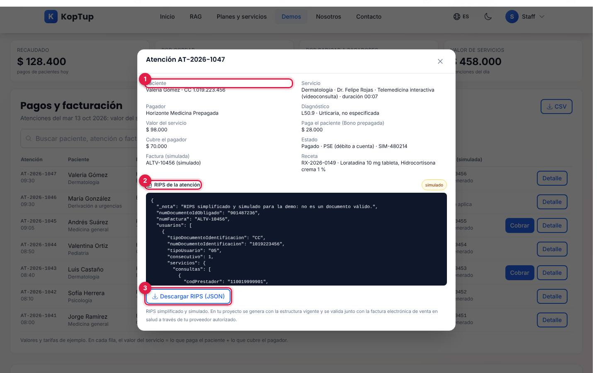

*Detalle de la atención AT-…-1047 con su RIPS simulado.*

1. **Datos de la atención**: paciente, servicio (especialidad, profesional, modalidad y duración), pagador, diagnóstico, valores, estado del pago (medio y referencia), factura simulada y receta.
2. **RIPS de la atención**: el JSON simplificado (prestador, factura, usuario, consulta con el código CUPS de la especialidad, modalidad, diagnóstico sin punto, valor y pago moderador). Empieza con la nota «RIPS simplificado y simulado para la demo: no es un documento válido».
3. **Descargar RIPS (JSON)**: descarga `RIPS-ALTV-10456.json`.

Qué decir: «Cada consulta queda lista para radicar: con su factura y su RIPS, y lo que debe el paciente cobrado en línea».

---

## Pantallas y funciones

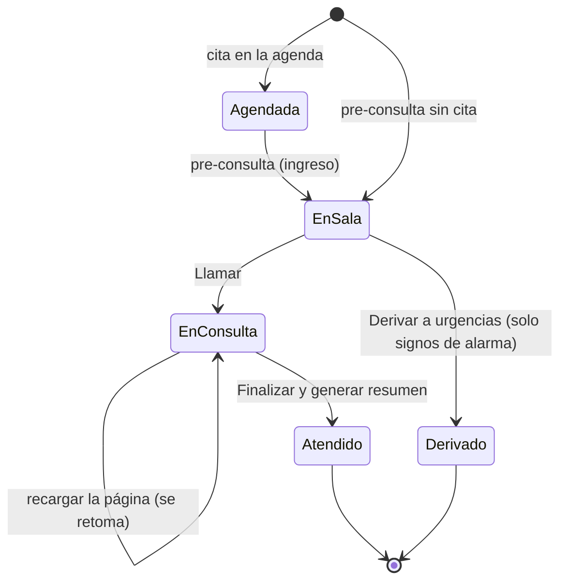

*Estados de un paciente en la demo. «Atendido» crea una atención por cobrar con factura y RIPS; «Derivado» crea una atención no facturable. La cita de la agenda sigue el mismo camino (Agendada, En sala de espera, Atendida o Derivada a urgencias).*

### Encabezado, primeros pasos e indicadores

- **Volver al catálogo de demos**, **Solicitar demo guiada** (`/solicitar-demo?demos=telemedicina`), **Cotizar** (`/contact?service=telemedicina`, que muestra «Estás cotizando: Plataforma de telemedicina») y **Restablecer** (pide confirmación; vuelve a los datos de ejemplo de la jornada de hoy y borra lo que hiciste en ese navegador).
- Título, la línea «Demo interactiva · para IPS y consultorios», para quién es y por dónde empezar, y las insignias **Datos de ejemplo**, **Video, mensajes, pagos y RIPS simulados** y **Jornada de hoy: <fecha> · <hora>**.
- **El reloj de la demo** arranca a las 09:30 cuando abres la jornada y avanza en tiempo real; se guarda, así que una recarga no lo devuelve a las 09:30. Si vuelves otro día, empieza una jornada nueva con los datos de ejemplo («Empezó la jornada de hoy: los datos de ejemplo se restablecieron»).
- Seis pestañas: Consultorio (profesional), Vista del paciente, Orientación de síntomas, Agenda, Laboratorio y Pagos y facturación.
- **Primeros pasos**: los seis pasos del recorrido, con su avance.

| Indicador | Cómo se calcula |
|---|---|
| En sala de espera | Pacientes en espera (incluye los de signo de alarma sin derivar) |
| Espera promedio | Promedio de minutos de espera de la sala, según la hora de llegada y el reloj de la demo |
| Atenciones de hoy | Consultas finalizadas del día (las derivaciones no cuentan) |
| Por cobrar | Suma de lo que deben los pacientes en atenciones por cobrar |

La jornada arranca con 5 pacientes en sala: María González (54 años, signo de alarma, Medicina general), Pedro López (67, prioritario, Medicina interna con Dra. Camila Ríos), Carlos Rodríguez (38, prioritario, Medicina general con Dra. Patricia Vargas), Laura Pérez (8 años, no prioritaria, Pediatría con Dr. Andrés Mejía) y Ana Martínez (29, no prioritaria, Dermatología con Dr. Felipe Rojas). Hay además 5 atenciones hechas entre las 08:00 y las 09:05 (3 pagadas y 2 por cobrar, $ 93.000).

### Consultorio (profesional)

Lo descrito en los [pasos 4 y 5](#paso-4-el-profesional-deriva-la-alarma-y-llama-al-paciente): sala de espera, video, chat y panel de la consulta. Debajo de la sala está el **Registro de auditoría** con los últimos 8 eventos; **Ver completo** abre todos los de la sesión (hasta 300), con buscador y **CSV** (`auditoria-telemedicina-<fecha>.csv`). Cada acción queda registrada con hora y con quién la hizo (Sistema, el profesional por su nombre, el paciente por su nombre o Facturación): orientaciones, citas (con la fecha legible, por ejemplo «el mar 13 oct»), pre-consultas e ingresos con cita, derivaciones, inicio y fin de consultas, cámara, micrófono, grabación, diagnóstico, firma y envío de recetas, facturas, pagos y descargas.

### Vista del paciente

El formulario del [paso 3](#paso-3-el-paciente-hace-su-pre-consulta), el mensaje de ejemplo con el enlace y la tarjeta **Prueba tu cámara y micrófono**: **Probar cámara y micrófono** pide permiso al navegador, muestra tu cámara y una barra con el nivel del micrófono («habla para verlo moverse»); **Detener la prueba** la apaga. La imagen y el sonido se quedan en tu navegador. Si no das permiso o no hay cámara, la tarjeta lo dice («No diste permiso para usar la cámara», «No encontramos una cámara o un micrófono»).

### Orientación de síntomas

El chat y las reglas del [paso 1](#paso-1-el-paciente-describe-sus-síntomas). **Empezar de nuevo** borra el resultado y la conversación.

### Agenda

Lo descrito en el [paso 2](#paso-2-agenda-una-cita-para-hoy). Valores de ejemplo por especialidad y pagador (los mismos con los que se factura la consulta):

| Especialidad | Particular | EPS (valor) | Prepagada (valor) |
|---|---|---|---|
| Medicina general | $ 65.000 | $ 45.000 | $ 58.000 |
| Pediatría | $ 95.000 | $ 62.000 | $ 80.000 |
| Dermatología | $ 120.000 | $ 78.000 | $ 98.000 |
| Medicina interna | $ 130.000 | $ 82.000 | $ 105.000 |
| Psicología | $ 90.000 | $ 55.000 | $ 75.000 |

*Tarifas de ejemplo. Con EPS el paciente paga una cuota moderadora de $ 5.200; con prepagada, un bono de $ 28.000; particular paga todo. El resto lo cubre el pagador.*

### Laboratorio

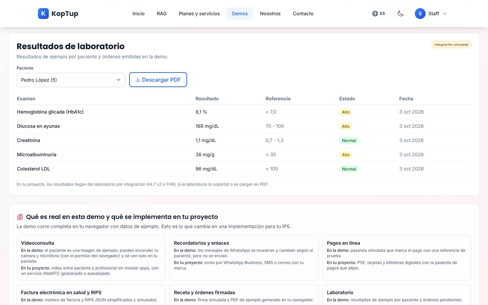

*Resultados de ejemplo de Pedro López, con la hemoglobina glicada, la glucosa y la microalbuminuria en «Alto».*

Elige el paciente (entre paréntesis, cuántos resultados tiene): la tabla muestra examen, resultado, referencia, estado (Normal, Alto, Bajo o Crítico) y fecha (relativa a la jornada de hoy). Debajo, **Órdenes emitidas hoy (pendientes de resultado)** con las órdenes firmadas en la demo para ese paciente. **Descargar PDF** descarga `laboratorio-<paciente>.pdf`. La integración con el laboratorio es simulada (insignia «Integración simulada»).

### Pagos y facturación

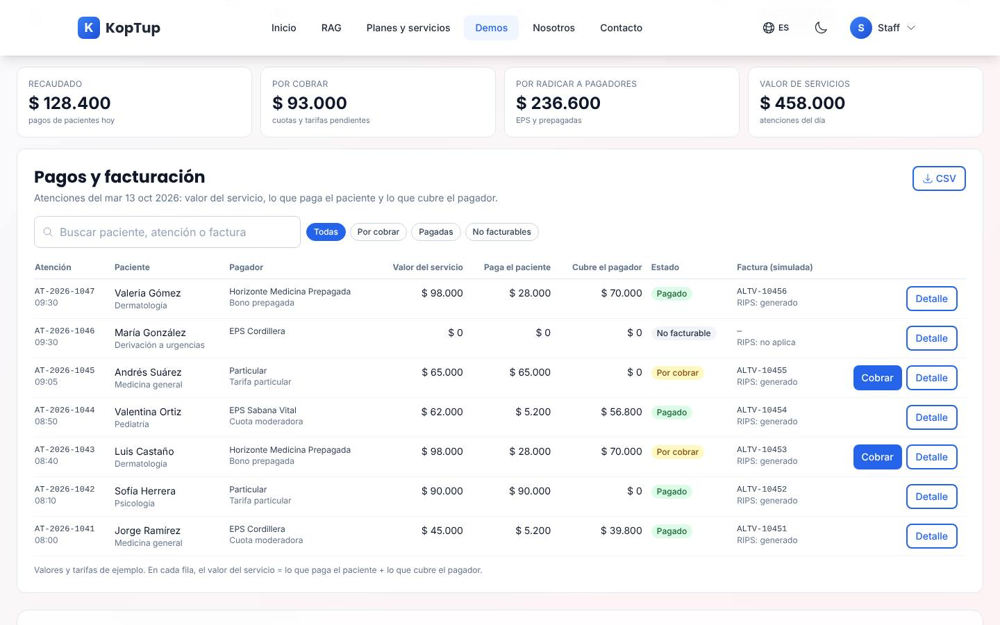

*Atenciones del día después del recorrido: la de Valeria Gómez (Dermatología, prepagada) ya está pagada y la derivación de María González no es facturable.*

- **Totales**: Recaudado (pagos de pacientes), Por cobrar, Por radicar a pagadores (EPS y prepagadas) y Valor de servicios. En cada fila, el valor del servicio = lo que paga el paciente + lo que cubre el pagador, con la tarifa de la especialidad.
- **Buscar** por paciente, atención o factura y filtrar por Todas, Por cobrar, Pagadas o No facturables.
- **CSV** descarga `atenciones-<fecha>.csv` (atención, fecha, paciente, servicio, pagador, diagnóstico, valores, estado, factura y RIPS).
- Por fila: **Cobrar** (solo si está por cobrar; ver el [paso 6](#paso-6-cobro-factura-y-rips)) y **Detalle** (con el RIPS; las derivaciones dicen «Las derivaciones a urgencias no generan factura ni RIPS en esta demo»).

### Qué es real en esta demo y nota final

Al final de la página, nueve tarjetas comparan «En la demo» y «En tu proyecto» (videoconsulta, recordatorios y enlaces, pagos, factura electrónica en salud y RIPS, receta firmada, laboratorio, ficha, orientación de síntomas y auditoría) y una nota cita la Resolución 2654 de 2019 (telesalud y telemedicina) y la Ley 1581 de 2012, aclarando que la habilitación del servicio es responsabilidad de la IPS. **Quiero telemedicina para mi IPS** lleva a la cotización. Debajo, el bloque común de las demos: **Solicitar demo guiada** (`/solicitar-demo?demos=telemedicina`), **Solicitar Cotización** (`/contact`) y **Ver Planes y Precios** (`/services#planes-rag`).

### En el celular

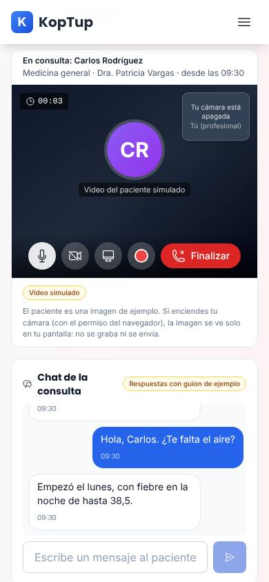

*Consulta en curso en un teléfono (390 px): al llamar a un paciente, la página baja sola hasta la consulta, sin quedar debajo del menú del sitio.*

Los botones del encabezado bajan a una segunda línea, las pestañas se desplazan de lado, los primeros pasos y los indicadores se apilan y el consultorio queda en una columna: sala de espera, auditoría, consulta, chat y panel de la consulta.

---

## Qué es real y qué es simulado

| Parte | Real o simulado | Detalle |
|---|---|---|
| Agenda, pre-consulta, sala de espera por prioridad, consultas, derivaciones | **Funciona de verdad, en el navegador** | La cita de hoy entra a la sala con su especialidad; los pacientes sin cita también. |
| Especialidad y tarifa de cada consulta | **Funciona de verdad** | Cada paciente lo atiende y lo firma el profesional de su especialidad, y se factura con la tarifa de esa especialidad y su pagador (valores de ejemplo). |
| Jornada y reloj | **Real, con hora de ejemplo** | La fecha es la de hoy en Colombia; el reloj arranca a las 09:30 y avanza en tiempo real. Festivos de Colombia calculados para cualquier año. |
| Orientación de síntomas | **Reglas fijas** | Expresiones de palabras clave en el navegador; no hay IA ni diagnóstico. |
| Tu cámara y micrófono | **Reales, solo en tu pantalla** | Con el permiso del navegador; no se graban ni se envían. |
| Video del paciente, compartir pantalla y grabación | **Simulados** | El paciente es una imagen; no hay video ni audio de otra persona. |
| Chat con el paciente | **Simulado (guion)** | Respuestas fijas por paciente, en orden. |
| Alertas de alergia y controles de cierre | **Funcionan de verdad** | Bloquean la firma y el cierre según las reglas descritas. |
| Receta, resumen y laboratorio en PDF | **Real, con datos ficticios** | Se generan en el navegador con la marca «DOCUMENTO DE EJEMPLO… sin validez clínica ni legal»; la firma es simulada. |
| WhatsApp, SMS y enlaces | **Simulados** | Los mensajes cambian según el paciente, pero no se envían; el enlace es de ejemplo. |
| Línea 123 | **Solo texto** | La demo no marca ningún número. |
| Pagos | **Simulados** | Pasarela de mentira; la referencia es `SIM-…`. |
| Factura y RIPS | **Simulados** | Número `ALTV-…` y un JSON simplificado que no es un RIPS válido. |
| CSV de atenciones y de auditoría, RIPS en JSON | **Real, con datos ficticios** | Se descargan desde el navegador. |
| IPS, pacientes, EPS, prepagada, profesionales, documentos y valores | **Ficticios** | NIT con dígito de verificación válido pero inventado; tarifas de ejemplo, no oficiales. |
| Dónde se guarda | **Navegador** | `localStorage` (`koptup:demo:telemedicina:v3`), incluida la consulta en curso; no se envía nada a ningún servidor. |

---

## Acceso

**Cómo lo ve un visitante.** La demo aparece en `/demo` con la tarjeta del catálogo, la insignia «Requiere acceso» y los botones **Solicitar acceso** y **Ya tengo acceso: iniciar sesión**. Si alguien abre `/demo/telemedicina` sin sesión, la web muestra en la misma dirección la pantalla de acceso:

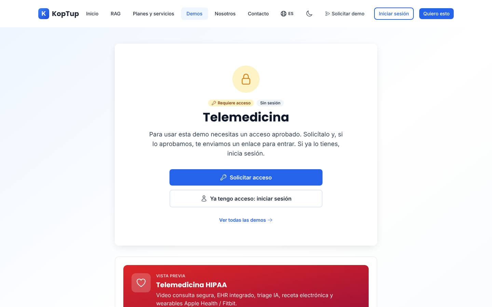

*Lo que ve un visitante sin sesión: «Requiere acceso», «Sin sesión» y los botones para pedir la demo o iniciar sesión. Debajo, una vista previa con el texto del catálogo (ver la limitación 1).*

- **Solicitar acceso** abre `/solicitar-demo?demos=telemedicina` con la demo ya elegida.
- **Ya tengo acceso: iniciar sesión** lleva a `/login` y, al entrar, vuelve a la demo.
- **Ver todas las demos** vuelve a `/demo`.
- Con sesión pero sin acceso, la misma pantalla dice que la cuenta todavía no tiene acceso; si el acceso venció o fue retirado, ofrece pedir más tiempo o solicitarlo de nuevo.

**Cómo se concede.** La solicitud llega a **Admin › Solicitudes de demo**, donde la demo se llama «Telemedicina». Pueden aprobarla los roles **admin** y **sales**. Al aprobar, se crea o se reutiliza la cuenta del prospecto, el acceso dura 14 días por defecto (se extiende o se revoca en **Admin › Accesos a demos**) y la persona recibe un correo con la decisión (con el enlace de activación si su cuenta es nueva). El equipo de KopTup (admin, manager, sales y developer) abre la demo sin solicitud. Solo el admin cambia el modo de acceso, en **Admin › Catálogo de demos**. Detalle en el [Manual del administrador](Doc-06-Manual-del-Administrador.md) y en [Flujos del visitante](Doc-04-Flujos-del-Visitante.md).

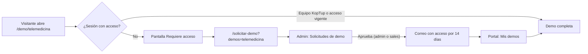

*Camino de un visitante hasta la demo.*

---

## Limitaciones conocidas

1. **La tarjeta del catálogo todavía promete más de lo que hay.** En `/demo` y en la vista previa de la pantalla de acceso dice «Telemedicina HIPAA», «Video call HIPAA-compliant con WebRTC propio», «Triage IA», «EHR/EMR» e «Integración wearables… y farmacias». En la demo no hay video entre dos personas, la orientación de síntomas son reglas fijas sin IA, y no hay wearables ni farmacias. La propia demo lo aclara en «Qué es real en esta demo»; el texto nuevo de la tarjeta está propuesto para el catálogo.
2. **Tres nombres para la misma demo:** «Telemedicina HIPAA» en el catálogo de `/demo`, «Telemedicina para IPS» en la página y «Telemedicina» en el catálogo del admin y en el formulario de solicitud.
3. **El cierre común de las demos no apunta a telemedicina.** En el bloque del final, **Solicitar Cotización** abre `/contact` sin el servicio elegido y **Ver Planes y Precios** abre los planes RAG (`/services#planes-rag`). Los botones propios de la demo (**Cotizar** y **Quiero telemedicina para mi IPS**) sí abren la cotización de la plataforma de telemedicina.
4. **El reloj de la demo no es la hora real.** La fecha es la de hoy, pero el reloj arranca a las 09:30 al abrir la jornada; las horas de consultas, recetas y eventos salen de ese reloj. Si la jornada cambia de día (pasada la medianoche en Colombia), la siguiente carga empieza una jornada nueva y borra lo que habías hecho.
5. **Solo videoconsulta.** La agenda no ofrece consulta telefónica ni presencial, y los pacientes sin cita se asignan a una especialidad por reglas simples (no hay un coordinador que reasigne).
6. **Los cambios viven solo en ese navegador.** Otra persona, otro equipo o una ventana privada ven los datos de ejemplo. Al recargar con una consulta abierta se retoma, pero la grabación, compartir pantalla y tu cámara se apagan.
