# Guía de la demo: Agente de voz con IA para call center

> Ruta `/demo/voice-ai` · Modo de acceso: **Con solicitud** · Tipo: **datos de ejemplo** (llamadas con guion fijo en el navegador; la voz la pone el propio navegador; no llama al servidor ni a un modelo de IA) · Plan del producto: [Voice AI para call center](Producto-voice-ai-callcenter.md)

**Resumen.** Muestra cómo atendería el teléfono un agente de voz con IA en cuatro llamadas de ejemplo en español (banca, salud, cobranza y pedidos): mientras la llamada avanza se ven la transcripción con los datos sensibles enmascarados, la intención, el sentimiento, las acciones que el agente ejecutaría en los sistemas de la empresa y, cuando hace falta, la transferencia a un asesor con todo el contexto. Completan la demo las métricas de la jornada, el registro de llamadas y una campaña saliente de cobranza **editable** que aplica de verdad los horarios, los festivos de Colombia, la frecuencia y la lista de exclusión. Está pensada para gerentes de contact center, cobranza y agendamiento de citas (lo dice el encabezado); se abre solo con un acceso aprobado y lo que haces se guarda solo en tu navegador.

**En esta página:** [Recorrido sugerido](#recorrido-sugerido-demo-comercial-de-5-minutos) · [Pantallas y funciones](#pantallas-y-funciones) · [Qué es real y qué es simulado](#qué-es-real-y-qué-es-simulado) · [Acceso](#acceso) · [Limitaciones conocidas](#limitaciones-conocidas)

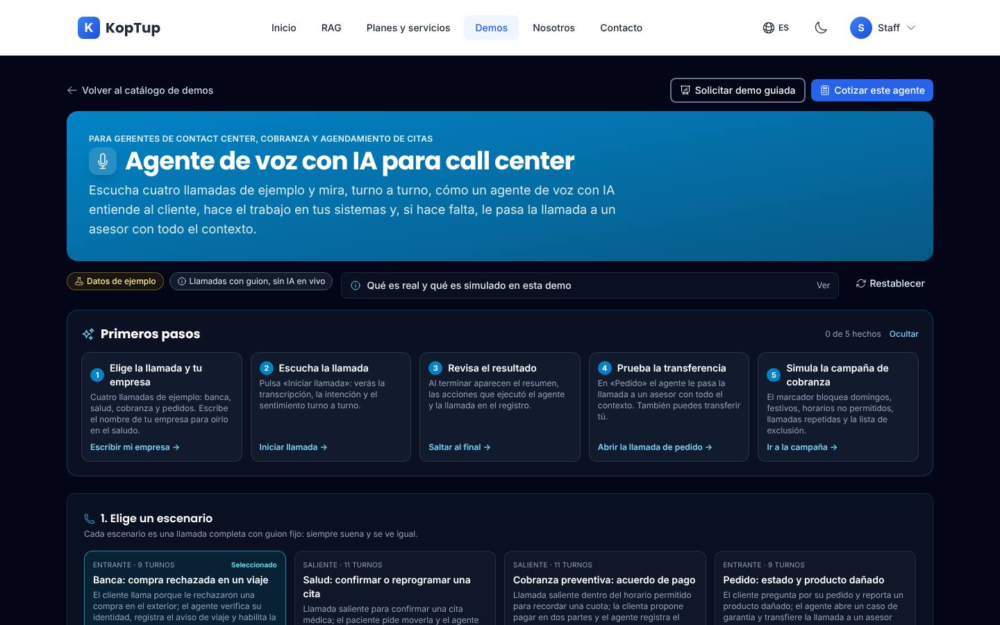

*Vista inicial: volver al catálogo y salidas comerciales arriba, encabezado con para quién es, rótulos «Datos de ejemplo» y «Llamadas con guion, sin IA en vivo», el desplegable «Qué es real y qué es simulado» y la tarjeta **Primeros pasos**.*

---

## Recorrido sugerido (demo comercial de 5 minutos)

La idea que vende: «el agente contesta, verifica, resuelve en tus sistemas y, si no puede, le pasa la llamada a una persona sin que el cliente repita nada». Todo está en una sola página, de arriba abajo, y la tarjeta **Primeros pasos** lleva por los cinco pasos con un botón cada uno (se marcan solos al hacerlos y el avance se guarda). Si alguien ya usó la demo en ese navegador, empieza con **Restablecer** (pide confirmación). Usa un computador con altavoces: la demo habla con la voz de tu navegador.

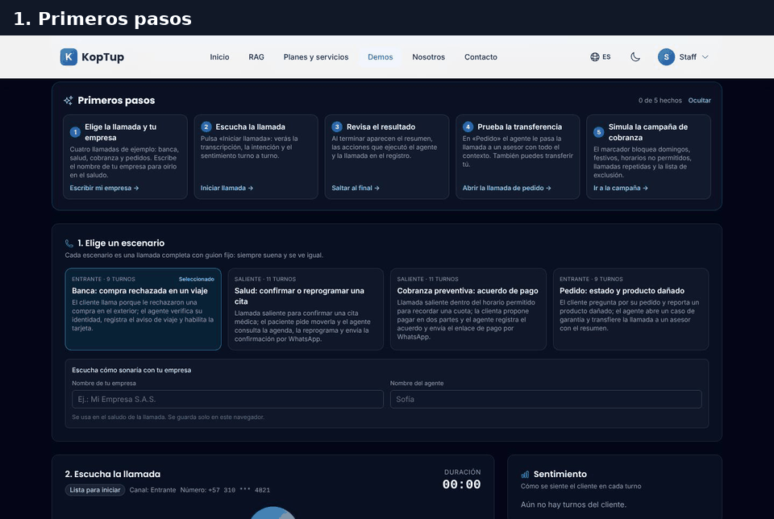

*Recorrido en 7 cuadros: primeros pasos, escenario y tu empresa, llamada en curso, resumen y acciones, transferencia, cumplimiento y métricas, y campaña saliente.*

### Paso 1. Elige el escenario y ponle el nombre del cliente

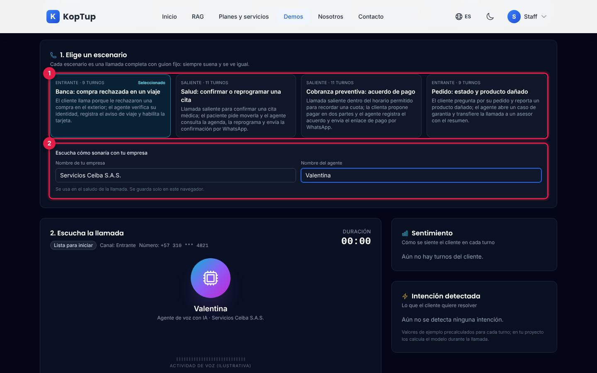

*Escenario «Banca» con la empresa y el agente personalizados.*

1. **Elige un escenario**: cuatro llamadas completas con guion fijo (siempre suenan y se ven igual). Con el teclado, las flechas cambian de escenario; volver a pulsar el escenario elegido lleva a la llamada.

| Escenario | Tipo | Turnos | Duración | Qué pasa |
|---|---|---|---|---|
| Banca: compra rechazada en un viaje | Entrante | 9 | 01:07 | El agente verifica la cédula, consulta movimientos, registra el aviso de viaje y habilita la tarjeta. Resuelve solo. |
| Salud: confirmar o reprogramar una cita | Saliente | 11 | 01:13 | Llama para confirmar una cita; el paciente pide moverla; el agente busca cupos, la reprograma y envía la confirmación por WhatsApp. Resuelve solo. |
| Cobranza preventiva: acuerdo de pago | Saliente | 11 | 01:06 | Recuerda una cuota dentro del horario permitido; la clienta propone pagar en dos partes; el agente registra el acuerdo y envía el enlace de pago. Resuelve solo. |
| Pedido: estado y producto dañado | Entrante | 9 | 01:13 | Consulta el pedido, abre un caso de garantía, pide fotos por WhatsApp y **transfiere** a un asesor con el resumen. |

2. **Escucha cómo sonaría con tu empresa**: el nombre de la empresa (hasta 40 caracteres) y el del agente (hasta 20; por defecto «Sofía») se usan en el saludo, en la transcripción y en el resumen. Se guardan solo en ese navegador. La duración de la llamada no cambia con el nombre.

Qué decir: «Escriban el nombre de su empresa: así sonaría su agente».

### Paso 2. Escucha la llamada

Para una demo rápida, elige **Velocidad 2×** antes de iniciar. La captura está en pausa en 00:30, justo cuando el agente verifica la identidad.

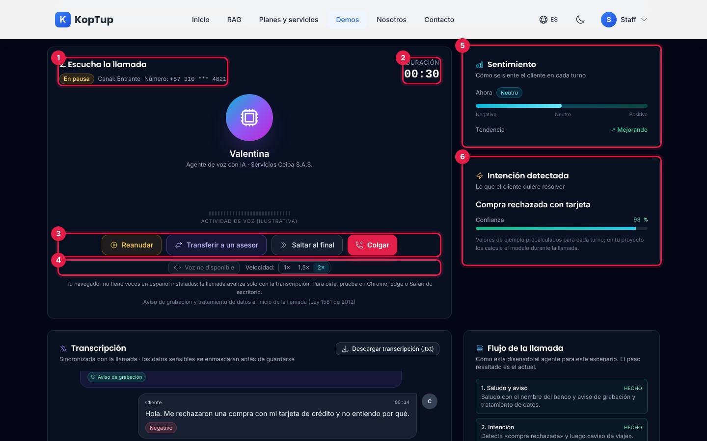

*Llamada de banca en pausa: la intención ya se detectó y el sentimiento va mejorando.*

1. **Estado y datos de la llamada**: Lista para iniciar, En curso, En pausa, Transferida a un asesor o Finalizada; canal (entrante o saliente) y número enmascarado.
2. **Duración**: el reloj de la llamada según el guion (cada turno tiene una duración fija).
3. **Controles**: **Pausar** / **Reanudar**, **Transferir a un asesor**, **Saltar al final** y **Colgar**. Al terminar aparece **Repetir llamada**.
4. **Voz y velocidad**: activar o silenciar la voz y elegir 1×, 1,5× o 2×. Debajo, una nota dice qué voz se está usando. En el navegador de las capturas no había voces en español, por eso dice «Voz no disponible» y «Tu navegador no tiene voces en español instaladas: la llamada avanza solo con la transcripción. Para oírla, prueba en Chrome, Edge o Safari de escritorio.».
5. **Sentimiento**: cómo se siente el cliente ahora (Negativo, Neutro o Positivo), en una barra, y la tendencia (Mejorando, Estable o Empeorando).
6. **Intención detectada**: lo que el cliente quiere resolver y la confianza (aquí, «Compra rechazada con tarjeta», 93 %). Son valores precalculados por turno; la propia tarjeta lo aclara.

En el centro, el círculo cambia de color y el texto dice «Habla Valentina» o «Habla el cliente»; la onda de voz es ilustrativa. El cliente suena con otra voz del navegador o con un tono más grave. Si la voz está activa, la llamada espera a que termine de hablar antes de pasar al siguiente turno.

Qué decir: «Mientras habla, el supervisor ya sabe qué quiere el cliente y cómo está».

### Paso 3. Resumen, transcripción y acciones

Deja terminar la llamada (o pulsa **Saltar al final**, también desde Primeros pasos). Aparece el resumen y se completa todo lo de abajo.

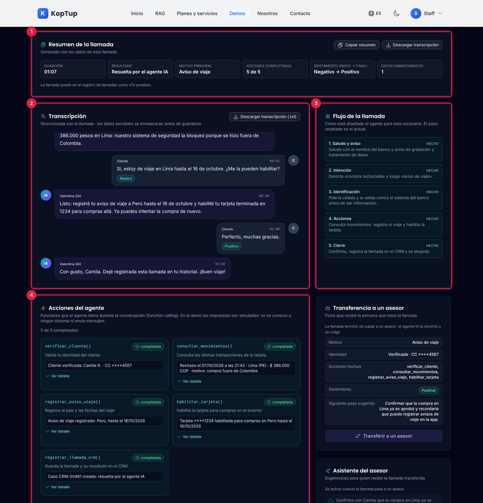

*Llamada de banca terminada: resuelta por el agente en 01:07, 5 de 5 acciones completadas.*

1. **Resumen de la llamada**: duración, resultado (Resuelta por el agente IA, Transferida a un asesor o Colgada antes de terminar), motivo principal, acciones completadas, sentimiento de inicio a fin y datos enmascarados. **Copiar resumen** lo copia como texto; **Descargar transcripción** baja el `.txt`. La llamada queda en el registro como «Tu prueba».
2. **Transcripción**: sincronizada con la llamada, con la hora de cada turno, el sentimiento de cada intervención del cliente y las marcas «Aviso de grabación» y «Dato enmascarado» (la cédula aparece como `CC ****4567`; en voz se lee completa, en la transcripción y en el archivo no). **Descargar transcripción (.txt)** baja `transcripcion-banca.txt` (en la versión en inglés, `transcript-banking.txt`).
3. **Flujo de la llamada**: los pasos con que está diseñado el agente para ese escenario (Saludo y aviso, Intención, Identificación, Acciones, Cierre o Transferencia), cada uno «hecho», «en curso» o «pendiente».
4. **Acciones del agente** (function calling): el subtítulo aclara que en la demo las respuestas son simuladas y que no se conecta a ningún sistema ni envía mensajes. Cada función muestra su estado (pendiente, ejecutando…, completada o «no se ejecutó» si la llamada terminó antes) y su resultado, por ejemplo `habilitar_tarjeta()` → «Tarjeta ****1234 habilitada para compras en Perú hasta el 16/10/2026». **Ver detalle** muestra la solicitud en JSON, la respuesta y con qué sistema se conectaría en un proyecto (sistema bancario central, agenda médica, cartera, pasarela de pagos, WhatsApp Business, CRM, tienda, mesa de ayuda o plataforma de contact center). En la versión en inglés, los nombres de las funciones (`create_payment_link()`, `verify_customer()`…) y los campos de la solicitud JSON están en inglés.

Qué decir: «No es solo una voz bonita: hace el trabajo en tus sistemas y deja la evidencia».

### Paso 4. Transferencia a un asesor con contexto

Pulsa **Abrir la llamada de pedido** en Primeros pasos (o elige **Pedido: estado y producto dañado**), luego **Iniciar llamada** y **Saltar al final**. Esta llamada termina transferida.

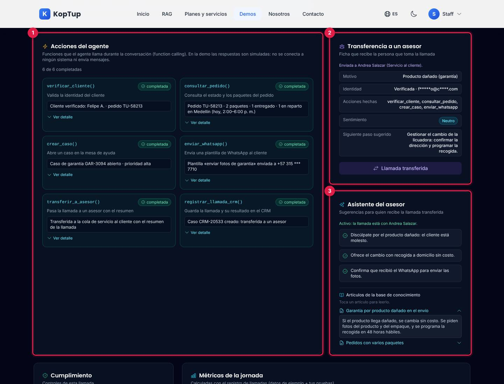

*Llamada de pedido transferida a Andrea Salazar (Servicio al cliente), con un artículo de la base de conocimiento abierto.*

1. **Acciones del agente**: las seis funciones completadas, de `verificar_cliente()` a `transferir_a_asesor()` y `registrar_llamada_crm()`.
2. **Transferencia a un asesor**: la ficha que recibe la persona: motivo, identidad verificada (con el correo enmascarado), acciones hechas, sentimiento y siguiente paso sugerido. Antes de transferir dice «Vista previa: esto recibiría el asesor si transfieres ahora»; el botón **Transferir a un asesor** solo funciona con la llamada en curso o en pausa.
3. **Asistente del asesor**: se activa cuando la llamada pasa a una persona («Activo: la llamada está con Andrea Salazar»): tres sugerencias y dos artículos de la base de conocimiento que se abren con un toque.

También puedes transferir a mano en cualquier escenario con **Transferir a un asesor** durante la llamada: la transcripción cierra con «Transferiste la llamada a … con el resumen de la conversación» y las acciones que faltaban quedan como «no se ejecutó».

Qué decir: «El asesor recibe la llamada sabiendo todo; el cliente no repite su cédula ni su problema».

### Paso 5. Cumplimiento y métricas

Elige **Cobranza preventiva**, iníciala y salta al final. Baja hasta **Cumplimiento** y **Métricas de la jornada**.

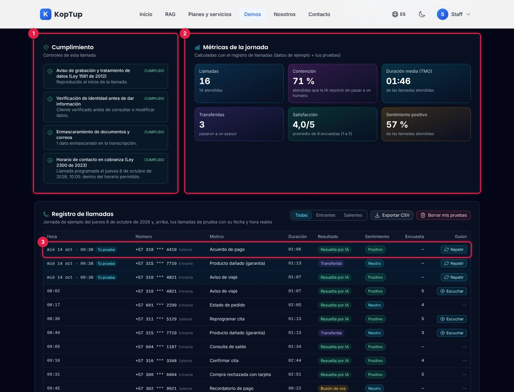

*Controles de la llamada de cobranza y métricas de la jornada con tres llamadas de prueba (banca, pedido y cobranza).*

1. **Cumplimiento**: aviso de grabación y tratamiento de datos (Ley 1581 de 2012), verificación de identidad antes de dar información, enmascaramiento de documentos y correos, y horario de contacto en cobranza (Ley 2300 de 2023). Cada control dice «cumplido», «pendiente» o «no aplica» (por ejemplo, el horario no aplica a una llamada entrante ni a una que no es de cobranza). En cobranza: «Llamada programada el jueves 8 de octubre de 2026, 10:05: dentro del horario permitido».
2. **Métricas de la jornada**: se calculan con el registro de llamadas (las 13 de ejemplo más tus pruebas).
3. **Tu prueba** en el registro: cada llamada que terminas queda arriba del registro, con su fecha y hora reales de Bogotá, y entra en las métricas.

| Métrica | Cómo se calcula | Con las 13 llamadas de ejemplo |
|---|---|---|
| Llamadas | Todas las del registro, y cuántas se atendieron (resueltas, transferidas o colgadas) | 13 (11 atendidas) |
| Contención | Atendidas que la IA resolvió sin pasar a un humano, sobre las atendidas | 73 % |
| Duración media (TMO) | Promedio de duración de las atendidas | 01:56 |
| Transferidas | Llamadas que pasaron a un asesor | 2 |
| Satisfacción | Promedio de la encuesta de 1 a 5 | 4,0/5 (8 encuestas) |
| Sentimiento positivo | Atendidas que terminaron con sentimiento positivo | 55 % |

*Con las tres pruebas de la captura quedan 16 llamadas (14 atendidas), 71 % de contención, 01:46 de TMO, 3 transferidas y 57 % de sentimiento positivo; tus pruebas no tienen encuesta.*

Qué decir: «Todo queda medido: cuánto resuelve solo, cuánto dura y cómo sale el cliente».

### Paso 6. Campaña saliente con reglas de horario

Pulsa **Ir a la campaña** en Primeros pasos (o baja hasta **Campaña saliente: recordatorio de pago**). Agrega un contacto, excluye o quita alguno si quieres, y pulsa **Simular campaña**: el marcador recorre los contactos en orden de fecha y hora (unos 5 segundos para los 14 de ejemplo).

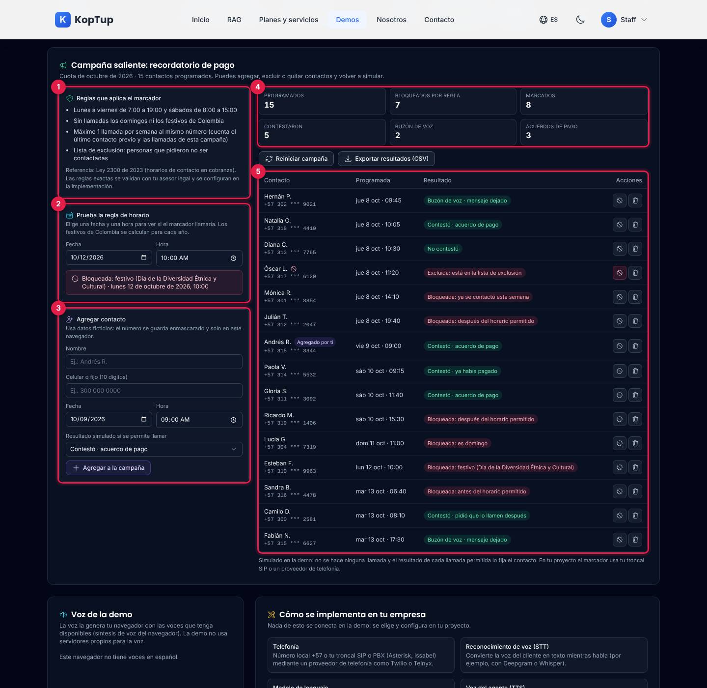

*Campaña con un contacto agregado (Andrés R.): 15 programados, 7 bloqueados por regla y 3 acuerdos de pago; la prueba de horario muestra que el 12 de octubre es festivo.*

1. **Reglas que aplica el marcador**: lunes a viernes de 7:00 a 19:00 y sábados de 8:00 a 15:00; sin domingos ni festivos de Colombia; máximo una llamada por semana al mismo número (cuenta el último contacto previo y las llamadas que la propia campaña ya hizo esa semana); lista de exclusión. Con la referencia a la Ley 2300 de 2023 y la nota de validar las reglas con un asesor legal.
2. **Prueba la regla de horario**: elige una fecha (entre 2024 y 2099) y una hora y la demo dice si el marcador llamaría o por qué no (domingo, festivo con su nombre, antes o después del horario). Los festivos de Colombia se calculan para cada año (fijos, trasladables al lunes por la Ley 51 de 1983 y los que dependen de la Pascua). Viene con el domingo 11 de octubre de 2026 a las 11:00.
3. **Agregar contacto**: nombre, celular (3xx) o fijo (60x) de 10 dígitos, fecha, hora y el resultado simulado si la regla permite llamar. El número se guarda enmascarado (`+57 315 *** 3344`) y solo en ese navegador; si no es válido (o la fecha no está entre 2024 y 2099), la demo lo dice. La campaña admite hasta 40 contactos: al llegar al tope, el formulario dice «La demo admite hasta 40 contactos: quita alguno para agregar otro.». Si agregas un contacto con el número de Mónica R. (`301 *** 8854`) esa misma semana, sale «Bloqueada: ya se contactó esta semana».
4. **Indicadores**: programados, bloqueados por regla, marcados, contestaron, buzón de voz y acuerdos de pago.
5. **Contactos**: cada uno con su hora programada, el resultado («Contestó · acuerdo de pago», «Buzón de voz · mensaje dejado», «No contestó», «Contestó · ya había pagado», «Contestó · pidió que lo llamen después») o el motivo del bloqueo (excluida, ya contactada esta semana, después del horario, domingo, festivo, antes del horario), y dos botones: **excluir / quitar de la lista de exclusión** y **quitar de la campaña**. Cambiar la campaña después de simularla la deja otra vez en espera («La campaña cambió: vuelve a simularla»). Mientras marca no se puede editar.

**Reiniciar campaña** la vuelve a dejar en espera y **Exportar resultados (CSV)** baja `campana-recordatorio-pago.csv`. La campaña (contactos y avance) se guarda en el navegador; si recargas a mitad, el botón dice **Continuar campaña**.

Qué decir: «El marcador no llama a quien no debe ni cuando no debe».

---

## Pantallas y funciones

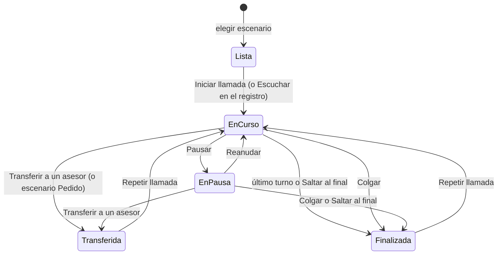

*Estados de la llamada. Al llegar a Finalizada o Transferida, la llamada se guarda en el registro como «Tu prueba» (resuelta, transferida o colgada).*

### Encabezado y primeros pasos

- Arriba: **Volver al catálogo de demos**, **Solicitar demo guiada** (`/solicitar-demo?demos=voice-ai`) y **Cotizar este agente** (`/contact?service=voice-ai-callcenter`, con el producto preseleccionado). El cierre de la página repite los dos botones.
- Encabezado: para quién es («Para gerentes de contact center, cobranza y agendamiento de citas»), título y qué hace la demo.
- Rótulos **Datos de ejemplo** y **Llamadas con guion, sin IA en vivo**; desplegable **Qué es real y qué es simulado en esta demo** (seis puntos, los mismos de la [tabla de abajo](#qué-es-real-y-qué-es-simulado)).
- **Restablecer**: pide confirmación (Escape la cancela) y borra tus llamadas de prueba, la personalización, la voz elegida, el avance de los primeros pasos y los cambios de la campaña; vuelve al escenario Banca.
- **Primeros pasos**: cinco pasos con su botón (**Escribir mi empresa**, **Iniciar llamada**, **Saltar al final**, **Abrir la llamada de pedido**, **Ir a la campaña**), contador «x de 5 hechos» y **Ocultar** / **Mostrar**.

### Escenario y llamada

Lo descrito en los [pasos 1 a 4](#paso-1-elige-el-escenario-y-ponle-el-nombre-del-cliente). Cada turno tiene una duración fija (igual en español e inglés y con cualquier nombre de empresa), así que la llamada de banca dura 01:07 y la de pedido 01:13 a velocidad normal. Si la voz del navegador está activa, la llamada espera a que termine de hablar antes de pasar al siguiente turno. Cambiar de escenario reinicia la llamada. En la versión en inglés del sitio, los guiones, la transcripción y la voz del navegador están en inglés.

### Transcripción, flujo, acciones, transferencia y asistente

Ver los [pasos 3 y 4](#paso-3-resumen-transcripción-y-acciones). Antes de iniciar, la transcripción dice «Pulsa «Iniciar llamada» para empezar.»; si cuelgas antes de terminar, cierra con «La llamada se colgó antes de terminar.».

### Registro de llamadas

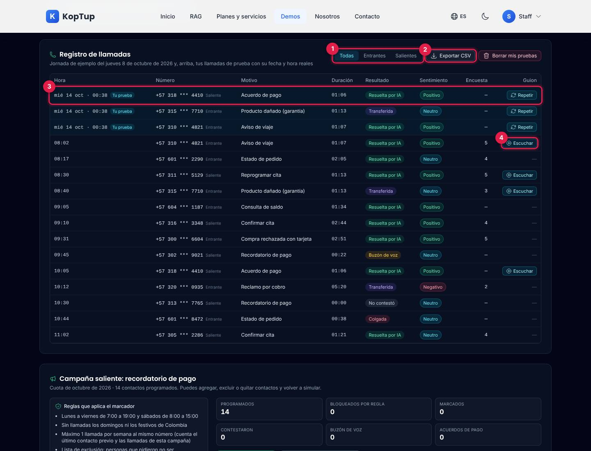

*Registro con tres llamadas de prueba arriba (con su fecha y hora) y las 13 de la jornada de ejemplo.*

1. **Filtro por canal**: Todas, Entrantes y Salientes.
2. **Exportar CSV** (`registro-llamadas-ejemplo.csv`, separado por punto y coma, con la columna «Fecha y hora»). **Borrar mis pruebas** solo aparece si hay pruebas.
3. **Tu prueba**: fecha y hora reales de Bogotá (por ejemplo «mié 14 oct · 10:05») y **Repetir**, que vuelve a reproducir esa llamada.
4. **Escuchar**: solo en las cuatro filas que son las llamadas del guion (08:02 banca, 08:30 salud, 08:40 pedido y 10:05 cobranza): mismo número, hora, duración, motivo, resultado y sentimiento final. Abre esa llamada en el reproductor, la inicia, sube hasta ella y lleva el foco del teclado al título de la llamada (lo mismo hacen los botones de Primeros pasos). Las demás filas solo existen en el registro y muestran «—».
5. **Motivo de tus pruebas**: el último motivo detectado en la parte de la llamada que alcanzaste a escuchar. Si cuelgas o transfieres antes de que se detecte el motivo, la fila dice «Sin motivo detectado» (igual que el resumen, que muestra «—»).

Jornada de ejemplo del jueves 8 de octubre de 2026: 7 entrantes y 6 salientes, de 08:02 a 11:02. Columnas: hora, número enmascarado y canal, motivo, duración, resultado (Resuelta por IA, Transferida, Colgada, Buzón de voz o No contestó), sentimiento, encuesta y guion. En el celular cada llamada se muestra como una tarjeta con los mismos datos y el botón **Escuchar** o **Repetir**.

### Voz de la demo, implementación y glosario

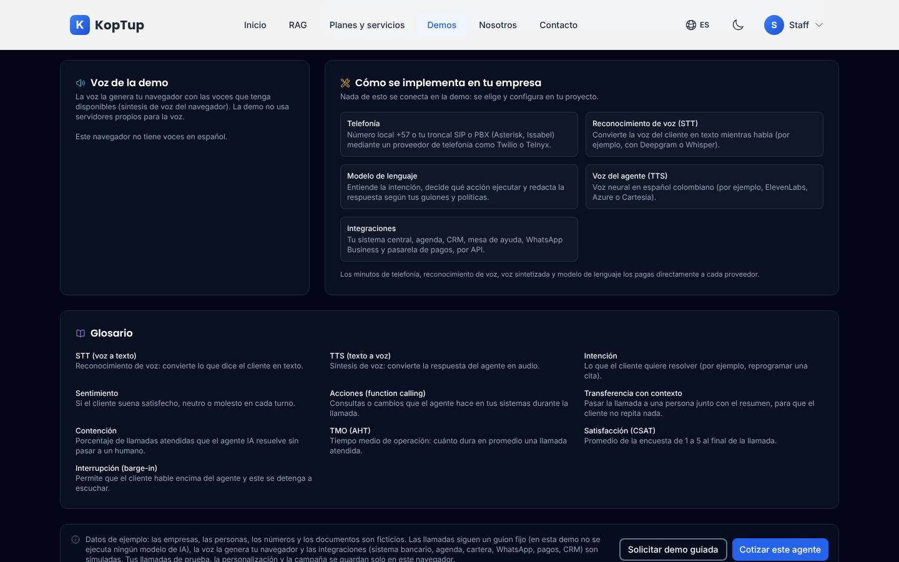

*Tarjetas del final de la página, en un navegador sin voces en español.*

- **Voz de la demo**: si el navegador tiene voces en español, permite elegir la voz del agente («Automática» elige la mejor, prefiriendo es-CO, luego español latinoamericano, de Estados Unidos, México y España). Si no hay, dice «Este navegador no tiene voces en español.».
- **Cómo se implementa en tu empresa**: telefonía (número +57, troncal SIP o PBX con un proveedor como Twilio o Telnyx), reconocimiento de voz (STT), modelo de lenguaje, voz del agente (TTS) e integraciones; los minutos de cada proveedor los paga el cliente directamente.
- **Glosario**: STT, TTS, intención, sentimiento, acciones (function calling), transferencia con contexto, contención, TMO, satisfacción (CSAT) e interrupción (barge-in).
- Nota final de datos de ejemplo con **Solicitar demo guiada** y **Cotizar este agente**, y el bloque común de las demos: **Solicitar demo guiada** (`/solicitar-demo?demos=voice-ai`), **Solicitar Cotización** (`/contact`) y **Ver Planes y Precios** (`/services#planes-rag`).

### En el celular

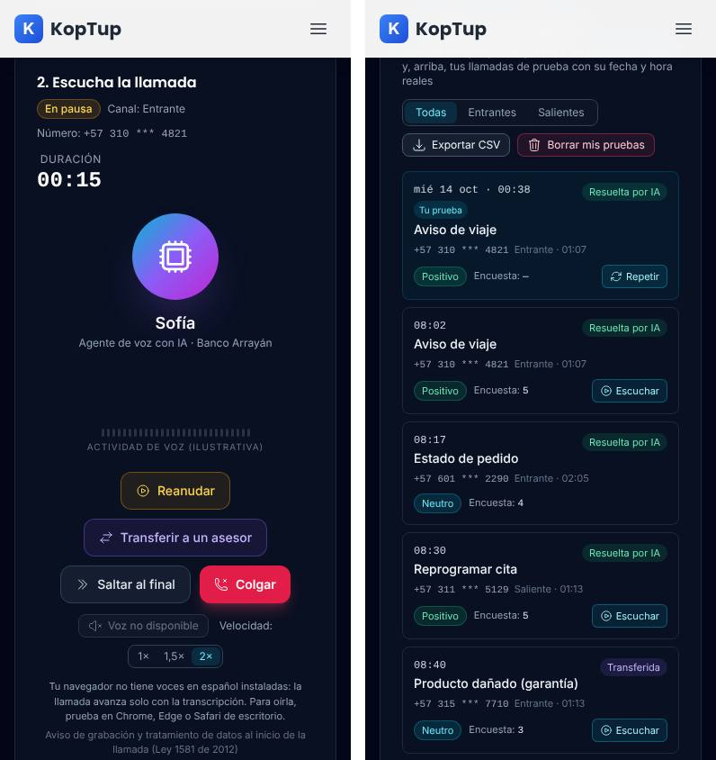

*En un teléfono (390 px): la llamada de banca en pausa y el registro de llamadas en tarjetas, con una prueba arriba.*

Todo se apila en una columna: primeros pasos, escenarios, llamada, sentimiento, intención, transcripción, flujo, acciones, transferencia, asistente, cumplimiento, métricas, registro (una tarjeta por llamada, sin desplazamiento lateral) y campaña (la fecha programada va debajo de cada contacto). Los controles de la llamada se acomodan en varias filas. La página no se desborda a lo ancho.

---

## Qué es real y qué es simulado

| Parte | Real o simulado | Detalle |
|---|---|---|
| Las cuatro llamadas | **Guion fijo** | Textos, turnos, duración, intención, confianza y sentimiento están escritos de antemano; no hay reconocimiento de voz ni modelo de IA. La demo lo dice en los rótulos y en «Qué es real y qué es simulado». |
| Voz | **Real, del navegador** | Síntesis de voz del navegador (Web Speech API) con las voces instaladas en el equipo; no usa servidores. Si no hay voces en español, la llamada avanza solo con texto. |
| Acciones del agente | **Simuladas** | Las respuestas de cada función son fijas; no se conecta a ningún sistema ni envía WhatsApp ni enlaces de pago (lo dice el subtítulo de la tarjeta). |
| Transferencia y asistente del asesor | **Simulados** | Muestran la ficha y las sugerencias; no hay asesor ni cola real. |
| Enmascaramiento | **Datos ya enmascarados** | Los documentos, correos y números vienen enmascarados en el guion; los números que agregas a la campaña se enmascaran al guardarlos. |
| Reglas de horario, festivos, exclusión y frecuencia | **Funcionan de verdad** | Se calculan en el navegador, con los festivos de Colombia de cada año entre 2024 y 2099. |
| Campaña saliente | **Simulada, editable** | No se hace ninguna llamada. Puedes agregar, excluir y quitar contactos; el resultado de cada llamada permitida lo fija el contacto. |
| Métricas | **Cálculo real sobre datos de ejemplo** | Con el registro de ejemplo más tus pruebas. |
| Transcripción `.txt`, resumen copiado y CSV | **Real, con datos ficticios** | Se generan en el navegador. |
| Empresas, personas, números y documentos | **Ficticios** | Banco Arrayán, IPS Monteclaro, Créditos Guadua y Casa Tucán. |
| Dónde se guarda | **Navegador** | `localStorage`: `koptup-demo-voice-ai-v1` (tus últimas 50 llamadas de prueba, la personalización, la voz, la velocidad, si la voz está activa y el avance de los primeros pasos) y `koptup-demo-voice-ai-campaign-v1` (contactos y avance de la campaña). |

---

## Acceso

**Cómo lo ve un visitante.** La demo aparece en `/demo` con la tarjeta «Voice AI / Call Center», la insignia «Requiere acceso» y los botones **Solicitar acceso** y **Ya tengo acceso: iniciar sesión**. Si alguien abre `/demo/voice-ai` sin sesión, la web muestra en la misma dirección la pantalla de acceso:

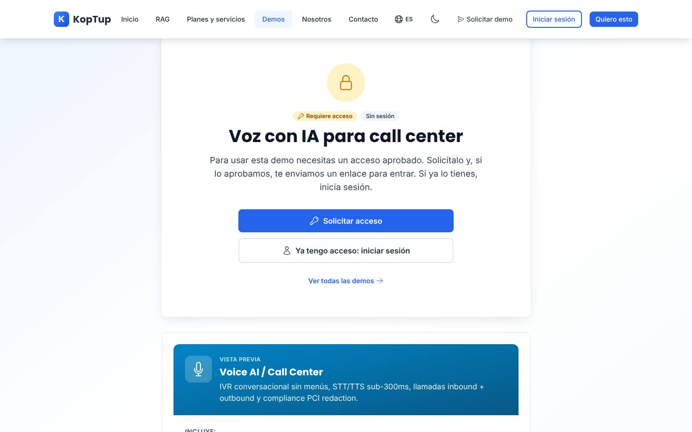

*Lo que ve un visitante sin sesión: «Requiere acceso», «Sin sesión» y los botones para pedir la demo o iniciar sesión. Debajo, una vista previa con el texto del catálogo (ver [limitación 2](#limitaciones-conocidas)).*

- **Solicitar acceso** abre `/solicitar-demo?demos=voice-ai` con la demo ya elegida.
- **Ya tengo acceso: iniciar sesión** lleva a `/login` y, al entrar, vuelve a la demo.
- **Ver todas las demos** vuelve a `/demo`.
- Con sesión pero sin acceso, la misma pantalla dice que la cuenta todavía no tiene acceso; si el acceso venció o fue retirado, ofrece pedir más tiempo o solicitarlo de nuevo. Si el servidor no responde, dice «No pudimos verificar tu acceso» y ofrece **Intentar de nuevo**.

**Cómo se concede.** La solicitud llega a **Admin › Solicitudes de demo**, donde la demo se llama «Voz con IA para call center». Pueden aprobarla los roles **admin** y **sales**. Al aprobar, se crea o se reutiliza la cuenta del prospecto, el acceso dura 14 días por defecto (se extiende o se revoca en **Admin › Accesos a demos**) y la persona recibe un correo con la decisión (con el enlace de activación si su cuenta es nueva). El equipo de KopTup (admin, manager, sales y developer) abre la demo sin solicitud. Solo el admin cambia el modo de acceso, en **Admin › Catálogo de demos**. Detalle en el [Manual del administrador](Doc-06-Manual-del-Administrador.md) y en [Flujos del visitante](Doc-04-Flujos-del-Visitante.md).

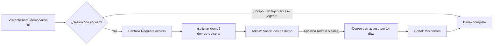

*Camino de un visitante hasta la demo.*

---

## Limitaciones conocidas

1. **No hay IA ni reconocimiento de voz.** Las llamadas siguen un guion fijo: no puedes hablarle al agente ni cambiar lo que responde; la intención, la confianza y el sentimiento están precalculados. La demo ya lo dice arriba (rótulo «Llamadas con guion, sin IA en vivo» y el desplegable «Qué es real y qué es simulado»), pero sigue siendo una demostración del flujo, no del modelo.
2. **La tarjeta del catálogo y la vista previa de la pantalla de acceso todavía prometen más.** Hablan de «IVR conversacional sin menús», «STT/TTS sub-300ms», «STT streaming (Whisper, Deepgram, AssemblyAI)», «TTS realista (ElevenLabs, Cartesia, Play.ht) con barge-in» y «PCI redaction». El texto nuevo, que describe lo que hace la demo, está propuesto y pendiente de aplicar en el catálogo (`messages/demos/_catalog.*.json`).
3. **La voz depende del navegador.** Si el equipo no tiene voces en español (pasa en algunos Linux, navegadores sin voces o modos sin audio), el botón dice «Voz no disponible» y la llamada avanza solo con texto. Las capturas de esta página se tomaron así. Con voz, la calidad y el acento son los del sistema operativo, no una voz neural colombiana.
4. **La campaña simula los resultados.** Las reglas (horario, domingos, festivos, frecuencia y exclusión) se calculan de verdad y lo que pasa en cada llamada permitida lo fija el contacto. Las reglas no se editan desde la demo a propósito: son las de la referencia legal (Ley 2300 de 2023) y en un proyecto se ajustan con el asesor legal del cliente; lo que sí se edita son los contactos, la exclusión y las fechas. La prueba de horario decide fechas entre 2024 y 2099. Como la demo solo guarda el número enmascarado, la regla de frecuencia trata como el mismo número a dos que compartan los tres primeros y los cuatro últimos dígitos (así se puede probar con los contactos de ejemplo, cuyo número completo no se muestra).
5. **La jornada de ejemplo es un día fijo.** El registro y la campaña de ejemplo son del 8 al 13 de octubre de 2026; tus pruebas sí llevan su fecha y hora reales y van arriba del registro.
6. **Los cambios viven solo en ese navegador.** Otra persona, otro equipo o una ventana privada ven los datos de ejemplo.
7. **El bloque común del final no apunta a este producto.** **Ver Planes y Precios** abre los planes RAG (`/services#planes-rag`) y **Solicitar Cotización** abre `/contact` sin el producto; los botones propios de la demo (**Cotizar este agente**) sí lo preseleccionan.
8. **Tres nombres para la misma demo:** «Agente de voz con IA para call center» en la página, «Voice AI / Call Center» en el catálogo y «Voz con IA para call center» en la pantalla de acceso y en el admin, hasta que se apliquen los cambios de nombre propuestos.
