# Guía de la demo: WMS y logística de bodegas

> Ruta `/demo/wms-logistica` · Modo de acceso: **Con solicitud** · Tipo: **datos de ejemplo** (todo corre en el navegador y se guarda en ese navegador hasta el final del día; no llama al servidor ni usa IA) · Plan del producto: [WMS y logística de bodegas](Producto-wms-logistica.md)

**Resumen.** Es un WMS de ejemplo que funciona de verdad dentro del navegador, con la operación de un operador logístico (3PL) ficticio, **LogiSabana Demo S.A.S.**, que tiene tres bodegas (CEDI Funza, Bodega Itagüí y Bodega Barranquilla) y guarda mercancía de tres clientes ficticios (cosmética, hogar y suplementos). El visitante recibe una orden de compra con escaneo, ubica lo recibido con reglas explicables, libera una ola de pedidos que reserva el stock por FEFO, la alista con la vista del alistador, empaca y genera la guía con su etiqueta en PDF, registra la entrega con firma en la app del conductor y la ve en el seguimiento. Cada paso cambia el inventario, el kardex, los indicadores y la prefactura 3PL. También hay mapa de ubicaciones, existencias por lote y vencimiento, conteo cíclico ABC, cross-dock, kits, transportadoras con cotizador, ruteo de flota propia y devoluciones. Las fechas y horas salen del momento en que se abre la demo. Sirve para mostrarle a un operador logístico, una marca de comercio electrónico o una distribuidora **cómo se vería** su operación; se abre solo con un acceso aprobado.

**En esta página:** [Recorrido sugerido](#recorrido-sugerido-demo-comercial-de-5-minutos) · [Pantallas y funciones](#pantallas-y-funciones) · [Qué es real y qué es simulado](#qué-es-real-y-qué-es-simulado) · [Acceso](#acceso) · [Limitaciones conocidas](#limitaciones-conocidas)

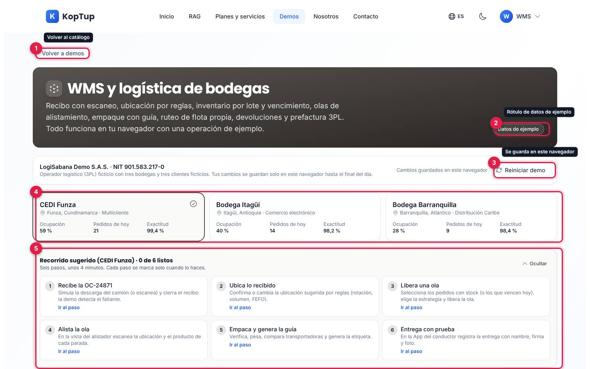

*Parte superior de la demo: (1) «Volver a demos», (2) el rótulo «Datos de ejemplo», (3) el aviso de que los cambios se guardan en este navegador y el botón «Reiniciar demo», (4) las tres bodegas con su ocupación, pedidos de hoy y exactitud de inventario, y (5) el recorrido sugerido de seis pasos, que se marca solo a medida que se hace.*

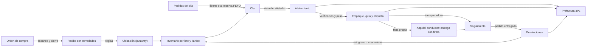

*El flujo que cuenta la demo. Todo está conectado: lo que haces en una pantalla se ve en las demás.*

---

## Recorrido sugerido (demo comercial de 5 minutos)

La demo trae su propio **recorrido sugerido** de seis pasos en el CEDI Funza. Cada tarjeta tiene **Ir al paso**, que abre la pantalla correcta, y se marca con un chulo verde cuando el visitante hace el paso (no al abrir la pantalla). Conviene empezar diciendo: «Es un WMS de ejemplo con datos ficticios; todo lo que hagan cambia el inventario y los indicadores, pero no sale de este navegador».

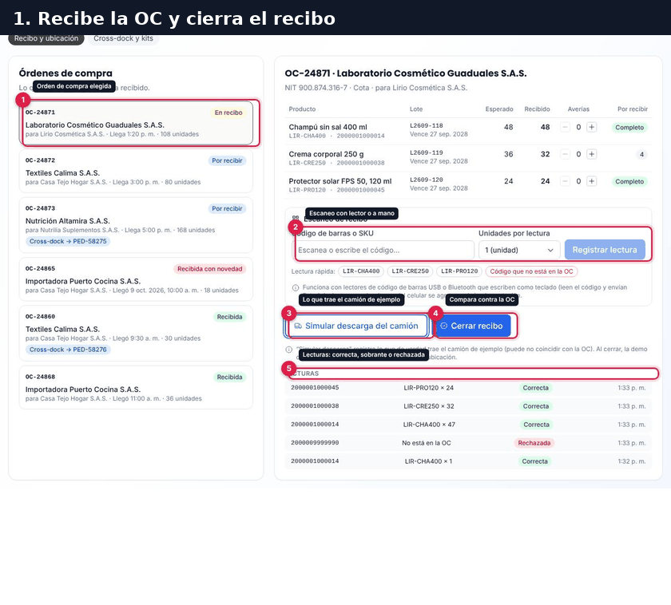

*Recorrido completo en seis cuadros: recibo, ubicación, ola, alistamiento, empaque y entrega.*

### Paso 1. Recibe la OC-24871

En el recorrido, pulsa **Ir al paso** en «Recibe la OC-24871» (o ve a **Entradas › Recibo y ubicación**). Escanea un código o usa los botones de **Lectura rápida**, pulsa **Simular descarga del camión** y luego **Cerrar recibo**.

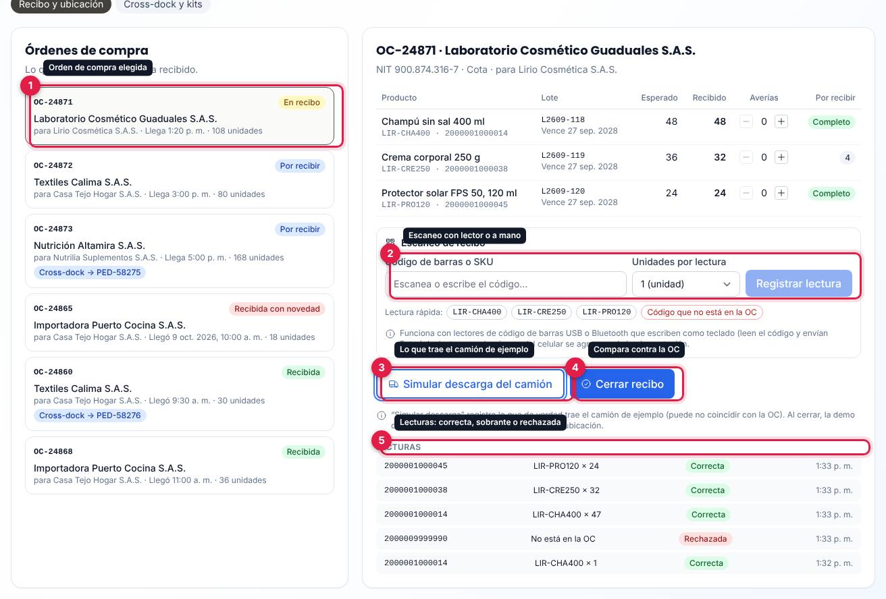

*La OC-24871 del Laboratorio Cosmético Guaduales (ficticio) para Lirio Cosmética, con lecturas correctas y una rechazada.*

1. **Órdenes de compra**: las de la bodega elegida, con proveedor, cliente del 3PL, hora de llegada y estado (Por recibir, En recibo, Recibida, Recibida con novedad). Las de cross-dock dicen a qué pedido van.
2. **Escaneo de recibo**: acepta el código de barras (EAN-13) o el SKU, con 1, 6 o 12 unidades por lectura. Funciona con lectores USB o Bluetooth que escriben como teclado. **Código que no está en la OC** muestra el rechazo.
3. **Simular descarga del camión**: registra lo que de verdad trae el camión de ejemplo, que no siempre coincide con la OC.
4. **Cerrar recibo**: compara lo recibido contra lo esperado y lista las novedades (faltantes, sobrantes, averías y códigos ajenos). Con **+** y **−** en «Averías» se marcan unidades dañadas, que van a cuarentena.
5. **Lecturas**: cada lectura con su resultado (Correcta, Sobrante o Rechazada) y la hora.

Qué decir: «El recibo se cierra contra la orden de compra: el sistema detecta solo que faltaron 4 cremas y que llegó un código que no venía en la orden».

### Paso 2. Ubica lo recibido

Debajo, en **Ubicación (putaway)**, confirma cada tarea con **Confirmar** (o cambia antes la ubicación en la lista).

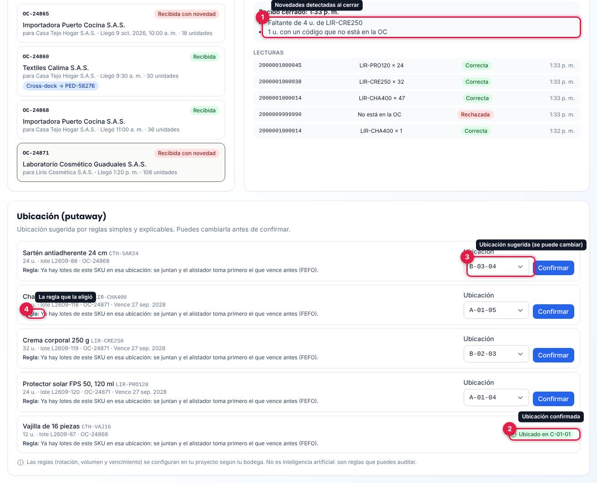

*Las novedades del recibo y las tareas de ubicación con la regla que eligió cada ubicación.*

1. **Novedades**: el faltante y el código ajeno detectados al cerrar.
2. **Ubicado en**: la tarea confirmada; las unidades ya están en el mapa, en existencias y en el kardex.
3. **Ubicación**: la sugerida, que se puede cambiar por una libre o por otra del mismo SKU.
4. **Regla**: por qué se eligió (mismo SKU ya ubicado, clase A cerca del despacho, voluminoso a la zona C, reserva en la zona B o averías a cuarentena). No es inteligencia artificial: son reglas que se pueden auditar.

### Paso 3. Libera una ola

Ve a **Salidas › Pedidos y olas**, pulsa **Seleccionar todos con stock** (o **Seleccionar los que vencen hoy**), elige la estrategia y pulsa **Liberar ola**.

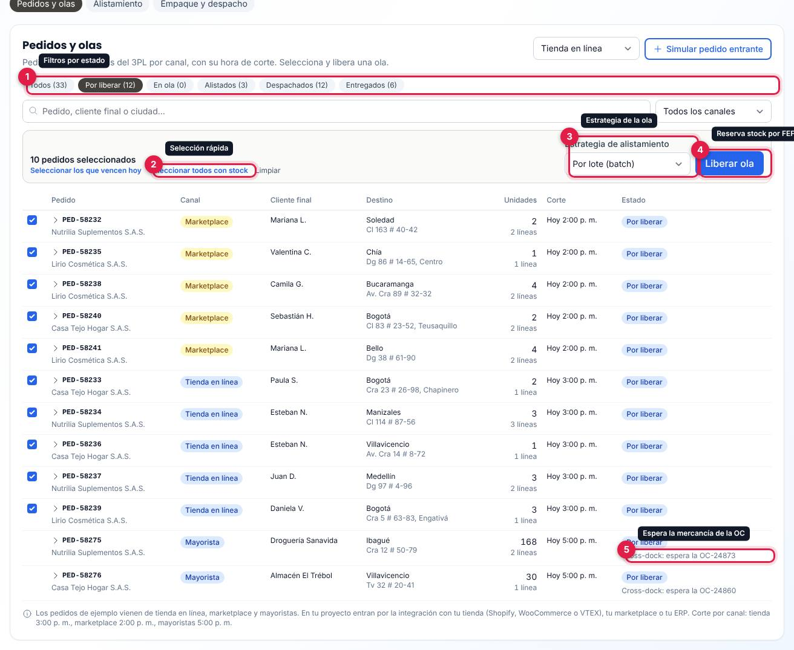

*Pedidos por liberar seleccionados con la estrategia «Por lote (batch)».*

1. **Filtros por estado**: Todos, Por liberar, En ola, Alistados, Despachados y Entregados, con su cantidad. Hay además buscador (pedido, cliente final o ciudad) y filtro por canal (tienda en línea, marketplace o mayorista).
2. **Selección rápida**: solo se pueden elegir pedidos con stock suficiente; los que no alcanzan dicen «Sin stock suficiente».
3. **Estrategia**: por pedido, por lote, por zona o clúster.
4. **Liberar ola**: reserva el stock por FEFO (primero vence, primero sale) y crea la ola.
5. **Cross-dock**: los pedidos mayoristas que esperan una OC no se liberan; salen por cross-dock cuando llega la mercancía.

Con **Simular pedido entrante** entra un pedido nuevo del canal elegido. Al abrir un pedido (la flecha junto al número) se ven sus líneas y, si ya está en ola, de qué ubicación y lote sale cada una.

### Paso 4. Alista la ola

Abre **Alistamiento**. En la **Vista del alistador** pulsa **Simular lecturas correctas** (o escribe la ubicación y el código) y luego **Confirmar**. Para terminar rápido, **Confirmar todas las tareas pendientes (supervisor)**.

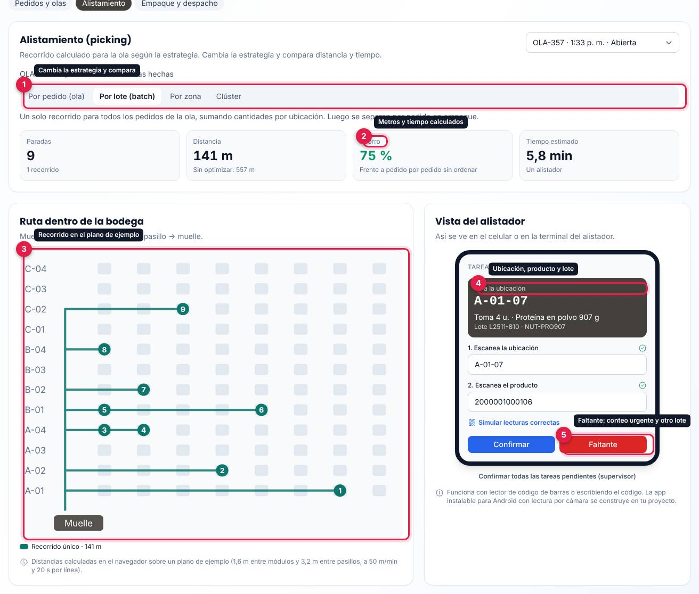

*La ola por lote: un solo recorrido frente al recorrido pedido por pedido, y la tarea actual en la vista del alistador.*

1. **Estrategia**: al cambiarla se recalculan las paradas, los metros, el ahorro y el tiempo estimado (por zona trabajan varios alistadores en paralelo).
2. **Indicadores**: calculados sobre el plano de ejemplo (1,6 m entre módulos, 3,2 m entre pasillos, 50 m por minuto y 20 s por línea).
3. **Ruta dentro de la bodega**: el recorrido dibujado con el orden de las paradas.
4. **Tarea actual**: ubicación, cantidad, producto y lote. La confirmación exige que la ubicación y el producto escaneados coincidan.
5. **Faltante**: si no está la mercancía, crea un conteo urgente de esa ubicación y busca el saldo en otro lote.

### Paso 5. Empaca y genera la guía

Pulsa **Ir a empaque**. Verifica las unidades (**Simular lectura** o **Verificar todo (supervisor)**), revisa el empaque y el peso, elige la transportadora y pulsa **Generar guía y despachar**. Se abre la etiqueta: **Descargar PDF** o **Imprimir**.

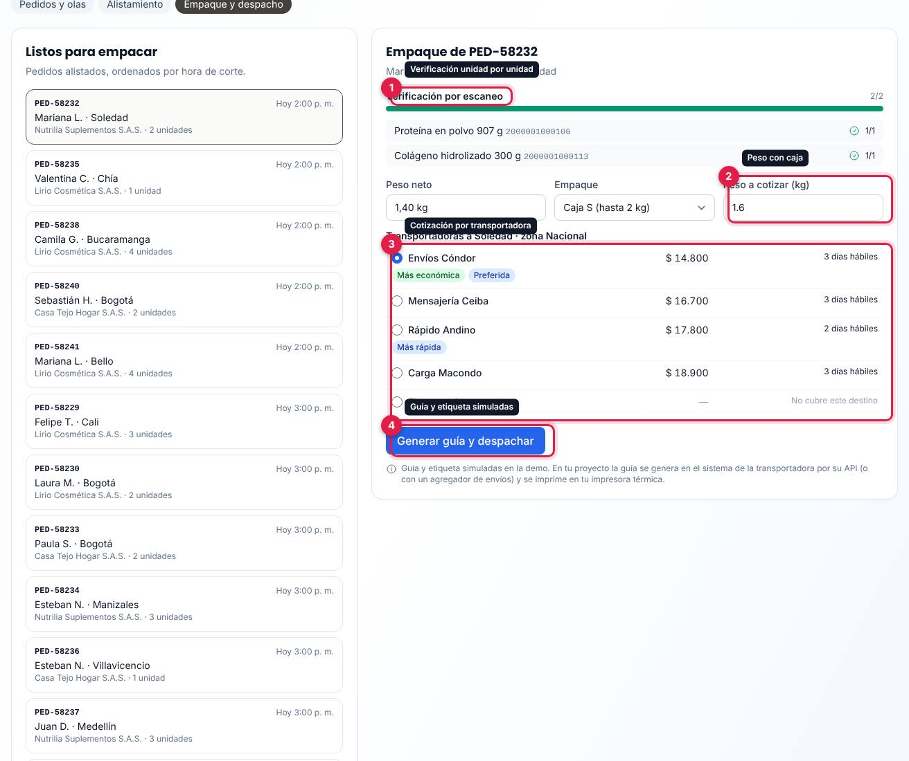

*Pedido verificado, caja sugerida y cotización de las transportadoras para su destino.*

1. **Verificación por escaneo**: unidad por unidad; si el alistamiento quedó corto, lo avisa y se despacha incompleto.
2. **Peso a cotizar**: peso neto más la caja sugerida; se puede cambiar.
3. **Transportadoras**: tarifa y tiempo de cada una para el destino y el peso, con «Más económica», «Más rápida» y «Preferida». Las que no cubren el destino o no llevan ese peso aparecen deshabilitadas.
4. **Generar guía y despachar**: crea la guía, descuenta el pedido y abre la etiqueta de 10 × 15 cm (con «EJEMPLO · Guía simulada» y barras ilustrativas).

### Paso 6. Entrega con prueba

Ve a **Transporte › App del conductor**. Pulsa **Llegué**, luego **Entregar**, escribe quién recibe, firma en el recuadro (con el dedo o el mouse) y pulsa **Confirmar entrega**.

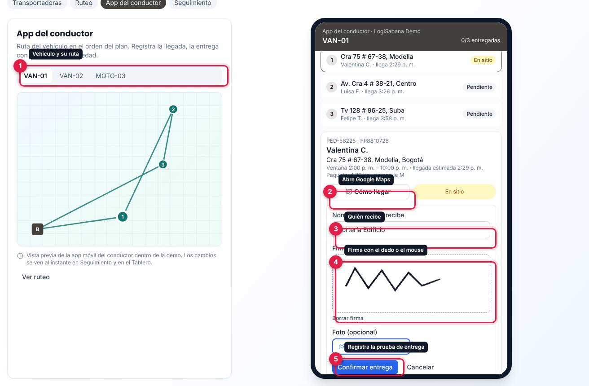

*Vista previa de la app del conductor con la prueba de entrega a medio llenar.*

1. **Vehículo**: cada vehículo de la flota propia con su ruta y su mapa ilustrativo.
2. **Cómo llegar**: abre la búsqueda de la dirección en Google Maps en otra pestaña.
3. **Quién recibe**: obligatorio.
4. **Firma**: obligatoria; se guarda como imagen en este navegador. La **foto** es opcional (cámara o archivo; se reduce a 320 px).
5. **Confirmar entrega**: el pedido queda entregado y se ve en Seguimiento, en el Tablero y en la prefactura. **No entregado** registra una novedad (no había nadie, dirección errada o rechazo) que luego se reprograma.

Para cerrar, muestra **Seguimiento** (la entrega con la firma), **Devoluciones** y **Facturación 3PL**, descritas abajo.

---

## Pantallas y funciones

### Encabezado, bodegas y navegación

Ver la [vista general](#guía-de-la-demo-wms-y-logística-de-bodegas).

| Elemento | Qué hace |
|---|---|
| **Volver a demos** | Vuelve al catálogo `/demo`. |
| **Datos de ejemplo** | Rótulo fijo: la empresa, los clientes, los proveedores, las personas y las transportadoras son ficticios. Los NIT tienen dígito de verificación válido y los códigos de barras, dígito de control EAN-13. |
| **Cambios guardados en este navegador** | Todo se guarda en el navegador (localStorage) hasta que cambia el día; entonces se genera la operación de ejemplo del nuevo día. Si el navegador no deja guardar, lo dice. |
| **Reiniciar demo** | Pide confirmación y vuelve a la operación de ejemplo de hoy. |
| **Tarjetas de bodega** | CEDI Funza (multicliente), Bodega Itagüí (comercio electrónico) y Bodega Barranquilla (distribución Caribe). La ocupación, los pedidos de hoy y la exactitud se calculan con los datos de cada bodega; al elegir una, todas las pantallas muestran su operación. |
| **Recorrido sugerido** | Seis pasos con **Ir al paso**; **Ocultar** lo pliega. |
| **Áreas** | Tablero, Entradas (Recibo y ubicación, Cross-dock y kits), Inventario (Mapa de bodega, Existencias y kardex, Conteo cíclico), Salidas (Pedidos y olas, Alistamiento, Empaque y despacho), Transporte (Transportadoras, Ruteo, App del conductor, Seguimiento) y Posventa y cobro (Devoluciones, Facturación 3PL). La pantalla y la bodega elegidas se recuerdan. |
| **Bloque final** | «¿Te gustaría algo así para tu negocio?» con **Solicitar demo guiada**, **Solicitar Cotización** y **Ver Planes y Precios**. Es común a todas las demos. |

### Tablero

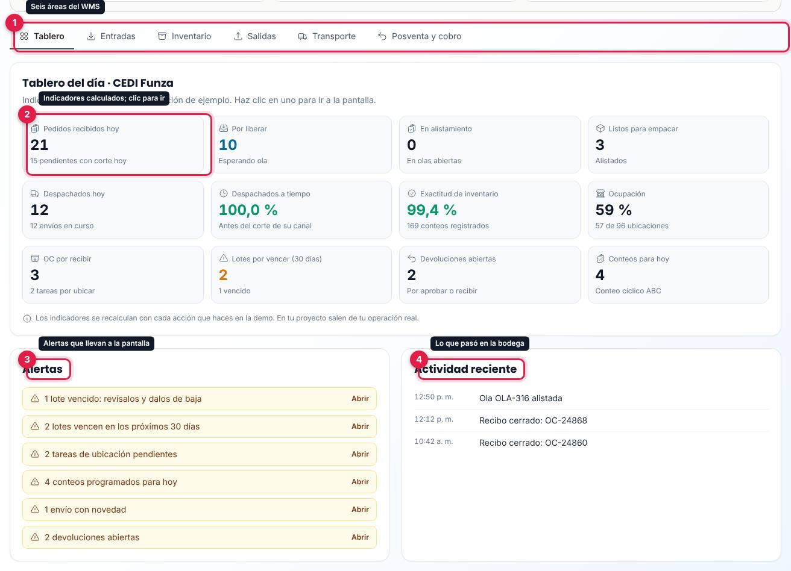

*Tablero del CEDI Funza: áreas, indicadores, alertas y actividad reciente.*

- **Doce indicadores** calculados con la operación de la bodega: pedidos recibidos hoy (y cuántos tienen corte hoy), por liberar, en alistamiento, listos para empacar, despachados hoy, despachados a tiempo (antes del corte de su canal), exactitud de inventario (conteos sin diferencia), ocupación de las 96 ubicaciones, OC por recibir, lotes por vencer en 30 días, devoluciones abiertas y conteos para hoy. Cada uno lleva a su pantalla.
- **Alertas**: lotes vencidos o por vencer, ubicaciones pendientes, conteos del día, envíos con novedad y devoluciones abiertas, con **Abrir**.
- **Actividad reciente**: lo que pasó en la bodega (recibos cerrados, olas, despachos, entregas, ajustes…), con la hora.

### Entradas

**Recibo y ubicación**: ver los [pasos 1](#paso-1-recibe-la-oc-24871) y [2](#paso-2-ubica-lo-recibido). Las OC de cada bodega llegan a horas relativas al momento en que se abre la demo (la primera ya está en el muelle).

**Cross-dock y kits**

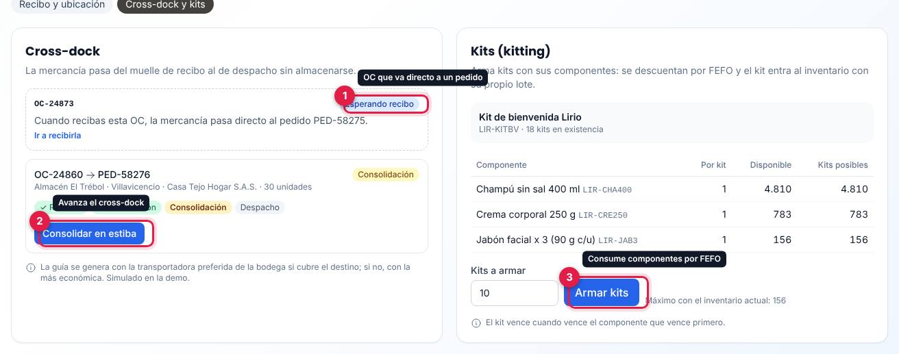

*La OC-24873 espera recibo para pasar directo a un pedido mayorista; otra mercancía ya va en consolidación; a la derecha, el armado de kits.*

- **Cross-dock**: la mercancía de una OC marcada como cross-dock no se almacena. Pasa por Clasificación, Consolidación y Despacho; en el último paso se genera la guía con la transportadora preferida de la bodega (o la más económica que cubra el destino). **Ir a recibirla** lleva al recibo de esa OC.
- **Kits (kitting)**: el «Kit de bienvenida Lirio» se arma con tres componentes. Muestra cuántos kits alcanzan con el inventario; **Armar kits** descuenta los componentes por FEFO, crea un lote nuevo del kit (vence cuando vence su primer componente) y lo ubica. Solo en el CEDI Funza.

### Inventario

**Mapa de bodega**

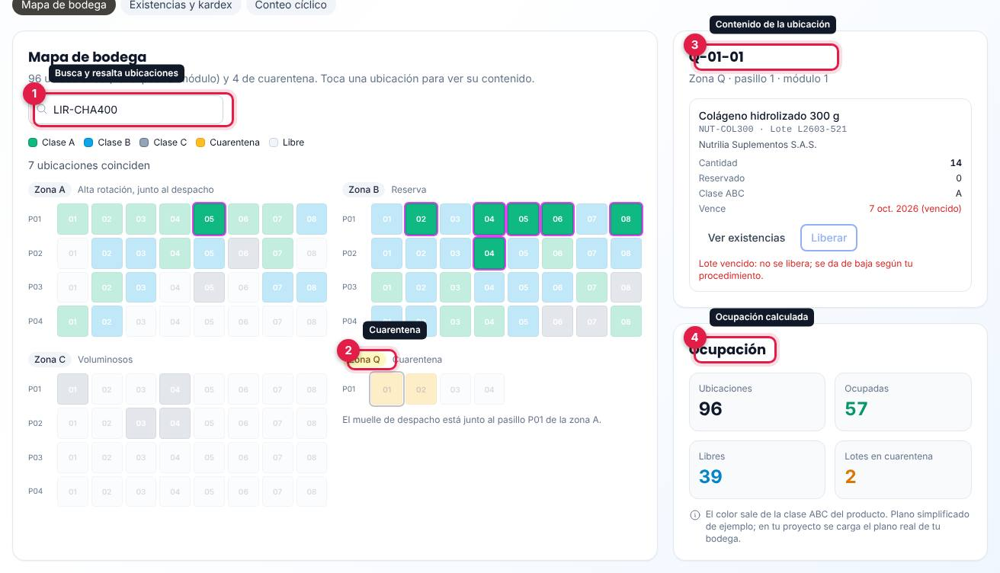

*Búsqueda de un SKU en el mapa y el detalle de una ubicación de cuarentena.*

- **96 ubicaciones** (zonas A, B y C de 4 pasillos por 8 módulos) y 4 de cuarentena. El color sale de la clase ABC del producto que ocupa la ubicación; las libres se ven en gris claro.
- **Buscador**: resalta las ubicaciones con ese SKU, producto o lote.
- **Detalle**: al tocar una ubicación se ven sus lotes con cantidad, reservado, clase y vencimiento, y los botones **Ver existencias**, **Enviar a cuarentena** (no si tiene unidades reservadas) o **Liberar** (no si el lote está vencido).
- **Ocupación**: ubicaciones, ocupadas, libres y lotes en cuarentena. Las tres bodegas tienen cifras distintas.

**Existencias y kardex**

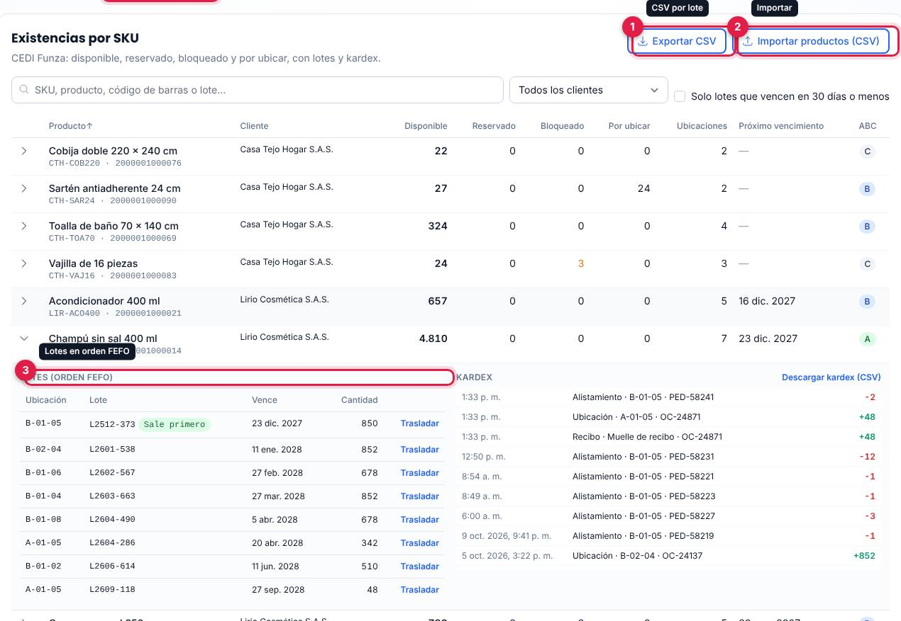

*Champú sin sal 400 ml abierto: lotes en orden FEFO y su kardex.*

- **Tabla por SKU**: disponible, reservado, bloqueado (cuarentena o vencido), por ubicar, ubicaciones, próximo vencimiento y clase ABC; se ordena por las columnas con flecha.
- **Filtros**: buscador (SKU, producto, código de barras o lote), cliente del 3PL y «Solo lotes que vencen en 30 días o menos».
- **Detalle del SKU**: lotes en orden FEFO («Sale primero»), **Trasladar** a otra bodega (inmediato en la demo) y el **kardex** con cada movimiento, más **Descargar kardex (CSV)**.
- **Exportar CSV**: existencias por lote de la bodega.
- **Importar productos (CSV)**: con plantilla descargable, archivo o texto pegado; valida SKU repetidos, cliente, números y código de barras, y reporta los errores por línea. Los productos importados se crean sin existencias.

**Conteo cíclico**

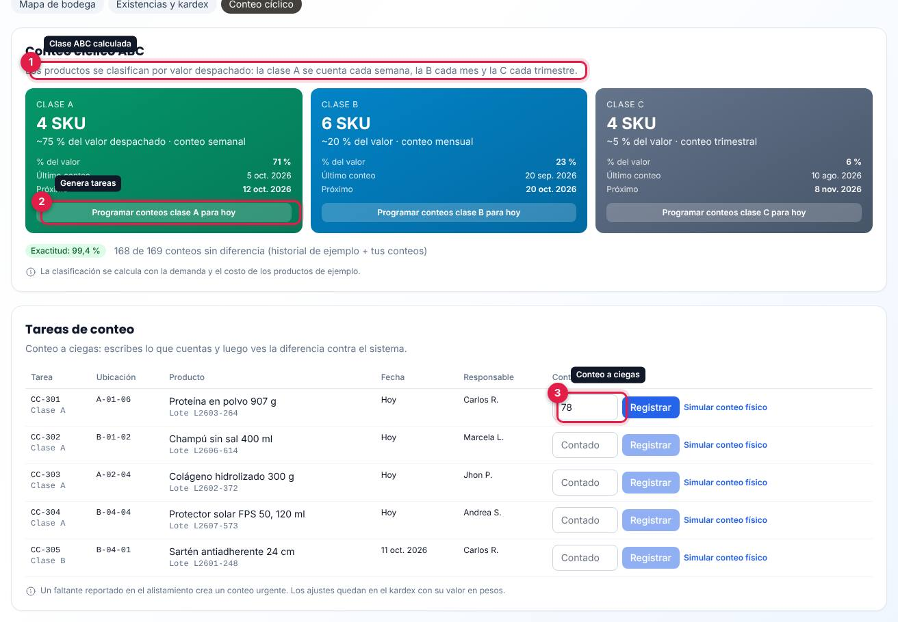

*Clases ABC calculadas con la demanda y el costo de los productos, y las tareas de conteo del día.*

- **Clases A, B y C** con el número de SKU, su porcentaje del valor despachado, el último conteo y el próximo (semanal, mensual y trimestral), con fechas relativas a hoy. **Programar conteos clase X para hoy** genera tareas.
- **Tareas de conteo**: conteo a ciegas. Se escribe lo contado (o **Simular conteo físico**) y **Registrar**: si cuadra, queda «Cuadra»; si no, muestra la diferencia en unidades y en pesos y pide **Aprobar ajuste** (va al kardex) o **Recontar**. La exactitud de inventario se actualiza.

### Salidas

**Pedidos y olas**, **Alistamiento** y **Empaque y despacho**: ver los [pasos 3](#paso-3-libera-una-ola), [4](#paso-4-alista-la-ola) y [5](#paso-5-empaca-y-genera-la-guía). En Empaque, **Guías generadas hoy** lista las guías con su flete y **Ver etiqueta**.

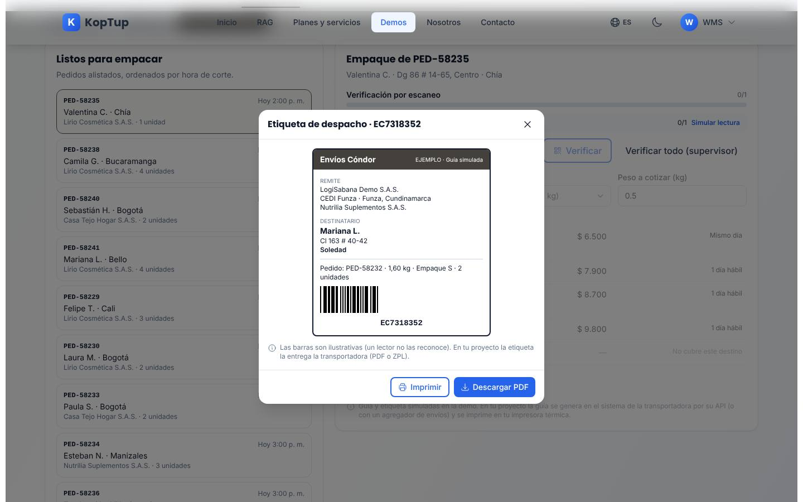

*Etiqueta de ejemplo de una guía recién generada, con Imprimir y Descargar PDF.*

### Transporte

**Transportadoras**

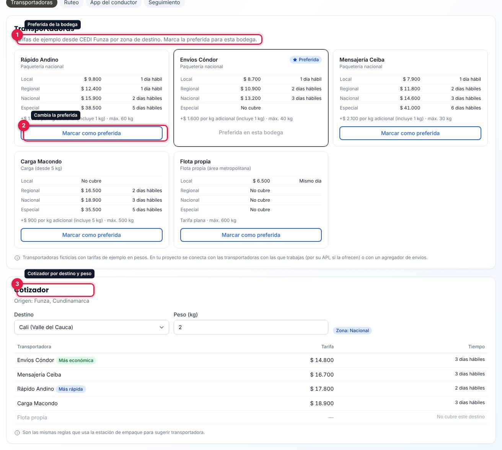

*Cuatro transportadoras ficticias y la flota propia, con tarifas de ejemplo en pesos, y el cotizador.*

- **Tarifas por zona** (local, regional, nacional y especial), kilo adicional y peso máximo. **Marcar como preferida** cambia la preferida de la bodega; se usa en empaque y en cross-dock.
- **Cotizador**: origen en la bodega elegida, destino entre 22 ciudades de Colombia y peso; ordena por precio y marca la más económica y la más rápida. Son las mismas reglas de la estación de empaque.

**Ruteo**

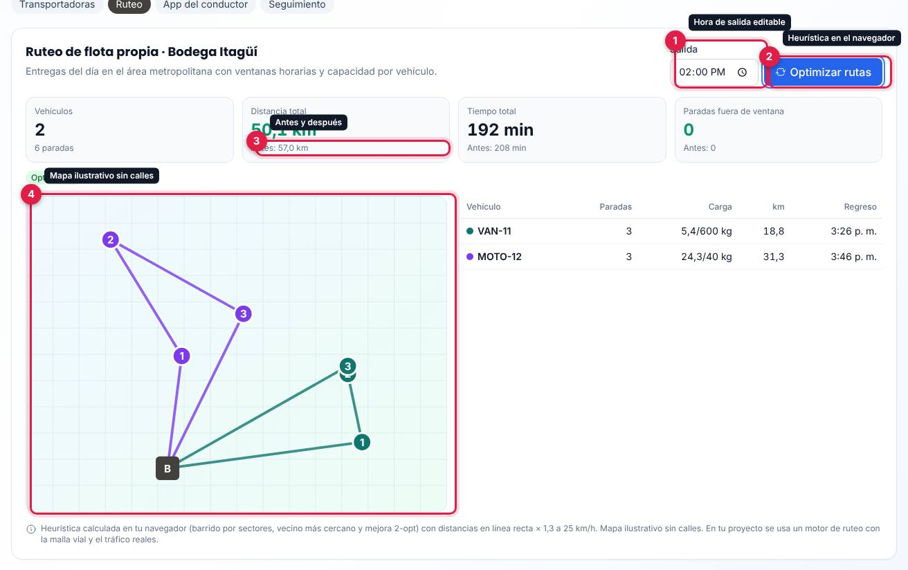

*Una bodega después de optimizar: la distancia y el tiempo bajan frente al plan inicial («Antes»).*

- **Entregas de flota propia** del día con ventana horaria, carga y capacidad de cada vehículo. La hora de salida por defecto es la próxima media hora (entre 7:00 a. m. y 6:00 p. m.) y se puede cambiar.
- **Optimizar rutas**: barrido por sectores, vecino más cercano y mejora 2-opt, calculado en el navegador con distancias en línea recta. Muestra el antes y el después; si no mejora, lo dice. Se bloquea cuando la ruta ya salió (algún pedido en sitio, entregado o con novedad).
- **Paradas del día**: vehículo, orden, pedido, dirección, ventana, llegada estimada (en rojo si llega tarde) y estado.

**App del conductor**: ver el [paso 6](#paso-6-entrega-con-prueba).

**Seguimiento**

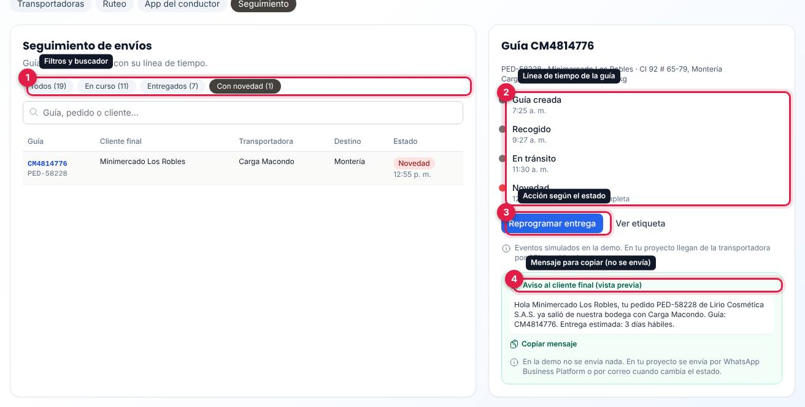

*Una guía con novedad: línea de tiempo, Reprogramar entrega y el aviso al cliente final.*

- **Lista de guías** de la bodega con filtros (Todos, En curso, Entregados, Con novedad) y buscador.
- **Detalle**: línea de tiempo con fecha y hora de cada evento y la prueba de entrega (con la firma si fue con flota propia). **Simular siguiente evento** avanza una guía de transportadora; **Reprogramar entrega** resuelve una novedad; las de flota propia se manejan desde la app del conductor.
- **Aviso al cliente final (vista previa)**: el texto del mensaje con **Copiar mensaje**. No se envía nada.

### Posventa y cobro

**Devoluciones**

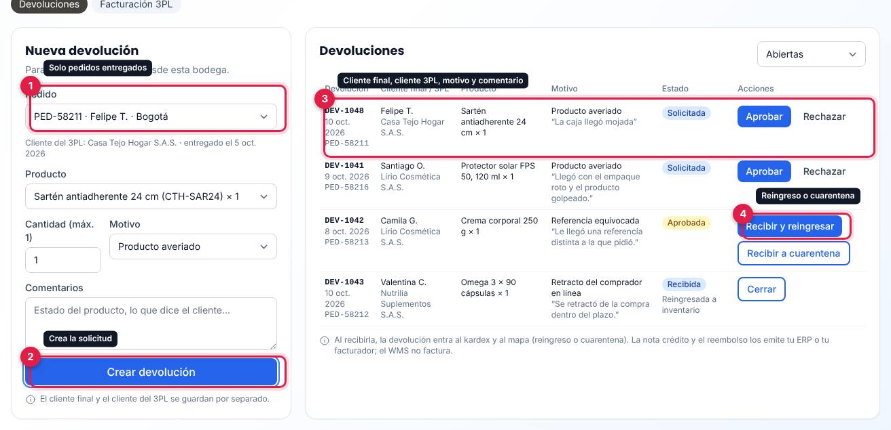

*Una devolución nueva con su comentario, y las acciones según el estado.*

- **Nueva devolución**: solo para pedidos entregados desde la bodega. Se elige pedido, producto, cantidad (hasta lo despachado), motivo (averiado, referencia equivocada, retracto o defecto de fábrica) y comentarios. Se guardan por separado el cliente final, el cliente del 3PL, el motivo y el comentario.
- **Ciclo**: Solicitada → **Aprobar** o **Rechazar** (con motivo) → **Recibir y reingresar** o **Recibir a cuarentena** (entra al kardex y al mapa) → **Cerrar**. El filtro muestra las abiertas o todas.

**Facturación 3PL**

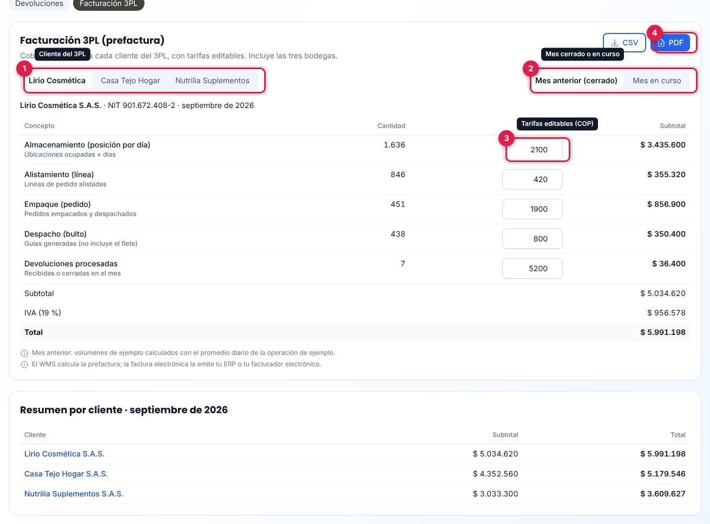

*Prefactura de Lirio Cosmética del mes anterior, con tarifas editables en pesos.*

- **Cliente** y **periodo** (mes anterior cerrado o mes en curso). El mes en curso suma a los días anteriores lo que se hizo hoy en la demo (alistamiento, despachos y devoluciones de las tres bodegas).
- **Conceptos**: almacenamiento por posición al día, alistamiento por línea, empaque por pedido, despacho por bulto y devoluciones, con cantidad, tarifa editable, subtotal, IVA del 19 % y total. El resumen por cliente usa los mismos cálculos.
- **CSV** y **PDF**: descargan la prefactura con la nota «Documento de ejemplo generado por la demo: no es una factura ni tiene validez tributaria». La factura electrónica la emite el ERP o el facturador del cliente.

### En el celular

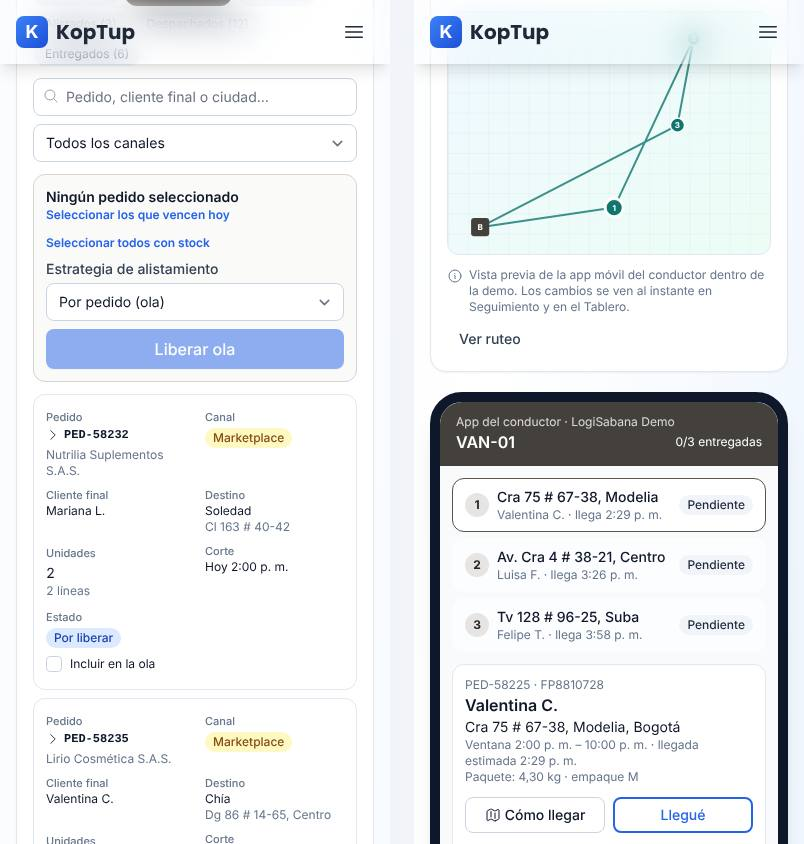

*A 390 px: los pedidos se ven como tarjetas con «Incluir en la ola», y la app del conductor ocupa el ancho de la pantalla.*

Todas las pantallas se adaptan a 390 px sin desbordes: las tablas pasan a tarjetas con el rótulo de cada dato, el mapa se toca (no depende del mouse) y, al elegir una OC, un pedido para empacar o una guía, la página baja sola hasta el detalle.

---

## Qué es real y qué es simulado

| Parte | Real o simulado | Detalle |
|---|---|---|
| Empresa, bodegas, clientes, proveedores, productos, personas y direcciones | **Datos de ejemplo** | Ficticios y generados siempre igual; las fechas y horas se calculan desde el momento en que se abre la demo, dentro del horario de la bodega (6:00 a. m. a 10:00 p. m.). |
| Recibo, ubicación, olas, reservas FEFO, alistamiento, empaque, conteos, traslados, kits, cross-dock y devoluciones | **Funciona en el navegador** | Cambian el inventario, el kardex, los indicadores y la prefactura de forma coherente entre pantallas. |
| Reglas de ubicación, clasificación ABC, recorridos de alistamiento, cotización y ruteo | **Cálculo real en el navegador** | Reglas y heurísticas explicables con los datos de ejemplo; no hay modelo de IA ni de aprendizaje automático. El plano y el mapa son ilustrativos. |
| Escáner | **Real (lector tipo teclado)** | Un lector USB o Bluetooth funciona en los campos de código. La lectura con la cámara del celular no está en la demo. |
| Guías, etiquetas y eventos de las transportadoras | **Simulado** | Las transportadoras son ficticias; no hay conexión con ninguna. La etiqueta PDF dice «EJEMPLO · Guía simulada» y sus barras no las lee un lector. |
| Firma y foto de la entrega | **Real, solo en este navegador** | Se dibujan o se toman de verdad y se guardan en el navegador; no se suben a ningún servidor. |
| «Cómo llegar» | **Real** | Abre la búsqueda de la dirección de ejemplo en Google Maps. |
| Aviso al cliente final | **Vista previa** | Solo se copia el texto; no se envía por WhatsApp ni por correo. |
| Exportar e importar CSV, kardex, etiqueta y prefactura en PDF | **Real** | Se generan en el navegador con los datos que se ven. La prefactura no es una factura electrónica. |
| Dónde quedan tus cambios | **En este navegador** | En localStorage hasta el final del día o hasta **Reiniciar demo**; no los ve nadie más. |

---

## Acceso

**Cómo lo ve un visitante.** La demo aparece en `/demo` con su tarjeta, la insignia «Requiere acceso» y los botones **Solicitar acceso** y **Ya tengo acceso: iniciar sesión**. Si alguien abre `/demo/wms-logistica` sin sesión, la web muestra en la misma dirección la pantalla de acceso:

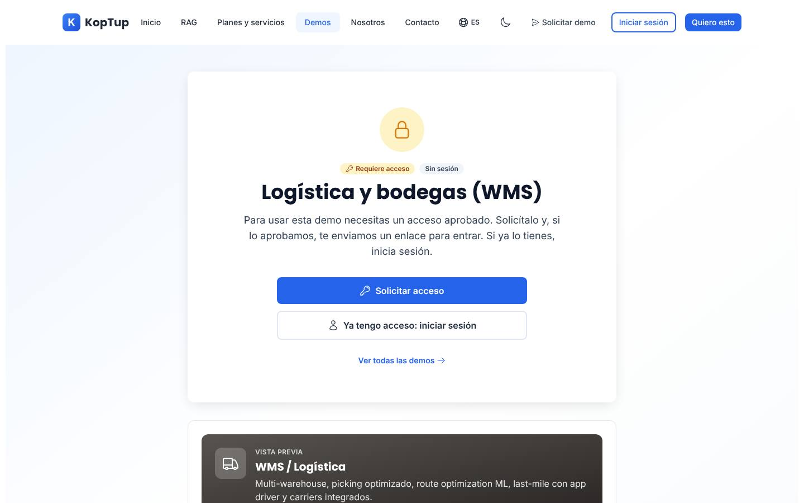

*Lo que ve un visitante sin sesión: «Requiere acceso», «Sin sesión», el nombre del catálogo «Logística y bodegas (WMS)» y los botones para pedir la demo o iniciar sesión. Debajo, una vista previa con el texto de la tarjeta del catálogo.*

- **Solicitar acceso** abre `/solicitar-demo?demos=wms-logistica` con esta demo ya elegida.
- **Ya tengo acceso: iniciar sesión** lleva a `/login?redirect=%2Fdemo%2Fwms-logistica` y, al entrar, vuelve a la demo.
- **Ver todas las demos** vuelve a `/demo`.
- Con sesión pero sin acceso, la misma pantalla dice que la cuenta todavía no tiene acceso; si el acceso venció o fue retirado, ofrece pedir más tiempo o solicitarlo de nuevo.

**Cómo se concede.** La solicitud llega a **Admin › Solicitudes de demo**. Pueden aprobarla los roles **admin** y **sales**. Al aprobar, se crea o se reutiliza la cuenta del prospecto, el acceso dura 14 días por defecto (se extiende o se revoca en **Admin › Accesos a demos**) y la persona recibe un correo con la decisión (con el enlace de activación si su cuenta es nueva). El equipo de KopTup (admin, manager, sales y developer) abre la demo sin solicitud. Solo el admin cambia el modo de acceso, en **Admin › Catálogo de demos**. Detalle en el [Manual del administrador](Doc-06-Manual-del-Administrador.md) y en [Flujos del visitante](Doc-04-Flujos-del-Visitante.md).

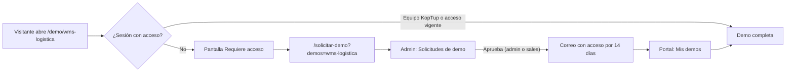

*Camino de un visitante hasta la demo.*

---

## Limitaciones conocidas

Son límites del alcance de una demo, no errores:

1. **Todo vive en un solo navegador.** No hay servidor ni base de datos: otra persona, otro navegador o una ventana privada ven la operación de ejemplo desde cero, y al cambiar el día se genera la del nuevo día.
2. **Sin conexión con sistemas externos.** No se conecta con transportadoras, tiendas en línea, marketplaces, ERP, lectores RFID ni WhatsApp; esas integraciones se construyen en el proyecto. Las guías y sus eventos son simulados (**Simular siguiente evento**).
3. **Plano y mapa ilustrativos.** Las distancias del alistamiento salen de un plano de ejemplo igual para las tres bodegas, y el ruteo usa distancias en línea recta (× 1,3) sin calles ni tráfico.
4. **Atajos de supervisor.** **Simular lecturas correctas**, **Verificar todo (supervisor)**, **Confirmar todas las tareas pendientes (supervisor)** y **Simular conteo físico** existen para hacer la demo en minutos; en una bodega real cada unidad se escanea.
5. **Sin lectura por cámara.** El escaneo funciona con lectores tipo teclado o escribiendo el código; la app instalable con cámara no está en la demo.
6. **Traslados inmediatos.** Un traslado entre bodegas pasa al instante; en un proyecto real pasa por despacho, tránsito y recibo.
7. **Volúmenes históricos de ejemplo.** La prefactura del mes anterior y los días previos del mes en curso usan volúmenes calculados con el promedio de la operación de ejemplo; solo lo de hoy sale de lo que se hace en la demo.
8. **El texto de la tarjeta del catálogo** (la que se ve en `/demo` y en la vista previa de la pantalla de acceso) todavía habla de «route optimization ML», «slotting ML» y transportadoras reales integradas; su corrección está pedida aparte (es un archivo compartido del catálogo). La demo misma no promete nada de eso.
